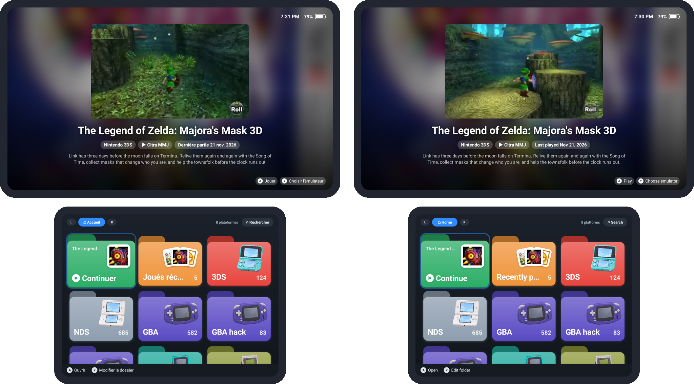

<p align="center"></p>

# Duo Launcher

<p align="center"><a href="README.md">English</a> · <a href="README.fr.md">Français</a> · <a href="README.zh-CN.md">简体中文</a> · <a href="README.zh-TW.md">繁體中文</a> · <a href="README.ja.md">日本語</a> · <a href="README.ko.md">한국어</a> · <a href="README.es.md">Español</a> · <b>Deutsch</b> · <a href="README.it.md">Italiano</a> · <a href="README.pt.md">Português</a> · <a href="README.ru.md">Русский</a></p>

Ein Spiele-Launcher für zwei Bildschirme, gemacht für den **Retroid Pocket Duo** und andere Android-Handhelds mit zweitem Display – ganz im Geist des 3DS-Hauptmenüs.
Du gibst ihm deine ROM-Ordner, er findet die Spiele, sortiert sie nach Konsole, Genre und Reihe, zeigt sie unten an, die Grafiken dazu oben, und startet jedes Spiel in dem Emulator, den du festlegst.

**Download:** Die aktuelle APK gibt es auf der [Releases-Seite](https://github.com/GenKnot/DuoLauncher/releases/latest) (ab Android 11). Wenn du eine neue Version über die alte installierst, bleiben alle Einstellungen und deine Spielzeit erhalten.

## Warum noch ein Launcher?

Duo Launcher war anfangs der Launcher eines einzelnen Spielers für einen einzelnen Handheld, und er wächst bis heute aus der Art, wie dieser Handheld tatsächlich benutzt wird. Ein paar Grundgedanken ziehen sich durch alles:

- **Zwei Bildschirme, zwei Aufgaben.** Unten wird ausgewählt: große Ordner, ein Raster, eine Liste, Menüs. Oben wird geschaut: die Konsole vor ihrem eigenen gezeichneten Hintergrund, das Logo eines Spiels über seinem Cover, eine Videovorschau, deine bisherige Spielzeit, eine Notiz an dich selbst oder ein Gespräch mit der KI. Nichts muss sich den Platz mit etwas anderem teilen.
- **Das Gamepad hat Vorrang.** Jede Funktion geht ohne den Bildschirm anzufassen: eine Tastatur fürs Steuerkreuz, gehaltene Richtungen, die weiterscrollen, L / R zum Blättern, L halten für die Sprachsuche, R halten, um mit der KI zu reden. Touch geht auch, ist aber nie nötig.
- **Deine Bibliothek, so wie sie schon ist.** Er liest die Metadaten und Bilder von Pegasus und ES-DE, die du vielleicht schon hast, legt seine eigenen Ergänzungen in einem eigenen Ordner `DuoLauncher` ab und schreibt nie in die Dateien eines anderen Frontends.
- **KI, die für dich arbeitet – mit deinem Schlüssel.** Übersetzung, Sortierung, Bilder, Tipps und Gespräche laufen über den Dienst, den *du* auswählst und direkt bezahlst. Die Schlüssel bleiben auf dem Handheld, und jede Anfrage wird in den Einstellungen mitgezählt, samt geschätzter Kosten – nichts passiert hinter deinem Rücken.
- **Alles lässt sich ändern, ausblenden oder teilen.** Jede Kachel auf der Startseite kann umbenannt, umgefärbt, mit einem neuen Bild versehen, verschoben oder ausgeblendet werden. Deine ganze Einrichtung lässt sich als eine Datei exportieren und an Freunde weitergeben – ohne deine Schlüssel und ohne deinen Spielverlauf.

Vorschläge und Fehlerberichte sind im [Issue-Tracker](https://github.com/GenKnot/DuoLauncher/issues) willkommen.

## Das Wichtigste im Überblick

- **Zwei Bildschirme, ein Launcher** – unten auswählen, oben Logos, Cover, Videovorschauen, Spielzeit und Beschreibungen sehen.
- **Alle Emulatoren an einem Ort** – 3DS, NDS, GBA, GB/GBC, NES, SNES, N64, GameCube, Wii, Mega Drive, PS1, PS2, PSP, PS Vita und Switch, dazu 22 ältere Konsolen über RetroArch (von Master System bis Dreamcast, PC Engine, Neo Geo, WonderSwan, Atari, Arcade, DOS …), der Emulator wahlweise pro Konsole oder pro Spiel. Spiele mit mehreren Discs erscheinen als ein Eintrag.
- **Schon sortiert** – jedes Spiel landet in einem von 14 Genres und in seiner Reihe (Ys, Castlevania, Super Robot Wars …). Die Startseite zeigt deine Bibliothek nach Konsole, Genre oder Reihe, und intelligente Ordner halten „Neu hinzugefügt“, „Spiele ich“, „Möchte ich spielen“, „Durchgespielt“ und „Am besten bewertet“ von selbst aktuell.
- **Ein KI-Begleiter** – halte überall R gedrückt und sprich: Er empfiehlt Spiele aus deiner eigenen Bibliothek, erklärt, wie du an einer Stelle weiterkommst, erzählt dir etwas über eine Geschichte oder plaudert einfach. Die Antworten können vorgelesen werden.
- **Cheats im Griff** – Tausende fertige Cheats für 3DS, NDS, PSP, GBA und jedes RetroArch-System, mit einem Tippen in deine Sprache übersetzt, bearbeitbar und zwischen Emulatoren geteilt.
- **Ergänzt, was fehlt** – echte Cover aus den libretro-Thumbnail-Sammlungen, offizielle englische Titel und von der KI gezeichnete Cover, Logos und Hintergründe im Stil des Launchers.
- **Gemacht für einen Handheld** – OLED-schonender Bildschirmschoner, WLAN-Übertragung aus dem Browser, Sicherung der Spielstände, Spielstatistik, RetroAchievements-Fortschritt, eine Speicherübersicht und eine Startseite, die in einer Sekunde da ist.
- **Ganz nach deinem Geschmack** – Farbdesigns und Design-Pakete, heller und dunkler Modus, Schriftgröße, Rand um die Cover, eine Einstellungsseite wie bei einer Konsole und Konfigurationen, die du exportieren und teilen kannst. 11 Sprachen für die Oberfläche.

## Screenshots

<p align="center"></p>

<table>
  <tr>
    <th>Einstellungen im 3DS-Stil</th>
    <th>Einstellungen im dunklen Modus</th>
  </tr>
  <tr>
    <td></td>
    <td></td>
  </tr>
  <tr>
    <th>KI-Nutzung und Kosten</th>
    <th>Konfiguration exportieren und importieren</th>
  </tr>
  <tr>
    <td></td>
    <td></td>
  </tr>
  <tr>
    <th colspan="2">Handgezeichnete Hintergründe für den dunklen Modus</th>
  </tr>
  <tr>
    <td colspan="2" align="center"></td>
  </tr>
  <tr>
    <th>Startseite nach Genre, mit Genre-Symbolen im Knetlook</th>
    <th>Startseite nach Reihe</th>
  </tr>
  <tr>
    <td></td>
    <td></td>
  </tr>
  <tr>
    <th>Genre und Reihe auf der Spielseite</th>
    <th>Notiz, KI fragen, Status, So wird gespielt, Spielstände</th>
  </tr>
  <tr>
    <td></td>
    <td></td>
  </tr>
  <tr>
    <th>Gamepad-Tastatur; englische Titel werden auch gefunden</th>
    <th>Die KI fragen, was man spielen soll</th>
  </tr>
  <tr>
    <td></td>
    <td></td>
  </tr>
  <tr>
    <th>KI-Werkzeuge: Reihen, Empfehlungen, Speicher, Pausen-Erinnerung</th>
    <th>Speicher: Größe pro Konsole, große ungespielte Spiele</th>
  </tr>
  <tr>
    <td></td>
    <td></td>
  </tr>
  <tr>
    <th>Spielseite mit Videovorschau</th>
    <th>Logo, Cover oder Video, pro Spiel</th>
  </tr>
  <tr>
    <td></td>
    <td></td>
  </tr>
  <tr>
    <th>Listenansicht</th>
    <th>Spielstatistik</th>
  </tr>
  <tr>
    <td></td>
    <td></td>
  </tr>
  <tr>
    <th>Farbdesigns</th>
    <th>Die Designfarben färben auch die Hintergründe</th>
  </tr>
  <tr>
    <td></td>
    <td></td>
  </tr>
  <tr>
    <th>Dunkler Modus</th>
    <th>Dunkler Modus</th>
  </tr>
  <tr>
    <td></td>
    <td></td>
  </tr>
  <tr>
    <th>WLAN-Übertragung</th>
    <th>Werkzeuge zum Aufräumen</th>
  </tr>
  <tr>
    <td></td>
    <td></td>
  </tr>
  <tr>
    <th>GameCube, mit Dolphin</th>
    <th>A halten, um einen Ordner zu verschieben</th>
  </tr>
  <tr>
    <td></td>
    <td></td>
  </tr>
  <tr>
    <th>Cheats vor dem Import auswählen, Namen schon übersetzt</th>
    <th>Spieldetails: Größe, Discs, Screenshots</th>
  </tr>
  <tr>
    <td></td>
    <td></td>
  </tr>
  <tr>
    <th>3DS-Cheats, mit einem Tippen übersetzt</th>
    <th>NDS-Cheats für DraStic, chinesische Datenbank</th>
  </tr>
  <tr>
    <td></td>
    <td></td>
  </tr>
  <tr>
    <th>RetroArch-Cheats (GBA)</th>
    <th>Bearbeiten, hinzufügen, herunterladen</th>
  </tr>
  <tr>
    <td></td>
    <td></td>
  </tr>
  <tr>
    <th>Einen Cheat umbenennen oder löschen</th>
    <th>Alle Cheats auf einmal übersetzen</th>
  </tr>
  <tr>
    <td></td>
    <td></td>
  </tr>
  <tr>
    <th>Bildschirmschoner (OLED-schonend)</th>
    <th>11 Sprachen</th>
  </tr>
  <tr>
    <td></td>
    <td></td>
  </tr>
</table>

## Erste Schritte

1. **Installiere die APK** von der [Releases-Seite](https://github.com/GenKnot/DuoLauncher/releases/latest) und öffne sie.
2. **Folge dem Willkommens-Rundgang.** Beim ersten Start führt dich ein kurzer Rundgang Seite für Seite durch die Einrichtung:
   - **„Deine früheren Einstellungen und dein Verlauf wurden gefunden“** – kommt als Erstes, und nur dann, wenn die automatische Kopie des Launchers auf einem Speicher liegt (nach einer Neuinstallation oder auf einem neuen Handheld mit derselben Karte). „Zurückholen“ lässt dich wie bei „Konfiguration importieren“ auswählen, welche Teile zurückkommen; „Neu anfangen“ macht ganz normal mit dem Rundgang weiter. Siehe [Einstellungen und Teilen](#einstellungen-und-teilen).
   - **Sprache.**
   - **Berechtigungen**, alle auf einer Seite: Dateizugriff (damit deine Spiele gefunden werden), Nutzungsdatenzugriff (damit als Spielzeit nur die Zeit zählt, in der ein Spiel wirklich auf dem Bildschirm ist) und die Rolle als Startbildschirm, als „optional“ markiert. Diese Seite findest du auch unter „Einstellungen“ → „System“ → „Berechtigungen“.
   - **Was gefunden wurde** – wie viele Konsolen und Spiele der Scan entdeckt hat und wo er gesucht hat: im Ordner `Roms` ganz oben auf jedem Speicher und in allen Ordnern, die du hinzugefügt hast. Läuft der Scan noch, steht das auf der Seite, und sie füllt sich, sobald er fertig ist. Eine Tür führt zur [Problemübersicht](#nützliche-werkzeuge) für alles, was er nicht zuordnen konnte.
   - **KI (optional)** – was die KI-Funktionen tun, und dass du den Dienst, den du wählst, für das bezahlst, was du nutzt. Danach *Schlüssel am Handy eingeben (WLAN)*, *Am Handheld einrichten* oder *Später*.
   - **Die Tasten** – was jede einzelne tut, auf einer Seite.

   Jede Seite hat *Rundgang überspringen*, und B geht eine Seite zurück. „Einstellungen“ → „System“ → „Willkommens-Rundgang erneut zeigen“ spielt ihn noch einmal ab.
   *Warum:* Die ersten Minuten entscheiden, ob der Launcher Sinn ergibt, und dafür sollte niemand erst diese Seite lesen müssen. Gleich zu sehen, wie viele Spiele gefunden wurden, beantwortet außerdem die erste Frage, die sich jeder stellt („Hat er meine Spiele gefunden?“). Wer schon weiß, was er tut, kann den Rundgang auf jeder Seite überspringen.
3. **Lass ihn deine Spiele finden.** Jeder Ordner `Roms` im internen Speicher oder auf einer SD-Karte wird von selbst erkannt. Weitere Ordner fügst du unter „Einstellungen“ → „Start und Bibliothek“ → „Spielordner“ hinzu. Die Konsolen werden an den Ordnernamen (`gba`, `Nintendo DS`, `psx` …) und an den Dateiendungen erkannt.
4. **Wähle Emulatoren**, wo du etwas anderes als den Standard willst: Drücke Y auf einem Konsolenordner für die ganze Konsole oder auf einem Spiel nur für dieses Spiel. Angeboten werden nur Emulatoren, die auch installiert sind.
5. **Optional: Trag einen KI-Schlüssel ein** unter „Einstellungen“ → „KI und Sprache“ → „KI-Dienste und Schlüssel“ – direkt auf dem Handheld oder bequemer vom Computer oder Handy aus übers WLAN („Einstellungen“ → „Spielstände, Übertragung, Teilen“ → „WLAN-Übertragung“ oder „Am Computer oder Handy eingeben“ im selben Menü). Alles außer den KI-Funktionen funktioniert auch ohne.
6. **Optional: Mach ihn zu deinem Startbildschirm** („Einstellungen“ → „System“ → „Als Startbildschirm festlegen“), dann startet er zusammen mit dem Handheld. Die Kachel „Android-Startbildschirm“ führt immer zurück zum Startbildschirm des Systems.

## Die Grundlagen

**Die Startseite** (unterer Bildschirm) enthält deine Konsolenordner und ein paar eingebaute Kacheln: „Weiterspielen“ (direkt zurück ins zuletzt gespielte Spiel), „Zuletzt gespielt“, „Favoriten“, „Neuer Ordner“, „Suchen“, „Spielstatistik“, „Speicher“, „Was spielen?“, „Einstellungen“ und „Android-Startbildschirm“. Mit SELECT schaltest du die Startseite zwischen Konsolen, Genres und Reihen um.

**Ein Ordner** zeigt seine Spiele als Raster aus Covern. X macht die Cover kleiner und verwandelt das Raster beim nächsten Mal in eine Liste mit Namen, Spielzeit und dem Zeitpunkt, an dem du zuletzt gespielt hast. SELECT sortiert („Standard“, „Name“, „Zuletzt gespielt“, „Meistgespielt“) und kann auf Veröffentlichungen in vereinfachtem Chinesisch, traditionellem Chinesisch oder Englisch filtern. L2 / R2 springen zum vorherigen oder nächsten Anfangsbuchstaben – chinesische Titel zählen dabei nach dem Anfangsbuchstaben ihres Pinyins.

**Der obere Bildschirm** folgt dem, was gerade ausgewählt ist: eine Konsole vor ihrem Hintergrund mit Spieleanzahl und Emulator; das Logo eines Spiels über seinem unscharfen Cover mit Konsole, Genre · Reihe, Emulator, Spielzeit und einer kurzen Beschreibung, nach einem Moment eine Videovorschau oder das Bild der Stelle, an der du aufgehört hast.

**Y** öffnet das Menü für das, was ausgewählt ist. Bei einem Spiel ist es kurz, und was man seltener braucht, liegt eine Tür weiter drinnen: Emulator, Favorit, zu einem Ordner hinzufügen / aus einem Ordner entfernen, Cheats ›, KI-Hilfe › (KI fragen, So wird gespielt), Spielinfos › (Details, Genre, Status und Wertung, Notiz, was der obere Bildschirm zeigt, KI-Bilder für dieses Spiel) und Mehr › (Spielstände, Als gesehen markieren, Ausblenden, Spieldatei löschen). Bei einem Konsolenordner: Standard-Emulator, Umbenennen, Ordner zusammenführen ›, Alle als gesehen markieren, Ausblenden. Bei einer eingebauten Kachel: Name, Farbe, Symbol und Hintergrund. Die ausgewählte Zeile erklärt sich unten im Menü in einer Zeile selbst.

*Warum:* Ein Menü mit fünfzehn Zeilen ist auf einem Handheld schwer zu überblicken. Die Türen halten die alltäglichen Zeilen vorne, und dank des einzeiligen Hinweises muss niemand raten, was eine Zeile tut, bevor er sie drückt.

**Spieldatei löschen** (Y → Mehr) fragt erst nach, mit der Größe und dem Hinweis, dass Spielstände erhalten bleiben; der Cursor steht zuerst auf „Abbrechen“, ein versehentlich schnelles doppeltes A löscht also nichts. Bei Spielen mit mehreren Discs gehen alle Dateien, und ein Spiel, das aus einer Liste der Problemübersicht (etwa „Doppelte Spiele“) gelöscht wird, fällt sofort aus dieser Liste heraus.

*Warum:* Doppelte und durchgespielte Spiele lassen sich ohne Computer wegräumen.

**Einmalige Tipps.** Sobald eine Funktion zum ersten Mal in Reichweite ist, erscheint auf dem unteren Bildschirm direkt über den Tastenhinweisen eine Zeile. Sie kommt nur einmal und verschwindet nach etwa neun Sekunden oder wenn du eine Taste drückst (nicht in den ersten zwei Sekunden oder so, damit sie nicht weg ist, bevor du sie lesen kannst; die Taste tut trotzdem, was sie soll). Bisher gibt es vier:

- auf der Startseite: A halten, um eine Kachel aufzunehmen und zu verschieben, Y für die Optionen dieser Kachel;
- zurück auf der Startseite, nachdem du einen Ordner verlassen hast: SELECT zeigt die Startseite nach Konsolen, Genres oder Reihen;
- auf einem Spiel in einem Konsolenordner, in der Sortierung „Standard“: A halten, um das Spiel dorthin zu schieben, wo du es haben willst, Y für Emulator, Cheats, Spielstände und mehr;
- im Ordner „Nicht erkannt“: A auf einer Datei, um anzugeben, für welche Konsole sie ist.

„Einstellungen“ → „System“ → „Tipps zu neuen Funktionen“ schaltet sie ab, und „Alle Tipps wieder zeigen“ holt die zurück, die du schon gesehen hast.
*Warum:* A halten zum Verschieben oder SELECT auf der Startseite übersieht man leicht und errät man kaum. Eine Zeile genau in dem Moment, in dem du sie brauchen kannst, merkt man sich besser als ein Handbuch, und einmal reicht: Ein Tipp, der immer wiederkommt, wird zu Rauschen.

### Steuerung

| Taste | Funktion |
|---|---|
| Steuerkreuz / linker Stick | Bewegen; halten, um weiterzulaufen |
| Links / rechts, L / R in einer Liste oder einem Menü | Seitenweise blättern |
| A | Öffnen / spielen; A halten, um einen Ordner der Startseite oder ein Spiel in einem Konsolenordner aufzunehmen und zu verschieben |
| B | Zurück |
| L / R | Vorherige / nächste Konsole (in den Einstellungen: Kategorie) |
| L halten | Sprachsuche |
| R halten | Mit der KI sprechen |
| L2 / R2 | Vorheriger / nächster Anfangsbuchstabe |
| X | Covergröße, danach Listenansicht |
| Y | Menü für das ausgewählte Spiel, den Ordner oder die Kachel |
| START | Einstellungen (von überall auf der Startseite, auch wenn die Kachel „Einstellungen“ ausgeblendet ist); in einem Menü wie A |
| SELECT | Auf der Startseite: Konsolen / Genres / Reihen; in einem Ordner: Sortierung und Sprachfilter |
| R3 | Suchen |
| In der Suchtastatur | A tippt, B löscht, X Leerzeichen, Y System-Tastatur, SELECT leert, START oder R3 fertig, L halten zum Sprechen |
| Im KI-Chat | R halten zum Sprechen, Y zum Tippen, X für ein neues Gespräch, SELECT für den Verlauf, L2 / R2 zum Zurückblättern, B zum Schließen; mit Steuerkreuz und A wählst du aus den Spielen darunter |

Alles geht auch per Touch: antippen zum Auswählen, noch mal antippen zum Öffnen, wischen zum Scrollen, und statt L, R, X, SELECT oder Suche tippst du einfach die Schaltflächen am oberen Rand an. A/B und X/Y lassen sich tauschen, je nachdem, ob du die Bestätigungstaste von Nintendo oder von Xbox gewohnt bist („Einstellungen“ → „Spielen“ → „Tasten“).

## Deine Bibliothek

- **Findet deine Spiele von selbst.** Interner Speicher und SD-Karten werden nach Ordnern namens `Roms` durchsucht; weitere fügst du unter „Einstellungen“ → „Start und Bibliothek“ → „Spielordner“ hinzu. Der letzte Scan wird zwischengespeichert, deshalb ist die Startseite in einer Sekunde da, und der nächste Scan läuft still im Hintergrund.
- **Konsolen** – 3DS, NDS, GBA (inklusive der Ordner für GBA mit Rumble und GBA-Hacks), GBC, GB, NES, SNES, N64, GameCube, Wii, Mega Drive, PlayStation 1/2/3, PSP, PS Vita und Switch, dazu Grafiken für PS4, PS5, Xbox 360 und Xbox Series. Auch alle übrigen Konsolen aus dem Pegasus-G-Paket werden erkannt: Virtual Boy, Master System, Game Gear, 32X, Mega-CD, Saturn, Dreamcast, NAOMI, PC Engine samt CD-Variante, PC-FX, Neo Geo CD, Neo Geo Pocket Color, WonderSwan und WonderSwan Color, Pokémon Mini, Atari Lynx, Atari 2600, Game & Watch, 3DO, DOS und Arcade.
- **Mehrere Discs als ein Spiel.** `Disc A/B`, `Disc 1/2`, `CD1/CD2`, `(Disc 2 of 3)` im selben Ordner oder eine Pegasus-Liste `files:` werden zu einem einzigen Eintrag. RetroArch und DuckStation bekommen eine `.m3u`-Playlist der Discs, damit du im Spiel die Disc wechseln kannst.
- **Android-Spiele und Apps** – installierte Spiele bekommen automatisch einen eigenen Ordner; andere Apps (Video, Browser …) kannst du in einen Ordner „Apps“ aufnehmen.
- **Arbeitet mit dem, was du schon hast.** Er liest Pegasus-`metadata.pegasus.txt`, `gamelist.xml` und `downloaded_media` von ES-DE / EmulationStation, RetroArch-Thumbnails sowie Ordner `media/`, `covers/` und `images/` neben den Spielen. An deren Dateien wird nichts verändert; die eigenen Ergänzungen des Launchers kommen in seinen eigenen Ordner `DuoLauncher` (siehe [Deine eigenen Spielinfos](#deine-eigenen-spielinfos)).
- **Bemerkt neue Spiele.** Kopiere Spiele auf die Karte, und der nächste Scan findet sie; sie tragen eine Woche lang (oder bis du sie spielst) ein NEU-Abzeichen, und du wirst gefragt, ob sie in Genres und Reihen einsortiert werden sollen. Diese Frage lässt sich abschalten. Y → „Als gesehen markieren“ nimmt das Abzeichen von einem Spiel; „Alle als gesehen markieren“ (Y auf einer Konsole oder einem Ordner, oder „Einstellungen“ → „Start und Bibliothek“) von vielen auf einmal, und der Schalter „NEW-Markierung“ dort schaltet es ganz ab.
- **Ordner zusammenführen.** Zwei Ordner derselben Konsole von verschiedenen Orten (etwa zwei PS1-Ordner) lassen sich als einer anzeigen: Y → „Ordner zusammenführen“ auf einer Konsole. Jedes Spiel behält seinen eigenen Emulator, Ordner mit demselben Namen werden von selbst zusammengeführt, und „… abtrennen“ macht es wieder rückgängig.
- **Eigene Ordner.** Die Kachel „Neuer Ordner“ legt einen Ordner mit eigenem Namen, eigener Farbe, eigenem Symbol und Hintergrund an. Mit Y fügst du ihm beliebige Spiele oder Apps hinzu, mit Y → „Aus diesem Ordner entfernen“ nimmst du sie wieder heraus.
- **Intelligente Ordner** füllen sich selbst: „Neu hinzugefügt“ (die letzten 30 Tage), „Noch nicht gespielt“, „Meistgespielt“, „Spiele ich“, „Möchte ich spielen“, „Durchgespielt“ und „Am besten bewertet“. Y auf einem davon zeigt seine Regel.
- **Weiterspielen und Favoriten.** Die erste Kachel der Startseite bringt dich direkt zurück ins letzte Spiel. Markiere Spiele mit Y → „Zu Favoriten“, um sie im Ordner „Favoriten“ zu sammeln.
- **Blende aus, was du nicht spielst** – einen Konsolenordner oder ein einzelnes Spiel bzw. eine App (Y → „Dieses Spiel ausblenden“); zurückholen kannst du sie unter „Einstellungen“ → „Start und Bibliothek“.
- **Räum die Spielnamen auf.** Namen, die direkt aus ROM-Dateien stammen, sehen oft so aus: `0153 - Legend of Zelda, The - The Minish Cap (USA) [!]`. „Einstellungen“ → „Start und Bibliothek“ → „Spielnamen aufräumen“ hat sechs Schalter, die anfangs alle aus sind: „Region und Sprachen weglassen“, „Versions- und Dump-Marken weglassen“, „Nummer am Anfang weglassen“, „Unterstriche und Punkte werden Leerzeichen“, „‚Zelda, The‘ wird ‚The Zelda‘“ und „Alles in Klammern weglassen“. Neben jedem Schalter zeigt ein Beispiel aus deiner eigenen Bibliothek den Namen vorher und nachher, und „Alle Änderungen ansehen“ listet jedes Spiel auf, das umbenannt würde. *Warum:* Nur der Name auf dem Bildschirm ändert sich. Die Dateien auf der Karte bleiben genau so, wie sie sind, Emulatoren, Spielstände und andere Frontends bekommen davon also nichts mit. Titel aus Pegasus, ES-DE oder deinen eigenen Änderungen bleiben unangetastet, denn die hat schon jemand bewusst gewählt. Markierungen, die Spiele voneinander unterscheiden, etwa `(Beta)` oder `(Hack)`, bleiben erhalten, solange du den Klammer-Schalter nicht einschaltest.
- **Bring Spiele in deine eigene Reihenfolge.** In einem Konsolenordner hältst du A auf einem Spiel (oder tippst lange darauf), um es aufzunehmen, schiebst es mit dem Steuerkreuz an seinen Platz und lässt los, um es abzulegen. Die Reihenfolge wird für diese Konsole gespeichert, übersteht neue Scans und gehört zur vollständigen Sicherung. Später hinzugefügte Spiele landen an ihrem gewohnten Platz. Y auf der Konsole → „Ursprüngliche Reihenfolge“ macht alles rückgängig. Verschieben geht nur in der Sortierung „Standard“ und ohne Sprachfilter, denn bei einer Sortierung nach Name oder Spielzeit hätte deine Reihenfolge keine Bedeutung. *Warum:* Die Spiele, die du gerade spielst, oder eine Reihe, geordnet nach Erscheinungsdatum, gehören zusammen nach oben – und das kann keine automatische Sortierung wissen.
- **Dein Katalog.** Nach jedem Scan wird die ganze Bibliothek in `DuoLauncher/catalog.tsv` geschrieben (Konsole, Datei, Titel, englischer Titel, Genre, Reihe, Spielzeit, Status, Wertung) – für Tabellenkalkulationen, andere Werkzeuge oder die KI.

### Genres und Reihen

Zweitausend Spiele nur nach Konsole durchzublättern wird schnell mühsam, deshalb bekommt jedes Spiel zusätzlich eines von 14 Genres (Rollenspiel, Action, Adventure, Jump 'n' Run, Taktik, Strategie, Shooter, Puzzle, Rennspiel, Sport, Kampfspiel, Simulation, Party & Musik, Sonstige) und seine Reihe.

- **Zuerst das eingebaute Wissen.** Eine Tabelle im Launcher (`assets/gamedb.tsv`, 3.860 Dateinamen, die alle Spiele der Pegasus-G-Paketlisten für diese Konsolen abdecken – mit dem `.iso`- und dem `.cso`-Namen, wo ein Paket beide hat) kennt Genre, Reihe und offiziellen englischen Titel gängiger ROM-Sets schon anhand von Konsole und Dateiname. Für Spiele, die sie kennt, braucht es weder KI noch Internet.
- **KI für den Rest.** „Einstellungen“ → „KI und Sprache“ → „Bibliothek von der KI aufräumen lassen“ → „KI: nach Genre ordnen“ / „KI: Spielreihen finden“ ordnet die übrigen Spiele ein. Die Ergebnisse werden in `DuoLauncher/<console>/genres.txt` und `series.txt` auf der Karte gespeichert – das passiert also nur einmal und übersteht auch eine Neuinstallation. Genres, die Pegasus oder ES-DE schon eingetragen haben („Action RPG“, „角色扮演“ …), werden auf die 14 Genres abgebildet.
- **Von Hand** – Y → „Genre“ bei jedem Spiel.
- **Auf dem Bildschirm.** Der obere Bildschirm zeigt Genre · Reihe eines Spiels, und SELECT auf der Startseite macht aus den Ordnern Genres oder Reihen. Die Namen der Reihen folgen der Sprache der Oberfläche.

### Suche

R3, die Kachel „Suchen“ oder die Suchschaltfläche öffnet oben eine Tastatur, die fürs Steuerkreuz gemacht ist, darüber deine letzten Suchen und eine Reihe Genre-Chips; die Treffer füllen schon beim Tippen den unteren Bildschirm. Chinesische Titel passen auf ihr Pinyin, dessen Anfangsbuchstaben und den Anfang jeder Silbe (`kdyg`, `mlao` → 马里奥), und jedes Spiel passt außerdem auf seinen offiziellen englischen Titel, sodass `zelda` auch 塞尔达传说 findet. Öffnest du die Suche aus einer Konsole heraus, sucht sie nur in dieser Konsole; die Schaltfläche „Alle Plattformen“ erweitert sie. Halte L, um einen Namen zu sagen, statt ihn zu tippen.

### Bilder, die sich selbst ergänzen

- **Echte Cover** – „Einstellungen“ → „Aufräumen“ → „Cover herunterladen“ (auch in der Problemübersicht unter „Spiele ohne Cover“) lädt Cover aus den libretro-Thumbnail-Sammlungen. NDS- und GBA-Spiele werden über den Spielcode im ROM zugeordnet (auch gezippte ROMs, mit Titelbildschirmen), so finden auch übersetzte und umbenannte Dateien ihre Bilder; Spiele für PlayStation 1/2, PSP, N64, GameCube, Wii, 3DS, GB/GBC, NES, SNES und Mega Drive werden über ihren englischen Titel zugeordnet. „Ohne Cover“ heißt überall dasselbe: Dem Spiel fehlt das Box-Cover (ein Logo oder Hintergrund allein zählt nicht), deshalb zeigen die Problemübersicht, „Cover herunterladen“ und das Menü für KI-Bilder dieselbe Zahl.
- **Symbole direkt aus den ROMs** – NDS-Banner-Symbole und 3DS-SMDH-Symbole; installierte 3DS-Titel zeigen ihren Namen in der Sprache der Oberfläche.
- **Cover, die zusammenpassen** – die Cover füllen ihre Kacheln oder sitzen alle mit demselben kleinen, mittleren oder großen Rand („Einstellungen“ → „Aussehen und Ton“ → „Rand um Cover“); weiße Rahmen, die fest im Coverbild stecken, werden abgeschnitten.
- **KI-Bilder** – mit einem Bild-Schlüssel zeichnet die KI Cover, Hintergrund und Titel-Logo. Für ein Spiel: Y → „Spielinfos“ → „KI-Bilder für dieses Spiel“; dort steht bei jedem Bild, ob das Spiel schon eins hat, ein neues ersetzt das bisherige, und das Titel-Logo braucht den englischen Titel (den findet „KI: Spielnamen und Beschreibungen“). Für viele Spiele: „Einstellungen“ → „KI und Sprache“ → „Bibliothek von der KI aufräumen lassen“ → „KI: fehlende Spielbilder zeichnen“; dort steht bei jeder Bildart, wie vielen Spielen sie fehlt, die Konsolenliste beginnt mit „Alle Plattformen“, und zwei Konsolen mit demselben Namen zeigen ihren Ordnernamen (etwa ein Ordner mit GBA-Hacks). Siehe [KI](#ki).

## Spielen

- **Emulator pro Spiel oder pro Konsole** (Y). Angeboten werden nur installierte Emulatoren:

  | Konsole | Emulatoren (der erste ist der Standard) |
  |---|---|
  | 3DS | AzaharPlus, Azahar, Citra MMJ, Citra MMJ (Leistungsmodus) |
  | NDS | DraStic, DraStic (einfacher Pfad), RetroArch · melonDS DS |
  | GB / GBC | RetroArch · Gambatte, mGBA |
  | GBA | RetroArch · mGBA, gpSP, gpSP Rumble |
  | NES | RetroArch · FCEUmm, Mesen |
  | SNES | RetroArch · Snes9x |
  | Mega Drive | RetroArch · Genesis Plus GX, PicoDrive |
  | N64 | RetroArch · Mupen64Plus-Next, Mupen64Plus FZ |
  | GameCube / Wii | Dolphin MMJR, Dolphin |
  | PS1 | RetroArch · PCSX ReARMed, SwanStation, DuckStation |
  | PS2 | ARMSX2, AetherSX2 |
  | PSP | PPSSPP, RetroArch · PPSSPP |
  | PS Vita | Vita3K (über die Title-ID, z. B. eine Datei namens `PCSE00000.psvita` oder ein Name, der sie enthält) |
  | Switch | Eden |
  | Virtual Boy | RetroArch · Beetle VB |
  | Master System / Game Gear | RetroArch · Genesis Plus GX, PicoDrive |
  | 32X | RetroArch · PicoDrive |
  | Mega-CD | RetroArch · Genesis Plus GX, PicoDrive |
  | Saturn | RetroArch · Yaba Sanshiro, Yabause |
  | Dreamcast / NAOMI | RetroArch · Flycast |
  | PC Engine / PC Engine CD | RetroArch · Beetle PCE Fast, Beetle PCE |
  | PC-FX | RetroArch · Beetle PC-FX |
  | Neo Geo CD | RetroArch · NeoCD |
  | Neo Geo Pocket Color | RetroArch · Beetle NeoPop, RACE |
  | WonderSwan / Color | RetroArch · Beetle Cygne |
  | Pokémon Mini | RetroArch · PokeMini |
  | Atari Lynx | RetroArch · Handy, Beetle Lynx |
  | Atari 2600 | RetroArch · Stella |
  | Game & Watch | RetroArch · Game & Watch |
  | 3DO | RetroArch · Opera |
  | DOS | RetroArch · DOSBox Pure |
  | Arcade | RetroArch · FinalBurn Neo, MAME 2003-Plus |

  Eine `metadata.pegasus.txt` von Pegasus bringt meist schon eine eigene Startzeile für jede Konsole mit; die wird zuerst verwendet, die Cores oben stehen daneben zur Auswahl.

- **Citra MMJ (Leistungsmodus)** – derselbe Citra-MMJ-Build, neu verpackt unter dem Paketnamen des Benchmarks AnTuTu, den viele Android-Systeme mit vollem Takt laufen lassen. Er wird nur angeboten, wenn hinter diesem Paket wirklich Citra steckt.
- **Spielzeit und Statistik** – wie lange und wann du jedes Spiel zuletzt gespielt hast, wie bei der Switch; mit Nutzungsdatenzugriff zählt nur die Zeit, in der das Spiel wirklich auf dem Bildschirm war. Die Kachel „Spielstatistik“ zeigt die Gesamtzeit, diese Woche Tag für Tag, die Zeit pro Konsole und die meistgespielten Spiele.
- **Wo du aufgehört hast** – der neueste Screenshot oder das Bild des neuesten Savestates eines gespielten Spiels wird zu seinem Hintergrund auf dem oberen Bildschirm.
- **Status, Wertung und Notizen** – markiere ein Spiel als „Spiele ich“, „Möchte ich spielen“, „Durchgespielt“ oder „Abgebrochen“ und gib ihm ein bis fünf Sterne (Y → „Status“); schreib oder sprich eine Zeile dazu, wo du gerade bist und was als Nächstes ansteht (Y → „Notiz“). All das steht beim nächsten Mal, wenn du das Spiel auswählst, auf dem oberen Bildschirm.
- **Spieldetails** (Y → „Details“) – Datei, Größe, Discs, Ordner, Emulator, Spielzeit, der offizielle englische Titel und die Screenshots des Spiels auf dem oberen Bildschirm.
- **Videovorschauen und Sounds** – nach einem Moment startet oben das Video eines Spiels (oder du wählst pro Spiel Logo oder Cover: Y → „Oberer Bildschirm“). Die dezenten Klänge der Oberfläche und die eigene Banner-Melodie jedes 3DS-Spiels lassen sich abschalten.
- **Aus dem Weg, solange du spielst.** Sobald ein Spiel startet, gehört der untere Bildschirm dem Emulator, und Video, Musik und Banner-Melodien verstummen. Außerdem gibt der Launcher die Bilder frei, die er im Speicher hält (gemessen: etwa 167 MB → 109 MB), lässt eine laufende Suche auf der Karte warten, bis du zurück bist, damit sie dem Emulator die Karte nicht streitig macht, und hält die Uhr-Aktualisierung und die Bewegung auf dem oberen Bildschirm an. Zurück im Launcher sind die Cover in unter einer Sekunde wieder da.
  *Warum:* Der Emulator hat den Arbeitsspeicher und die Karte für sich allein.
- **Wenn ein Spiel nicht startet** – eine fehlende Datei, ein nicht installierter Emulator, einer, der diese Art Datei nicht öffnen kann, oder ein Spiel, das sich sofort wieder schließt: Für jeden Fall gibt es eine Meldung, die sagt, was zu tun ist. Die [Problemübersicht](#nützliche-werkzeuge) listet Konsolen ohne installierten Emulator auf, bevor du darüber stolperst.
- **Pausen-Erinnerung** („Einstellungen“ → „Spielen“) – nach einer, zwei oder drei Stunden in einem Spiel schlägt der Launcher eine Pause vor, wenn du zurückkommst.
- **RetroAchievements** – mit deinem Benutzernamen und Web-API-Schlüssel siehst du zuletzt gespielte Spiele mit ihrem Erfolgsfortschritt, und Spiele mit Erfolgen bekommen ein 🏆.

## Dein KI-Begleiter

All das ist optional und nutzt den KI-Dienst, den du mit deinem eigenen Schlüssel auswählst (siehe [KI](#ki)).

- **Sprich überall mit ihm.** Halte R auf der Startseite, in einem Ordner oder in der Suchtastatur und sprich – oder drück Y zum Tippen. Das Gespräch füllt den oberen Bildschirm; die Spiele, die er empfiehlt oder findet, füllen den unteren und lassen sich direkt mit A starten. Frag, was du spielen sollst („ein entspanntes RPG, nicht zu lang“), grenz es weiter ein („etwas mit mehr Action“), frag, wie du an der Stelle im ausgewählten Spiel weiterkommst, nach einer Geschichte oder einer Figur, oder plaudere einfach. Er merkt sich das Gespräch eine halbe Stunde lang.
  *Warum:* Unten werden Spiele ausgewählt, also landen die Vorschläge der KI dort; oben ist Platz zum Lesen. Und auf einem Handheld geht eine Schultertaste halten und reden schneller als jedes Menü.
- **Neues Gespräch, gespeicherter Verlauf.** X im Chat beginnt ein neues Gespräch; SELECT listet die früheren auf, die neuesten oben – zum erneuten Öffnen, einzeln Löschen oder alle Löschen (auch unter „Einstellungen“ → „KI und Sprache“ → „KI-Gesprächsverlauf“). Solange der Chat offen ist, schweigen Videovorschauen, 3DS-Bannermelodien und Klickgeräusche, und gesprochene Antworten laufen mit Medienlautstärke.
  *Warum:* Eine neue Frage soll nicht das alte Thema mitschleppen, eine gute Antwort soll nicht mit einem Neustart verschwinden, und eine vorgelesene Antwort nützt nichts, wenn ein Spieltrailer darüber läuft. Der Verlauf kommt nie in eine Konfiguration, die du mit *Teilen* exportierst; in der automatischen Kopie unter `DuoLauncher/profile/` steckt er aber mit drin, sodass er eine Neuinstallation übersteht. Und der Schalter „KI-Gespräche speichern“ in „KI-Gesprächsverlauf“ schaltet ihn ab.
- **Antworten zum Vorlesen** – „Einstellungen“ → „KI und Sprache“ → „KI-Dienste und Schlüssel“ → „KI-Sprachantworten“: Soniox (mit eigenem Schlüssel) oder OpenAI (mit dem Bild-Schlüssel), mit Auswahl von Stimme und Sprechtempo und einer Schaltfläche zum Anhören. Aus, solange du es nicht einschaltest.
- **Was spiele ich heute** – Y auf der Kachel „Was spielen?“ lässt die KI sechs Spiele aus deiner Bibliothek aussuchen, die zu deinem Geschmack passen, jeweils mit Begründung. Ein einfacher Druck auf die Kachel wählt ein zufälliges Spiel, bevorzugt eines, das du noch nie gespielt hast.
- **Nach einem Spiel fragen** (Y → „KI fragen“) – eine Frage zum ausgewählten Spiel, getippt oder gesprochen, beantwortet auf dem oberen Bildschirm.
- **So wird gespielt** (Y → „So wird gespielt“) – die Steuerung (inklusive der vertauschten Bestätigen- und Abbrechen-Tasten japanischer Versionen) und die Grundlagen, die Neulinge brauchen, einmal pro Spiel geschrieben und aufbewahrt.
- **Noch kein Schlüssel?** Wenn du R hältst, wird erklärt, wie du einen einträgst – auf dem Handheld oder vom Computer übers WLAN.

## Cheats

Y → „Cheats“ bei einem Spiel listet seine Cheats auf; A schaltet einen an oder aus.

| | 3DS (Azahar, Citra) | NDS (DraStic) | PSP (PPSSPP) | RetroArch (GBA, GB, GBC, NES, SNES, N64, MD, PS1, …) |
|---|---|---|---|---|
| Wo sie liegen | `azahar/cheats/` und `citra-emu/cheats/`, `<title ID>.txt` – für beide geschrieben, ein Emulatorwechsel behält sie also | die ganze Liste in `DuoLauncher/cheats/NDS/`; die eingeschalteten landen in DraStics eigenen benutzerdefinierten Cheats (`DraStic/cheats/<game file name>.cht`), die auch bei übersetzten ROMs funktionieren | `PSP/Cheats/<game ID>.ini`, die eigenen Cheat-Dateien von PPSSPP; die Spiel-ID wird aus der ISO, CSO oder EBOOT.PBP gelesen | `RetroArch/cheats/<core>/<game file name>.cht`, von RetroArch beim Spielstart geladen |
| Schon auf dem Gerät | – | DraStics `usrcheat.dat` (auf Retroid-Handhelds auf Chinesisch), nur über den Spielcode zugeordnet – so finden gepatchte und übersetzte ROMs ihre Cheats auch dort, wo DraStic selbst keine zeigt | PPSSPPs `cheat.db` und auf Retroid-Handhelds chinesische Cheat-Dateien für rund 4.300 Spiele | Retroid liefert chinesische Cheats für Hunderte Spiele mit (`000 中文金手指` und die Core-Ordner); ein Spiel ohne eigene Datei bekommt eine Kopie, über den Namen zugeordnet |
| Download | [Sharkive](https://github.com/FlagBrew/Sharkive), rund 650 Spiele, über die aus dem ROM gelesene Title-ID | [libretro-database](https://github.com/libretro/libretro-database), rund 4.200 Spiele, über den Spielcode im ROM-Header | [CWCheat-Database-Plus+](https://github.com/Saramagrean/CWCheat-Database-Plus-), rund 4.300 Spiele, über die Spiel-ID | [libretro-database](https://github.com/libretro/libretro-database) für GBA, über den Spielcode im ROM-Header |

- **Vor dem Import auswählen** – ein Download listet zuerst auf, was er gefunden hat, schon übersetzt, mit „Alle wählen“ / „Keine wählen“; hinzugefügt werden nur die angehakten. *Warum:* Eine Datenbank kann Dutzende Codes pro Spiel enthalten, und die meisten Spieler wollen drei davon.
- **Übersetzen** – englische Cheat-Namen werden mit einem Tippen in die Sprache der Oberfläche übertragen, für ein Spiel oder für alle Spiele auf einmal („Einstellungen“ → „Aufräumen“). Gängige Cheats kommen aus einem eingebauten Glossar (无限血量, 金钱最大, 主代码 …); der Rest geht an den kostenlosen Dienst MyMemory, mit Googles kostenlosem Endpunkt als zweitem Versuch. Versionskennungen (`v1.2`) und Tastenhinweise (`(START+L)`) bleiben erhalten, und der ursprüngliche englische Name bleibt als Kommentar in der Datei.
- **Mit KI übersetzen** – mit einem KI-Schlüssel gehen die Cheats eines Spiels zusammen mit dem Spielnamen ans Modell, sodass es die offiziellen Namen von Figuren und Gegenständen verwendet (鬼神林克, 心之容器 …).
- **Bearbeiten** – jeden Cheat umbenennen oder löschen, alle Cheats eines Spiels auf einmal löschen oder eigene mit ihren Codes hinzufügen (3DS-, NDS- und PSP-Codes werden auf das Format `XXXXXXXX YYYYYYYY` geprüft).
- **Sicher für DraStic** – Flashcart-Patches (Umgehungen des Kopierschutzes, Overlay- und WLAN-Fixes) werden bei NDS-Downloads weggelassen, weil DraStic abstürzt, wenn sie eingeschaltet sind, und es können höchstens 256 Codezeilen gleichzeitig aktiv sein – mehr kann DraStic nicht laden.
- **Sicher für deine Dateien** – wenn eine von Hand geschriebene 3DS-Cheat-Datei zum ersten Mal geändert wird, bleibt das Original als `.txt.bak` erhalten.
- **RetroArch, einmalig** – schalte in RetroArch einmal „Schnellmenü“ → „Cheats“ → „Beim Laden automatisch anwenden“ („Auto-Apply Cheats During Game Load“) ein, dann sind die Cheats, die du hier einschaltest, ab dem Moment aktiv, in dem ein Spiel startet.

## Optik und Bedienung

- **Der obere Bildschirm (1920×1080)** – jede Konsole vor ihrem eigenen Scherenschnitt-Hintergrund, oder das Logo des ausgewählten Spiels über seinem unscharfen Cover, mit Tags und einer kurzen Beschreibung; Uhrzeit und Akku sitzen in der Ecke.
- **Der untere Bildschirm (1280×960)** – Konsolenordner, ein zoombares Cover-Raster und eine Listenansicht, mit Tastenhinweisen am unteren Rand, die kurz bleiben und weglassen, was bei großer Schrift nicht mehr passt.
- **Designs** – sieben Farbschemata, eigene Farben und Design-Pakete mit Konsolenbildern, Hintergründen, einer Schrift, Klängen und Musik. Ein Design färbt auch die Strichzeichnungen im Hintergrund des oberen Bildschirms. Siehe [Designs](#designs).
- **Heller und dunkler Modus** – folgt dem System oder wird von dir festgelegt, mit eigens gezeichneten Hintergründen für jeden Modus.
- **Alles auf der Startseite gehört dir.** Jede eingebaute Kachel und jeder Konsolenordner lässt sich umbenennen, umfärben, mit eigenem Symbol versehen (ein eigenes Bild oder eines, das der Bilddienst im Knetstil des Launchers zeichnet), verschieben (A halten oder lange antippen) oder ausblenden und unter „Einstellungen“ → „Start und Bibliothek“ → „Ausgeblendete Ordner“ wieder zurückholen. Eingebaute Kacheln wie „Spielstatistik“, „Speicher“ und „Was spielen?“ können auch einen eigenen Hintergrund für den oberen Bildschirm bekommen.
- **Aussehen der Konsolen** – Bild, heller und dunkler Hintergrund sowie Ordnerfarbe jeder Konsole lassen sich ersetzen („Einstellungen“ → „Aussehen und Ton“ → „Plattform-Aussehen“). Ein dunkler Hintergrund kann vom Bilddienst aus dem hellen neu gezeichnet werden, damit die beiden immer zusammenpassen.
- **Schriftgröße** – vier Größen für beide Bildschirme.
- **Bildschirmschoner** – nach ein paar Minuten ohne Eingabe zeigt der obere Bildschirm deine Cover mit einer Uhr, und der untere wird schwarz. Der Text wechselt mit jedem Bild die Ecke und wandert langsam, damit sich nichts in ein OLED-Panel einbrennt.
- **Duo Lite** („Einstellungen“ → „Aussehen und Ton“, erste Zeile) – ein einziger Schalter, der Videovorschau und 3DS-Bannermusik abschaltet, dazu das unscharfe Artwork hinter einem Spiel, die treibenden Punkte auf dem oberen Bildschirm, das sanfte Kippen und Wippen des Konsolenbilds, die Eingangsanimation und den pulsierenden Auswahlrahmen. Solange er an ist, stehen die Schalter „Videovorschau“ und „3DS-Bannermusik“ auf aus und sagen beim Drücken, warum; deine eigene Wahl ist wieder da, sobald Duo Lite aus ist. Auf dem Duo gemessen, im Leerlauf auf der Startseite: Der obere Bildschirm zeichnet normalerweise rund 600 Bilder in 5 Sekunden neu, mit Duo Lite kein einziges.
  *Warum:* für lange Runden im Akkubetrieb, oder wenn dir ein ruhiges Bild einfach lieber ist.

## Einstellungen und Teilen

- **Eine Einstellungsseite wie bei einer Konsole.** START öffnet eine einzige Seite: links die Kategorien („Aussehen und Ton“, „Start und Bibliothek“, „Spielen“, „KI und Sprache“, „Spielstände, Übertragung, Teilen“, „Aufräumen“, „System“), rechts die Zeilen der gewählten Kategorie mit ihren aktuellen Werten und Schaltern, und oben die Version, der freie Platz auf jedem Laufwerk und welche KI-Dienste aktiv sind. L / R wechseln die Kategorie.
  Manche Zeilen sind Türen zu einem kleineren Menü („KI-Dienste und Schlüssel“, „Bibliothek von der KI aufräumen lassen“, „Problemübersicht“ …). Steht der Cursor auf einer davon, sagt eine Zeile unten auf der Karte, was dahinter liegt, und B bringt dich von drinnen zurück auf dieselbe Zeile, mit schon aktualisierten Werten.
  *Warum:* Eine Kategorie mit einem Dutzend Zeilen wirkt auf einem 1280×960-Bildschirm wie eine Wand. Die selteneren Einstellungen hinter einer Tür zu sammeln hält jede Kategorie kurz, und dank der einzeiligen Notiz weißt du, was hinter einer Tür steckt, bevor du hindurchgehst.
- **Sichere oder teile deine Einrichtung.** „Einstellungen“ → „Spielstände, Übertragung, Teilen“ → „Meine Konfiguration exportieren“ fragt, was hinein soll: Einstellungen und eigene Bilder, der Spielverlauf, Spielstatus, Bewertungen und Notizen, Schlüssel und Konten, KI-Nutzung und Gespräche sowie die Spieldaten in den Ordnern `DuoLauncher` – oder eine von zwei Abkürzungen, *Teilen* (nur Einstellungen und Bilder) und *Vollständige Sicherung* (alles). „Konfiguration importieren“ holt eine aus `DuoLauncher/exports` oder dem Download-Ordner – egal ob per WLAN, Chat-App oder Speicherkarte geschickt – und zeigt, was sie enthält, sodass du abwählen kannst, was so bleiben soll, wie es ist. Schickst du auf der WLAN-Seite eine Datei an *Konfigurationen zum Importieren*, landet sie direkt in `DuoLauncher/exports` und wartet dort schon in „Konfiguration importieren“.
  *Warum:* Eine Konfiguration für einen Freund darf nie deine Schlüssel oder deinen Verlauf enthalten, während eine eigene Sicherung auf einem neuen Handheld oder nach einer Neuinstallation genau denselben Launcher zurückbringen soll. Eine vollständige Sicherung enthält deine Schlüssel, deshalb erinnert dich der Export daran, sie für dich zu behalten, und ein Schlüssel von dir wird nie an eine Adresse geschickt, die aus der Konfiguration von jemand anderem stammt.
- **Speicherort der Daten** („Einstellungen“ → „Spielstände, Übertragung, Teilen“) – wohin der Ordner `DuoLauncher` kommt: Genres, Serien und KI-Namen jeder Konsole, geladene und von der KI gezeichnete Bilder, Sicherungen der Spielstände, Exporte, Designs und die unten beschriebene Kopie der Einstellungen. „Bei den Spielen“ ist die Voreinstellung und das bisherige Verhalten: die Daten jeder Konsole auf dem Speicher, auf dem ihre Spiele liegen, die Sicherungen auf der Karte. „Karte“ legt alles auf die TF-Karte, sodass deine Daten mit der Karte zu einem anderen Handheld wandern (steckt keine Karte, springt vorerst der interne Speicher ein). „Intern“ behält alles auf dem Handheld, auch wenn du Karten tauschst. Was vor einem Wechsel geschrieben wurde, wird weiter dort gelesen, wo es liegt. Ist „Karte“ oder „Intern“ gewählt, zeigt „Vorhandene Daten hierher verschieben“ erst die Größe und holt dann die `DuoLauncher`-Ordner von den anderen Speichern herüber; Dateien, die schon da sind, bleiben erhalten, und die NDS-Cheat-Listen und Playlists für Spiele mit mehreren Discs bleiben dort, wo die Emulatoren sie erwarten.
  *Warum:* Wo deine Daten liegen, entscheidest du; fest eingebaut ist dabei nichts.
- **Eine automatische Kopie von Einstellungen und Verlauf.** „Kopie von Einstellungen und Verlauf behalten“ (im selben Menü, von Haus aus an) kopiert Einstellungen, eigene Bilder, Spielzeit, Status, Bewertungen und Notizen, die Reihenfolge der Spiele, KI-Nutzung und Gespräche nach `DuoLauncher/profile/` auf dem gewählten Speicher – das erste Mal innerhalb einer Minute, danach immer, wenn sich etwas geändert hat. Geprüft wird etwa einmal pro Minute, solange der Launcher zu sehen ist, nie während ein Spiel läuft, und behalten wird nur die neueste Kopie. API-Schlüssel bleiben draußen, es sei denn, „API-Schlüssel in die Kopie aufnehmen“ ist an – mit dem Hinweis, dass jeder mit der Karte sie lesen könnte. „Jetzt eine Kopie speichern“ legt sofort eine an und zeigt, wann die letzte entstanden ist. Nach einer Neuinstallation oder auf einem neuen Handheld mit derselben Karte beginnt der Willkommens-Rundgang mit „Deine früheren Einstellungen und dein Verlauf wurden gefunden“: „Zurückholen“ lässt dich wie bei „Konfiguration importieren“ die Teile auswählen, „Neu anfangen“ lässt sie liegen.
  *Warum:* Bisher nahmen eine Deinstallation oder ein Zurücksetzen auf Werkseinstellungen Spielzeit, Notizen und Einstellungen mit, wenn du nicht daran gedacht hattest, sie von Hand zu exportieren.
- **11 Sprachen** – 简体中文, 繁體中文, English, 日本語, 한국어, Français, Español, Deutsch, Italiano, Português, Русский.

## Nützliche Werkzeuge

- **Problemübersicht** – die erste Zeile von „Einstellungen“ → „Aufräumen“. Sie prüft die Bibliothek jedes Mal im Hintergrund, wenn du sie öffnest, und sammelt alles, was einen Blick wert sein könnte, mit einer Zahl an jeder Zeile:
  - **Fehlende Berechtigungen** – öffnet die Seite mit den Berechtigungen.
  - **Nicht erkannte Dateien** – öffnet den Ordner „Nicht erkannt“, wo A auf einer Datei ihre Konsole festlegt.
  - **Konsolen ohne installierten Emulator** – wähl eine Konsole, um die installierten Emulatoren zu sehen (A wechselt zu einem davon) und die, von denen der Launcher weiß, dass sie nach der Installation funktionieren würden, dazu *Diese Konsole öffnen*.
  - **Dateien, die nicht aufgehen** – leere Dateien und Dateien, die in einer Spieleliste von Pegasus oder ES-DE stehen, aber nicht auf der Karte liegen.
  - **Spiele ohne Cover** – ein kleines Menü: „Diese N Spiele ansehen“, „Cover herunterladen“ (läuft direkt dort mit der Zeile „Suche Cover online…“, danach kommt das Menü mit der neuen Zahl zurück und sagt, wie viele gefunden wurden – oder dass online keine zu finden waren) und „Cover für diese N Spiele mit KI zeichnen“.
  - **Doppelte Spiele** – dieselbe Konsole, derselbe Name und dieselbe Größe, also höchstwahrscheinlich ein Spiel, das zweimal kopiert wurde.

  Die erste Zeile stellt klar, dass nichts davon den Launcher am Laufen hindert, und aufgeführt werden nur die Probleme, die es wirklich gibt. Auch die Seite *Was gefunden wurde* im Willkommens-Rundgang führt hierher. B in einer Liste, die von hier aus geöffnet wurde (Spiele ohne Cover, Doppelte Spiele, Dateien, die nicht aufgehen), führt zurück in die Problemübersicht statt auf die Startseite.
  *Warum:* Diese Prüfungen waren früher über die Einstellungen verstreut, und ein fehlender Emulator fiel erst auf, wenn ein Spiel nicht startete. Ein einziger Ort, der geprüft wird, wenn du hingehst, und der sich nie von selbst meldet, heißt: Du räumst auf, wenn dir danach ist, und ignorierst den Rest.
- **WLAN-Übertragung** – „Einstellungen“ → „Spielstände, Übertragung, Teilen“ → „WLAN-Übertragung“ zeigt auf dem oberen Bildschirm die Adresse der Seite mit einem QR-Code daneben, das Admin-Passwort (sechs zufällige Ziffern oder ein eigenes) und eine kurze Liste, wofür die Seite gut ist. Scanne den Code mit der Handykamera oder tipp die Adresse in einen Browser im selben Netzwerk. Der QR-Code wird auf dem Handheld erzeugt, eine Internetverbindung braucht es also nicht. B im WLAN-Menü führt dorthin zurück, wo du es geöffnet hast.
  Die Seite folgt dem hellen oder dunklen Modus von Handy oder Computer und erscheint in der ersten bevorzugten Sprache des Browsers, die der Launcher unter seinen elf Sprachen hat (traditionelles Chinesisch für Taiwan, Hongkong und Macau), sonst auf Englisch. Alles darauf ist übersetzt, mit denselben Namen wie in der App. Bevor sie entsperrt ist, fragt sie nur nach dem Admin-Passwort und sagt, was du dort tun kannst. Einmal entsperrt (ein Neuladen schickt das Passwort nicht erneut) bietet sie:
  - **Dateien senden** – einen Ordner wählen und Dateien hineinziehen: ROMs in einen beliebigen Konsolenordner, Design-Pakete oder eine Konfiguration nach *Konfigurationen zum Importieren*, die sie in `DuoLauncher/exports` ablegt, sodass sie unter „Einstellungen“ → „Konfiguration importieren“ auftaucht.
  - **Die Einstellungen für KI-Übersetzung, KI-Bilder, KI-Sprachantworten und RetroAchievements**, damit du lange Schlüssel am Computer einfügen kannst. Gespeicherte Schlüssel werden nie vollständig angezeigt.
  - **Downloads** – jede exportierte Konfiguration, jedes exportierte Design und jede Spielstand-Sicherung, die neuesten zuerst, mit Größe und Datum.

  Der Bildschirm des Handhelds bleibt an, solange die Übertragung läuft, denn bei ausgeschaltetem Bildschirm ist die Seite nicht erreichbar.
  *Warum:* Eine Adresse auf dem Handy abzutippen ist das Fummelige daran, und eine Kamera erledigt das in einer Sekunde. Die Downloads liegen hinter dem Passwort, weil eine vollständige Sicherung deine API-Schlüssel enthalten kann, und eine Seite, die jeder im selben WLAN öffnen kann, soll die nicht herausgeben.
- **Speicher** – eine Kachel auf der Startseite zeigt, wie voll die Karte ist, und oben den freien Platz jedes Laufwerks. Darin: die Größe der Spiele jeder Konsole, die größten nie gespielten Spiele und das Löschen der Dateien eines Spiels (alle Discs und die Dateien, die eine `.cue` oder `.m3u` nennt) nach einer Rückfrage.
- **Sicherung der Spielstände** – sichere und stelle die Spielstände von DraStic, RetroArch, PPSSPP, AetherSX2, DuckStation, Mupen64Plus FZ, Azahar und Citra in einem einzigen Zip wieder her, abgelegt in `DuoLauncher/backups` auf der SD-Karte (im internen Speicher, wenn keine Karte drin ist). Nach drei Stunden Spielzeit ohne Sicherung erinnert dich der Launcher daran oder legt, wenn du willst, selbst eine an (die zehn neuesten automatischen Sicherungen bleiben erhalten; deine eigenen werden nie entfernt). Beim Wiederherstellen wird jeder Spielstand erst ersetzt, wenn seine Kopie vollständig ist. Y → „Spielstände“ sichert und stellt ein einzelnes Spiel für sich wieder her.
- **Aufräumen** – die Problemübersicht, „Speicher“, „Cover herunterladen“, „Alle Cheats übersetzen“ und eine Seite „Diagnose“. „Doppelte Spiele“ und „Spiele ohne Cover“ wohnen jetzt in der Problemübersicht. Die KI-Werkzeuge (Namen und Beschreibungen für eine ganze Konsole, Genres, Reihen, Genre-Symbole, Bilder für fehlende Grafiken) findest du unter „KI und Sprache“ → „Bibliothek von der KI aufräumen lassen“.
- **Updates** – „Einstellungen“ → „System“ → „Info“ prüft einmal am Tag das neueste GitHub-Release und verlinkt darauf.
- **Startbildschirm** – leg ihn als Standard-Startbildschirm-App fest, dann startet er mit dem Handheld; die Kachel „Android-Startbildschirm“ (oder „Einstellungen“ → „System“ → „Zum Android-Startbildschirm“) führt zurück zum Startbildschirm des Systems, und „Einstellungen“ → „System“ → „Android-Einstellungen“ öffnet die Einstellungen des Systems selbst.

## KI

Alles hier ist optional und läuft über dein eigenes Konto. Die Schlüssel liegen in den Einstellungen des Launchers auf dem Handheld und werden nur an den Dienst geschickt, den du ausgewählt hast. Eintragen kannst du sie unter „Einstellungen“ → „KI und Sprache“ → „KI-Dienste und Schlüssel“ oder auf der WLAN-Seite vom Computer oder Handy aus.

„Einstellungen“ → „KI und Sprache“ hat sechs Zeilen:

- **„Mit der KI aussuchen“** und **„KI: Was spiele ich heute“** – der Chat und die sechs Vorschläge (siehe [Dein KI-Begleiter](#dein-ki-begleiter)).
- **„KI-Dienste und Schlüssel“** – „KI-Übersetzung“, „KI-Bilder“ und „KI-Sprachantworten“, jeweils mit Dienst und Schlüssel, dazu *Am Computer oder Handy eingeben (WLAN-Seite)*.
- **„Bibliothek von der KI aufräumen lassen“** – „KI: Spielnamen und Beschreibungen“, „KI: nach Genre ordnen“, „KI: Spielreihen finden“, „KI: Genre-Symbole“ und „KI: fehlende Spielbilder zeichnen“.
- **„KI-Gesprächsverlauf“** – frühere Gespräche und der Schalter „KI-Gespräche speichern“.
- **„KI-Nutzung und Kosten“.**

*Warum:* Diese Kategorie hatte früher dreizehn Zeilen in einer Liste, in der sich Alltägliches mit Schlüsseln mischte, die man einmal einträgt. Jetzt stehen die beiden Dinge, für die man herkommt, ganz oben, die einmalige Einrichtung liegt hinter einer Tür und die Aufgaben, die sich durch die ganze Bibliothek arbeiten, hinter einer anderen.

- **KI-Übersetzung** – DeepSeek, Qwen, OpenAI, Claude, Gemini oder eine beliebige OpenAI-kompatible Adresse. Dieser Schlüssel übernimmt alles, was mit Text zu tun hat: den Chat, die Spielvorschläge, „KI fragen“, „So wird gespielt“, Genres und Reihen, Cheat-Namen (ein ganzes Spiel in einer Anfrage) sowie Spielnamen und Beschreibungen in deiner Sprache (in die eigenen Metadaten des Launchers geschrieben, zusammen mit dem offiziellen englischen Titel – so liest sich eine Bibliothek voller chinesischer Titel ganz natürlich auf Englisch und umgekehrt). Ohne Schlüssel werden Cheats über kostenlose Dienste übersetzt.
- **KI-Bilder** – ein OpenAI-Bild-Schlüssel (das neueste Bildmodell, das der Schlüssel nutzen darf, wird automatisch gewählt). Cover, Titel-Logos, Hintergründe, Konsolenbilder, Ordner- und Kachelsymbole sowie Hintergründe, alle im selben Knet- und Scherenschnitt-Stil wie die eingebauten Grafiken; Symbole werden mit transparentem Hintergrund gezeichnet, damit ihre weißen Stellen erhalten bleiben. Ein Bild dauert etwa eine halbe Minute. Derselbe Schlüssel verwandelt deine Stimme in Text (`/audio/transcriptions`), weil der Handheld keine eigene Spracherkennung hat.
- **KI-Sprachantworten** – Soniox mit eigenem Schlüssel oder OpenAI mit dem Bild-Schlüssel; Stimme und Sprechtempo („Normal“, „Zügig“, „Schnell“ – standardmäßig „Zügig“, da beide Chinesisch recht langsam vorlesen).
- **KI-Nutzung und Kosten** – jede Anfrage des Launchers wird auf dem Handheld gezählt: Anfragen, Tokens, Bilder und Sprechminuten, mit geschätzten Kosten für heute, diese Woche, diesen Monat und insgesamt. Die Schätzung nutzt die veröffentlichten Preise der Dienste für das, was du verwendest; jeder Preis lässt sich auf deinen eigenen setzen (ein anderes Modell, ein Wiederverkäufer, ein Rabatt). Maßgeblich ist die Rechnung deines Anbieters.

## Wie der Launcher deine Spiele findet

Für den Anfang brauchst du weder eine Metadaten-Datei noch einen Scraper noch eine bestimmte Ordnerstruktur: Kopiere die Spiele auf die Karte, den Rest erledigt der Launcher. Dieser Abschnitt erklärt genau, wie das funktioniert – damit du weißt, wohin was gehört und warum ein Spiel dort auftaucht, wo es auftaucht.

### Wo er sucht

- **Jeder Ordner `Roms` auf oberster Ebene eines Speichers** – im internen Speicher und auf jeder SD-Karte. Groß- und Kleinschreibung spielt keine Rolle (`ROMs`, `roms`). Abschalten lässt sich das unter „Einstellungen“ → „Start und Bibliothek“ → „Spielordner“ → „Roms-Ordner automatisch finden“.
- **Jeder Ordner, den du hinzufügst**, unter „Einstellungen“ → „Start und Bibliothek“ → „Spielordner“ – für Spiele, die woanders liegen.
- **Bis zu drei Ordnerebenen tiefer** von dort aus. Ordner mit Bildern oder Emulatordateien werden übersprungen: `media`, `images`, `videos`, `covers`, `boxart`, `screenshots`, `manuals`, `marquees`, `wheel`, `saves`, `states`, `savestates`, `bios`, `system`, `cheats`, `downloaded_media`.
- **In Azahar oder Citra installierte 3DS-Spiele** (aus deren Ordner `sdmc`) und **Android-Spiele** kommen ebenfalls hinzu.

Das Ergebnis eines Scans wird gespeichert, deshalb ist die Startseite in einer Sekunde da; später kopierte Spiele findet der nächste Scan.

*Warum:* Die meisten haben schon einen Ordner `Roms` von einem anderen Frontend oder aus einem ROM-Paket. Wer dort ansetzt, muss vorher nichts verschieben, umbenennen oder einrichten.

### Empfohlene Ordnerstruktur

Ein Ordner pro Konsole, benannt nach der Konsole:

```
Roms/
  3DS/      NDS/      GBA/      GBC/      GB/
  NES/      SNES/     N64/      NGC/      WII/
  MD/       PS1/      PS2/      PSP/      PSV/
  SWITCH/   SATURN/   DC/       PCE/      ARCADE/  …
```

Ordnernamen werden großzügig abgeglichen (Leerzeichen, Bindestriche und Großbuchstaben werden ignoriert), und die üblichen Namen aus Pegasus, ES-DE und RetroArch funktionieren ebenfalls:

| Konsole | Ordnernamen, die er versteht | Dateitypen, die er überall erkennt |
|---|---|---|
| Nintendo 3DS | `3ds`, `n3ds`, `nintendo3ds` | `.3ds` `.cci` `.cxi` `.cia` `.3dsx` |
| Nintendo DS | `nds`, `ds`, `nintendods` | `.nds` `.dsi` |
| Game Boy Advance | `gba`, `gameboyadvance` | `.gba` |
| Game Boy Color | `gbc`, `gameboycolor` | `.gbc` |
| Game Boy | `gb`, `gameboy` | `.gb` |
| NES / Famicom | `nes`, `fc`, `famicom` | `.nes` `.fds` `.unf` |
| SNES / Super Famicom | `snes`, `sfc`, `superfamicom`, `supernintendo` | `.sfc` `.smc` |
| Nintendo 64 | `n64`, `nintendo64` | `.n64` `.z64` `.v64` |
| GameCube | `ngc`, `gc`, `gamecube`, `nintendogamecube` | `.gcm` `.gcz` `.rvz` `.ciso` |
| Wii | `wii`, `nintendowii` | `.wbfs` `.wad` |
| Mega Drive / Genesis | `md`, `genesis`, `megadrive`, `segagenesis` | `.md` `.gen` `.smd` |
| PlayStation | `ps1`, `psx`, `playstation` | `.pbp` |
| PlayStation 2 | `ps2`, `playstation2` | – (braucht seinen Ordner) |
| PSP | `psp` | `.cso` |
| PS Vita | `psv`, `psvita`, `vita` | `.vpk` |
| Switch | `switch`, `ns`, `nintendoswitch` | `.nsp` `.xci` `.nsz` `.xcz` |
| Virtual Boy | `vb`, `virtualboy` | `.vb` `.vboy` |
| Master System | `sms`, `mastersystem` | `.sms` |
| Game Gear | `gg`, `gamegear` | `.gg` |
| 32X | `32x`, `sega32x`, `md32x` | `.32x` |
| Mega-CD / Sega CD | `segacd`, `megacd`, `mdcd` | – (am Inhalt erkannt) |
| Saturn | `saturn`, `ss`, `segasaturn` | – (am Inhalt erkannt) |
| Dreamcast | `dc`, `dreamcast` | `.cdi` `.gdi` |
| NAOMI / Atomiswave | `naomi`, `naomi2`, `atomiswave` | – (braucht seinen Ordner) |
| PC Engine / TurboGrafx-16 | `pce`, `pcengine`, `tg16` | `.pce` |
| PC Engine CD | `pcecd`, `pcenginecd`, `tgcd` | – (braucht seinen Ordner) |
| PC-FX | `pcfx` | – (braucht seinen Ordner) |
| Neo Geo CD | `neogeocd`, `ngcd` | – (braucht seinen Ordner) |
| Neo Geo Pocket Color | `ngpc`, `ngp`, `neogeopocket` | `.ngp` `.ngc` |
| WonderSwan | `ws`, `wonderswan` | `.ws` |
| WonderSwan Color | `wsc`, `wonderswancolor` | `.wsc` |
| Pokémon Mini | `pokemini` | `.min` |
| Atari Lynx | `lynx`, `atarilynx` | `.lnx` |
| Atari 2600 | `atari`, `atari2600`, `2600` | `.a26` |
| Game & Watch | `gw`, `gameandwatch` | `.mgw` |
| 3DO | `3do` | – (am Inhalt erkannt) |
| DOS | `dos`, `msdos`, `pc` | `.dosz` |
| Arcade | `arcade`, `mame`, `fbneo`, `fba`, `neogeo`, `cps1`/`cps2`/`cps3` | – (braucht seinen Ordner) |

### Gemischte Ordner – und was einen eigenen Ordner braucht

Du kannst auch alles in einen einzigen Ordner werfen. Für jede Datei fragt der Launcher der Reihe nach:

1. **Hast du selbst gesagt, für welche Konsole sie ist?** (siehe den letzten Absatz unten)
2. **Verrät es der Ordnername?**
3. **Gehört der Dateityp nur zu einer Konsole?** (rechte Spalte oben)
4. **Was sagt die Datei selbst?** Bei Dateitypen, die sich mehrere Konsolen teilen, liest er ein paar Bytes am Anfang der Datei – das geht auch auf einer großen Karte schnell:
   - `.iso` – Discs für GameCube, Wii, PSP, PlayStation, Saturn, Mega-CD und 3DO tragen jeweils ihre eigene Kennung; eine PlayStation-Disc über 900 MB zählt als PS2.
   - `.rvz`, `.wia`, `.ciso` – der Disc-Header unterscheidet GameCube von Wii. (`.gcz` lässt sich nicht unterscheiden und zählt als GameCube.)
   - `.cue` – der erste Track der `.bin`, auf die sie verweist: PlayStation, Saturn, Mega-CD oder 3DO.
   - `.chd` – eine GD-ROM für Dreamcast oder eine PS2-DVD; CD-Images anderer Konsolen brauchen ihren Ordner.
   - `.zip` – ein einzelnes Spiel darin (bis zu vier Dateien), dessen Dateityp zu nur einer Konsole gehört, etwa eine `.gba` in einer `.zip`. Arcade-Sets aus vielen Teilen brauchen einen Arcade-Ordner.
   - `.m3u` – das, was ihre erste Disc ist.

Was danach immer noch unklar ist (etwa eine `.7z` oder die `.zip` eines Arcade-Spiels außerhalb eines Arcade-Ordners), fällt nicht einfach weg, sondern landet auf der Startseite in einem Ordner **Nicht erkannt**. Drück dort bei einem Spiel A oder Y und wähl einmal seine Konsole; die Wahl wird gespeichert, übersteht jeden neuen Scan und lässt sich mit Y → Für welche Konsole? → Zurücksetzen wieder aufheben. Bei PlayStation-Paaren aus `.cue` + `.bin` wird nur die `.cue` aufgeführt. Die [Problemübersicht](#nützliche-werkzeuge) zählt diese Dateien unter „Nicht erkannte Dateien“ und öffnet dir den Ordner.

*Warum:* Falsch raten ist schlimmer als gar nicht raten – ein PS2-Spiel, das als PSP-Spiel gilt, würde nicht starten. Deshalb entscheidet der Launcher nur, wenn Ordner, Dateityp oder der Header der Datei eine klare Antwort geben, und fragt dich beim Rest, statt ihn zu verstecken.

### Woher Namen, Bilder und Details kommen

Für jedes Spiel gewinnt die erste Quelle, die etwas zu bieten hat:

1. **Der eigene Ordner des Launchers `DuoLauncher/`** (siehe unten) – deine Korrekturen, KI-Übersetzungen, Genres und Reihen. Nichts hat Vorrang davor.
2. **Pegasus** – eine `metadata.pegasus.txt` im Spieleordner mit ihren Titeln, Beschreibungen, Bildern, Startzeilen und Disc-Listen. Später hinzukopierte Spiele ohne Eintrag erscheinen trotzdem.
3. **ES-DE / EmulationStation** – `gamelist.xml` neben den Spielen oder in `ES-DE/gamelists/` und Bilder in `downloaded_media/`.
4. **Bilder neben den Spielen** – `media/<file name without extension>/` oder ein gleichnamiges Bild in `covers/`, `images/` oder `boxart/`.
5. **RetroArch-Thumbnails.**
6. **Die eingebaute Spieltabelle** (3.860 bekannte Dateinamen) – offizieller englischer Titel, Genre und Reihe.
7. **Der Dateiname** selbst.

Die Dateien anderer Frontends werden nur gelesen, nie verändert, sodass sich Pegasus, ES-DE und Duo Launcher dieselbe Karte teilen können.

*Warum:* Deine eigenen Änderungen sollen immer gewinnen – aber alles, was du oder ein anderes Frontend schon gesammelt habt, soll genutzt und nicht weggeworfen werden.

### Was im Ordner `DuoLauncher` liegt

Der Launcher legt seine eigenen Dateien in einem Ordner `DuoLauncher` im Hauptverzeichnis eines Speichers ab. Was zu einer Konsole gehört, liegt standardmäßig auf dem Speicher mit ihren Spielen (meist der SD-Karte); unter „Einstellungen“ → „Spielstände, Übertragung, Teilen“ → „Speicherort der Daten“ lässt sich stattdessen alles auf die Karte oder in den internen Speicher legen (siehe [Einstellungen und Teilen](#einstellungen-und-teilen)). Cheat-Listen und Disc-Listen liegen immer im internen Speicher:

| Pfad | Was es ist |
|---|---|
| `DuoLauncher/<console>/metadata.txt` | Namen, Beschreibungen und englische Titel, die du oder die KI hinzugefügt habt (Pegasus-Format, siehe [Deine eigenen Spielinfos](#deine-eigenen-spielinfos)) |
| `DuoLauncher/<console>/media/<file name without extension>/` | Eigene oder heruntergeladene Logos, Cover und Hintergrundbilder |
| `DuoLauncher/<console>/genres.txt`, `series.txt` | Genre und Reihe jedes Spiels |
| `DuoLauncher/cheats/NDS/` | Die vollständigen NDS-Cheat-Listen (interner Speicher) |
| `DuoLauncher/m3u/` | Disc-Listen für Spiele mit mehreren Discs (interner Speicher) |
| `DuoLauncher/themes/` | Design-Pakete (auf jedem Speicher) |
| `DuoLauncher/backups/` | Sicherungen der Spielstände (auf der SD-Karte, wenn sie einen Ordner `DuoLauncher` hat) |
| `DuoLauncher/exports/` | Exportierte Konfigurationen und Designs |
| `DuoLauncher/profile/` | Die automatische Kopie deiner Einstellungen und deines Verlaufs (auf dem unter „Speicherort der Daten“ gewählten Speicher) |
| `DuoLauncher/catalog.tsv` | Eine Liste deiner ganzen Bibliothek, für deinen eigenen Gebrauch geschrieben |

Einstellungen wie der Aufbau der Startseite, Ordner, Emulatorwahl und Spielzeit werden in der App gespeichert, und eine Kopie davon hält sich in `DuoLauncher/profile/` von selbst auf dem neuesten Stand; „Einstellungen“ → „Spielstände, Übertragung, Teilen“ → „Meine Konfiguration exportieren“ kann sie zusammen mit allem oben Genannten in einer Datei sichern (siehe [Einstellungen und Teilen](#einstellungen-und-teilen)).

## Deine eigenen Spielinfos

Leg einen Ordner `DuoLauncher` im Hauptverzeichnis der SD-Karte (oder des internen Speichers) an, um Namen, Beschreibungen und Bilder zu ergänzen oder zu korrigieren, ohne die Dateien anderer Frontends anzufassen. Was hier steht, hat Vorrang vor Pegasus, ES-DE und den Daten des Spiels selbst.

```
DuoLauncher/
  3DS/metadata.txt
  3DS/media/<file name without extension>/logo.png   (also cover.png, background.png)
  NDS/metadata.txt
```

`metadata.txt` verwendet das Pegasus-Format. Einträge werden über `file:` zugeordnet, bei in einen Emulator installierten 3DS-Spielen über `titleid:`:

```
game: 勇者派遣会社
titleid: 0004000000065600
description: …
```

Namen und Beschreibungen kannst du pro Sprache mit `name.<language>:` und `description.<language>:` angeben (`en`, `zh-CN`, `zh-TW`, `ja`, `ko`, `fr`, `es`, `de`, `it`, `pt`, `ru`; `zh` gilt für beide Chinesisch-Varianten). Sie werden verwendet, solange der Launcher in dieser Sprache läuft, sodass ein Ordner Spielern mehrerer Sprachen dienen kann:

```
game: 塞尔达传说 姆祖拉的假面
file: 塞尔达传说 姆祖拉的假面 汉化版.cci
name.en: The Legend of Zelda: Majora's Mask 3D
description.en: Link has three days before the moon falls on Termina…
```

## Designs

„Einstellungen“ → „Aussehen und Ton“ → „Design“ bietet sieben eingebaute Farbdesigns („Himmelblau“, „Kirschrot“, „Mintgrün“, „Traubenlila“, „Mandarine“, „Sakura-Rosa“, „Graphit“), **eigene Farben** (wähl eine Hauptfarbe und eine Hintergrundfarbe; alle Abstufungen für hellen und dunklen Modus werden daraus berechnet) und alle installierten Design-Pakete. Ein Design färbt beide Bildschirme, auch die Strichzeichnungen im Hintergrund des oberen Bildschirms.

Ein Design-Paket ist ein Ordner (oder ein `.zip` davon, das beim ersten Gebrauch entpackt wird) in `DuoLauncher/themes/` auf der SD-Karte oder im internen Speicher. Alles darin ist optional; was ein Design weglässt, kommt aus dem eingebauten Aussehen – ein Design kann also auch nur aus ein paar Farben bestehen.

```
DuoLauncher/themes/my-theme/
  theme.txt                      name, author, colours (see below)
  consoles/<type>.png            console pictures      (3ds, nds, gba, ..., recent, search, settings, custom)
  backgrounds/<type>.jpg         upper-screen backdrops
  backgrounds/dark/<type>.jpg    backdrops for dark mode
  logo.png
  font.ttf, font-bold.ttf
  sounds/move|open|back|launch.ogg   (or .wav / .mp3)
  music.ogg (or music.mp3)       loops on the home screen (Settings → Background music appears when a theme has music)
```

Zur Baumstruktur oben: `theme.txt` enthält Name, Autor und Farben; `consoles/` die Konsolenbilder, `backgrounds/` die Hintergründe für den oberen Bildschirm und `backgrounds/dark/` die für den dunklen Modus. `music.ogg` läuft in Schleife auf der Startseite (die Einstellung „Hintergrundmusik“ erscheint, sobald ein Design Musik hat).

`theme.txt` besteht aus Zeilen der Form `key: value`: `color.<name>` für den hellen und `dark.color.<name>` für den dunklen Modus, mit Namen wie `accent`, `shelf-top`, `shelf-bottom`, `card`, `text`, `pill`, `footer`, `backdrop-paper` / `backdrop-ink` (die Strichzeichnungen oben) und `folder.<type>` für die Ordner der Startseite. `base-color: #RRGGBB` allein reicht schon für ein komplettes Farbschema. [themes/sakura](themes/sakura/theme.txt) ist ein vollständiges Beispiel, in dem jeder Schlüssel erklärt wird. „Einstellungen“ → „Spielstände, Übertragung, Teilen“ → „Aktuelles Design exportieren“ speichert alles, was du eingestellt hast, als Zip in `DuoLauncher/exports/`, das andere einfach in ihren eigenen Ordner `themes/` legen können; deine eigenen Bilder kommen unter `own/` mit.

## Selbst bauen

Kein Android Studio und kein Gradle nötig – nur die Kommandozeilen-Tools des Android SDK (build-tools 35, Plattform android-35) und JDK 17 oder neuer:

```powershell
powershell -File build.ps1            # builds DuoLauncher.apk
powershell -File build.ps1 -Install   # also installs over adb, grants file access and starts it
```

Die erste Zeile baut `DuoLauncher.apk`; mit `-Install` wird sie zusätzlich per adb installiert, bekommt Dateizugriff und wird gestartet. Ein Debug-Signaturschlüssel (`debug.keystore`) wird beim ersten Build erzeugt und nicht eingecheckt. `shot.ps1` schickt Tastendrücke über adb und speichert Screenshots beider Bildschirme – praktisch, wenn man an der Oberfläche arbeitet.

## Grafiken

`assets/consoles/<type>.png` (Konsolen- und Kachelsymbole im Knetlook) und `assets/backgrounds/<type>.jpg` (Scherenschnitt-Hintergründe in Strichzeichnung, mit eigenen Versionen für den dunklen Modus in `backgrounds/dark/`) wurden für dieses Projekt gemacht. Die Hintergründe sind in Graustufen gehalten, damit ein Farbdesign sie einfärben kann. Konsolen ohne eigenes Bild bekommen stattdessen eine gezeichnete Konsole.

## Hinweise zum Start der Emulatoren

- AzaharPlus akzeptiert nur eine Tree-URI unterhalb eines Ordners, auf den es schon Zugriff hat:
  `content://com.android.externalstorage.documents/tree/<volume>%3ARoms%2F3DS/document/<volume>%3ARoms%2F3DS%2F<file>`
- Citra MMJ: `org.citra.emu/org.citra.emu.ui.EmulationActivity` mit `-e GamePath <path>`.
- Citra MMJ (Leistungsmodus) ist derselbe Build, neu verpackt als `com.antutu.ABenchMark`; viele Android-Builds lassen diesen Paketnamen mit vollem CPU-/GPU-Takt laufen. Er wird nur angeboten, wenn dieses Paket wirklich Citra enthält.
- DraStic in der Fassung, die auf Retroid-Handhelds mitgeliefert wird, erwartet `-e GAMEPATH "/sf<path>"`; für unveränderte Builds gibt es die Variante „einfacher Pfad“.
- RetroArch: `com.retroarch.aarch64/...RetroActivityFuture` mit `-e ROM`, `-e LIBRETRO <core>` und `-e CONFIGFILE`. Die in der Startzeile genannte Konfigurationsdatei wird beibehalten: Auf dem Duo zeigt RetroArchs eigene `retroarch.cfg` Retroids Rahmen pro System in voller Größe, während Retroids bildschirmspezifische `retroarch1920x1080.cfg` die Spiele klein in einem TV-Rahmen darstellt.
- Dolphin (MMJR und offiziell): `.../ui.main.MainActivity` mit `--es AutoStartFile <path>`.
- ARMSX2, AetherSX2, Eden, PPSSPP und Mupen64Plus FZ bekommen das Spiel als schreibgeschützten Link `content://com.duo.launcher.rom/...` mit einer einmaligen Leseberechtigung und brauchen deshalb keinen eigenen Ordnerzugriff.
- Vita3K: `org.vita3k.emulator/.Emulator` mit dem String-Array-Extra `AppStartParameters = ["-r", "<title ID>"]`.
- Startzeilen aus Pegasus-Metadaten werden unverändert übernommen.

### Citra MMJ auf einem Handheld mit zwei Bildschirmen

Citra MMJ legt den Touchscreen standardmäßig auf das obere Display. Damit das Hauptbild oben liegt und die Bildschirmtasten verschwinden, beende Citra und trage in `/sdcard/citra-emu/config/config-mmj.ini` Folgendes ein:

```ini
[Controls]
input_overlay_hide = True
[Layout]
landscape_swap_screen = True
```

## Feedback

Duo Launcher entwickelt sich danach, wie er benutzt wird. Wenn etwas fehlt, unklar ist oder nicht funktioniert – oder wenn du ein Design gebaut hast, das sich zu teilen lohnt –, eröffne ein [Issue](https://github.com/GenKnot/DuoLauncher/issues).

## Lizenz

[MIT](LICENSE)
