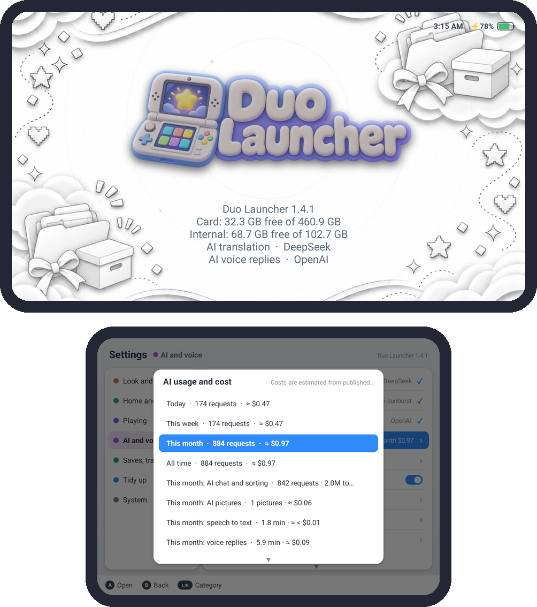
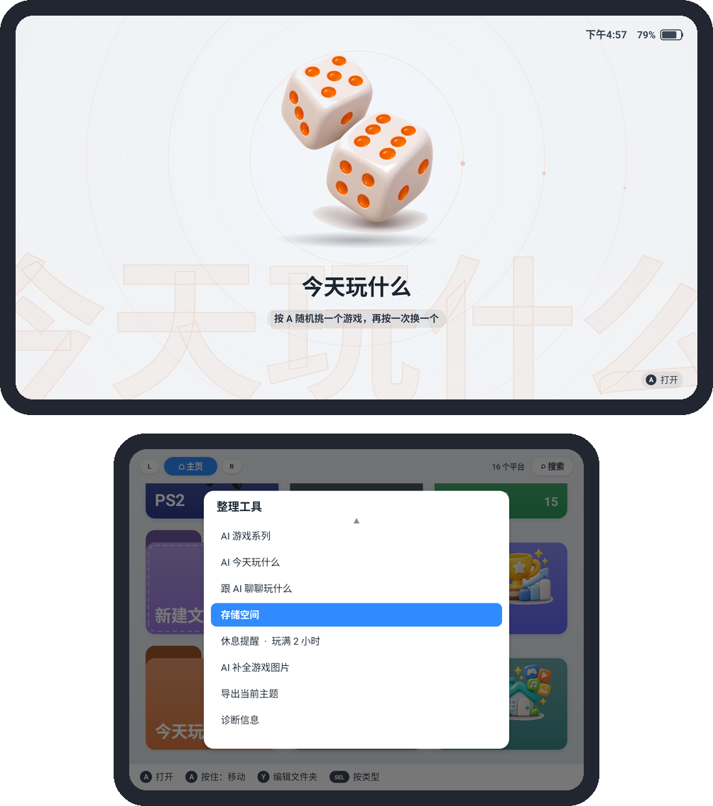

<p align="center"></p>

# Duo Launcher

<p align="center"><a href="README.md">English</a> · <a href="README.fr.md">Français</a> · <a href="README.zh-CN.md">简体中文</a> · <a href="README.zh-TW.md">繁體中文</a> · <a href="README.ja.md">日本語</a> · <a href="README.ko.md">한국어</a> · <b>Español</b> · <a href="README.de.md">Deutsch</a> · <a href="README.it.md">Italiano</a> · <a href="README.pt.md">Português</a> · <a href="README.ru.md">Русский</a></p>

Un launcher de juegos para dos pantallas, pensado para la **Retroid Pocket Duo** y otras portátiles Android con segunda pantalla, al estilo del menú principal de la 3DS.
Le indicas tus carpetas de ROMs y él encuentra los juegos, los ordena por consola, género y saga, los muestra en la pantalla inferior con sus imágenes en la superior, y abre cada uno con el emulador que tú elijas.
También trae trucos: si un juego no tiene ninguno en la consola, los descarga de las grandes bases de datos de la comunidad (Sharkive, libretro, CWCheat), te deja marcar los que quieras, traduce sus nombres al idioma de la interfaz con un toque y los escribe donde el emulador los lee, así que funcionan nada más arrancar el juego.

**Descarga:** el APK más reciente está en la [página de versiones](https://github.com/GenKnot/DuoLauncher/releases/latest) (Android 11 o posterior). Si instalas una versión nueva encima de la anterior, conservas todos los ajustes y tu tiempo de juego.

## ¿Por qué otro launcher?

Duo Launcher empezó como el launcher de un solo jugador para una sola portátil, y sigue creciendo a partir de cómo se usa esa portátil en el día a día. Se apoya en cuatro promesas:

1. **Funciona con la biblioteca que ya tienes**: da igual con qué frontend la montaste, no hay que rehacer nada. Hoy lee Pegasus y ES-DE, y vendrán más frontends.
2. **IA cuando quieras y como quieras**: varios servicios para elegir, tu propia clave, un coste que puedes ver, y todas las funciones de IA son opcionales.
3. **El trabajo pesado lo hace él**: trucos, imágenes, traducciones, pasar archivos, ordenar.
4. **Todo se adapta a ti**: se puede elegir casi cada detalle, y todo lo que muestra algo se puede desactivar.

Además de encontrar tus juegos y arrancarlos, esto es lo que dan de sí esas promesas:

- **Trucos, de la descarga al primer fotograma.** Si un juego no tiene trucos en la portátil, los busca en las grandes bases de datos de la comunidad (Sharkive para 3DS, libretro para NDS y GBA, CWCheat para PSP), te deja marcar solo los que quieras, traduce sus nombres a tu idioma con un toque (con una clave de IA, incluso con los nombres oficiales de los personajes y objetos del juego) y los escribe en los archivos de trucos de cada emulador: Azahar y Citra, DraStic, PPSSPP y RetroArch. Más en [Trucos](#trucos).
- **Una IA que conoce tu biblioteca.** Mantén R y pregúntale a qué jugar ahora, cómo pasarte un jefe o de qué va una historia: te responde a partir de los juegos que tienes de verdad. La misma IA traduce los nombres y las descripciones, coloca cada juego en un género y una saga, y dibuja las portadas, logos y fondos que falten. Funciona con el servicio que *tú* eliges y con tu propia clave, y cada solicitud queda registrada en los ajustes con un coste estimado. Más en [Tu compañero con IA](#tu-compañero-con-ia) y en [IA](#ia).
- **Se configura desde el móvil.** Activa la transferencia Wi-Fi y aparece un código QR en la pantalla de arriba. Escanéalo y una página en el idioma de tu móvil te deja enviar juegos, escribir las claves de API con un teclado de verdad, importar y exportar configuraciones y descargar copias de seguridad, sin cables ni gestor de archivos. Más en [Herramientas útiles](#herramientas-útiles).
- **Un solo sitio para todo lo que merece un vistazo.** «Problemas detectados» reúne los archivos que no ha sabido reconocer, las consolas sin emulador, los juegos sin portada y los duplicados, y arregla la mayoría ahí mismo. Más en [Herramientas útiles](#herramientas-útiles).
- **Aprovecha los datos de cada frontend sin tocarlos.** Lee a la vez los metadatos y las imágenes de Pegasus y de ES-DE, guarda lo que añade en su propia carpeta `DuoLauncher` y nunca reescribe los archivos de otro frontend, así que todos pueden compartir la misma tarjeta. Más en [De dónde salen los nombres, las imágenes y los detalles](#de-dónde-salen-los-nombres-las-imágenes-y-los-detalles).
- **A tu gusto, hasta el último detalle.** Combinaciones de colores y paquetes de temas para compartir, modo claro y oscuro, tu propia imagen y color para cualquier casilla, tamaño del texto, márgenes de las portadas, reglas para limpiar los nombres, tu propio orden de juegos, dónde se guardan los datos y Duo Lite para aligerar cada pantalla. Toda tu configuración se puede exportar en un solo archivo y pasársela a un amigo, sin tus claves ni tu historial de juego. Más en [Aspecto](#aspecto) y [Temas](#temas).
- **Ordenado por sagas, no solo por consolas.** Ys, Castlevania, Super Robot Wars… cada juego se agrupa con el resto de su saga y queda archivado en uno de 14 géneros, gracias a la tabla de juegos integrada o a la IA. Más en [Géneros y sagas](#géneros-y-sagas).

Y hay unas cuantas ideas detrás de todo:

- **Dos pantallas, dos tareas.** La pantalla de abajo sirve para elegir: carpetas grandes, una cuadrícula, una lista, menús. La de arriba sirve para mirar: la consola sobre su propio fondo ilustrado, el logo de un juego sobre su portada, un vídeo de muestra, cuánto tiempo llevas jugado, una nota que te dejaste o una conversación con la IA. Nada tiene que compartir espacio con otra cosa.
- **El mando va primero.** Todo funciona sin tocar la pantalla: un teclado pensado para la cruceta, direcciones que siguen avanzando si las mantienes, L / R para pasar página, mantener L para buscar por voz, mantener R para hablar con la IA. La pantalla táctil también funciona, solo que no hace falta.
### Junto a otros frontends

| | Duo Launcher | Otros frontends |
|---|:-:|:-:|
| Trucos descargados, elegidos, traducidos y preparados para cada emulador | ✅ | poco común |
| IA integrada que conoce tu biblioteca | ✅ | poco común |
| Configuración desde el móvil por Wi-Fi, con un código QR | ✅ | poco común |
| «Problemas detectados» | ✅ | poco común |
| Datos de Pegasus y de ES-DE leídos a la vez | ✅ | poco común |
| Agrupado por saga | ✅ | poco común |
| Agrupado por género | ✅ | habitual |
| Lista de juegos e imágenes en dos pantallas | ✅ | habitual |
| Tiempo de juego y RetroAchievements | ✅ | habitual |

Una idea aproximada, según lo que ofrecían otros frontends en noviembre de 2026. Muchos son excelentes en lo suyo; Duo Launcher simplemente pone su esfuerzo en lo de arriba. Si algo de esto se ha quedado anticuado, dilo en el [gestor de incidencias](https://github.com/GenKnot/DuoLauncher/issues).

Las sugerencias y los informes de errores son bienvenidos en el [gestor de incidencias](https://github.com/GenKnot/DuoLauncher/issues).

## Lo más destacado

- **Trucos listos para usar**: miles de trucos para 3DS, NDS, PSP, GBA y todos los sistemas de RetroArch, tomados de la propia consola o, si un juego no tiene, descargados de las grandes bases de datos (Sharkive, libretro, CWCheat), donde marcas solo los que quieres. Los nombres se traducen a tu idioma con un toque, cada truco se puede editar y todo se escribe en los archivos de trucos del propio emulador, así que funcionan desde que arranca el juego.
- **Un compañero con IA**: mantén R en cualquier sitio y habla. Te recomienda juegos de tu propia biblioteca, te explica cómo pasar una parte de un juego, te cuenta una historia o simplemente charla contigo. Las respuestas se pueden leer en voz alta.
- **Dos pantallas, un launcher**: eliges en la pantalla de abajo; en la de arriba ves logos, portadas, vídeos de muestra, tiempo de juego y descripciones.
- **Todos los emuladores en un sitio**: 3DS, NDS, GBA, GB/GBC, NES, SNES, N64, GameCube, Wii, Mega Drive, PS1, PS2, PSP, PS Vita y Switch, más 22 consolas más antiguas a través de RetroArch (de Master System a Dreamcast, PC Engine, Neo Geo, WonderSwan, Atari, arcade, DOS…), con el emulador elegido por consola o por juego. Los juegos de varios discos aparecen como uno solo.
- **Se ordena solo**: cada juego queda archivado en uno de 14 géneros y en su saga (Ys, Castlevania, Super Robot Wars…). El inicio muestra tu biblioteca por consola, por género o por saga, y las carpetas inteligentes mantienen al día «añadidos recientemente», «jugando», «pendiente», «terminado» y «mejor valorados».
- **Completa lo que falta**: portadas reales de los paquetes de miniaturas de libretro, títulos oficiales en inglés y portadas, logos y fondos dibujados por IA con el estilo propio del launcher.
- **Hecho para una portátil**: salvapantallas seguro para OLED, transferencia por Wi-Fi desde un navegador, copias de las partidas guardadas, estadísticas de juego, progreso de RetroAchievements, un resumen del almacenamiento y una pantalla de inicio que está lista en un segundo.
- **A tu gusto**: temas de color y paquetes de temas, modo claro y oscuro, tamaño del texto, márgenes de las portadas, una página de ajustes como la de una consola y configuraciones que puedes exportar y compartir. 11 idiomas de interfaz.

## Capturas de pantalla

<p align="center"></p>

<table>
  <tr>
    <th>Ajustes al estilo 3DS</th>
    <th>Ajustes en modo oscuro</th>
  </tr>
  <tr>
    <td></td>
    <td></td>
  </tr>
  <tr>
    <th>Uso y coste de la IA</th>
    <th>Exportar e importar la configuración</th>
  </tr>
  <tr>
    <td></td>
    <td></td>
  </tr>
  <tr>
    <th colspan="2">Ilustraciones a mano para el modo oscuro</th>
  </tr>
  <tr>
    <td colspan="2" align="center"></td>
  </tr>
  <tr>
    <th>Inicio por género, con iconos de plastilina</th>
    <th>Inicio por saga</th>
  </tr>
  <tr>
    <td></td>
    <td></td>
  </tr>
  <tr>
    <th>Género y saga en la página del juego</th>
    <th>Nota, preguntar a la IA, estado, cómo se juega, partidas</th>
  </tr>
  <tr>
    <td></td>
    <td></td>
  </tr>
  <tr>
    <th>Teclado para mando; también encuentra títulos en inglés</th>
    <th>Pregúntale a la IA a qué jugar</th>
  </tr>
  <tr>
    <td></td>
    <td></td>
  </tr>
  <tr>
    <th>Herramientas de IA: sagas, sugerencias, almacenamiento, aviso de descanso</th>
    <th>Almacenamiento: tamaño por consola, juegos grandes sin jugar</th>
  </tr>
  <tr>
    <td></td>
    <td></td>
  </tr>
  <tr>
    <th>Página del juego con vídeo de muestra</th>
    <th>Logo, portada o vídeo, para cada juego</th>
  </tr>
  <tr>
    <td></td>
    <td></td>
  </tr>
  <tr>
    <th>Vista de lista</th>
    <th>Estadísticas de juego</th>
  </tr>
  <tr>
    <td></td>
    <td></td>
  </tr>
  <tr>
    <th>Temas de color</th>
    <th>Los colores del tema llegan a los fondos</th>
  </tr>
  <tr>
    <td></td>
    <td></td>
  </tr>
  <tr>
    <th>Modo oscuro</th>
    <th>Modo oscuro</th>
  </tr>
  <tr>
    <td></td>
    <td></td>
  </tr>
  <tr>
    <th>Transferencia Wi-Fi</th>
    <th>Herramientas para ordenar</th>
  </tr>
  <tr>
    <td></td>
    <td></td>
  </tr>
  <tr>
    <th>GameCube, con Dolphin</th>
    <th>Mantén A para mover una carpeta</th>
  </tr>
  <tr>
    <td></td>
    <td></td>
  </tr>
  <tr>
    <th>Elige los trucos antes de importarlos, con los nombres traducidos</th>
    <th>Detalles del juego: tamaño, discos, capturas</th>
  </tr>
  <tr>
    <td></td>
    <td></td>
  </tr>
  <tr>
    <th>Trucos de 3DS, traducidos con un toque</th>
    <th>Trucos de NDS para DraStic, base de datos en chino</th>
  </tr>
  <tr>
    <td></td>
    <td></td>
  </tr>
  <tr>
    <th>Trucos de RetroArch (GBA)</th>
    <th>Editar, añadir, descargar</th>
  </tr>
  <tr>
    <td></td>
    <td></td>
  </tr>
  <tr>
    <th>Renombrar o borrar un truco</th>
    <th>Traducir todos los trucos de una vez</th>
  </tr>
  <tr>
    <td></td>
    <td></td>
  </tr>
  <tr>
    <th>Salvapantallas (seguro para OLED)</th>
    <th>11 idiomas</th>
  </tr>
  <tr>
    <td></td>
    <td></td>
  </tr>
</table>

## Primeros pasos

1. **Instala el APK** desde la [página de versiones](https://github.com/GenKnot/DuoLauncher/releases/latest) y ábrelo.
2. **Sigue la guía de bienvenida.** La primera vez que lo abres, una guía corta te acompaña en la configuración, página a página:
   - **«Se encontraron tus ajustes y registros anteriores»**: aparece la primera, y solo cuando la copia automática del launcher está en alguna unidad (tras reinstalar, o en una consola nueva con la misma tarjeta). «Recuperarlos» te deja elegir qué partes vuelven, como en «Importar una configuración»; «Empezar de cero» sigue con la guía como siempre. Consulta [Ajustes y compartir](#ajustes-y-compartir).
   - **El idioma.**
   - **Los permisos**, todos en una misma página: acceso a los archivos (para encontrar tus juegos), acceso a los datos de uso (para que el tiempo de juego cuente solo el rato en que el juego está de verdad en pantalla) y el papel de pantalla de inicio, marcado como «opcional». Esta página también está en «Ajustes → Sistema → Permisos».
   - **«Lo que se encontró»**: cuántas consolas y juegos ha encontrado el escaneo y dónde ha buscado: la carpeta `Roms` en la raíz de cada unidad, más las carpetas que hayas añadido. Si el escaneo aún no ha terminado, la página lo dice y se completa en cuanto acaba. Una puerta lleva a [«Problemas detectados»](#herramientas-útiles) para todo lo que no ha sabido colocar.
   - **«IA (opcional)»**: qué hacen las funciones de IA, y que lo que uses lo pagas al servicio que elijas. Después, «Escribir las claves en el móvil (Wi-Fi)», «Configurar en la consola» o «Más tarde».
   - **«Los botones»**: para qué sirve cada uno, en una sola página.

   Todas las páginas tienen «Saltar la guía», y B vuelve a la página anterior. «Ajustes → Sistema → Ver otra vez la guía de bienvenida» la repite.
   *Por qué:* los primeros minutos deciden si el launcher tiene sentido para ti, y quien empieza no debería tener que leerse esta página para llegar hasta ahí. Ver enseguida cuántos juegos se han encontrado responde además a la primera pregunta que se hace todo el mundo («¿ha encontrado mis juegos?»). Quien ya sabe lo que hace puede saltársela desde cualquier página.
3. **Deja que encuentre tus juegos.** Cualquier carpeta `Roms` de la memoria interna o de una tarjeta SD se detecta sola. Puedes añadir otras carpetas en «Ajustes → Inicio y biblioteca → Carpetas de juegos». Las consolas se reconocen por el nombre de la carpeta (`gba`, `Nintendo DS`, `psx`…) y por la extensión de los archivos.
4. **Elige los emuladores** allí donde quieras algo distinto del predeterminado: pulsa Y sobre la carpeta de una consola para toda la consola, o sobre un juego solo para ese juego. Solo se ofrecen los emuladores que tienes instalados.
5. **Opcional: añade una clave de IA** en «Ajustes → IA y voz → Servicios de IA y claves», desde la propia portátil o, más cómodo, desde un ordenador o un móvil por Wi-Fi («Ajustes → Partidas, transferencia, compartir → Transferencia Wi-Fi», o «Introducir en un ordenador o móvil (página Wi-Fi)» en ese mismo menú). Todo funciona sin clave salvo las funciones de IA.
6. **Opcional: conviértelo en tu pantalla de inicio** («Ajustes → Sistema → Usar como pantalla de inicio») para que arranque junto con la portátil. La casilla «Inicio de Android» siempre te devuelve a la pantalla de inicio del sistema.

## Lo básico

**El inicio** (pantalla inferior) contiene las carpetas de tus consolas y unas cuantas casillas integradas: «Continuar» (vuelves directamente al último juego), «Jugados recientemente», «Favoritos», «Nueva carpeta», «Buscar», «Estadísticas», «Almacenamiento», «¿A qué juego?», «Ajustes» e «Inicio de Android». SELECT cambia el inicio entre consolas, géneros y sagas.

**Una carpeta** muestra sus juegos como una cuadrícula de portadas. X hace las portadas más pequeñas y, una vez más, convierte la cuadrícula en una lista con nombres, tiempo de juego y cuándo jugaste por última vez. SELECT ordena (orden predeterminado, nombre, jugados recientemente, más jugados) y puede mostrar solo las versiones en chino simplificado, chino tradicional o inglés. L2 / R2 saltan a la inicial anterior o siguiente; los títulos en chino cuentan por la inicial de su pinyin.

**La pantalla superior** sigue a lo que tengas seleccionado: una consola sobre su fondo, con su número de juegos y su emulador; o el logo de un juego sobre su portada difuminada, con su consola, género · saga, emulador, tiempo de juego y una descripción breve, un vídeo de muestra pasado un momento, o la imagen del punto donde lo dejaste.

**Y** abre el menú de lo que tengas seleccionado. En un juego es corto, y lo que se usa menos queda una puerta más adentro: emulador, favorito, añadir a una carpeta / quitar de una carpeta, Trucos ›, Ayuda de la IA › (preguntar a la IA, cómo se juega), Información del juego › (detalles, género, estado y valoración, nota, qué muestra la pantalla superior, imágenes con IA para este juego) y Más › (partidas, marcar como visto, ocultar, borrar el archivo). En la carpeta de una consola: emulador predeterminado, cambiar nombre, Unir carpetas ›, marcar todo como visto y ocultar. En una casilla integrada: nombre, color, icono e imagen de fondo. La fila seleccionada se explica a sí misma en una línea al pie del menú.

*Por qué:* un menú de quince filas cuesta de leer en una consola portátil. Las puertas dejan delante las filas de cada día, y la pista de una línea hace que nadie tenga que adivinar qué hace una fila antes de pulsarla.

**Borrar el archivo** (Y → Más) pregunta antes, con el tamaño y el aviso de que las partidas guardadas se conservan; el cursor empieza en «Cancelar», así que pulsar A dos veces seguidas sin querer no borra nada. De un juego con varios discos se borran todos sus archivos, y un juego borrado desde una lista de «Problemas detectados» («Juegos duplicados», por ejemplo) desaparece de esa lista al momento.

*Por qué:* los duplicados y los juegos que ya terminaste se pueden quitar sin ordenador.

**Consejos que salen una sola vez.** La primera vez que tienes a mano una función, aparece una línea justo encima de la leyenda de botones de la pantalla inferior. Solo sale una vez, y desaparece a los nueve segundos más o menos o cuando pulsas un botón (salvo en los dos primeros segundos, para que no se vaya antes de que puedas leerla; el botón hace su función igualmente). De momento hay cuatro:

- en el inicio: mantén A para coger una casilla y moverla, Y para las opciones de esa casilla;
- al volver al inicio después de salir de una carpeta: SELECT muestra el inicio por consola, por género o por saga;
- sobre un juego en la carpeta de una consola, con el orden predeterminado: mantén A para mover el juego donde quieras, Y para emulador, trucos, partidas y más;
- en la carpeta «Sin reconocer»: pulsa A sobre un archivo para indicar de qué consola es.

«Ajustes → Sistema → Consejos sobre funciones nuevas» los desactiva, y «Volver a mostrar todos los consejos» recupera los que ya has visto.
*Por qué:* mantener A para mover, o SELECT en el inicio, son fáciles de pasar por alto y difíciles de adivinar. Una línea justo cuando puedes usarlo se recuerda mejor que un manual, y con una vez basta: un consejo que sale una y otra vez acaba siendo ruido.

### Controles

| Botón | Acción |
|---|---|
| Cruceta / stick izquierdo | Moverse; mantén para seguir avanzando |
| Izquierda / derecha, L / R en una lista o un menú | Página a página |
| A | Abrir / jugar; mantén A para coger y mover una carpeta del inicio o un juego dentro de la carpeta de una consola |
| B | Atrás |
| L / R | Consola anterior / siguiente (en los ajustes: categoría) |
| Mantener L | Buscar por voz |
| Mantener R | Hablar con la IA |
| L2 / R2 | Inicial anterior / siguiente |
| X | Tamaño de las portadas y, después, vista de lista |
| Y | Menú del juego, la carpeta o la casilla seleccionada |
| START | Ajustes (desde cualquier punto del inicio, aunque la casilla «Ajustes» esté oculta); en un menú, lo mismo que A |
| SELECT | En el inicio: consolas / géneros / sagas; en una carpeta: orden y filtro de idioma |
| R3 | Buscar |
| En el teclado de búsqueda | A escribe, B borra, X espacio, Y teclado del sistema, SELECT limpia, START o R3 terminan, mantén L para hablar |
| En el chat con la IA | Mantén R para hablar, Y para escribir, X para una charla nueva, SELECT para el historial, L2 / R2 para volver atrás en la conversación, B para cerrar; la cruceta y A eligen entre los juegos de abajo |

Todo funciona también con la pantalla táctil: toca para seleccionar, vuelve a tocar para abrir, desliza para desplazarte y toca las pastillas de la parte superior en lugar de L, R, X, SELECT o Buscar. A/B y X/Y se pueden intercambiar para tener los botones de confirmar al estilo Nintendo o Xbox («Ajustes → Juego → Botones»).

## Tu biblioteca

- **Encuentra tus juegos solo.** Busca carpetas `Roms` en la memoria interna y en las tarjetas SD; puedes añadir más en «Ajustes → Inicio y biblioteca → Carpetas de juegos». El último escaneo se guarda en caché, así que el inicio aparece en un segundo y el siguiente escaneo se hace en silencio en segundo plano.
- **Consolas**: 3DS, NDS, GBA (y las carpetas de GBA con vibración y de hacks), GBC, GB, NES, SNES, N64, GameCube, Wii, Mega Drive, PlayStation 1/2/3, PSP, PS Vita y Switch, con imágenes también para PS4, PS5, Xbox 360 y Xbox Series. También reconoce todas las demás consolas del pack Pegasus G: Virtual Boy, Master System, Game Gear, 32X, Mega-CD, Saturn, Dreamcast, NAOMI, PC Engine y su CD, PC-FX, Neo Geo CD, Neo Geo Pocket Color, WonderSwan y WonderSwan Color, Pokémon Mini, Atari Lynx, Atari 2600, Game & Watch, 3DO, DOS y arcade.
- **Juegos de varios discos como uno solo.** `Disc A/B`, `Disc 1/2`, `CD1/CD2`, `(Disc 2 of 3)` en una misma carpeta, o una lista `files:` de Pegasus, se convierten en una sola entrada. RetroArch y DuckStation reciben una lista `.m3u` con los discos para que puedas cambiar de disco dentro del juego.
- **Juegos y aplicaciones de Android**: los juegos instalados tienen su propia carpeta automáticamente; cualquier otra aplicación (vídeo, navegador…) se puede añadir a una carpeta «Aplicaciones».
- **Funciona con lo que ya tienes.** Lee `metadata.pegasus.txt` de Pegasus, `gamelist.xml` y `downloaded_media` de ES-DE / EmulationStation, las miniaturas de RetroArch y las carpetas `media/`, `covers/` e `images/` que haya junto a los juegos. No toca nada de lo suyo; lo que añade el launcher va a su propia carpeta `DuoLauncher` (consulta [Tu propia información de juegos](#tu-propia-información-de-juegos)).
- **Se da cuenta de los juegos nuevos.** Copia juegos a la tarjeta y el siguiente escaneo los encuentra; llevan la etiqueta NEW durante una semana (o hasta que los juegues) y te propone clasificarlos por género y saga. Esa pregunta se puede desactivar. Y → «Marcar como visto» quita la etiqueta de un juego; «Marcar todo como visto» (Y sobre una consola o carpeta, o «Ajustes → Inicio y biblioteca») la quita de muchos a la vez, y el interruptor «Etiquetas NEW» de ahí las desactiva del todo.
- **Unir carpetas.** Dos carpetas de la misma consola en sitios distintos (por ejemplo, dos de PS1) se pueden mostrar como una sola: «Y → Unir carpetas» sobre una consola. Cada juego conserva su emulador, las carpetas con el mismo nombre se unen solas y «Separar» lo deshace.
- **Tus propias carpetas.** La casilla «Nueva carpeta» crea una carpeta con su propio nombre, color, icono e imagen de fondo. Añade cualquier juego o aplicación con Y, y sácalo de nuevo con «Y → Quitar de esta carpeta».
- **Las carpetas inteligentes** se llenan solas: añadidos recientemente (los últimos 30 días), sin jugar, más jugados, jugando, pendiente, terminado y mejor valorados. Y sobre una de ellas muestra su regla.
- **Continuar y favoritos.** La primera casilla del inicio te devuelve directamente al último juego. Marca juegos con Y para reunirlos en una carpeta «Favoritos».
- **Oculta lo que no juegas**: la carpeta de una consola, o un solo juego o aplicación («Y → Ocultar este juego»); los recuperas en «Ajustes → Inicio y biblioteca».
- **Limpia los nombres de los juegos.** Los nombres sacados tal cual de los archivos ROM suelen tener esta pinta: `0153 - Legend of Zelda, The - The Minish Cap (USA) [!]`. «Ajustes → Inicio y biblioteca → Limpiar nombres de juegos» tiene seis interruptores, todos apagados de entrada: «Quitar región e idiomas», «Quitar versión y marcas de dump», «Quitar el número inicial», «Guiones bajos y puntos pasan a espacios», «"Zelda, The" pasa a "The Zelda"» y «Quitar todo lo que va entre paréntesis». Junto a cada interruptor hay un ejemplo sacado de tu propia biblioteca con el nombre antes y después, y «Ver todos los cambios» enumera todos los juegos que cambiarían de nombre. *Por qué:* solo cambia el nombre que ves en pantalla. Los archivos de la tarjeta se quedan exactamente como están, así que ni los emuladores, ni las partidas guardadas, ni otros frontends se enteran. Los títulos que vienen de Pegasus, de ES-DE o de tus propias ediciones no se tocan, porque alguien ya los eligió. Las etiquetas que distinguen un juego de otro, como `(Beta)` o `(Hack)`, se conservan salvo que actives el interruptor de los paréntesis.
- **Ordena los juegos a tu manera.** Dentro de la carpeta de una consola, mantén A sobre un juego (o haz una pulsación larga) para cogerlo, muévelo con la cruceta y suéltalo para dejarlo en su sitio. El orden se guarda para esa consola, sobrevive a los nuevos escaneos y entra en la copia completa. Los juegos que añadas más tarde ocupan su lugar de siempre. «Y → Volver al orden original» sobre la consola lo deshace. Solo se puede mover con el orden predeterminado y sin filtro de idioma, porque al ordenar por nombre o por tiempo de juego tu orden no tendría ningún sentido. *Por qué:* los juegos a los que estás jugando ahora, o una saga en orden de lanzamiento, tienen su sitio juntos arriba del todo, y ningún orden automático puede saber eso.
- **Tu catálogo.** Tras cada escaneo, toda la biblioteca se escribe en `DuoLauncher/catalog.tsv` (consola, archivo, título, título en inglés, género, saga, tiempo de juego, estado, valoración), para hojas de cálculo, otras herramientas o la IA.

### Géneros y sagas

Recorrer dos mil juegos solo por consola acaba cansando, así que cada juego recibe además uno de 14 géneros (rol, acción, aventura, plataformas, táctica, estrategia, disparos, puzles, carreras, deportes, lucha, simulación, party y música, otros) y su saga.

- **Primero, lo que ya sabe.** Una tabla incluida en el launcher (`assets/gamedb.tsv`, 3860 nombres de archivo que cubren todos los juegos de las listas de los packs G de Pegasus para estas consolas, con los nombres `.iso` y `.cso` cuando un pack trae los dos) ya conoce el género, la saga y el título oficial en inglés de los sets de ROMs habituales por consola y nombre de archivo. Los juegos que conoce no necesitan IA ni conexión a internet.
- **La IA para el resto.** «Ajustes → IA y voz → Que la IA ordene la biblioteca → IA: ordenar por género» / «IA: sagas de juegos» clasifica los juegos que faltan, y los resultados se guardan en `DuoLauncher/<console>/genres.txt` y `series.txt` en la tarjeta, así que se hace una sola vez y sobrevive a las reinstalaciones. Los géneros que ya hayan escrito Pegasus o ES-DE («Action RPG», «角色扮演»…) se asignan a los 14 géneros.
- **A mano**: «Y → Género» en cualquier juego.
- **En pantalla.** La pantalla superior muestra el género · saga de cada juego, y SELECT en el inicio convierte las carpetas en géneros o sagas. Los nombres de las sagas siguen el idioma de la interfaz.

### Búsqueda

R3, la casilla «Buscar» o el botón de búsqueda abren en la pantalla superior un teclado pensado para la cruceta, con tus búsquedas recientes y una fila de géneros encima; los resultados llenan la pantalla inferior mientras escribes. Los títulos en chino coinciden con su pinyin, con sus iniciales y con el principio de cada sílaba (`kdyg`, `mlao` → 马里奥), y cada juego coincide también con su título oficial en inglés, así que `zelda` encuentra 塞尔达传说. Si la abres desde dentro de una consola, busca solo en esa consola, con un botón «Todas las plataformas» para ampliarla. Mantén L para decir un nombre en lugar de escribirlo.

### Imágenes que se completan solas

- **Portadas reales**: «Ajustes → Ordenar → Descargar portadas» (también en «Problemas detectados», dentro de «Juegos sin portada») baja las portadas de los paquetes de miniaturas de libretro. Los juegos de NDS y GBA se identifican por el código de juego que lleva la ROM (también las ROMs comprimidas en zip, con pantallas de título), así que los archivos traducidos o renombrados siguen encontrando sus imágenes; los de PlayStation 1/2, PSP, N64, GameCube, Wii, 3DS, GB/GBC, NES, SNES y Mega Drive se identifican por su título en inglés. «Sin portada» significa lo mismo en todas partes: el juego no tiene carátula (un logo o un fondo solos no cuentan), así que «Problemas detectados», «Descargar portadas» y el menú de imágenes con IA dan el mismo número.
- **Iconos sacados de las propias ROMs**: los iconos de banner de NDS y los iconos SMDH de 3DS; los títulos de 3DS instalados muestran su nombre en el idioma de la interfaz.
- **Portadas uniformes**: las portadas llenan su casilla, o todas quedan con el mismo margen pequeño, mediano o grande («Ajustes → Aspecto y sonido → Margen de portadas»); los marcos blancos que traen algunas imágenes de portada se recortan.
- **Imágenes con IA**: con una clave de imágenes, la IA dibuja portada, fondo y logo de título. Para un juego: «Y → Información del juego → Imágenes con IA para este juego», que indica si el juego ya tiene cada una; la nueva sustituye a la actual, y el logo de título necesita el título en inglés (lo encuentra «IA: nombres y descripciones»). Para muchos juegos: «Ajustes → IA y voz → Que la IA ordene la biblioteca → IA: dibujar imágenes que faltan», que dice cuántos juegos no tienen cada tipo; la lista de consolas empieza por «Todas las plataformas», y dos consolas con el mismo nombre muestran el nombre de su carpeta (una carpeta de hacks de GBA, por ejemplo). Consulta [IA](#ia).

## Jugar

- **Emulador por juego o por consola** (Y). Solo se ofrecen los emuladores instalados:

  | Consola | Emuladores (el primero es el predeterminado) |
  |---|---|
  | 3DS | AzaharPlus, Azahar, Citra MMJ, Citra MMJ (modo rendimiento) |
  | NDS | DraStic, DraStic (ruta simple), RetroArch · melonDS DS |
  | GB / GBC | RetroArch · Gambatte, mGBA |
  | GBA | RetroArch · mGBA, gpSP, gpSP Rumble |
  | NES | RetroArch · FCEUmm, Mesen |
  | SNES | RetroArch · Snes9x |
  | Mega Drive | RetroArch · Genesis Plus GX, PicoDrive |
  | N64 | RetroArch · Mupen64Plus-Next, Mupen64Plus FZ |
  | GameCube / Wii | Dolphin MMJR, Dolphin |
  | PS1 | RetroArch · PCSX ReARMed, SwanStation, DuckStation |
  | PS2 | ARMSX2, AetherSX2 |
  | PSP | PPSSPP, RetroArch · PPSSPP |
  | PS Vita | Vita3K (por ID de título, p. ej. un archivo llamado `PCSE00000.psvita` o un nombre que lo contenga) |
  | Switch | Eden |
  | Virtual Boy | RetroArch · Beetle VB |
  | Master System / Game Gear | RetroArch · Genesis Plus GX, PicoDrive |
  | 32X | RetroArch · PicoDrive |
  | Mega-CD | RetroArch · Genesis Plus GX, PicoDrive |
  | Saturn | RetroArch · Yaba Sanshiro, Yabause |
  | Dreamcast / NAOMI | RetroArch · Flycast |
  | PC Engine / PC Engine CD | RetroArch · Beetle PCE Fast, Beetle PCE |
  | PC-FX | RetroArch · Beetle PC-FX |
  | Neo Geo CD | RetroArch · NeoCD |
  | Neo Geo Pocket Color | RetroArch · Beetle NeoPop, RACE |
  | WonderSwan / Color | RetroArch · Beetle Cygne |
  | Pokémon Mini | RetroArch · PokeMini |
  | Atari Lynx | RetroArch · Handy, Beetle Lynx |
  | Atari 2600 | RetroArch · Stella |
  | Game & Watch | RetroArch · Game & Watch |
  | 3DO | RetroArch · Opera |
  | DOS | RetroArch · DOSBox Pure |
  | Arcade | RetroArch · FinalBurn Neo, MAME 2003-Plus |

  Un `metadata.pegasus.txt` de Pegasus suele traer su propia línea de arranque para cada consola; esa se usa primero, y los cores de arriba se ofrecen junto a ella.

- **Citra MMJ (modo rendimiento)**: la misma versión de Citra MMJ reempaquetada con el nombre de paquete del benchmark AnTuTu, que muchos sistemas Android ejecutan a frecuencia máxima. Solo se ofrece cuando ese paquete es realmente Citra.
- **Tiempo de juego y estadísticas**: cuánto tiempo has jugado a cada juego y cuándo fue la última vez, al estilo de Switch; con el acceso a los datos de uso concedido, solo cuenta el tiempo en que el juego estuvo de verdad en pantalla. La casilla «Estadísticas» muestra el total, esta semana día a día, el tiempo por consola y los juegos más jugados.
- **Donde lo dejaste**: la captura o la imagen del estado guardado más reciente de un juego que ya has jugado pasa a ser su fondo en la pantalla superior.
- **Estado, valoración y notas**: marca un juego como jugando, pendiente, terminado o abandonado y dale de una a cinco estrellas («Y → Estado»); escribe o dicta una frase sobre dónde vas y qué te toca hacer después («Y → Nota»). Todo aparece en la pantalla superior la próxima vez que vuelvas al juego.
- **Detalles del juego** («Y → Detalles»): archivo, tamaño, discos, carpeta, emulador, tiempo de juego, el título oficial en inglés y las capturas del juego en la pantalla superior.
- **Vídeos de muestra y sonidos**: el vídeo de un juego empieza en la pantalla superior pasado un momento (o elige logo o portada para cada juego: «Y → Pantalla superior»). Los sonidos suaves de la interfaz y la melodía del banner de cada juego de 3DS se pueden desactivar.
- **Se aparta mientras juegas.** En cuanto arranca un juego, la pantalla inferior pasa al emulador y se paran el vídeo, la música y las melodías de los banners. Además, el launcher suelta las imágenes que tiene en memoria (medido: de unos 167 MB a 109 MB), deja en espera hasta que vuelvas cualquier análisis de la tarjeta que esté en marcha, para no disputarle la tarjeta al emulador, y detiene la actualización del reloj y el movimiento de la pantalla superior. Al volver, las portadas están otra vez en pantalla en menos de un segundo.
  *Por qué:* el emulador tiene la memoria y la tarjeta para él solo.
- **Cuando un juego no arranca**: si falta el archivo, el emulador no está instalado, no puede abrir ese tipo de archivo o el juego se cierra al instante, aparece un mensaje que te dice qué hacer en cada caso. [«Problemas detectados»](#herramientas-útiles) te avisa de las consolas cuyo emulador no está instalado antes de que te encuentres con el problema.
- **Aviso de descanso** («Ajustes → Juego»): tras una, dos o tres horas con un juego, el launcher te sugiere un descanso cuando vuelves.
- **RetroAchievements**: con tu nombre de usuario y tu clave Web API, ves los juegos jugados recientemente con su progreso de logros, y una etiqueta 🏆 en los juegos que tienen logros.

## Tu compañero con IA

Todo esto es opcional y usa el servicio de IA que elijas con tu propia clave (consulta [IA](#ia)).

- **Háblale desde cualquier sitio.** Mantén R en el inicio, en una carpeta o en el teclado de búsqueda y habla, o pulsa Y para escribir. La conversación ocupa la pantalla superior; los juegos que te recomienda o encuentra llenan la inferior, listos para empezar con A. Pregúntale a qué jugar («un RPG tranquilo y no muy largo»), afina la búsqueda («algo con más acción»), pregúntale cómo pasar la parte del juego que tienes seleccionado, por una historia o un personaje, o simplemente charla. Recuerda la conversación durante media hora.
  *Por qué:* la pantalla de abajo es donde se eligen los juegos, así que las sugerencias de la IA aparecen ahí; la de arriba queda libre para leer. Y en una portátil, mantener un gatillo y hablar es más rápido que cualquier menú.
- **Charla nueva, historial guardado.** X en el chat empieza una charla nueva; SELECT muestra las anteriores, la más reciente arriba, para volver a abrirlas, borrarlas una a una o todas a la vez (también en «Ajustes → IA y voz → Historial de charlas con la IA»). Mientras el chat está abierto, las vistas previas en vídeo, las melodías de los banners de 3DS y los sonidos de los botones se callan, y las respuestas habladas suenan con el volumen multimedia.
  *Por qué:* una pregunta nueva no debería arrastrar el tema anterior, una respuesta que vale la pena no debería perderse al reiniciar, y una respuesta en voz alta no sirve si encima suena el tráiler de un juego. El historial nunca va en una configuración exportada con *Compartir*, pero sí en la copia automática de `DuoLauncher/profile/`, así que reinstalar no lo borra; y el interruptor «Guardar charlas con la IA», dentro de «Historial de charlas con la IA», lo desactiva.
- **Respuestas en voz alta**: «Ajustes → IA y voz → Servicios de IA y claves → Respuestas de voz de la IA»: Soniox (con su propia clave) u OpenAI (la clave de imágenes), con elección de voz y velocidad y un botón para probar. Desactivado a menos que lo actives.
- **A qué jugar hoy**: Y sobre la casilla «¿A qué juego?» hace que la IA elija seis juegos de tu biblioteca según tus gustos, con el motivo de cada uno. Si solo pulsas la casilla, elige uno al azar, dando preferencia a los que nunca has jugado.
- **Pregunta sobre un juego** («Y → Preguntar a la IA»): una pregunta sobre el juego seleccionado, escrita o dicha, con la respuesta en la pantalla superior.
- **Cómo se juega** («Y → Cómo se juega»): los controles (incluidos los botones de confirmar / cancelar intercambiados de las versiones japonesas) y lo básico que necesita alguien que empieza, escrito una vez por juego y guardado.
- **¿Aún no tienes clave?** Al mantener R te explica cómo añadir una, desde la portátil o desde un ordenador por Wi-Fi.

## Trucos

«Y → Trucos» sobre un juego muestra su lista de trucos; A activa o desactiva cada uno.

| | 3DS (Azahar, Citra) | NDS (DraStic) | PSP (PPSSPP) | RetroArch (GBA, GB, GBC, NES, SNES, N64, MD, PS1, …) |
|---|---|---|---|---|
| Dónde se guardan | `azahar/cheats/` y `citra-emu/cheats/`, `<title ID>.txt`; se escriben para los dos, así que no se pierden si cambias de emulador | la lista completa en `DuoLauncher/cheats/NDS/`; los activados van a los trucos personalizados de DraStic (`DraStic/cheats/<game file name>.cht`), que también funcionan con ROMs traducidas | `PSP/Cheats/<game ID>.ini`, los archivos de trucos del propio PPSSPP; el ID del juego se lee de la ISO, el CSO o el EBOOT.PBP | `RetroArch/cheats/<core>/<game file name>.cht`, que RetroArch carga al iniciar el juego |
| Ya en el dispositivo | – | el `usrcheat.dat` de DraStic (en chino en las portátiles Retroid), identificado solo por el código de juego, así que las ROMs parcheadas y traducidas encuentran sus trucos incluso cuando el propio DraStic no muestra ninguno | el `cheat.db` de PPSSPP y, en las portátiles Retroid, archivos de trucos en chino para unos 4300 juegos | Retroid incluye trucos en chino para cientos de juegos (`000 中文金手指` y las carpetas de los cores); un juego sin archivo propio recibe una copia, identificada por el nombre |
| Descarga | [Sharkive](https://github.com/FlagBrew/Sharkive), unos 650 juegos, por el ID de título leído de la ROM | [libretro-database](https://github.com/libretro/libretro-database), unos 4200 juegos, por el código de juego de la cabecera de la ROM | [CWCheat-Database-Plus+](https://github.com/Saramagrean/CWCheat-Database-Plus-), unos 4300 juegos, por ID de juego | [libretro-database](https://github.com/libretro/libretro-database) para GBA, por el código de juego de la cabecera de la ROM |

- **Elige antes de importar**: una descarga primero muestra lo que ha encontrado, ya traducido, con «Seleccionar todo» / «Quitar todo»; solo se añaden los marcados. *Por qué:* una base de datos puede tener decenas de códigos por juego, y la mayoría de los jugadores quiere tres.
- **Traducir**: los nombres de trucos en inglés pasan a tu idioma de interfaz con un toque, para un juego o para todos a la vez («Ajustes → Ordenar»). Los trucos habituales salen de un glosario integrado (无限血量, 金钱最大, 主代码…); el resto va al servicio gratuito MyMemory, con el servicio gratuito de Google como segundo intento. Las etiquetas de versión (`v1.2`) y las indicaciones de botones (`(START+L)`) se conservan, y el nombre original en inglés queda en el archivo como nota.
- **Traducir con IA**: con una clave de IA, los trucos de un juego se envían al modelo junto con el nombre del juego, para que use los nombres oficiales de personajes y objetos (鬼神林克, 心之容器…).
- **Editar**: renombra o borra cualquier truco, borra todos los trucos de un juego de una vez o añade los tuyos con sus códigos (los códigos de 3DS, NDS y PSP se comprueban con el formato `XXXXXXXX YYYYYYYY`).
- **Seguro para DraStic**: los parches de flashcart (saltos de protección anticopia, arreglos de overlay y de Wi-Fi) se dejan fuera de las descargas de NDS porque DraStic se cuelga si están activados, y como mucho puede haber 256 líneas de código activas a la vez, el máximo que DraStic puede cargar.
- **Seguro para tus archivos**: la primera vez que se modifica un archivo de trucos de 3DS escrito a mano, el original se guarda como `.txt.bak`.
- **RetroArch, una sola vez**: activa una vez en RetroArch «Menú rápido → Trucos → Auto-Apply Cheats During Game Load» (aplicar los trucos al cargar el juego), y los trucos que actives aquí funcionarán desde que empiece el juego.

## Aspecto

- **La pantalla superior (1920×1080)**: cada consola sobre su propio fondo de papel recortado, o el logo del juego seleccionado sobre su portada difuminada, con etiquetas y una descripción breve; el reloj y la batería están en la esquina.
- **La pantalla inferior (1280×960)**: carpetas de consolas, una cuadrícula de portadas con zoom y una vista de lista, con indicaciones de botones abajo que se mantienen cortas y dejan fuera lo que no cabe cuando el texto es grande.
- **Temas**: siete combinaciones de colores, colores propios y paquetes de temas con imágenes de consolas, fondos, una fuente, sonidos y música. El tema también colorea los fondos de líneas de la pantalla superior. Consulta [Temas](#temas).
- **Modo claro y oscuro**: sigue al sistema o lo eliges tú, con un juego de fondos dibujado aparte para cada modo.
- **Todo lo del inicio es tuyo.** Cada casilla integrada y cada carpeta de consola se puede renombrar, cambiar de color, darle su propio icono (una imagen tuya, o una dibujada por el servicio de imágenes con el estilo de plastilina del launcher), mover (mantén A o pulsación larga) u ocultar, y recuperarla en «Ajustes → Inicio y biblioteca → Carpetas ocultas». Las casillas integradas como «Estadísticas», «Almacenamiento» y «¿A qué juego?» también pueden tener su propio fondo en la pantalla superior.
- **Aspecto de cada consola**: la imagen de cada consola, su fondo claro y oscuro y el color de su carpeta se pueden sustituir («Ajustes → Aspecto y sonido → Aspecto de plataformas»). El servicio de imágenes puede redibujar un fondo oscuro a partir del claro, para que los dos siempre casen.
- **Tamaño del texto**: cuatro tamaños para las dos pantallas.
- **Salvapantallas**: tras unos minutos sin tocar nada, la pantalla superior muestra tus portadas con un reloj y la inferior se apaga. El texto cambia de esquina con cada imagen y se desplaza poco a poco, para que nada se quede marcado en un panel OLED.
- **Duo Lite** («Ajustes → Aspecto y sonido», la primera fila): un solo interruptor que apaga las vistas previas en vídeo y la música de los banners de 3DS, la ilustración difuminada detrás de un juego, los puntitos que flotan en la pantalla superior y el suave balanceo de la imagen de la consola, la animación de entrada y el marco de selección que palpita. Mientras está activado, los interruptores «Vista previa en vídeo» y «Música de los banners de 3DS» aparecen apagados y explican por qué si los pulsas; tus propias elecciones vuelven al desactivar Duo Lite. Medido en la Duo, con el launcher quieto en el inicio: la pantalla superior suele redibujar unos 600 fotogramas en 5 segundos, y en Duo Lite ninguno.
  *Por qué:* para sesiones largas con batería, o si simplemente prefieres una pantalla quieta.

## Ajustes y compartir

- **Una página de ajustes como la de una consola.** START abre una sola página: las categorías a la izquierda («Aspecto y sonido», «Inicio y biblioteca», «Juego», «IA y voz», «Partidas, transferencia, compartir», «Ordenar», «Sistema»), las opciones de la categoría elegida a la derecha con sus valores e interruptores, y la pantalla superior con la versión, el espacio libre de cada unidad y qué servicios de IA están activos. L / R cambian de categoría.
  Algunas filas son puertas a un menú más pequeño («Servicios de IA y claves», «Que la IA ordene la biblioteca», «Problemas detectados»…). Cuando el cursor está sobre una, una línea al pie de la tarjeta dice qué hay detrás, y B desde dentro te devuelve a la misma fila con sus valores ya actualizados.
  *Por qué:* una categoría con una docena de filas parece un muro en una pantalla de 1280×960. Agrupar los ajustes menos usados tras una puerta mantiene cada categoría corta, y la nota de una línea te dice qué hay detrás de una puerta antes de cruzarla.
- **Haz una copia o comparte tu configuración.** «Ajustes → Partidas, transferencia, compartir → Exportar mi configuración» te pregunta qué incluir: los ajustes y tus propias imágenes, el historial de juego, el estado, las valoraciones y las notas de los juegos, las claves y cuentas, el uso de la IA y las charlas, y los datos de los juegos en las carpetas `DuoLauncher`; o uno de dos atajos, *Compartir* (solo ajustes e imágenes) y *Copia completa* (todo). «Importar una configuración» carga una desde `DuoLauncher/exports` o la carpeta Descargas, tanto si te llegó por Wi-Fi como por una app de mensajería o en una tarjeta, y muestra lo que contiene para que desmarques lo que deba quedarse como está. En la página Wi-Fi, un archivo enviado a «Configuraciones para importar» va directo a `DuoLauncher/exports`, así que ya te espera en «Importar una configuración».
  *Por qué:* una configuración que le pasas a un amigo nunca debe llevar tus claves ni tu historial, mientras que una copia tuya debe devolverte exactamente el mismo launcher en una consola nueva o tras reinstalar. Una copia completa contiene tus claves, así que la exportación te avisa de que te la guardes para ti, y una clave tuya nunca se dirige a una dirección que venga de la configuración de otra persona.
- **Dónde se guardan los datos** («Ajustes → Partidas, transferencia, compartir»): dónde va la carpeta `DuoLauncher`, es decir, los géneros, sagas y nombres puestos por la IA de cada consola, las imágenes descargadas o dibujadas por la IA, las copias de seguridad de las partidas, las exportaciones, los temas y la copia de los ajustes que se explica abajo. «Junto a los juegos» es la opción por defecto y lo que hacía hasta ahora: los datos de cada consola en la unidad donde están sus juegos, y las copias de seguridad en la tarjeta. «Tarjeta» lo pone todo en la tarjeta TF, así que tus datos van con ella a otra consola (sin tarjeta, se usa la memoria interna mientras tanto). «Interno» lo deja todo en la consola aunque cambies de tarjeta. Lo que se escribió antes del cambio se sigue leyendo donde esté. Con «Tarjeta» o «Interno» elegido, «Mover aquí los datos existentes» te enseña cuánto ocupa y luego trae las carpetas `DuoLauncher` de las otras unidades; los archivos que ya estaban se conservan, y las listas de trucos de NDS y las listas de reproducción multidisco se quedan donde los emuladores las buscan.
  *Por qué:* dónde viven tus datos lo decides tú; nada de eso está fijado en el código.
- **Una copia automática de ajustes y registros.** «Guardar una copia de ajustes y registros» (en el mismo menú, activado por defecto) copia tus ajustes, tus propias imágenes, el tiempo de juego, el estado, las valoraciones y las notas, el orden de los juegos, el uso de la IA y las charlas en `DuoLauncher/profile/` de la unidad elegida: la primera vez antes de un minuto y después cada vez que algo cambia. Lo comprueba más o menos cada minuto mientras el launcher está en pantalla, nunca durante una partida, y solo guarda la copia más reciente. Las claves API quedan fuera salvo que actives «Incluir las claves API en la copia», que avisa de que cualquiera con la tarjeta podría leerlas. «Guardar una copia ahora» hace una al momento y muestra cuándo se hizo la última. Tras reinstalar, o en una consola nueva con la misma tarjeta, la guía de bienvenida empieza con «Se encontraron tus ajustes y registros anteriores»: «Recuperarlos» te deja elegir qué partes, como en «Importar una configuración», y «Empezar de cero» los deja como están.
  *Por qué:* hasta ahora, desinstalar o restablecer de fábrica se llevaba el tiempo de juego, las notas y los ajustes, a menos que te hubieras acordado de exportarlos a mano.
- **11 idiomas**: 简体中文, 繁體中文, English, 日本語, 한국어, Français, Español, Deutsch, Italiano, Português, Русский.

## Herramientas útiles

- **Problemas detectados**: la primera fila de «Ajustes → Ordenar». Cada vez que lo abres revisa la biblioteca en segundo plano y reúne todo lo que quizá merezca un vistazo, con un contador en cada fila:
  - **«Permisos que faltan»**: abre la página de permisos.
  - **«Archivos sin reconocer»**: abre la carpeta «Sin reconocer», donde A sobre un archivo te deja elegir su consola.
  - **«Consolas sin emulador instalado»**: elige una consola para ver los emuladores que ya tienes instalados (A cambia a uno de ellos) y los que el launcher sabe que funcionarán en cuanto los instales, además de «Abrir esta consola».
  - **«Archivos que no se abren»**: archivos vacíos, y archivos que nombra una lista de juegos de Pegasus o ES-DE pero que no están en la tarjeta.
  - **«Juegos sin portada»**: un pequeño menú con «Ver cuáles son los N juegos», «Descargar portadas» (se pone en marcha ahí mismo con la línea «Buscando portadas en línea…» y luego vuelve el menú con el nuevo número y cuántas encontró, o avisa de que no encontró ninguna en línea) y «Dibujar portadas para estos N juegos con IA».
  - **«Juegos duplicados»**: misma consola, mismo nombre y mismo tamaño; casi seguro, un juego copiado dos veces.

  La primera fila aclara que nada de esto impide usar el launcher, y solo aparecen los problemas que existen de verdad. La página «Lo que se encontró» de la guía de bienvenida también lleva aquí. B en una lista abierta desde aquí («Juegos sin portada», «Juegos duplicados», «Archivos que no se abren») vuelve a «Problemas detectados», no al inicio.
  *Por qué:* estas comprobaciones estaban repartidas por los ajustes, y un emulador que faltaba solo se notaba cuando un juego no arrancaba. Un único sitio que se revisa cuando entras, y que nunca salta por su cuenta, te deja poner orden cuando te apetezca e ignorar el resto.
- **Transferencia Wi-Fi**: «Ajustes → Partidas, transferencia, compartir → Transferencia Wi-Fi» muestra en la pantalla superior la dirección de la página con un código QR al lado, la contraseña de administración (seis dígitos al azar, o la que tú pongas) y una breve lista de para qué sirve la página. Escanea el código con la cámara del móvil, o escribe la dirección en un navegador de la misma red. El código QR se genera en la propia portátil, así que no hace falta conexión a internet. B en el menú Wi-Fi te devuelve a donde lo abriste.
  La página sigue el modo claro u oscuro del móvil o del ordenador, y aparece en el primer idioma preferido del navegador de entre los once del launcher (chino tradicional para Taiwán, Hong Kong y Macao), o en inglés si ninguno encaja. Todo está traducido, con los mismos nombres que en la aplicación. Antes de desbloquearla solo pide la contraseña de administración y explica qué se puede hacer en ella. Una vez desbloqueada (recargar la página no vuelve a enviar la contraseña) tiene:
  - **Enviar archivos**: elige una carpeta y suelta los archivos: ROMs en la carpeta de cualquier consola, paquetes de temas, o una configuración en «Configuraciones para importar», que la deja en `DuoLauncher/exports` para que aparezca en «Ajustes → Importar una configuración».
  - **Los ajustes de Traducción con IA, Imágenes con IA, Respuestas de voz de la IA y RetroAchievements**, para pegar las claves largas desde un ordenador. Las claves guardadas nunca se muestran enteras.
  - **Descargas**: todas las configuraciones y temas exportados y las copias de partidas, las más recientes arriba, con tamaño y fecha.

  La pantalla de la portátil se mantiene encendida mientras dura la transferencia, porque con la pantalla apagada no se puede acceder a la página.
  *Por qué:* escribir una dirección en el móvil es lo engorroso, y una cámara lo hace en un segundo. Las descargas están tras la contraseña porque una copia completa puede llevar tus claves de API, y una página que puede abrir cualquiera en la misma Wi-Fi no debería repartirlas.
- **Almacenamiento**: una casilla del inicio muestra lo llena que está la tarjeta, y el espacio libre de cada unidad en la pantalla superior. Dentro: el tamaño de los juegos de cada consola, los juegos más grandes que nunca has jugado y la opción de borrar los archivos de un juego (todos los discos, y los archivos que nombra un `.cue` o un `.m3u`) tras una confirmación.
- **Copias de las partidas guardadas**: copia y restaura las partidas de DraStic, RetroArch, PPSSPP, AetherSX2, DuckStation, Mupen64Plus FZ, Azahar y Citra en un solo zip, guardado en `DuoLauncher/backups` en la tarjeta SD (o en la memoria interna si no hay tarjeta). Tras tres horas de juego sin copia, el launcher te lo recuerda o, si lo prefieres, la hace él solo (se guardan las diez copias automáticas más recientes; las tuyas nunca se borran). Al restaurar, cada partida solo se sustituye cuando su copia está completa. «Y → Partidas» copia y restaura un solo juego por separado.
- **Ordenar**: «Problemas detectados», «Almacenamiento», «Descargar portadas», «Traducir todos los trucos» y una página de «Diagnóstico». «Juegos duplicados» y «Juegos sin portada» ahora están dentro de «Problemas detectados». Las herramientas de IA (nombres y descripciones de una consola entera, géneros, sagas, iconos de géneros, imágenes para lo que no tiene) están en «IA y voz → Que la IA ordene la biblioteca».
- **Actualizaciones**: «Ajustes → Sistema → Acerca de» comprueba una vez al día la última versión publicada en GitHub y enlaza a ella.
- **Pantalla de inicio**: ponlo como aplicación de inicio predeterminada para que arranque con la portátil; la casilla «Inicio de Android» (o «Ajustes → Sistema → Salir al inicio de Android») te devuelve a la pantalla de inicio del sistema, y «Ajustes → Sistema → Ajustes de Android» abre los ajustes del propio sistema.

## IA

Todo lo de este apartado es opcional y usa tu propia cuenta. Las claves se guardan en los ajustes del launcher, en la portátil, y solo se envían al servicio que hayas elegido. Introdúcelas en «Ajustes → IA y voz → Servicios de IA y claves», o en la página Wi-Fi desde un ordenador o un móvil.

«Ajustes → IA y voz» tiene seis filas:

- **«Elegir con la IA»** y **«IA: a qué jugar hoy»**: el chat y las seis sugerencias (consulta [Tu compañero con IA](#tu-compañero-con-ia)).
- **«Servicios de IA y claves»**: «Traducción con IA», «Imágenes con IA» y «Respuestas de voz de la IA», cada una con su servicio y su clave, e «Introducir en un ordenador o móvil (página Wi-Fi)».
- **«Que la IA ordene la biblioteca»**: «IA: nombres y descripciones», «IA: ordenar por género», «IA: sagas de juegos», «IA: iconos de géneros» e «IA: dibujar imágenes que faltan».
- **«Historial de charlas con la IA»**: las conversaciones anteriores y el interruptor «Guardar charlas con la IA».
- **«Uso y coste de la IA».**

*Por qué:* antes esta categoría tenía trece filas en una sola lista, que mezclaba lo que usas a diario con claves que introduces una sola vez. Ahora las dos cosas a las que viene la gente están arriba, la configuración que se hace una vez queda tras una puerta y las tareas que recorren toda la biblioteca, tras otra.

- **Traducción con IA**: DeepSeek, Qwen, OpenAI, Claude, Gemini o cualquier dirección compatible con OpenAI. Esta clave es la que conversa: el chat, las sugerencias de juegos, «Preguntar a la IA», «Cómo se juega», géneros y sagas, nombres de trucos (un juego entero en una sola solicitud), y nombres y descripciones de juegos en tu idioma (que se escriben en los metadatos propios del launcher junto con el título oficial en inglés, para que una biblioteca de títulos en chino se lea con naturalidad en inglés, y al revés). Sin clave, los trucos se traducen con servicios gratuitos.
- **Imágenes con IA**: una clave de imágenes de OpenAI (se elige automáticamente el modelo de imagen más reciente que permita la clave). Portadas, logos de título, fondos, imágenes de consolas, iconos y fondos de carpetas y casillas, todo con el mismo estilo de iconos de plastilina y papel recortado que el arte integrado; los iconos se dibujan con fondo transparente para que sus partes blancas se mantengan. Cada imagen tarda alrededor de medio minuto. La misma clave convierte tu voz en texto (`/audio/transcriptions`), ya que la portátil no tiene reconocimiento de voz propio.
- **Respuestas de voz de la IA**: Soniox con su propia clave, u OpenAI con la clave de imágenes; voz y velocidad («Normal», «Rápido», «Muy rápido»; «Rápido» por defecto, porque los dos leen el chino despacio).
- **Uso y coste de la IA**: cada solicitud que hace el launcher se cuenta en la portátil: solicitudes, tokens, imágenes y minutos de voz, con un coste estimado de hoy, esta semana, este mes y en total. La estimación usa los precios públicos de los servicios para lo que usas; cada precio se puede cambiar por el tuyo (otro modelo, un revendedor, un descuento). Lo que cuenta es la factura de tu proveedor.

## Cómo encuentra tus juegos

Para empezar no necesitas un archivo de metadatos, un scraper ni una estructura de carpetas concreta: copia los juegos a la tarjeta y el launcher se encarga del resto. Este apartado explica exactamente cómo, para que sepas dónde poner las cosas y por qué un juego aparece donde aparece.

### Dónde busca

- **Cada carpeta `Roms` en la raíz de una unidad**: la memoria interna y cada tarjeta SD. Da igual que lleve mayúsculas o no (`ROMs`, `roms`). Puedes desactivarlo en «Ajustes → Inicio y biblioteca → Carpetas de juegos → Buscar carpetas Roms automáticamente».
- **Cualquier carpeta que añadas** en «Ajustes → Inicio y biblioteca → Carpetas de juegos», para los juegos que guardas en otro sitio.
- **Hasta tres niveles de carpetas por debajo** de ahí. Se saltan las carpetas que contienen imágenes o archivos de emuladores: `media`, `images`, `videos`, `covers`, `boxart`, `screenshots`, `manuals`, `marquees`, `wheel`, `saves`, `states`, `savestates`, `bios`, `system`, `cheats`, `downloaded_media`.
- **Los juegos de 3DS instalados en Azahar o Citra** (desde su carpeta `sdmc`) y **los juegos de Android** también se añaden.

El resultado de cada escaneo se guarda, así que el inicio aparece en un segundo; los juegos que copies después los encuentra el siguiente escaneo.

*Por qué:* la mayoría de la gente ya tiene una carpeta `Roms` de otro frontend o de un pack de ROMs. Partir de ella significa que no hay que mover, renombrar ni configurar nada antes.

### Estructura recomendada

Una carpeta por consola, con el nombre de la consola:

```
Roms/
  3DS/      NDS/      GBA/      GBC/      GB/
  NES/      SNES/     N64/      NGC/      WII/
  MD/       PS1/      PS2/      PSP/      PSV/
  SWITCH/   SATURN/   DC/       PCE/      ARCADE/  …
```

Los nombres de carpeta se comparan con flexibilidad (se ignoran espacios, guiones y mayúsculas), y también valen los nombres habituales de Pegasus, ES-DE y RetroArch:

| Consola | Nombres de carpeta que entiende | Tipos de archivo que reconoce en cualquier sitio |
|---|---|---|
| Nintendo 3DS | `3ds`, `n3ds`, `nintendo3ds` | `.3ds` `.cci` `.cxi` `.cia` `.3dsx` |
| Nintendo DS | `nds`, `ds`, `nintendods` | `.nds` `.dsi` |
| Game Boy Advance | `gba`, `gameboyadvance` | `.gba` |
| Game Boy Color | `gbc`, `gameboycolor` | `.gbc` |
| Game Boy | `gb`, `gameboy` | `.gb` |
| NES / Famicom | `nes`, `fc`, `famicom` | `.nes` `.fds` `.unf` |
| SNES / Super Famicom | `snes`, `sfc`, `superfamicom`, `supernintendo` | `.sfc` `.smc` |
| Nintendo 64 | `n64`, `nintendo64` | `.n64` `.z64` `.v64` |
| GameCube | `ngc`, `gc`, `gamecube`, `nintendogamecube` | `.gcm` `.gcz` `.rvz` `.ciso` |
| Wii | `wii`, `nintendowii` | `.wbfs` `.wad` |
| Mega Drive / Genesis | `md`, `genesis`, `megadrive`, `segagenesis` | `.md` `.gen` `.smd` |
| PlayStation | `ps1`, `psx`, `playstation` | `.pbp` |
| PlayStation 2 | `ps2`, `playstation2` | – (necesita su carpeta) |
| PSP | `psp` | `.cso` |
| PS Vita | `psv`, `psvita`, `vita` | `.vpk` |
| Switch | `switch`, `ns`, `nintendoswitch` | `.nsp` `.xci` `.nsz` `.xcz` |
| Virtual Boy | `vb`, `virtualboy` | `.vb` `.vboy` |
| Master System | `sms`, `mastersystem` | `.sms` |
| Game Gear | `gg`, `gamegear` | `.gg` |
| 32X | `32x`, `sega32x`, `md32x` | `.32x` |
| Mega-CD / Sega CD | `segacd`, `megacd`, `mdcd` | – (por el contenido) |
| Saturn | `saturn`, `ss`, `segasaturn` | – (por el contenido) |
| Dreamcast | `dc`, `dreamcast` | `.cdi` `.gdi` |
| NAOMI / Atomiswave | `naomi`, `naomi2`, `atomiswave` | – (necesita su carpeta) |
| PC Engine / TurboGrafx-16 | `pce`, `pcengine`, `tg16` | `.pce` |
| PC Engine CD | `pcecd`, `pcenginecd`, `tgcd` | – (necesita su carpeta) |
| PC-FX | `pcfx` | – (necesita su carpeta) |
| Neo Geo CD | `neogeocd`, `ngcd` | – (necesita su carpeta) |
| Neo Geo Pocket Color | `ngpc`, `ngp`, `neogeopocket` | `.ngp` `.ngc` |
| WonderSwan | `ws`, `wonderswan` | `.ws` |
| WonderSwan Color | `wsc`, `wonderswancolor` | `.wsc` |
| Pokémon Mini | `pokemini` | `.min` |
| Atari Lynx | `lynx`, `atarilynx` | `.lnx` |
| Atari 2600 | `atari`, `atari2600`, `2600` | `.a26` |
| Game & Watch | `gw`, `gameandwatch` | `.mgw` |
| 3DO | `3do` | – (por el contenido) |
| DOS | `dos`, `msdos`, `pc` | `.dosz` |
| Arcade | `arcade`, `mame`, `fbneo`, `fba`, `neogeo`, `cps1`/`cps2`/`cps3` | – (necesita su carpeta) |

### Carpetas mezcladas y qué necesita su propia carpeta

También puedes meterlo todo en una sola carpeta. Para cada archivo, el launcher se pregunta, en este orden:

1. **¿Le has dicho tú de qué consola es?** (mira el último punto más abajo)
2. **¿Lo dice el nombre de su carpeta?**
3. **¿Su tipo de archivo pertenece a una sola consola?** (la columna de la derecha de arriba)
4. **¿Qué dice el propio archivo?** Con los tipos de archivo que comparten varias consolas, lee unos pocos bytes del principio del archivo, algo rápido incluso en una tarjeta grande:
   - `.iso`: los discos de GameCube, Wii, PSP, PlayStation, Saturn, Mega-CD y 3DO llevan cada uno su propia marca; un disco de PlayStation de más de 900 MB cuenta como PS2.
   - `.rvz`, `.wia`, `.ciso`: la cabecera del disco distingue GameCube de Wii. (Con `.gcz` no se puede distinguir, así que cuenta como GameCube.)
   - `.cue`: la primera pista del `.bin` que nombra: PlayStation, Saturn, Mega-CD o 3DO.
   - `.chd`: un GD-ROM de Dreamcast o un DVD de PS2; las imágenes de CD de otras consolas necesitan su carpeta.
   - `.zip`: un único juego dentro (hasta cuatro archivos) cuyo tipo pertenece a una sola consola, como un `.gba` dentro de un `.zip`. Los sets de arcade, con muchas partes, necesitan una carpeta de arcade.
   - `.m3u`: lo que sea su primer disco.

Lo que siga sin identificarse después de todo eso (un `.7z`, por ejemplo, o el `.zip` de un juego de arcade fuera de una carpeta de arcade) no se descarta: va a parar a una carpeta **Sin reconocer** en el inicio. Pulsa A o Y sobre uno de esos juegos y elige su consola una sola vez; la elección se recuerda, sobrevive a los nuevos escaneos y se puede deshacer con Y → ¿De qué consola es? → Restablecer. En los pares `.cue` + `.bin` de PlayStation, solo se muestra el `.cue`. [«Problemas detectados»](#herramientas-útiles) cuenta estos archivos en «Archivos sin reconocer» y te abre la carpeta.

*Por qué:* adivinar mal es peor que no adivinar; un juego de PS2 tomado por uno de PSP no arrancaría. Por eso el launcher solo decide cuando la carpeta, el tipo de archivo o la cabecera del propio archivo dan una respuesta clara, y por lo demás te pregunta en lugar de esconderlo.

### De dónde salen los nombres, las imágenes y los detalles

Para cada juego, gana la primera fuente que tenga algo:

1. **La carpeta propia del launcher, `DuoLauncher/`** (ver más abajo): tus correcciones, las traducciones de la IA, los géneros y las sagas. Nada tiene prioridad sobre ella.
2. **Pegasus**: un `metadata.pegasus.txt` en la carpeta de los juegos, con sus títulos, descripciones, imágenes, líneas de arranque y listas de varios discos. Los juegos copiados después que no tengan entrada también aparecen.
3. **ES-DE / EmulationStation**: `gamelist.xml` junto a los juegos o en `ES-DE/gamelists/`, y las imágenes en `downloaded_media/`.
4. **Imágenes junto a los juegos**: `media/<file name without extension>/`, o una imagen con el mismo nombre en `covers/`, `images/` o `boxart/`.
5. **Miniaturas de RetroArch.**
6. **La tabla de juegos incluida** (3860 nombres de archivo conocidos): título oficial en inglés, género y saga.
7. **El propio nombre del archivo.**

Los archivos de otros frontends solo se leen, nunca se modifican, así que Pegasus, ES-DE y Duo Launcher pueden compartir la misma tarjeta.

*Por qué:* tus propios cambios deben ganar siempre, pero todo lo que tú u otro frontend ya hayáis reunido debe aprovecharse, no tirarse.

### Qué guarda la carpeta `DuoLauncher`

El launcher guarda sus propios archivos en una carpeta `DuoLauncher` en la raíz de una unidad. Por defecto, lo que pertenece a una consola está en la unidad que tiene sus juegos (normalmente la tarjeta SD); en «Ajustes → Partidas, transferencia, compartir → Dónde se guardan los datos» puedes ponerlo todo en la tarjeta o en la memoria interna (consulta [Ajustes y compartir](#ajustes-y-compartir)). Las listas de trucos y de discos están siempre en la memoria interna:

| Ruta | Qué es |
|---|---|
| `DuoLauncher/<console>/metadata.txt` | Nombres, descripciones y títulos en inglés añadidos por ti o por la IA (formato de Pegasus, consulta [Tu propia información de juegos](#tu-propia-información-de-juegos)) |
| `DuoLauncher/<console>/media/<file name without extension>/` | Tus logos, portadas y fondos, propios o descargados |
| `DuoLauncher/<console>/genres.txt`, `series.txt` | Género y saga de cada juego |
| `DuoLauncher/cheats/NDS/` | Las listas completas de trucos de NDS (memoria interna) |
| `DuoLauncher/m3u/` | Listas de discos de los juegos de varios discos (memoria interna) |
| `DuoLauncher/themes/` | Packs de temas (en cualquier unidad) |
| `DuoLauncher/backups/` | Copias de seguridad de las partidas (en la tarjeta SD si tiene una carpeta `DuoLauncher`) |
| `DuoLauncher/exports/` | Configuraciones y temas exportados |
| `DuoLauncher/profile/` | La copia automática de tus ajustes y registros (en la unidad elegida en «Dónde se guardan los datos») |
| `DuoLauncher/catalog.tsv` | Una lista de toda tu biblioteca, escrita para tu propio uso |

Los ajustes como la distribución del inicio, las carpetas, los emuladores elegidos y el tiempo de juego se guardan dentro de la app, con una copia en `DuoLauncher/profile/` que se mantiene al día sola; «Ajustes → Partidas, transferencia, compartir → Exportar mi configuración» puede guardarlos, junto con todo lo anterior, en un solo archivo (consulta [Ajustes y compartir](#ajustes-y-compartir)).

## Tu propia información de juegos

Crea una carpeta `DuoLauncher` en la raíz de la tarjeta SD (o de la memoria interna) para añadir o corregir nombres, descripciones e imágenes sin tocar los archivos de otros frontends. Lo que pongas aquí tiene prioridad sobre Pegasus, ES-DE y los datos del propio juego.

```
DuoLauncher/
  3DS/metadata.txt
  3DS/media/<file name without extension>/logo.png   (also cover.png, background.png)
  NDS/metadata.txt
```

`metadata.txt` usa el formato de Pegasus. Las entradas se identifican por `file:`, o por `titleid:` en el caso de juegos de 3DS instalados en un emulador:

```
game: 勇者派遣会社
titleid: 0004000000065600
description: …
```

Los nombres y las descripciones se pueden dar por idioma con `name.<language>:` y `description.<language>:` (`en`, `zh-CN`, `zh-TW`, `ja`, `ko`, `fr`, `es`, `de`, `it`, `pt`, `ru`; `zh` vale para los dos chinos). Se usan mientras el launcher esté en ese idioma, así que una misma carpeta sirve para jugadores de varios idiomas:

```
game: 塞尔达传说 姆祖拉的假面
file: 塞尔达传说 姆祖拉的假面 汉化版.cci
name.en: The Legend of Zelda: Majora's Mask 3D
description.en: Link has three days before the moon falls on Termina…
```

## Temas

«Ajustes → Aspecto y sonido → Tema» ofrece siete temas de color integrados (azul, rojo, verde, morado, naranja, rosa, grafito), **colores propios** (eliges un color principal y un color de fondo, y a partir de ellos se calculan todos los tonos del modo claro y del oscuro) y los paquetes de temas que tengas instalados. Un tema colorea las dos pantallas, incluidos los fondos de líneas de la pantalla superior.

Un paquete de temas es una carpeta (o un `.zip` de una, que se descomprime la primera vez que se usa) dentro de `DuoLauncher/themes/` en la tarjeta SD o la memoria interna. Todo es opcional; lo que un tema no incluya se toma del aspecto integrado, así que un tema puede ser tan pequeño como unos cuantos colores.

```
DuoLauncher/themes/my-theme/
  theme.txt                      name, author, colours (see below)
  consoles/<type>.png            console pictures      (3ds, nds, gba, ..., recent, search, settings, custom)
  backgrounds/<type>.jpg         upper-screen backdrops
  backgrounds/dark/<type>.jpg    backdrops for dark mode
  logo.png
  font.ttf, font-bold.ttf
  sounds/move|open|back|launch.ogg   (or .wav / .mp3)
  music.ogg (or music.mp3)       loops on the home screen (Settings → Background music appears when a theme has music)
```

`theme.txt` usa líneas `key: value`: `color.<name>` para el modo claro y `dark.color.<name>` para el oscuro, con nombres como `accent`, `shelf-top`, `shelf-bottom`, `card`, `text`, `pill`, `footer`, `backdrop-paper` / `backdrop-ink` (las líneas de los fondos de la pantalla superior) y `folder.<type>` para las carpetas del inicio. Con `base-color: #RRGGBB` basta para tener una combinación de colores completa. [themes/sakura](themes/sakura/theme.txt) es un ejemplo completo con todas las claves explicadas. «Ajustes → Partidas, transferencia, compartir → Exportar tema actual» guarda lo que tengas configurado como un zip en `DuoLauncher/exports/`, que otros pueden soltar en su propia carpeta `themes/`; tus propias imágenes van incluidas en `own/`. La opción «Ajustes → Música de fondo» aparece cuando un tema trae música.

## Compilar

No hacen falta Android Studio ni Gradle, solo las herramientas de línea de comandos del Android SDK (build-tools 35, plataforma android-35) y JDK 17 o posterior:

```powershell
powershell -File build.ps1            # builds DuoLauncher.apk
powershell -File build.ps1 -Install   # also installs over adb, grants file access and starts it
```

La primera compilación genera una clave de firma de depuración (`debug.keystore`), que no se sube al repositorio. `shot.ps1` envía pulsaciones de botones por adb y guarda capturas de las dos pantallas, algo muy práctico mientras se trabaja en la interfaz.

## Arte

`assets/consoles/<type>.png` (iconos de plastilina de consolas y casillas) y `assets/backgrounds/<type>.jpg` (fondos de líneas en papel recortado, con sus versiones para el modo oscuro en `backgrounds/dark/`) se hicieron para este proyecto. Los fondos están en escala de grises, para que un tema de color pueda teñirlos. Las consolas sin imagen usan una consola dibujada en su lugar.

## Notas de arranque

- AzaharPlus solo acepta una URI de árbol dentro de una carpeta a la que ya tenga acceso:
  `content://com.android.externalstorage.documents/tree/<volume>%3ARoms%2F3DS/document/<volume>%3ARoms%2F3DS%2F<file>`
- Citra MMJ: `org.citra.emu/org.citra.emu.ui.EmulationActivity` con `-e GamePath <path>`.
- Citra MMJ (modo rendimiento) es la misma versión reempaquetada como `com.antutu.ABenchMark`; muchas versiones de Android ejecutan ese nombre de paquete con la CPU y la GPU a frecuencia máxima. Solo se ofrece cuando ese paquete contiene realmente Citra.
- DraStic, tal como viene en las portátiles Retroid, espera `-e GAMEPATH "/sf<path>"`; para las versiones estándar se ofrece la variante «ruta simple».
- RetroArch: `com.retroarch.aarch64/...RetroActivityFuture` con `-e ROM`, `-e LIBRETRO <core>` y `-e CONFIGFILE`. Se respeta el archivo de configuración que indica la línea de arranque: en la Duo, el `retroarch.cfg` propio de RetroArch muestra a tamaño completo los marcos por sistema de Retroid, mientras que el `retroarch1920x1080.cfg` por pantalla de Retroid dibuja los juegos pequeños dentro de un marco de televisor.
- Dolphin (MMJR y oficial): `.../ui.main.MainActivity` con `--es AutoStartFile <path>`.
- ARMSX2, AetherSX2, Eden, PPSSPP y Mupen64Plus FZ reciben el juego como un enlace `content://com.duo.launcher.rom/...` de solo lectura con un permiso de lectura de un solo uso, así que no necesitan acceso propio a ninguna carpeta.
- Vita3K: `org.vita3k.emulator/.Emulator` con el extra de tipo array de cadenas `AppStartParameters = ["-r", "<title ID>"]`.
- Las líneas de arranque de los metadatos de Pegasus se usan sin cambios.

### Citra MMJ en una consola de doble pantalla

Citra MMJ pone por defecto la pantalla táctil en la pantalla de arriba. Para tener la imagen principal arriba y ocultar los botones en pantalla, cierra Citra y pon esto en `/sdcard/citra-emu/config/config-mmj.ini`:

```ini
[Controls]
input_overlay_hide = True
[Layout]
landscape_swap_screen = True
```

## Comentarios

Duo Launcher toma forma según cómo se usa. Si falta algo, hay algo confuso o roto, o has hecho un tema que merece la pena compartir, abre una [incidencia](https://github.com/GenKnot/DuoLauncher/issues).

## Licencia

[MIT](LICENSE)
