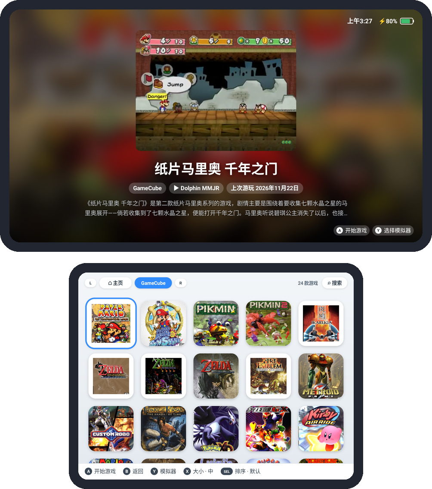
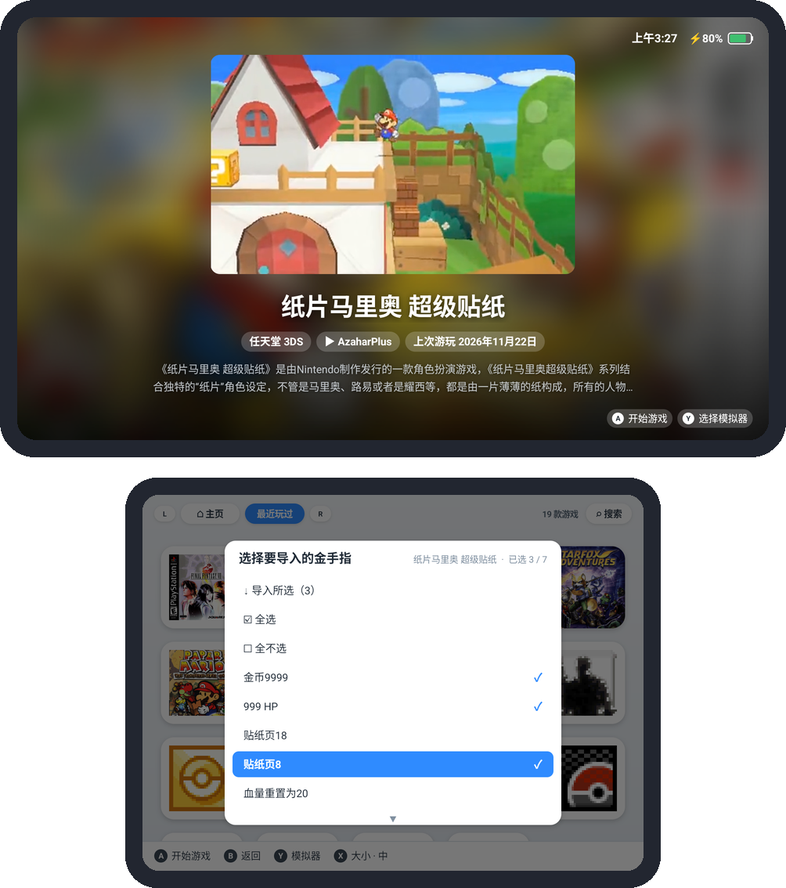

<p align="center"></p>

# Duo Launcher

<p align="center"><a href="README.md">English</a> · <b>Français</b> · <a href="README.zh-CN.md">简体中文</a> · <a href="README.zh-TW.md">繁體中文</a> · <a href="README.ja.md">日本語</a> · <a href="README.ko.md">한국어</a> · <a href="README.es.md">Español</a> · <a href="README.de.md">Deutsch</a> · <a href="README.it.md">Italiano</a> · <a href="README.pt.md">Português</a> · <a href="README.ru.md">Русский</a></p>

Un launcher de jeux à deux écrans pour la **Retroid Pocket Duo** et les autres consoles portables Android dotées d'un second écran, dans l'esprit du menu d'accueil de la 3DS.
Indiquez-lui vos dossiers de ROM : il trouve les jeux, les range par console, par genre et par série, les affiche sur l'écran du bas avec leurs illustrations sur celui du haut, et lance chaque jeu dans l'émulateur de votre choix.

**Téléchargement :** le dernier APK se trouve sur la [page des versions](https://github.com/GenKnot/DuoLauncher/releases/latest) (Android 11 ou plus récent). Installer une nouvelle version par-dessus l'ancienne conserve tous les réglages et votre temps de jeu.

## Pourquoi encore un launcher ?

Duo Launcher est né comme le launcher d'un joueur pour une console, et il évolue toujours à partir de la façon dont cette console sert vraiment au quotidien. Quelques idées le traversent de bout en bout :

- **Deux écrans, deux rôles.** L'écran du bas sert à choisir : de grands dossiers, une grille, une liste, des menus. L'écran du haut sert à regarder : la console sur son propre fond illustré, le logo d'un jeu sur sa jaquette, un aperçu vidéo, votre temps de jeu, une note pour vous-même ou une conversation avec l'IA. Rien n'a à partager la place avec autre chose.
- **La manette d'abord.** Tout fonctionne sans toucher l'écran : un clavier pensé pour la croix directionnelle, des directions qu'on maintient pour continuer à défiler, L / R pour tourner les pages, L maintenu pour chercher à la voix, R maintenu pour parler à l'IA. Le tactile marche aussi, mais il n'est jamais obligatoire.
- **Votre bibliothèque, telle qu'elle est déjà.** Il lit les métadonnées et les images Pegasus et ES-DE que vous avez peut-être déjà, range ses propres ajouts dans son dossier `DuoLauncher` et ne réécrit jamais les fichiers d'un autre frontend.
- **Une IA qui travaille pour vous, avec votre clé.** Traduction, classement, images, conseils et conversation passent par le service que *vous* choisissez et payez directement. Les clés restent sur la console, et chaque requête est comptée dans les paramètres avec un coût estimé : rien ne tourne dans votre dos.
- **Tout se modifie, se masque ou se partage.** Chaque tuile de l'accueil peut être renommée, changer de couleur, recevoir une nouvelle image, être déplacée ou masquée. Toute votre configuration peut être exportée dans un seul fichier et passée à un ami – sans vos clés ni votre historique de jeu.

Suggestions et rapports de bugs sont les bienvenus sur le [suivi des tickets](https://github.com/GenKnot/DuoLauncher/issues).

## Points forts

- **Deux écrans, un seul launcher** – on choisit sur l'écran du bas ; on voit logos, jaquettes, aperçus vidéo, temps de jeu et descriptions sur celui du haut.
- **Tous les émulateurs au même endroit** – 3DS, NDS, GBA, GB/GBC, NES, SNES, N64, GameCube, Wii, Mega Drive, PS1, PS2, PSP, PS Vita et Switch, avec un émulateur choisi par console ou par jeu. Les jeux sur plusieurs disques n'apparaissent qu'une fois.
- **Rangé pour vous** – chaque jeu est classé dans l'un des 14 genres et dans sa série (Ys, Castlevania, Super Robot Wars …). L'accueil présente votre bibliothèque par console, par genre ou par série, et des dossiers intelligents tiennent à jour « Ajoutés récemment », « En cours », « À faire », « Terminé » et « Les mieux notés ».
- **Un compagnon IA** – maintenez R n'importe où et parlez : il vous conseille parmi vos propres jeux, explique comment passer un passage difficile, raconte une histoire ou discute, tout simplement. Les réponses peuvent être lues à voix haute.
- **Les codes de triche, bien gérés** – des milliers de codes prêts à l'emploi pour la 3DS, la NDS, la PSP, la GBA et tous les systèmes RetroArch, traduits dans votre langue d'une pression, modifiables et partagés entre émulateurs.
- **Complète ce qui manque** – de vraies jaquettes tirées des collections de vignettes libretro, les titres officiels en anglais, et des jaquettes, logos et fonds dessinés par IA dans le style du launcher.
- **Pensé pour une console portable** – économiseur d'écran sans risque pour l'OLED, transfert Wi-Fi depuis un navigateur, sauvegarde des parties, statistiques de jeu, progression RetroAchievements, vue d'ensemble du stockage, et un écran d'accueil prêt en une seconde.
- **À votre goût** – thèmes de couleurs et packs de thèmes, modes clair et sombre, taille du texte, marge des jaquettes, une page de paramètres comme sur une console, et des configurations à exporter et partager. 11 langues d'interface.

## Captures d'écran

<p align="center"></p>

<table>
  <tr>
    <th>Réglages façon 3DS</th>
    <th>Réglages en mode sombre</th>
  </tr>
  <tr>
    <td></td>
    <td></td>
  </tr>
  <tr>
    <th>Utilisation et coût de l'IA</th>
    <th>Exporter et importer la configuration</th>
  </tr>
  <tr>
    <td></td>
    <td></td>
  </tr>
  <tr>
    <th colspan="2">Illustrations dessinées pour le mode sombre</th>
  </tr>
  <tr>
    <td colspan="2" align="center"></td>
  </tr>
  <tr>
    <th>Accueil par genre, avec les icônes de genre en pâte à modeler</th>
    <th>Accueil par série</th>
  </tr>
  <tr>
    <td></td>
    <td></td>
  </tr>
  <tr>
    <th>Genre et série sur la page du jeu</th>
    <th>Note, Demander à l'IA, statut, comment jouer, sauvegardes</th>
  </tr>
  <tr>
    <td></td>
    <td></td>
  </tr>
  <tr>
    <th>Clavier à la manette ; les titres anglais marchent aussi</th>
    <th>Demander à l'IA à quoi jouer</th>
  </tr>
  <tr>
    <td></td>
    <td></td>
  </tr>
  <tr>
    <th>Outils IA : séries, suggestions, stockage, rappel de pause</th>
    <th>Stockage : taille par console, gros jeux jamais lancés</th>
  </tr>
  <tr>
    <td></td>
    <td></td>
  </tr>
  <tr>
    <th>Page du jeu avec aperçu vidéo</th>
    <th>Logo, jaquette ou vidéo, jeu par jeu</th>
  </tr>
  <tr>
    <td></td>
    <td></td>
  </tr>
  <tr>
    <th>Vue en liste</th>
    <th>Statistiques de jeu</th>
  </tr>
  <tr>
    <td></td>
    <td></td>
  </tr>
  <tr>
    <th>Thèmes de couleurs</th>
    <th>Les couleurs du thème s'appliquent aux fonds</th>
  </tr>
  <tr>
    <td></td>
    <td></td>
  </tr>
  <tr>
    <th>Mode sombre</th>
    <th>Mode sombre</th>
  </tr>
  <tr>
    <td></td>
    <td></td>
  </tr>
  <tr>
    <th>Transfert Wi-Fi</th>
    <th>Outils de rangement</th>
  </tr>
  <tr>
    <td></td>
    <td></td>
  </tr>
  <tr>
    <th>GameCube, avec Dolphin</th>
    <th>Maintenir A pour déplacer un dossier</th>
  </tr>
  <tr>
    <td></td>
    <td></td>
  </tr>
  <tr>
    <th>Choisir les codes avant l'import, noms traduits</th>
    <th>Détails du jeu : taille, disques, captures</th>
  </tr>
  <tr>
    <td></td>
    <td></td>
  </tr>
  <tr>
    <th>Codes 3DS, traduits d'une pression</th>
    <th>Codes NDS pour DraStic, base de données chinoise</th>
  </tr>
  <tr>
    <td></td>
    <td></td>
  </tr>
  <tr>
    <th>Codes RetroArch (GBA)</th>
    <th>Modifier, ajouter, télécharger</th>
  </tr>
  <tr>
    <td></td>
    <td></td>
  </tr>
  <tr>
    <th>Renommer ou supprimer un code</th>
    <th>Traduire tous les codes d'un coup</th>
  </tr>
  <tr>
    <td></td>
    <td></td>
  </tr>
  <tr>
    <th>Économiseur d'écran (sans risque pour l'OLED)</th>
    <th>11 langues</th>
  </tr>
  <tr>
    <td></td>
    <td></td>
  </tr>
</table>

## Prise en main

1. **Installez l'APK** depuis la [page des versions](https://github.com/GenKnot/DuoLauncher/releases/latest) et ouvrez-le.
2. **Choisissez une langue**, puis accordez les autorisations demandées, toutes regroupées sur une seule page : l'accès aux fichiers (pour trouver vos jeux), l'accès aux données d'utilisation (pour que le temps de jeu ne compte que le temps où un jeu est vraiment à l'écran) et, si vous le souhaitez, le rôle d'écran d'accueil. Vous pouvez revenir à cette page à tout moment dans « Paramètres → Système → Autorisations ».
3. **Laissez-le trouver vos jeux.** Tout dossier `Roms` sur le stockage interne ou une carte SD est détecté tout seul. D'autres dossiers s'ajoutent dans « Paramètres → Accueil et bibliothèque → Dossiers de jeux ». Les consoles sont reconnues d'après le nom des dossiers (`gba`, `Nintendo DS`, `psx` …) et l'extension des fichiers.
4. **Choisissez les émulateurs** là où vous voulez autre chose que celui par défaut : appuyez sur Y sur un dossier de console pour toute la console, ou sur un jeu pour ce jeu seulement. Seuls les émulateurs installés sont proposés.
5. **Facultatif : ajoutez une clé d'IA** dans « Paramètres → IA et voix » – sur la console, ou plus confortablement depuis un ordinateur ou un téléphone en Wi-Fi (« Paramètres → Sauvegardes, transfert, partage → Transfert Wi-Fi »). Tout, sauf les fonctions d'IA, marche sans.
6. **Facultatif : faites-en votre écran d'accueil** (« Paramètres → Système → Définir comme écran d'accueil (au démarrage) ») pour qu'il se lance au démarrage de la console. La tuile « Accueil Android » ramène toujours à l'écran d'accueil du système.

## Les bases

**L'accueil** (écran du bas) contient vos dossiers de consoles et quelques tuiles intégrées : « Continuer » (pour reprendre directement le dernier jeu), « Joués récemment », « Favoris », « Nouveau dossier », « Rechercher », « Statistiques », « Stockage », « À quoi jouer ? », « Paramètres » et « Accueil Android ». SELECT fait basculer l'accueil entre consoles, genres et séries.

**Un dossier** affiche ses jeux sous forme de grille de jaquettes. X réduit la taille des jaquettes, et une pression de plus transforme la grille en liste avec les noms, le temps de jeu et la date de la dernière partie. SELECT trie (« Par défaut », « Nom », « Joués récemment », « Les plus joués ») et peut n'afficher que les versions en chinois simplifié, en chinois traditionnel ou en anglais. L2 / R2 sautent à l'initiale précédente ou suivante – les titres chinois comptent selon l'initiale de leur pinyin.

**L'écran du haut** suit ce qui est sélectionné : une console sur son fond, avec son nombre de jeux et son émulateur ; le logo d'un jeu sur sa jaquette floutée, avec sa console, son genre · sa série, son émulateur, son temps de jeu et une courte description, un aperçu vidéo au bout d'un instant, ou l'image de l'endroit où vous vous étiez arrêté.

**Y** ouvre le menu de ce qui est sélectionné – sur un jeu : émulateur, favori, dossiers, codes de triche, détails, genre, note, demander à l'IA, statut et note sur cinq, comment jouer, sauvegardes, ce que montre l'écran du haut, masquer. Sur un dossier de console : émulateur par défaut, renommer, fusionner des dossiers, masquer. Sur une tuile intégrée : nom, couleur, icône et fond.

### Commandes

| Bouton | Action |
|---|---|
| Croix / stick gauche | Se déplacer ; maintenir pour continuer |
| Gauche / droite, L / R dans une liste ou un menu | Une page à la fois |
| A | Ouvrir / jouer ; maintenir A sur un dossier de l'accueil pour le prendre et le déplacer |
| B | Retour |
| L / R | Console précédente / suivante (dans les paramètres : catégorie) |
| Maintenir L | Recherche vocale |
| Maintenir R | Parler à l'IA |
| L2 / R2 | Initiale précédente / suivante |
| X | Taille des jaquettes, puis vue en liste |
| Y | Menu du jeu, du dossier ou de la tuile sélectionné |
| START | Paramètres (depuis n'importe où sur l'accueil, même si la tuile « Paramètres » est masquée) ; dans un menu, comme A |
| SELECT | Sur l'accueil : consoles / genres / séries ; dans un dossier : tri et filtre de langue |
| R3 | Recherche |
| Dans le clavier de recherche | A saisit, B efface, X espace, Y clavier système, SELECT vide le champ, START ou R3 valide, maintenir L pour parler |
| Dans la discussion avec l'IA | Maintenir R pour parler, Y pour écrire, X pour une nouvelle discussion, SELECT pour l'historique, L2 / R2 pour remonter, B pour fermer ; la croix et A choisissent parmi les jeux en dessous |

Tout marche aussi au toucher : touchez pour sélectionner, touchez encore pour ouvrir, faites glisser pour défiler, et touchez les pastilles en haut à la place de L, R, X, SELECT ou de la recherche. A/B et X/Y peuvent être inversés pour une validation façon Nintendo ou Xbox (« Paramètres → Jeu → Boutons »).

## Votre bibliothèque

- **Trouve vos jeux tout seul.** Le stockage interne et les cartes SD sont fouillés à la recherche de dossiers `Roms` ; d'autres s'ajoutent dans « Paramètres → Accueil et bibliothèque → Dossiers de jeux ». La dernière analyse est mise en cache : l'accueil est prêt en une seconde, et l'analyse suivante tourne discrètement en arrière-plan.
- **Consoles** – 3DS, NDS, GBA (ainsi que les dossiers GBA vibration et GBA modifiés), GBC, GB, NES, SNES, N64, GameCube, Wii, Mega Drive, PlayStation 1/2/3, PSP, PS Vita et Switch, avec aussi des illustrations pour PS4, PS5, Xbox 360 et Xbox Series.
- **Les jeux multi-disques n'en font qu'un.** `Disc A/B`, `Disc 1/2`, `CD1/CD2`, `(Disc 2 of 3)` dans un même dossier, ou une liste `files:` de Pegasus, deviennent une seule entrée. RetroArch et DuckStation reçoivent une playlist `.m3u` des disques, pour changer de disque en cours de partie.
- **Jeux et applications Android** – les jeux installés ont automatiquement leur propre dossier ; les autres applications (vidéo, navigateur …) peuvent être ajoutées à un dossier « Applications ».
- **Fonctionne avec ce que vous avez déjà.** Il lit le `metadata.pegasus.txt` de Pegasus, le `gamelist.xml` et le `downloaded_media` d'ES-DE / EmulationStation, les vignettes de RetroArch, et les dossiers `media/`, `covers/` et `images/` placés à côté des jeux. Rien chez eux n'est modifié ; les ajouts du launcher vont dans son propre dossier `DuoLauncher` (voir [Vos propres infos de jeu](#vos-propres-infos-de-jeu)).
- **Repère les nouveaux jeux.** Copiez des jeux sur la carte et la prochaine analyse les trouve ; ils portent un badge NEW pendant une semaine (ou jusqu'à ce que vous y jouiez), et le launcher propose de les classer par genre et par série. Cette question peut être désactivée. Y → « Marquer comme vu » retire le badge d'un jeu ; « Tout marquer comme vu » (Y sur une console ou un dossier, ou « Paramètres → Accueil et bibliothèque ») en retire beaucoup d'un coup, et l'interrupteur « Badges NEW » au même endroit les supprime complètement.
- **Fusionner des dossiers.** Deux dossiers de la même console situés à des endroits différents (deux dossiers PS1, par exemple) peuvent s'afficher comme un seul : Y → « Fusionner les dossiers » sur une console. Chaque jeu garde son émulateur, les dossiers de même nom fusionnent d'eux-mêmes, et « Séparer » annule l'opération.
- **Vos propres dossiers.** La tuile « Nouveau dossier » crée un dossier avec son nom, sa couleur, son icône et son fond. Ajoutez-y n'importe quel jeu ou application avec Y, et retirez-le avec Y → « Retirer de ce dossier ».
- **Les dossiers intelligents** se remplissent tout seuls : « Ajoutés récemment » (les 30 derniers jours), « Jamais joués », « Les plus joués », « En cours », « À faire », « Terminé » et « Les mieux notés ». Y sur l'un d'eux affiche sa règle.
- **Continuer et favoris.** La première tuile de l'accueil relance directement le dernier jeu. Ajoutez des jeux aux favoris avec Y pour les retrouver dans un dossier « Favoris ».
- **Masquez ce à quoi vous ne jouez pas** – un dossier de console, ou un seul jeu ou une seule application (Y → « Masquer ce dossier » ou « Masquer ce jeu ») ; faites-les réapparaître dans « Paramètres → Accueil et bibliothèque ».
- **Votre catalogue.** Après chaque analyse, toute la bibliothèque est écrite dans `DuoLauncher/catalog.tsv` (console, fichier, titre, titre anglais, genre, série, temps de jeu, statut, note) – pour un tableur, d'autres outils ou l'IA.

### Genres et séries

Parcourir deux mille jeux uniquement par console finit par lasser, alors chaque jeu reçoit aussi l'un des 14 genres (RPG, action, aventure, plateforme, tactique, stratégie, tir, réflexion, course, sport, combat, simulation, party et musique, autres) et sa série.

- **D'abord ce que le launcher sait déjà.** Une table intégrée (`assets/gamedb.tsv`, 3 860 noms de fichiers couvrant tous les jeux des listes des packs G de Pegasus pour ces consoles, avec à la fois les noms `.iso` et `.cso` quand un pack contient les deux) connaît déjà le genre, la série et le titre officiel anglais des sets de ROM courants, d'après la console et le nom de fichier. Les jeux qu'elle connaît n'ont besoin ni d'IA ni d'Internet.
- **L'IA pour le reste.** « Paramètres → IA et voix → IA : classer par genre » et « IA : séries de jeux » classent les jeux restants, et les résultats sont gardés sur la carte dans `DuoLauncher/<console>/genres.txt` et `series.txt` : c'est fait une fois pour toutes et ça survit aux réinstallations. Les genres déjà écrits par Pegasus ou ES-DE (« Action RPG », « 角色扮演 » …) sont ramenés aux 14 genres.
- **À la main** – Y → « Genre » sur n'importe quel jeu.
- **À l'écran.** L'écran du haut affiche le genre · la série d'un jeu, et SELECT sur l'accueil transforme les dossiers en genres ou en séries. Les noms de séries suivent la langue de l'interface.

### Recherche

R3, la tuile « Rechercher » ou le bouton de recherche ouvre sur l'écran du haut un clavier pensé pour la croix directionnelle, avec vos recherches récentes et une rangée de genres au-dessus ; les résultats remplissent l'écran du bas au fil de la saisie. Les titres chinois se trouvent par leur pinyin, ses initiales et le début de chaque syllabe (`kdyg`, `mlao` → 马里奥), et chaque jeu répond aussi à son titre officiel anglais : `zelda` trouve 塞尔达传说. Ouverte depuis une console, la recherche se limite à cette console, avec un bouton « Toutes les plateformes » pour l'élargir. Maintenez L pour dire un nom au lieu de le taper.

### Des images qui se complètent toutes seules

- **De vraies jaquettes** – « Paramètres → Ranger → Télécharger les jaquettes » récupère les jaquettes dans les collections de vignettes libretro. Les jeux NDS et GBA sont reconnus grâce au code du jeu inscrit dans la ROM (ROM zippées comprises, avec les écrans titres), si bien que les fichiers traduits ou renommés trouvent quand même leurs images ; les jeux PlayStation 1/2, PSP, N64, GameCube, Wii, 3DS, GB/GBC, NES, SNES et Mega Drive sont reconnus par leur titre anglais.
- **Des icônes tirées directement des ROM** – les icônes de bannière NDS et les icônes SMDH de la 3DS ; les titres 3DS installés affichent leur nom dans la langue de l'interface.
- **Des jaquettes qui s'accordent** – les jaquettes remplissent leurs tuiles, ou ont toutes la même petite, moyenne ou grande marge (« Paramètres → Apparence et son → Marge des jaquettes ») ; les cadres blancs incrustés dans les images de jaquette sont rognés.
- **Des images par IA** – avec une clé d'image, des jaquettes, des logos de titre et des fonds peuvent être dessinés pour les jeux qui n'en ont pas (Y → « Détails » → « Créer une jaquette avec l'IA », ou toute une console d'un coup dans « Paramètres → IA et voix → Images IA »). Voir [IA](#ia).

## Jouer

- **Un émulateur par jeu ou par console** (Y). Seuls les émulateurs installés sont proposés :

  | Console | Émulateurs (le premier est celui par défaut) |
  |---|---|
  | 3DS | AzaharPlus, Azahar, Citra MMJ, Citra MMJ (mode performance) |
  | NDS | DraStic, DraStic (plain path), RetroArch · melonDS DS |
  | GB / GBC | RetroArch · Gambatte, mGBA |
  | GBA | RetroArch · mGBA, gpSP, gpSP Rumble |
  | NES | RetroArch · FCEUmm, Mesen |
  | SNES | RetroArch · Snes9x |
  | Mega Drive | RetroArch · Genesis Plus GX, PicoDrive |
  | N64 | RetroArch · Mupen64Plus-Next, Mupen64Plus FZ |
  | GameCube / Wii | Dolphin MMJR, Dolphin |
  | PS1 | RetroArch · PCSX ReARMed, SwanStation, DuckStation |
  | PS2 | ARMSX2, AetherSX2 |
  | PSP | PPSSPP, RetroArch · PPSSPP |
  | PS Vita | Vita3K (par ID de titre, par exemple un fichier nommé `PCSE00000.psvita` ou dont le nom le contient) |
  | Switch | Eden |

- **Citra MMJ (mode performance)** – la même version de Citra MMJ, réempaquetée sous le nom de paquet du benchmark AnTuTu, que beaucoup de systèmes Android font tourner à pleine fréquence. Elle n'est proposée que si ce paquet est bien Citra.
- **Temps de jeu et statistiques** – combien de temps vous avez joué à chaque jeu et quand pour la dernière fois, à la manière de la Switch ; avec l'accès aux données d'utilisation, seul le temps où le jeu était vraiment à l'écran est compté. La tuile « Statistiques » affiche le total, la semaine en cours jour par jour, le temps par console et les jeux les plus joués.
- **Là où vous vous étiez arrêté** – la capture d'écran ou l'image de sauvegarde d'état la plus récente d'un jeu devient son fond sur l'écran du haut.
- **Statut, note et mémo** – indiquez qu'un jeu est « En cours », « À faire », « Terminé » ou « Abandonné » et donnez-lui de une à cinq étoiles (Y → « Statut ») ; écrivez ou dictez une ligne sur l'endroit où vous en êtes et ce qu'il reste à faire (Y → « Note »). Tout cela s'affiche sur l'écran du haut la prochaine fois que vous reprenez le jeu.
- **Détails du jeu** (Y → « Détails ») – fichier, taille, disques, dossier, émulateur, temps de jeu, titre officiel anglais, et les captures d'écran du jeu sur l'écran du haut.
- **Aperçus vidéo et sons** – l'extrait vidéo d'un jeu démarre sur l'écran du haut au bout d'un instant (ou choisissez le logo ou la jaquette jeu par jeu : Y → « Écran du haut »). Les petits sons de l'interface et la musique de bannière propre à chaque jeu 3DS peuvent être coupés.
- **Quand un jeu ne démarre pas** – fichier manquant, émulateur non installé, émulateur incapable d'ouvrir ce type de fichier, ou jeu qui se ferme aussitôt : chaque cas affiche un message qui dit quoi faire.
- **Rappel de pause** (« Paramètres → Jeu ») – après une, deux ou trois heures sur un jeu, le launcher vous suggère une pause quand vous revenez.
- **RetroAchievements** – avec votre nom d'utilisateur et votre clé Web API : les jeux joués récemment avec leur progression de succès, et une étiquette 🏆 sur les jeux qui ont des succès.

## Votre compagnon IA

Tout ceci est facultatif et utilise le service d'IA de votre choix avec votre propre clé (voir [IA](#ia)).

- **Parlez-lui n'importe où.** Maintenez R sur l'accueil, dans un dossier ou dans le clavier de recherche et parlez – ou appuyez sur Y pour écrire. La conversation occupe l'écran du haut ; les jeux qu'elle recommande ou trouve remplissent celui du bas, prêts à être lancés avec A. Demandez à quoi jouer (« un RPG tranquille, pas trop long »), affinez (« quelque chose avec plus d'action »), demandez comment passer le passage du jeu sélectionné, posez une question sur une histoire ou un personnage, ou discutez, tout simplement. Elle se souvient de la conversation pendant une demi-heure.
  *Pourquoi :* c'est sur l'écran du bas qu'on choisit ses jeux, donc les suggestions de l'IA y atterrissent ; l'écran du haut reste libre pour la lecture. Et sur une console portable, maintenir une gâchette et parler va plus vite que n'importe quel menu.
- **Nouvelle discussion, historique enregistré.** X dans la discussion en commence une nouvelle ; SELECT liste les précédentes, la plus récente en haut, pour les rouvrir, les supprimer une par une ou toutes d'un coup (aussi dans « Paramètres → IA et voix → Historique des discussions IA »). Tant que la discussion est ouverte, les aperçus vidéo, les musiques de bannière 3DS et les sons des touches se taisent, et les réponses lues passent au volume multimédia.
  *Pourquoi :* une nouvelle question ne doit pas traîner l'ancien sujet, une réponse utile ne doit pas disparaître au redémarrage, et une réponse lue ne sert à rien si la bande-annonce d'un jeu passe par-dessus. L'historique reste sur la console, ne fait jamais partie d'une configuration exportée, et « Enregistrer les discussions IA » le désactive.
- **Réponses lues à voix haute** – « Paramètres → IA et voix → Réponses vocales de l’IA » : Soniox (avec sa propre clé) ou OpenAI (la clé d'image), avec le choix de la voix et du débit, et un bouton pour écouter un essai. Désactivé tant que vous ne l'activez pas.
- **À quoi jouer aujourd'hui** – Y sur la tuile « À quoi jouer ? » demande à l'IA de choisir six jeux de votre bibliothèque selon vos goûts, avec une raison pour chacun. Une simple pression sur la tuile en tire un au hasard, en privilégiant ceux auxquels vous n'avez jamais joué.
- **Poser une question sur un jeu** (Y → « Demander à l'IA ») – une question sur le jeu sélectionné, écrite ou dite à voix haute, avec la réponse sur l'écran du haut.
- **Comment jouer** (Y → « Comment jouer ») – les commandes (y compris les boutons valider / annuler inversés des versions japonaises) et les bases dont un débutant a besoin, rédigées une fois par jeu puis conservées.
- **Pas encore de clé ?** Maintenir R explique comment en ajouter une – sur la console, ou depuis un ordinateur en Wi-Fi.

## Codes de triche

Y → « Codes de triche » sur un jeu affiche la liste de ses codes ; A en active ou désactive un.

| | 3DS (Azahar, Citra) | NDS (DraStic) | PSP (PPSSPP) | RetroArch (GBA, GB, GBC, NES, SNES, N64, MD, PS1, …) |
|---|---|---|---|---|
| Où ils sont rangés | `azahar/cheats/` et `citra-emu/cheats/`, `<title ID>.txt` – écrits pour les deux, donc changer d'émulateur les conserve | la liste complète dans `DuoLauncher/cheats/NDS/` ; ceux qui sont activés vont dans les codes personnalisés de DraStic (`DraStic/cheats/<game file name>.cht`), qui marchent aussi pour les ROM traduites | `PSP/Cheats/<game ID>.ini`, les fichiers de codes de PPSSPP ; l'ID du jeu est lu dans l'ISO, le CSO ou l'EBOOT.PBP | `RetroArch/cheats/<core>/<game file name>.cht`, chargés par RetroArch au lancement du jeu |
| Déjà présents sur l'appareil | – | le `usrcheat.dat` de DraStic (en chinois sur les consoles Retroid), associé par le seul code du jeu, si bien que les ROM patchées ou traduites trouvent leurs codes même là où DraStic n'en affiche aucun | le `cheat.db` de PPSSPP et, sur les consoles Retroid, des fichiers de codes en chinois pour environ 4 300 jeux | Retroid fournit des codes en chinois pour des centaines de jeux (`000 中文金手指` et les dossiers des cores) ; un jeu sans fichier à lui en reçoit une copie, associée par le nom |
| Téléchargement | [Sharkive](https://github.com/FlagBrew/Sharkive), environ 650 jeux, par l'ID de titre lu dans la ROM | [libretro-database](https://github.com/libretro/libretro-database), environ 4 200 jeux, par le code du jeu dans l'en-tête de la ROM | [CWCheat-Database-Plus+](https://github.com/Saramagrean/CWCheat-Database-Plus-), environ 4 300 jeux, par l'ID du jeu | [libretro-database](https://github.com/libretro/libretro-database) pour la GBA, par le code du jeu dans l'en-tête de la ROM |

- **Choisir avant d'importer** – un téléchargement commence par lister ce qu'il a trouvé, déjà traduit, avec « Tout sélectionner » / « Tout désélectionner » ; seuls les codes cochés sont ajoutés. *Pourquoi :* une base peut contenir des dizaines de codes par jeu, alors que la plupart des joueurs n'en veulent que trois.
- **Traduire** – les noms de codes en anglais passent dans la langue de l'interface d'une pression, pour un jeu ou pour tous les jeux d'un coup (« Paramètres → Ranger »). Les codes courants viennent d'un glossaire intégré (无限血量, 金钱最大, 主代码 …) ; le reste passe par le service gratuit MyMemory, avec le point d'accès gratuit de Google en second essai. Les mentions de version (`v1.2`) et les indications de boutons (`(START+L)`) sont conservées, et le nom anglais d'origine reste dans le fichier en commentaire.
- **Traduire avec l'IA** – avec une clé d'IA, les codes d'un jeu sont envoyés au modèle avec le nom du jeu, pour qu'il reprenne les noms officiels des personnages et des objets (鬼神林克, 心之容器 …).
- **Modifier** – renommez ou supprimez n'importe quel code, supprimez d'un coup tous les codes d'un jeu, ou ajoutez les vôtres avec leurs lignes de code (les codes 3DS, NDS et PSP sont vérifiés au format `XXXXXXXX YYYYYYYY`).
- **Sans danger pour DraStic** – les patchs pour linkers (contournements anti-piratage, correctifs d'overlay et de Wi-Fi) sont exclus des téléchargements NDS, car DraStic plante quand ils sont activés, et 256 lignes de code au plus peuvent être actives en même temps, le maximum que DraStic sait charger.
- **Sans danger pour vos fichiers** – la première fois qu'un fichier de codes 3DS écrit à la main est modifié, l'original est conservé sous `.txt.bak`.
- **RetroArch, une fois pour toutes** – activez une seule fois dans RetroArch « Quick Menu → Cheats → Auto-Apply Cheats During Game Load » (en français dans RetroArch : « Menu rapide → Codes de triche », option d'application automatique au chargement du jeu), et les codes que vous activez ici sont actifs dès le démarrage du jeu.

## Apparence

- **L'écran du haut (1920×1080)** – chaque console sur son propre fond en papier découpé, ou le logo du jeu sélectionné sur sa jaquette floutée, avec des étiquettes et une courte description ; l'horloge et la batterie sont dans le coin.
- **L'écran du bas (1280×960)** – les dossiers de consoles, une grille de jaquettes zoomable et une vue en liste, avec en bas des aides aux touches qui restent courtes et laissent de côté ce qui ne rentre pas quand le texte est grand.
- **Thèmes** – sept palettes de couleurs, des couleurs personnalisées, et des packs de thèmes avec illustrations de consoles, fonds, police, sons et musique. Un thème colore aussi les fonds en dessin au trait de l'écran du haut. Voir [Thèmes](#thèmes).
- **Modes clair et sombre** – suit le système ou se règle à la main, avec une série de fonds dessinée pour chacun.
- **Tout sur l'accueil vous appartient.** Chaque tuile intégrée et chaque dossier de console peut être renommé, changer de couleur, recevoir son icône (une image à vous, ou une icône dessinée par le service d'images dans le style pâte à modeler du launcher), être déplacé (maintenir A, ou appui long) ou masqué, puis réaffiché dans « Paramètres → Accueil et bibliothèque → Dossiers masqués ». Les tuiles intégrées comme « Statistiques », « Stockage » et « À quoi jouer ? » peuvent aussi avoir leur propre fond sur l'écran du haut.
- **Apparence des consoles** – l'image de chaque console, son fond clair et son fond sombre ainsi que la couleur de son dossier peuvent être remplacés (« Paramètres → Apparence et son → Apparence des plateformes »). Un fond sombre peut être redessiné par le service d'images à partir du fond clair, pour que les deux restent toujours assortis.
- **Taille du texte** – quatre tailles, pour les deux écrans.
- **Économiseur d'écran** – après quelques minutes d'inactivité, l'écran du haut fait défiler vos jaquettes avec une horloge et l'écran du bas passe au noir. Le texte change de coin à chaque image et dérive lentement, pour que rien ne marque une dalle OLED.

## Paramètres et partage

- **Une page de paramètres comme sur une console.** START ouvre une seule page : les catégories à gauche (« Apparence et son », « Accueil et bibliothèque », « Jeu », « IA et voix », « Sauvegardes, transfert, partage », « Ranger », « Système »), les lignes de la catégorie choisie à droite avec leurs valeurs actuelles et leurs interrupteurs, et sur l'écran du haut la version, l'espace libre de chaque support et les services d'IA actifs. L / R changent de catégorie.
- **Partagez votre configuration.** « Paramètres → Sauvegardes, transfert, partage → Exporter ma configuration » écrit un seul zip avec tous les réglages (apparence, disposition et ordre de l'accueil, dossiers, éléments masqués, choix d'émulateurs, services d'IA) et vos propres images. « Importer une configuration » en récupère une dans `DuoLauncher/exports` ou dans le dossier Download – qu'elle soit arrivée par Wi-Fi, par une messagerie ou sur une carte.
  *Pourquoi on peut la partager sans crainte :* les clés, les mots de passe et l'historique de jeu n'entrent jamais dans une configuration, en importer une conserve les vôtres, et une de vos clés n'est jamais envoyée vers une adresse venue de la configuration de quelqu'un d'autre.
- **11 langues** – 简体中文, 繁體中文, English, 日本語, 한국어, Français, Español, Deutsch, Italiano, Português, Русский.

## Outils pratiques

- **Transfert Wi-Fi** – « Paramètres → Sauvegardes, transfert, partage → Transfert Wi-Fi » affiche une adresse et un code PIN. Ouvrez l'adresse dans un navigateur sur le même réseau, saisissez le PIN et déposez vos ROM ou vos packs de thèmes directement dans n'importe quel dossier de console. La même page contient les réglages d'IA, de voix et de RetroAchievements, protégés par un mot de passe admin (six chiffres aléatoires, ou le vôtre), pour coller les longues clés depuis un ordinateur. L'écran de la console reste allumé pendant le transfert, car la page n'est plus joignable une fois l'écran éteint.
- **Stockage** – une tuile de l'accueil montre le remplissage de la carte, et l'espace libre de chaque support sur l'écran du haut. À l'intérieur : la taille des jeux de chaque console, les plus gros jeux jamais lancés, et la suppression des fichiers d'un jeu (tous les disques, et les fichiers cités par un `.cue` ou un `.m3u`) après confirmation.
- **Sauvegarde des parties** – sauvegardez et restaurez les sauvegardes de DraStic, RetroArch, PPSSPP, AetherSX2, DuckStation, Mupen64Plus FZ, Azahar et Citra dans un seul zip, rangé dans `DuoLauncher/backups` sur la carte SD (sur le stockage interne s'il n'y a pas de carte). Après trois heures de jeu sans copie, le launcher vous le rappelle, ou en fait une tout seul si vous préférez (les dix copies automatiques les plus récentes sont gardées ; les vôtres ne sont jamais supprimées). Une restauration ne remplace chaque sauvegarde qu'une fois sa copie complète. Y → « Sauvegardes » copie et restaure un seul jeu à part.
- **Ranger** – trouver les jeux en double, lister les jeux sans images, télécharger les jaquettes manquantes, traduire tous les codes d'un coup, et une page de diagnostic ; les outils d'IA (noms et descriptions de toute une console, genres, séries, images, icônes de genre) se trouvent dans « IA et voix ».
- **Mises à jour** – « Paramètres → Système → À propos » vérifie la dernière version publiée sur GitHub une fois par jour et donne le lien.
- **Écran d'accueil** – définissez-le comme application d'accueil par défaut pour qu'il démarre avec la console ; la tuile « Accueil Android » (ou « Paramètres → Système → Quitter vers l'accueil Android ») ramène à l'écran d'accueil du système, et « Paramètres → Système → Paramètres Android » ouvre les paramètres du système.

## IA

Tout ce qui suit est facultatif et utilise votre propre compte. Les clés sont gardées dans les réglages du launcher, sur la console, et envoyées uniquement au service choisi. Saisissez-les dans « Paramètres → IA et voix », ou sur la page Wi-Fi depuis un ordinateur ou un téléphone.

- **Traduction IA** – DeepSeek, Qwen, OpenAI, Claude, Gemini ou toute adresse compatible OpenAI. C'est cette clé qui fait parler l'IA : la discussion, les suggestions de jeux, « Demander à l'IA », « Comment jouer », les genres et les séries, les noms de codes (tout un jeu en une requête), et les noms et descriptions de jeux dans votre langue (écrits dans les métadonnées du launcher avec le titre officiel anglais, pour qu'une bibliothèque de titres chinois se lise naturellement en anglais, et inversement). Sans clé, les codes sont traduits par des services gratuits.
- **Images IA** – une clé d'image OpenAI (le modèle d'image le plus récent auquel la clé a accès est choisi automatiquement). Jaquettes, logos de titre, fonds, images de consoles, icônes et fonds des dossiers et des tuiles, le tout dans le même style d'icônes en pâte à modeler et de papier découpé que les illustrations intégrées ; les icônes sont dessinées sur fond transparent pour que leurs parties blanches restent visibles. Une image prend environ une demi-minute. La même clé transforme votre voix en texte (`/audio/transcriptions`), puisque la console n'a pas de reconnaissance vocale à elle.
- **Réponses vocales de l’IA** – Soniox avec sa propre clé, ou OpenAI avec la clé d'image ; voix et débit (« Normal », « Rapide », « Très rapide » – « Rapide » par défaut, car les deux lisent le chinois lentement).
- **Utilisation et coût de l’IA** – chaque requête du launcher est comptée sur la console : requêtes, jetons, images et minutes de voix, avec un coût estimé pour aujourd'hui, cette semaine, ce mois-ci et au total. L'estimation s'appuie sur les tarifs publics des services pour ce que vous utilisez ; chaque prix peut être remplacé par le vôtre (autre modèle, revendeur, remise). C'est la facture de votre fournisseur qui fait foi.

## Vos propres infos de jeu

Placez un dossier `DuoLauncher` à la racine de la carte SD (ou du stockage interne) pour ajouter ou corriger des noms, des descriptions et des images sans toucher aux fichiers des autres frontends. Ce qui s'y trouve l'emporte sur Pegasus, ES-DE et les données du jeu lui-même.

```
DuoLauncher/
  3DS/metadata.txt
  3DS/media/<file name without extension>/logo.png   (also cover.png, background.png)
  NDS/metadata.txt
```

`metadata.txt` utilise le format Pegasus. Les entrées sont associées par `file:`, ou par `titleid:` pour les jeux 3DS installés dans un émulateur :

```
game: 勇者派遣会社
titleid: 0004000000065600
description: …
```

Les noms et les descriptions peuvent être donnés par langue avec `name.<language>:` et `description.<language>:` (`en`, `zh-CN`, `zh-TW`, `ja`, `ko`, `fr`, `es`, `de`, `it`, `pt`, `ru` ; `zh` couvre les deux chinois). Ils sont utilisés quand le launcher tourne dans cette langue, si bien qu'un même dossier peut servir à des joueurs de plusieurs langues :

```
game: 塞尔达传说 姆祖拉的假面
file: 塞尔达传说 姆祖拉的假面 汉化版.cci
name.en: The Legend of Zelda: Majora's Mask 3D
description.en: Link has three days before the moon falls on Termina…
```

## Thèmes

« Paramètres → Apparence et son → Thème » propose sept thèmes de couleurs intégrés (bleu, rouge, vert, violet, orange, rose, graphite), des **couleurs personnalisées** (choisissez une couleur principale et une couleur de fond ; toutes les nuances des modes clair et sombre en sont déduites), et tous les packs de thèmes installés. Un thème colore les deux écrans, y compris les fonds en dessin au trait de l'écran du haut.

Un pack de thèmes est un dossier (ou le `.zip` d'un dossier, décompressé à la première utilisation) placé dans `DuoLauncher/themes/` sur la carte SD ou le stockage interne. Tout est facultatif ; ce qu'un thème ne fournit pas vient de l'apparence intégrée, si bien qu'un thème peut se limiter à quelques couleurs.

```
DuoLauncher/themes/my-theme/
  theme.txt                      name, author, colours (see below)
  consoles/<type>.png            console pictures      (3ds, nds, gba, ..., recent, search, settings, custom)
  backgrounds/<type>.jpg         upper-screen backdrops
  backgrounds/dark/<type>.jpg    backdrops for dark mode
  logo.png
  font.ttf, font-bold.ttf
  sounds/move|open|back|launch.ogg   (or .wav / .mp3)
  music.ogg (or music.mp3)       loops on the home screen (Settings → Background music appears when a theme has music)
```

`theme.txt` se compose de lignes `key: value` : `color.<name>` pour le mode clair et `dark.color.<name>` pour le mode sombre, avec des noms comme `accent`, `shelf-top`, `shelf-bottom`, `card`, `text`, `pill`, `footer`, `backdrop-paper` / `backdrop-ink` (le dessin au trait de l'écran du haut) et `folder.<type>` pour les dossiers de l'accueil. `base-color: #RRGGBB` suffit à lui seul pour une palette complète. [themes/sakura](themes/sakura/theme.txt) est un exemple complet où chaque clé est expliquée. Le réglage « Musique de fond » n'apparaît dans les paramètres que lorsqu'un thème contient de la musique. « Paramètres → Sauvegardes, transfert, partage → Exporter le thème actuel » enregistre tout ce que vous avez configuré dans un zip placé dans `DuoLauncher/exports/`, que d'autres peuvent déposer dans leur propre dossier `themes/` ; vos propres images l'accompagnent dans `own/`.

## Compilation

Ni Android Studio ni Gradle ne sont nécessaires – seulement les outils en ligne de commande du SDK Android (build-tools 35, plateforme android-35) et un JDK 17 ou plus récent :

```powershell
powershell -File build.ps1            # builds DuoLauncher.apk
powershell -File build.ps1 -Install   # also installs over adb, grants file access and starts it
```

Une clé de signature de débogage (`debug.keystore`) est générée à la première compilation et n'est pas versionnée. `shot.ps1` envoie des pressions de touches via adb et enregistre des captures des deux écrans, ce qui est pratique quand on travaille sur l'interface.

## Illustrations

`assets/consoles/<type>.png` (icônes de consoles et de tuiles en pâte à modeler) et `assets/backgrounds/<type>.jpg` (fonds en papier découpé façon dessin au trait, avec leurs propres versions pour le mode sombre dans `backgrounds/dark/`) ont été créés pour ce projet. Les fonds sont en niveaux de gris, pour qu'un thème de couleurs puisse les teinter. Les consoles sans image se rabattent sur une console dessinée.

## Notes de lancement

- AzaharPlus n'accepte qu'une URI d'arborescence située sous un dossier auquel il a déjà accès :
  `content://com.android.externalstorage.documents/tree/<volume>%3ARoms%2F3DS/document/<volume>%3ARoms%2F3DS%2F<file>`
- Citra MMJ : `org.citra.emu/org.citra.emu.ui.EmulationActivity` avec `-e GamePath <path>`.
- Citra MMJ (mode performance) est la même version réempaquetée sous le nom `com.antutu.ABenchMark` ; beaucoup de versions d'Android font tourner ce nom de paquet à pleine fréquence CPU/GPU. Elle n'est proposée que si ce paquet contient vraiment Citra.
- DraStic, tel qu'il est fourni sur les consoles Retroid, attend `-e GAMEPATH "/sf<path>"` ; une variante « plain path » est proposée pour les versions d'origine.
- RetroArch : `com.retroarch.aarch64/...RetroActivityFuture` avec `-e ROM`, `-e LIBRETRO <core>` et `-e CONFIGFILE`. Le fichier de configuration indiqué dans la ligne de lancement est conservé : sur la Duo, le `retroarch.cfg` de RetroArch affiche en plein format les cadres par système de Retroid, alors que le `retroarch1920x1080.cfg` par écran de Retroid affiche les jeux en petit dans un cadre de télévision.
- Dolphin (MMJR et officiel) : `.../ui.main.MainActivity` avec `--es AutoStartFile <path>`.
- ARMSX2, AetherSX2, Eden, PPSSPP et Mupen64Plus FZ reçoivent le jeu sous forme de lien `content://com.duo.launcher.rom/...` en lecture seule, avec une autorisation de lecture ponctuelle : ils n'ont besoin d'aucun accès aux dossiers de leur côté.
- Vita3K : `org.vita3k.emulator/.Emulator` avec l'extra de type tableau de chaînes `AppStartParameters = ["-r", "<title ID>"]`.
- Les lignes de lancement présentes dans les métadonnées Pegasus sont utilisées telles quelles.

### Citra MMJ sur une console à deux écrans

Par défaut, Citra MMJ met l'écran tactile sur l'écran du haut. Pour avoir l'image principale en haut et masquer les boutons à l'écran, fermez Citra et réglez dans `/sdcard/citra-emu/config/config-mmj.ini` :

```ini
[Controls]
input_overlay_hide = True
[Layout]
landscape_swap_screen = True
```

## Retours

Duo Launcher se façonne selon la manière dont on s'en sert. S'il manque quelque chose, si un point n'est pas clair ou ne marche pas – ou si vous avez créé un thème qui mérite d'être partagé – ouvrez un [ticket](https://github.com/GenKnot/DuoLauncher/issues).

## Licence

[MIT](LICENSE)
