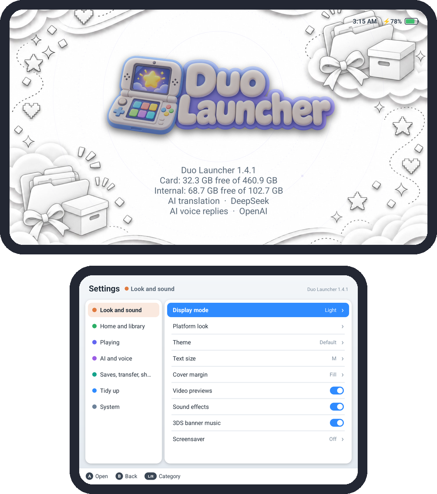
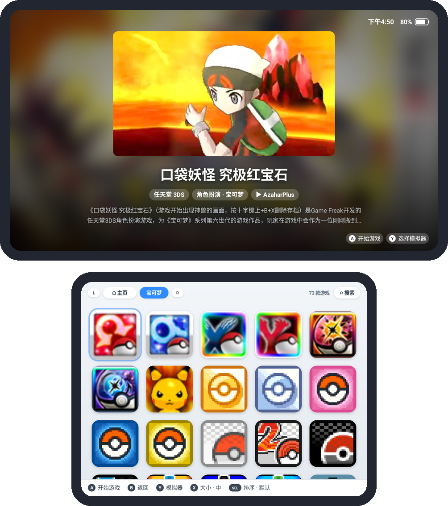

<p align="center"></p>

# Duo Launcher

<p align="center"><a href="README.md">English</a> · <a href="README.fr.md">Français</a> · <a href="README.zh-CN.md">简体中文</a> · <a href="README.zh-TW.md">繁體中文</a> · <a href="README.ja.md">日本語</a> · <a href="README.ko.md">한국어</a> · <a href="README.es.md">Español</a> · <a href="README.de.md">Deutsch</a> · <b>Italiano</b> · <a href="README.pt.md">Português</a> · <a href="README.ru.md">Русский</a></p>

Un launcher di giochi a doppio schermo per il **Retroid Pocket Duo** e le altre console portatili Android con un secondo display, sullo stile del menu Home del 3DS.
Gli indichi le cartelle delle ROM e lui trova i giochi, li ordina per console, genere e serie, li mostra sullo schermo inferiore con le immagini su quello superiore e avvia ogni gioco con l'emulatore che hai scelto.
Anche i trucchi sono già inclusi: se un gioco non ne ha sulla console, li scarica dai grandi database della community (Sharkive, libretro, CWCheat), ti lascia spuntare quelli che vuoi, traduce i nomi nella lingua dell'interfaccia con un tocco e li scrive dove l'emulatore li legge, così funzionano appena il gioco parte.

**Download:** l'APK più recente è nella [pagina delle release](https://github.com/GenKnot/DuoLauncher/releases/latest) (Android 11 o successivo). Installando una nuova versione sopra la vecchia mantieni tutte le impostazioni e il tempo di gioco.

## Perché un altro launcher?

Duo Launcher è nato come il launcher di un giocatore per una sola console portatile, e continua a crescere da come quella console si usa davvero. Si regge su quattro promesse:

1. **Funziona con la libreria che hai già**: qualunque frontend tu abbia usato per prepararla, non c'è niente da rifare. Oggi legge Pegasus ed ES-DE, e altri frontend sono in arrivo.
2. **L'IA quando la vuoi, come la vuoi**: diversi servizi tra cui scegliere, la tua chiave, un costo che vedi, e ogni funzione IA è facoltativa.
3. **Le faccende noiose le sbriga lui**: trucchi, immagini, traduzioni, copia dei file, riordino.
4. **Tutto si adatta a te**: una scelta per quasi ogni dettaglio, e tutto ciò che mostra qualcosa si può disattivare.

Oltre a trovare i tuoi giochi e avviarli, ecco cosa vogliono dire, in concreto, queste promesse:

- **Trucchi, dal download al primo fotogramma.** Quando un gioco non ha trucchi sulla console, li scarica dai grandi database della community (Sharkive per 3DS, libretro per NDS e GBA, CWCheat per PSP), ti lascia spuntare solo quelli che vuoi, ne traduce i nomi nella tua lingua con un tocco (con una chiave IA, perfino con i nomi ufficiali di personaggi e oggetti del gioco) e li scrive nei file dei trucchi di ciascun emulatore: Azahar e Citra, DraStic, PPSSPP e RetroArch. Vedi [Trucchi](#trucchi).
- **Un'IA che conosce la tua libreria.** Tieni premuto R e chiedi a cosa giocare dopo, come superare un boss o di cosa parla una storia: risponde partendo dai giochi che hai davvero. La stessa IA traduce nomi e descrizioni dei giochi, assegna ogni gioco a un genere e a una serie e disegna le copertine, i loghi e gli sfondi che mancano. Usa il servizio che scegli *tu*, con la tua chiave, e ogni richiesta viene contata nelle impostazioni con un costo stimato. Vedi [Il tuo compagno IA](#il-tuo-compagno-ia) e [IA](#ia).
- **Si configura dal telefono.** Attiva il trasferimento Wi-Fi e sullo schermo superiore compare un codice QR. Inquadralo e si apre una pagina nella lingua del tuo telefono, da cui puoi inviare giochi, scrivere le chiavi API su una tastiera vera, importare ed esportare configurazioni e scaricare i backup. Niente cavi, niente file manager. Vedi [Strumenti utili](#strumenti-utili).
- **Un solo posto per tutto ciò che va controllato.** «Problemi rilevati» raccoglie i file che non è riuscito a riconoscere, le console senza emulatore, i giochi senza copertina e i doppioni, e risolve quasi tutto lì per lì. Vedi [Strumenti utili](#strumenti-utili).
- **I dati di ogni frontend, usati e lasciati in pace.** Legge fianco a fianco metadati e immagini di Pegasus ed ES-DE, tiene le sue aggiunte nella sua cartella `DuoLauncher` e non riscrive mai i file di un altro frontend, così possono convivere tutti sulla stessa scheda. Vedi [Da dove arrivano nomi, immagini e dettagli](#da-dove-arrivano-nomi-immagini-e-dettagli).
- **Tuo da modificare, fin nei dettagli.** Temi di colore e pacchetti di temi da condividere, modalità chiara e scura, un'immagine e un colore a tua scelta per ogni riquadro, dimensione del testo, margini delle copertine, regole per ripulire i nomi, un ordine dei giochi tutto tuo, dove salvare i dati e Duo Lite per alleggerire ogni schermo. L'intera configurazione si può esportare in un unico file da passare a un amico, senza le tue chiavi e senza la tua cronologia di gioco. Vedi [Aspetto](#aspetto) e [Temi](#temi).
- **Ordinati per serie, non solo per console.** Ys, Castlevania, Super Robot Wars … ogni gioco finisce accanto al resto della sua serie e in uno dei 14 generi, grazie alla tabella dei giochi integrata o all'IA. Vedi [Generi e serie](#generi-e-serie).

E alcune idee che lo attraversano tutto:

- **Due schermi, due compiti.** Lo schermo inferiore serve a scegliere: cartelle grandi, una griglia, un elenco, i menu. Quello superiore serve a guardare: la console sul suo sfondo illustrato, il logo di un gioco sopra la copertina, un'anteprima video, quanto hai giocato, una nota per te stesso o una conversazione con l'IA. Nessuno deve dividere lo spazio con qualcos'altro.
- **Prima di tutto il gamepad.** Ogni funzione si usa senza toccare lo schermo: una tastiera pensata per la croce direzionale, direzioni che continuano a scorrere se le tieni premute, L / R per cambiare pagina, L tenuto premuto per cercare a voce, R tenuto premuto per parlare con l'IA. Il touch funziona lo stesso, solo che non è obbligatorio.

### Accanto ad altri frontend

| | Duo Launcher | Altri frontend |
|---|:-:|:-:|
| Trucchi scaricati, scelti, tradotti e preparati per ogni emulatore | ✅ | raro |
| IA integrata che conosce la tua libreria | ✅ | raro |
| Configurazione dal telefono via Wi-Fi, con un codice QR | ✅ | raro |
| «Problemi rilevati» | ✅ | raro |
| Dati di Pegasus ed ES-DE letti fianco a fianco | ✅ | raro |
| Giochi raggruppati per serie | ✅ | raro |
| Giochi raggruppati per genere | ✅ | comune |
| Elenco dei giochi e immagini su due schermi | ✅ | comune |
| Tempo di gioco e RetroAchievements | ✅ | comune |

Un quadro indicativo, in base a ciò che offrivano gli altri frontend a novembre 2026. Molti sono ottimi in quello su cui puntano; Duo Launcher mette semplicemente il suo impegno nelle cose qui sopra. Se qualcosa qui non è più aggiornato, segnalalo nell'[issue tracker](https://github.com/GenKnot/DuoLauncher/issues).

Suggerimenti e segnalazioni di bug sono benvenuti nell'[issue tracker](https://github.com/GenKnot/DuoLauncher/issues).

## In breve

- **Trucchi pronti all'uso**: migliaia di trucchi per 3DS, NDS, PSP, GBA e tutti i sistemi RetroArch, presi dalla console stessa o, se un gioco non ne ha, scaricati dai grandi database (Sharkive, libretro, CWCheat), dove spunti solo quelli che vuoi. I nomi si traducono nella tua lingua con un tocco, ogni trucco si può modificare e tutto viene scritto nei file dei trucchi dell'emulatore, quindi funziona appena il gioco parte.
- **Un compagno IA**: tieni premuto R ovunque e parla. Ti consiglia giochi della tua libreria, ti spiega come superare un punto difficile, ti racconta una trama o fa due chiacchiere. Le risposte possono essere lette ad alta voce.
- **Due schermi, un launcher**: scegli sullo schermo inferiore; su quello superiore vedi loghi, copertine, anteprime video, tempo di gioco e descrizioni.
- **Tutti gli emulatori in un posto solo**: 3DS, NDS, GBA, GB/GBC, NES, SNES, N64, GameCube, Wii, Mega Drive, PS1, PS2, PSP, PS Vita e Switch, più 22 console più vecchie tramite RetroArch (da Master System a Dreamcast, PC Engine, Neo Geo, WonderSwan, Atari, arcade, DOS…), con l'emulatore scelto per console o per singolo gioco. I giochi su più dischi compaiono come uno solo.
- **Già in ordine**: ogni gioco finisce in uno di 14 generi e nella sua serie (Ys, Castlevania, Super Robot Wars …). La Home mostra la libreria per console, per genere o per serie, e le cartelle smart tengono aggiornati «Aggiunti di recente», «In corso», «Da giocare», «Finito» e «I più votati».
- **Completa ciò che manca**: vere copertine dai set di miniature di libretro, titoli ufficiali in inglese e copertine, loghi e sfondi disegnati dall'IA nello stile del launcher.
- **Fatto per una portatile**: salvaschermo sicuro per gli OLED, trasferimento Wi-Fi dal browser, backup dei salvataggi, statistiche di gioco, progressi RetroAchievements, una panoramica dello spazio e una Home pronta in un secondo.
- **Tuo da modificare**: temi di colore e pacchetti di temi, modalità chiara e scura, dimensione del testo, margini delle copertine, una pagina delle impostazioni come quella di una console e configurazioni da esportare e condividere. 11 lingue dell'interfaccia.

## Screenshot

<p align="center"></p>

<table>
  <tr>
    <th>Impostazioni in stile 3DS</th>
    <th>Impostazioni in modalità scura</th>
  </tr>
  <tr>
    <td></td>
    <td></td>
  </tr>
  <tr>
    <th>Uso e costo dell'IA</th>
    <th>Esporta e importa la configurazione</th>
  </tr>
  <tr>
    <td></td>
    <td></td>
  </tr>
  <tr>
    <th colspan="2">Sfondi disegnati a mano per la modalità scura</th>
  </tr>
  <tr>
    <td colspan="2" align="center"></td>
  </tr>
  <tr>
    <th>Home per genere, con le icone dei generi in plastilina</th>
    <th>Home per serie</th>
  </tr>
  <tr>
    <td></td>
    <td></td>
  </tr>
  <tr>
    <th>Genere e serie nella pagina del gioco</th>
    <th>Nota, Chiedi all'IA, stato, come si gioca, salvataggi</th>
  </tr>
  <tr>
    <td></td>
    <td></td>
  </tr>
  <tr>
    <th>Tastiera per gamepad; trova anche i titoli inglesi</th>
    <th>Chiedi all'IA a cosa giocare</th>
  </tr>
  <tr>
    <td></td>
    <td></td>
  </tr>
  <tr>
    <th>Strumenti IA: serie, consigli, spazio, promemoria pausa</th>
    <th>Spazio: dimensione per console, giochi grandi mai giocati</th>
  </tr>
  <tr>
    <td></td>
    <td></td>
  </tr>
  <tr>
    <th>Pagina del gioco con anteprima video</th>
    <th>Logo, copertina o video, per ogni gioco</th>
  </tr>
  <tr>
    <td></td>
    <td></td>
  </tr>
  <tr>
    <th>Vista a elenco</th>
    <th>Statistiche di gioco</th>
  </tr>
  <tr>
    <td></td>
    <td></td>
  </tr>
  <tr>
    <th>Temi di colore</th>
    <th>I colori del tema arrivano fino agli sfondi</th>
  </tr>
  <tr>
    <td></td>
    <td></td>
  </tr>
  <tr>
    <th>Modalità scura</th>
    <th>Modalità scura</th>
  </tr>
  <tr>
    <td></td>
    <td></td>
  </tr>
  <tr>
    <th>Trasferimento Wi-Fi</th>
    <th>Strumenti per fare ordine</th>
  </tr>
  <tr>
    <td></td>
    <td></td>
  </tr>
  <tr>
    <th>GameCube, con Dolphin</th>
    <th>Tieni premuto A per spostare una cartella</th>
  </tr>
  <tr>
    <td></td>
    <td></td>
  </tr>
  <tr>
    <th>Scegli i trucchi prima di importarli, nomi già tradotti</th>
    <th>Dettagli del gioco: dimensione, dischi, screenshot</th>
  </tr>
  <tr>
    <td></td>
    <td></td>
  </tr>
  <tr>
    <th>Trucchi 3DS, tradotti con un tocco</th>
    <th>Trucchi NDS per DraStic, database cinese</th>
  </tr>
  <tr>
    <td></td>
    <td></td>
  </tr>
  <tr>
    <th>Trucchi RetroArch (GBA)</th>
    <th>Modifica, aggiungi, scarica</th>
  </tr>
  <tr>
    <td></td>
    <td></td>
  </tr>
  <tr>
    <th>Rinomina o elimina un trucco</th>
    <th>Traduci tutti i trucchi in una volta</th>
  </tr>
  <tr>
    <td></td>
    <td></td>
  </tr>
  <tr>
    <th>Salvaschermo (sicuro per OLED)</th>
    <th>11 lingue</th>
  </tr>
  <tr>
    <td></td>
    <td></td>
  </tr>
</table>

## Per iniziare

1. **Installa l'APK** dalla [pagina delle release](https://github.com/GenKnot/DuoLauncher/releases/latest) e aprilo.
2. **Segui la guida iniziale.** Al primo avvio una breve guida ti accompagna nella configurazione, una pagina alla volta:
   - **«Abbiamo trovato le tue impostazioni e i tuoi registri precedenti»**: compare per prima, e solo quando la copia automatica del launcher si trova su una memoria (dopo una reinstallazione, o su una console nuova con la stessa scheda). «Ripristinali» ti fa scegliere quali parti riportare, come in «Importa una configurazione»; «Ricomincia da zero» prosegue con la guida come sempre. Vedi [Impostazioni e condivisione](#impostazioni-e-condivisione).
   - **La lingua.**
   - **Le autorizzazioni**, tutte in un'unica pagina: l'accesso ai file (per trovare i giochi), l'accesso ai dati di utilizzo (così il tempo di gioco conta solo quando il gioco è davvero sullo schermo) e il ruolo di schermata Home, segnato come «facoltativo». La stessa pagina si trova anche in «Impostazioni → Sistema → Autorizzazioni».
   - **«Cosa è stato trovato»**: quante console e quanti giochi ha trovato la scansione, e dove ha cercato: la cartella `Roms` nella radice di ogni unità, più le cartelle che hai aggiunto tu. Se la scansione è ancora in corso, la pagina lo dice e si completa appena finisce. Una porta conduce a [«Problemi rilevati»](#strumenti-utili) per tutto quello che non è riuscita a sistemare.
   - **«IA (facoltativa)»**: cosa fanno le funzioni IA, e che quello che usi lo paghi al servizio che scegli. Poi «Inserisci le chiavi dal telefono (Wi-Fi)», «Configura sulla console» oppure «Più tardi».
   - **«I tasti»**: a cosa serve ognuno, in una sola pagina.

   Ogni pagina ha «Salta la guida», e B torna alla pagina precedente. «Impostazioni → Sistema → Rivedi la guida iniziale» la fa ripartire.
   *Perché:* i primi minuti decidono se il launcher ha senso, e chi è alle prime armi non dovrebbe leggersi questa pagina per arrivarci. Vedere subito quanti giochi sono stati trovati risponde anche alla prima domanda che si fanno tutti («ha trovato i miei giochi?»). Chi sa già cosa sta facendo può saltarla da qualsiasi pagina.
3. **Lascia che trovi i tuoi giochi.** Qualsiasi cartella `Roms` nella memoria interna o su una scheda SD viene rilevata da sola. Altre cartelle si aggiungono in «Impostazioni → Home e libreria → Cartelle dei giochi». Le console vengono riconosciute dai nomi delle cartelle (`gba`, `Nintendo DS`, `psx` …) e dalle estensioni dei file.
4. **Scegli gli emulatori** dove vuoi qualcosa di diverso da quello predefinito: premi Y su una cartella console per tutta la console, o su un gioco solo per quel gioco. Vengono proposti solo gli emulatori installati.
5. **Facoltativo: aggiungi una chiave IA** in «Impostazioni → IA e voce → Servizi IA e chiavi», direttamente sulla console o, più comodamente, da un computer o da un telefono via Wi-Fi («Impostazioni → Salvataggi, trasferimento, condivisione → Trasferimento Wi-Fi», oppure «Inserisci da computer o telefono (pagina Wi-Fi)» nello stesso menu). Tutto tranne le funzioni IA funziona anche senza.
6. **Facoltativo: rendilo la tua schermata Home** («Impostazioni → Sistema → Imposta come schermata Home») così parte insieme alla console. Il riquadro «Home di Android» riporta sempre alla schermata Home di sistema.

## Le basi

**La Home** (schermo inferiore) contiene le cartelle delle console e alcuni riquadri integrati: «Continua» (per tornare subito all'ultimo gioco), «Giocati di recente», «Preferiti», «Nuova cartella», «Cerca», «Statistiche», «Spazio», «A cosa giocare?», «Impostazioni» e «Home di Android». SELECT passa dalla vista per console a quella per genere o per serie.

**Una cartella** mostra i suoi giochi come una griglia di copertine. X rimpicciolisce le copertine e, premuto ancora, trasforma la griglia in un elenco con nomi, tempo di gioco e data dell'ultima partita. SELECT ordina (predefinito, nome, giocati di recente, più giocati) e può mostrare solo le edizioni in cinese semplificato, cinese tradizionale o inglese. L2 / R2 saltano alla lettera iniziale precedente o successiva; i titoli cinesi contano con l'iniziale del pinyin.

**Lo schermo superiore** segue quello che hai selezionato: una console sul suo sfondo con il numero di giochi e l'emulatore; il logo di un gioco sopra la copertina sfocata, con console, genere · serie, emulatore, tempo di gioco e una breve descrizione, dopo un attimo un'anteprima video oppure l'immagine del punto in cui ti eri fermato.

**Y** apre il menu dell'elemento selezionato. Su un gioco è corto, e le voci meno usate stanno una porta più in là: emulatore, preferito, aggiungi a / rimuovi da una cartella, Trucchi ›, Aiuto IA › (chiedi all'IA, come si gioca), Info sul gioco › (dettagli, genere, stato e voto, nota, cosa mostra lo schermo superiore, immagini IA per questo gioco) e Altro › (salvataggi, segna come visto, nascondi, elimina il file). Su una cartella console: emulatore predefinito, rinomina, Unisci cartelle ›, segna tutti come visti, nascondi. Su un riquadro integrato: nome, colore, icona e sfondo. La riga selezionata si spiega da sola con una frase in fondo al menu.

*Perché:* un menu da quindici righe è difficile da leggere su una console portatile. Le porte tengono davanti le voci di tutti i giorni, e il suggerimento di una riga evita di dover indovinare cosa fa una voce prima di premerla.

**Elimina il file** (Y → Altro) chiede prima conferma, con la dimensione e la precisazione che i salvataggi restano; il cursore parte da «Annulla», quindi una doppia pressione troppo rapida di A non cancella nulla. Di un gioco su più dischi se ne vanno tutti i file, e un gioco eliminato da un elenco di «Problemi rilevati» («Giochi doppi», per esempio) sparisce subito da quell'elenco.

*Perché:* i doppioni e i giochi che hai finito si tolgono senza computer.

**Suggerimenti che compaiono una volta sola.** La prima volta che una funzione è a portata di mano, compare una riga appena sopra la legenda dei tasti sullo schermo inferiore. Si vede una volta sola, e sparisce dopo circa nove secondi o quando premi un tasto (ma non nei primi due secondi circa, così non scompare prima che tu riesca a leggerla; il tasto fa comunque il suo lavoro). Per ora sono quattro:

- nella Home: tieni premuto A per prendere un riquadro e spostarlo, Y per le opzioni del riquadro;
- tornando alla Home dopo essere uscito da una cartella: SELECT mostra la Home per console, per genere o per serie;
- su un gioco in una cartella console, nell'ordine predefinito: tieni premuto A per spostare il gioco dove vuoi, Y per emulatore, trucchi, salvataggi e altro;
- nella cartella «Non riconosciuti»: premi A su un file per indicarne la console.

«Impostazioni → Sistema → Suggerimenti sulle novità» li disattiva, e «Mostra di nuovo tutti i suggerimenti» riporta quelli che hai già visto.
*Perché:* tenere premuto A per spostare, o SELECT nella Home, sono facili da non notare e difficili da indovinare. Una riga nel momento in cui puoi usarla si ricorda meglio di un manuale, e una volta basta: un suggerimento che torna di continuo diventa rumore.

### Comandi

| Tasto | Azione |
|---|---|
| Croce direzionale / stick sinistro | Muoversi; tieni premuto per continuare |
| Sinistra / destra, L / R in un elenco o menu | Una pagina alla volta |
| A | Apri / gioca; tieni premuto A per prendere e spostare una cartella della Home o un gioco dentro una cartella console |
| B | Indietro |
| L / R | Console precedente / successiva (nelle impostazioni: categoria) |
| Tieni premuto L | Ricerca vocale |
| Tieni premuto R | Parla con l'IA |
| L2 / R2 | Lettera iniziale precedente / successiva |
| X | Dimensione copertine, poi vista a elenco |
| Y | Menu del gioco, della cartella o del riquadro selezionato |
| START | Impostazioni (da qualunque punto della Home, anche con il riquadro «Impostazioni» nascosto); in un menu fa come A |
| SELECT | Nella Home: console / generi / serie; in una cartella: ordine e filtro per lingua |
| R3 | Cerca |
| Nella tastiera di ricerca | A scrive, B cancella, X spazio, Y tastiera di sistema, SELECT svuota, START o R3 per finire, tieni premuto L per parlare |
| Nella chat con l'IA | Tieni premuto R per parlare, Y per scrivere, X per una nuova chat, SELECT per la cronologia, L2 / R2 per scorrere indietro, B per chiudere; con la croce e A scegli tra i giochi sotto |

Tutto funziona anche al tocco: tocca per selezionare, tocca di nuovo per aprire, scorri con il dito e tocca le etichette in alto al posto di L, R, X, SELECT o Cerca. A/B e X/Y si possono scambiare per avere la conferma in stile Nintendo o Xbox («Impostazioni → Gioco → Tasti»).

## La tua libreria

- **Trova i giochi da solo.** Cerca cartelle `Roms` nella memoria interna e sulle schede SD; altre si aggiungono in «Impostazioni → Home e libreria → Cartelle dei giochi». L'ultima scansione resta in memoria, così la Home è pronta in un secondo e la scansione successiva gira in silenzio in background.
- **Console**: 3DS, NDS, GBA (con le cartelle GBA vibrazione e GBA modificati), GBC, GB, NES, SNES, N64, GameCube, Wii, Mega Drive, PlayStation 1/2/3, PSP, PS Vita e Switch, con le immagini anche per PS4, PS5, Xbox 360 e Xbox Series. Vengono riconosciute anche tutte le altre console del pacchetto Pegasus G: Virtual Boy, Master System, Game Gear, 32X, Mega-CD, Saturn, Dreamcast, NAOMI, PC Engine e la sua versione CD, PC-FX, Neo Geo CD, Neo Geo Pocket Color, WonderSwan e WonderSwan Color, Pokémon Mini, Atari Lynx, Atari 2600, Game & Watch, 3DO, DOS e arcade.
- **Giochi su più dischi come uno solo.** `Disc A/B`, `Disc 1/2`, `CD1/CD2`, `(Disc 2 of 3)` nella stessa cartella, oppure una lista `files:` di Pegasus, diventano una sola voce. RetroArch e DuckStation ricevono una playlist `.m3u` dei dischi, così puoi cambiare disco durante il gioco.
- **Giochi e app Android**: i giochi installati hanno automaticamente la loro cartella; qualsiasi altra app (video, browser …) si può aggiungere a una cartella «App».
- **Funziona con quello che hai già.** Legge `metadata.pegasus.txt` di Pegasus, `gamelist.xml` e `downloaded_media` di ES-DE / EmulationStation, le miniature di RetroArch e le cartelle `media/`, `covers/` e `images/` accanto ai giochi. Nessuno di questi file viene modificato; le aggiunte del launcher vanno nella sua cartella `DuoLauncher` (vedi [Le tue informazioni sui giochi](#le-tue-informazioni-sui-giochi)).
- **Si accorge dei giochi nuovi.** Copia dei giochi sulla scheda e la scansione successiva li trova; per una settimana (o finché non li giochi) portano l'etichetta NEW e ti viene proposto di ordinarli per genere e serie. La domanda si può disattivare. Y → «Segna come visto» toglie l'etichetta da un gioco; «Segna tutti come visti» (Y su una console o una cartella, oppure «Impostazioni → Home e libreria») la toglie da molti in una volta, e l'interruttore «Etichette NEW» lì le disattiva del tutto.
- **Unire cartelle.** Due cartelle della stessa console in posti diversi (due cartelle PS1, per esempio) si possono mostrare come una sola: Y → «Unisci cartelle» su una console. Ogni gioco mantiene il suo emulatore, le cartelle con lo stesso nome si uniscono da sole e «Separa» annulla l'unione.
- **Cartelle tue.** Il riquadro «Nuova cartella» crea una cartella con nome, colore, icona e sfondo propri. Ci aggiungi qualsiasi gioco o app con Y e lo togli con Y → «Rimuovi da questa cartella».
- **Le cartelle smart** si riempiono da sole: aggiunti di recente (ultimi 30 giorni), mai giocati, più giocati, in corso, da giocare, finiti e più votati. Y su una di esse mostra la sua regola.
- **Continua e preferiti.** Il primo riquadro della Home ti riporta subito nell'ultimo gioco. Segna i giochi con la stella tramite Y per raccoglierli nella cartella «Preferiti».
- **Nascondi quello che non giochi**: una cartella console, oppure un singolo gioco o app (Y → «Nascondi questo gioco»); li ritrovi in «Impostazioni → Home e libreria».
- **Ripulisci i nomi dei giochi.** I nomi presi pari pari dai file ROM spesso sono così: `0153 - Legend of Zelda, The - The Minish Cap (USA) [!]`. «Impostazioni → Home e libreria → Ripulisci i nomi dei giochi» ha sei interruttori, tutti spenti all'inizio: «Togli regione e lingue», «Togli versione e sigle di dump», «Togli il numero iniziale», «Trattini bassi e punti diventano spazi», «"Zelda, The" diventa "The Zelda"» e «Togli tutto ciò che è tra parentesi». Accanto a ogni interruttore c'è un esempio preso dalla tua libreria, con il nome prima e dopo, e «Vedi tutte le modifiche» elenca tutti i giochi che verrebbero rinominati. *Perché:* cambia solo il nome sullo schermo. I file sulla scheda restano esattamente come sono, quindi emulatori, salvataggi e altri frontend non ne risentono. I titoli che vengono da Pegasus, da ES-DE o da tue modifiche non vengono toccati, perché qualcuno li ha già scelti. Le sigle che distinguono un gioco dall'altro, come `(Beta)` o `(Hack)`, restano, a meno che tu non attivi l'interruttore delle parentesi.
- **Metti i giochi nel tuo ordine.** Dentro una cartella console, tieni premuto A su un gioco (o fai una pressione prolungata) per prenderlo, spostalo con la croce direzionale e rilascia per posarlo. L'ordine viene ricordato per quella console, resiste alle nuove scansioni e fa parte del backup completo. I giochi aggiunti in seguito finiscono al loro solito posto. Y sulla console → «Torna all'ordine originale» annulla tutto. Lo spostamento funziona solo con l'ordinamento predefinito e senza filtro per lingua, perché in un ordinamento per nome o per tempo di gioco il tuo ordine non avrebbe senso. *Perché:* i giochi a cui stai giocando adesso, o una serie in ordine di uscita, stanno bene tutti insieme in cima, e nessun ordinamento automatico può saperlo.
- **Il tuo catalogo.** Dopo ogni scansione l'intera libreria viene scritta in `DuoLauncher/catalog.tsv` (console, file, titolo, titolo inglese, genere, serie, tempo di gioco, stato, voto), da usare con un foglio di calcolo, con altri strumenti o con l'IA.

### Generi e serie

Sfogliare duemila giochi solo per console stanca presto, quindi ogni gioco riceve anche uno di 14 generi (gioco di ruolo, azione, avventura, piattaforme, tattico, strategia, sparatutto, rompicapo, corse, sport, picchiaduro, simulazione, party e musica, altro) e la sua serie.

- **Prima le conoscenze integrate.** Una tabella interna al launcher (`assets/gamedb.tsv`, 3.860 nomi di file che coprono tutti i giochi delle liste dei pacchetti Pegasus G per queste console, con sia il nome `.iso` sia quello `.cso` quando un pacchetto li ha entrambi) conosce già genere, serie e titolo ufficiale inglese dei set di ROM più comuni, per console e nome del file. I giochi che conosce non hanno bisogno né dell'IA né di internet.
- **L'IA per il resto.** «Impostazioni → IA e voce → Fai riordinare la libreria all’IA → IA: ordina per genere» / «IA: serie di giochi» sistema i giochi rimanenti, e i risultati restano in `DuoLauncher/<console>/genres.txt` e `series.txt` sulla scheda: si fa una volta sola e sopravvive alle reinstallazioni. I generi già scritti da Pegasus o ES-DE ("Action RPG", "角色扮演" …) vengono ricondotti ai 14 generi.
- **A mano**: Y → «Genere» su qualsiasi gioco.
- **Sullo schermo.** Lo schermo superiore mostra genere · serie di un gioco, e SELECT nella Home trasforma le cartelle in generi o serie. I nomi delle serie seguono la lingua dell'interfaccia.

### Ricerca

R3, il riquadro «Cerca» o il pulsante di ricerca aprono sullo schermo superiore una tastiera pensata per la croce direzionale, con le ricerche recenti e una fila di generi sopra; i risultati riempiono lo schermo inferiore mentre scrivi. I titoli cinesi si trovano con il pinyin, con le sue iniziali e con l'inizio di ogni sillaba (`kdyg`, `mlao` → 马里奥), e ogni gioco si trova anche con il suo titolo ufficiale inglese, quindi `zelda` trova 塞尔达传说. Se la apri dentro una console cerca solo in quella console, con un pulsante «Tutte le piattaforme» per allargare la ricerca. Tieni premuto L per dire un nome invece di scriverlo.

### Immagini che si completano da sole

- **Copertine vere**: «Impostazioni → Riordina → Scarica copertine» (anche in «Problemi rilevati», sotto «Giochi senza copertina») scarica le copertine dai set di miniature di libretro. I giochi NDS e GBA vengono riconosciuti dal codice del gioco dentro la ROM (anche le ROM zippate, con le schermate del titolo), così anche i file tradotti o rinominati trovano le loro immagini; i giochi PlayStation 1/2, PSP, N64, GameCube, Wii, 3DS, GB/GBC, NES, SNES e Mega Drive vengono riconosciuti dal titolo inglese. «Senza copertina» vuol dire la stessa cosa ovunque: il gioco non ha la copertina della confezione (un logo o uno sfondo da soli non contano), quindi «Problemi rilevati», «Scarica copertine» e il menu delle immagini IA mostrano lo stesso numero.
- **Icone prese direttamente dalle ROM**: le icone dei banner NDS e le icone SMDH del 3DS; i titoli 3DS installati mostrano il nome nella lingua dell'interfaccia.
- **Copertine uniformi**: le copertine riempiono il riquadro oppure stanno tutte con lo stesso margine piccolo, medio o grande («Impostazioni → Aspetto e suono → Margine copertine»); le cornici bianche presenti nelle immagini vengono tagliate.
- **Immagini IA**: con una chiave per le immagini, l'IA disegna copertina, sfondo e logo del titolo. Per un gioco: Y → «Info sul gioco» → «Immagini IA per questo gioco», che dice per ognuna se il gioco ce l'ha già; quella nuova sostituisce l'attuale, e il logo del titolo richiede il titolo inglese (lo trova «IA: nomi e descrizioni»). Per molti giochi: «Impostazioni → IA e voce → Fai riordinare la libreria all’IA → IA: disegna le immagini mancanti», che indica a quanti giochi manca ogni tipo; l'elenco delle console comincia con «Tutte le piattaforme», e due console con lo stesso nome mostrano il nome della cartella (per esempio una cartella di hack GBA). Vedi [IA](#ia).

## Giocare

- **Emulatore per gioco o per console** (Y). Vengono proposti solo gli emulatori installati:

  | Console | Emulatori (il primo è quello predefinito) |
  |---|---|
  | 3DS | AzaharPlus, Azahar, Citra MMJ, Citra MMJ (modalità prestazioni) |
  | NDS | DraStic, DraStic (percorso semplice), RetroArch · melonDS DS |
  | GB / GBC | RetroArch · Gambatte, mGBA |
  | GBA | RetroArch · mGBA, gpSP, gpSP Rumble |
  | NES | RetroArch · FCEUmm, Mesen |
  | SNES | RetroArch · Snes9x |
  | Mega Drive | RetroArch · Genesis Plus GX, PicoDrive |
  | N64 | RetroArch · Mupen64Plus-Next, Mupen64Plus FZ |
  | GameCube / Wii | Dolphin MMJR, Dolphin |
  | PS1 | RetroArch · PCSX ReARMed, SwanStation, DuckStation |
  | PS2 | ARMSX2, AetherSX2 |
  | PSP | PPSSPP, RetroArch · PPSSPP |
  | PS Vita | Vita3K (tramite title ID, per esempio un file chiamato `PCSE00000.psvita` o un nome che lo contiene) |
  | Switch | Eden |
  | Virtual Boy | RetroArch · Beetle VB |
  | Master System / Game Gear | RetroArch · Genesis Plus GX, PicoDrive |
  | 32X | RetroArch · PicoDrive |
  | Mega-CD | RetroArch · Genesis Plus GX, PicoDrive |
  | Saturn | RetroArch · Yaba Sanshiro, Yabause |
  | Dreamcast / NAOMI | RetroArch · Flycast |
  | PC Engine / PC Engine CD | RetroArch · Beetle PCE Fast, Beetle PCE |
  | PC-FX | RetroArch · Beetle PC-FX |
  | Neo Geo CD | RetroArch · NeoCD |
  | Neo Geo Pocket Color | RetroArch · Beetle NeoPop, RACE |
  | WonderSwan / Color | RetroArch · Beetle Cygne |
  | Pokémon Mini | RetroArch · PokeMini |
  | Atari Lynx | RetroArch · Handy, Beetle Lynx |
  | Atari 2600 | RetroArch · Stella |
  | Game & Watch | RetroArch · Game & Watch |
  | 3DO | RetroArch · Opera |
  | DOS | RetroArch · DOSBox Pure |
  | Arcade | RetroArch · FinalBurn Neo, MAME 2003-Plus |

  Un `metadata.pegasus.txt` di Pegasus di solito porta con sé una propria riga di avvio per ogni console; viene usata per prima, e i core qui sopra vengono proposti accanto.

- **Citra MMJ (modalità prestazioni)**: la stessa build di Citra MMJ ripacchettizzata con il nome di pacchetto del benchmark AnTuTu, che molti sistemi Android fanno girare alla massima frequenza. Viene proposta solo se quel pacchetto è davvero Citra.
- **Tempo di gioco e statistiche**: quanto e quando hai giocato l'ultima volta a ogni gioco, come su Switch; con l'accesso ai dati di utilizzo conta solo il tempo in cui il gioco era davvero sullo schermo. Il riquadro «Statistiche» mostra il totale, la settimana in corso giorno per giorno, il tempo per console e i giochi più giocati.
- **Dove ti eri fermato**: lo screenshot o l'immagine dello stato di salvataggio più recente di un gioco diventa il suo sfondo sullo schermo superiore.
- **Stato, voto e note**: segna un gioco come in corso, da giocare, finito o abbandonato e dagli da una a cinque stelle (Y → «Stato»); scrivi o detta una riga su dove sei arrivato e cosa fare dopo (Y → «Nota»). Tutto compare sullo schermo superiore la prossima volta che riprendi il gioco.
- **Dettagli del gioco** (Y → «Dettagli»): file, dimensione, dischi, cartella, emulatore, tempo di gioco, titolo ufficiale inglese e gli screenshot del gioco sullo schermo superiore.
- **Anteprime video e suoni**: dopo un attimo parte sullo schermo superiore il video del gioco (oppure scegli logo o copertina per ogni gioco: Y → «Schermo superiore»). I suoni discreti dell'interfaccia e la musichetta del banner di ogni gioco 3DS si possono disattivare.
- **Si fa da parte mentre giochi.** Appena parte un gioco, lo schermo inferiore passa all'emulatore e video, musica e musiche dei banner si fermano. In più il launcher libera le immagini che tiene in memoria (misurato: da circa 167 MB a 109 MB), mette in pausa fino al tuo ritorno una scansione della scheda già in corso, così non contende la scheda all'emulatore, e ferma l'aggiornamento dell'orologio e i movimenti dello schermo superiore. Quando torni, le copertine sono di nuovo sullo schermo in meno di un secondo.
  *Perché:* l'emulatore ha la memoria e la scheda tutte per sé.
- **Quando un gioco non parte**: un file mancante, un emulatore non installato, uno che non sa aprire quel tipo di file o un gioco che si chiude subito: per ogni caso compare un messaggio che dice cosa fare. [«Problemi rilevati»](#strumenti-utili) elenca le console con l'emulatore non installato prima che tu ci sbatta contro.
- **Promemoria pausa** («Impostazioni → Gioco»): dopo una, due o tre ore in un gioco, al ritorno il launcher ti suggerisce una pausa.
- **RetroAchievements**: con nome utente e chiave Web API, vedi i giochi giocati di recente con i progressi degli obiettivi, e un'etichetta 🏆 sui giochi che hanno obiettivi.

## Il tuo compagno IA

Tutto questo è facoltativo e usa il servizio IA che scegli tu, con la tua chiave (vedi [IA](#ia)).

- **Parlagli ovunque.** Tieni premuto R nella Home, in una cartella o nella tastiera di ricerca e parla, oppure premi Y per scrivere. La conversazione riempie lo schermo superiore; i giochi che consiglia o trova riempiono quello inferiore, pronti da avviare con A. Chiedigli a cosa giocare ("un GDR rilassante, non troppo lungo"), restringi la scelta ("qualcosa con più azione"), chiedi come superare il punto del gioco che hai selezionato, informazioni su una trama o un personaggio, o fai semplicemente due chiacchiere. Ricorda la conversazione per mezz'ora.
  *Perché:* lo schermo inferiore è quello dove si scelgono i giochi, quindi i consigli dell'IA finiscono lì; quello superiore resta libero per leggere. E su una console portatile tenere premuto un dorsale e parlare è più veloce di qualsiasi menu.
- **Nuova chat, cronologia salvata.** X nella chat ne inizia una nuova; SELECT elenca le precedenti, le più recenti in alto, per riaprirle, eliminarle una per una o tutte insieme (anche in «Impostazioni → IA e voce → Cronologia chat IA»). Finché la chat è aperta, anteprime video, musiche dei banner 3DS e suoni dei tasti restano in silenzio, e le risposte lette usano il volume multimediale.
  *Perché:* una domanda nuova non deve trascinarsi dietro l'argomento di prima, una risposta utile non deve sparire al riavvio, e una risposta letta non serve se sopra c'è il trailer di un gioco. La cronologia non finisce mai in una configurazione esportata con *Condividi*, ma è inclusa nella copia automatica in `DuoLauncher/profile/`, quindi una reinstallazione non la cancella; e l'interruttore «Salva le chat IA», dentro «Cronologia chat IA», la disattiva.
- **Risposte lette ad alta voce**: «Impostazioni → IA e voce → Servizi IA e chiavi → Risposte vocali dell'IA»: Soniox (con la sua chiave) oppure OpenAI (la chiave delle immagini), con scelta della voce e della velocità e un pulsante di prova. Disattivate finché non le accendi.
- **A cosa giocare oggi**: Y sul riquadro «A cosa giocare?» fa scegliere all'IA sei giochi della tua libreria in base ai tuoi gusti, con un motivo per ciascuno. Premendo semplicemente il riquadro ne esce uno a caso, con la preferenza per i giochi che non hai mai provato.
- **Chiedi su un gioco** (Y → «Chiedi all'IA»): una domanda sul gioco selezionato, scritta o a voce, con la risposta sullo schermo superiore.
- **Come si gioca** (Y → «Come si gioca»): i comandi (compresi i tasti di conferma / annulla invertiti delle edizioni giapponesi) e le basi che servono a chi inizia, scritti una volta per gioco e conservati.
- **Non hai ancora una chiave?** Tenendo premuto R ti viene spiegato come aggiungerne una, sulla console o da un computer via Wi-Fi.

## Trucchi

Y → «Trucchi» su un gioco elenca i suoi trucchi; A ne attiva o disattiva uno.

| | 3DS (Azahar, Citra) | NDS (DraStic) | PSP (PPSSPP) | RetroArch (GBA, GB, GBC, NES, SNES, N64, MD, PS1, …) |
|---|---|---|---|---|
| Dove stanno | `azahar/cheats/` e `citra-emu/cheats/`, `<title ID>.txt`: scritti per entrambi, così cambiando emulatore restano | l'elenco completo in `DuoLauncher/cheats/NDS/`; quelli attivi finiscono nei trucchi personalizzati di DraStic (`DraStic/cheats/<game file name>.cht`), che funzionano anche con le ROM tradotte | `PSP/Cheats/<game ID>.ini`, i file dei trucchi di PPSSPP; l'ID del gioco viene letto dall'ISO, dal CSO o dall'EBOOT.PBP | `RetroArch/cheats/<core>/<game file name>.cht`, caricato da RetroArch all'avvio del gioco |
| Già sul dispositivo | – | `usrcheat.dat` di DraStic (in cinese sulle console Retroid), abbinato solo tramite il codice del gioco, così le ROM patchate e tradotte trovano i loro trucchi anche dove DraStic stesso non ne mostra | `cheat.db` di PPSSPP e, sulle console Retroid, file di trucchi in cinese per circa 4.300 giochi | Retroid include trucchi in cinese per centinaia di giochi (`000 中文金手指` e le cartelle dei core); un gioco senza file proprio ne riceve una copia, abbinata per nome |
| Download | [Sharkive](https://github.com/FlagBrew/Sharkive), circa 650 giochi, tramite il title ID letto dalla ROM | [libretro-database](https://github.com/libretro/libretro-database), circa 4.200 giochi, tramite il codice del gioco nell'intestazione della ROM | [CWCheat-Database-Plus+](https://github.com/Saramagrean/CWCheat-Database-Plus-), circa 4.300 giochi, tramite l'ID del gioco | [libretro-database](https://github.com/libretro/libretro-database) per GBA, tramite il codice del gioco nell'intestazione della ROM |

- **Scegli prima di importare**: un download mostra prima cosa ha trovato, già tradotto, con «Seleziona tutto» / «Deseleziona tutto»; vengono aggiunti solo quelli spuntati. *Perché:* un database può avere decine di codici per gioco, e alla maggior parte dei giocatori ne servono tre.
- **Traduci**: i nomi inglesi dei trucchi passano nella lingua dell'interfaccia con un tocco, per un gioco o per tutti i giochi insieme («Impostazioni → Riordina»). I trucchi comuni vengono da un glossario integrato (无限血量, 金钱最大, 主代码 …); gli altri passano dal servizio gratuito MyMemory, con l'endpoint gratuito di Google come secondo tentativo. Le indicazioni di versione (`v1.2`) e dei tasti (`(START+L)`) restano, e il nome inglese originale rimane nel file come nota.
- **Traduci con l'IA**: con una chiave IA, i trucchi di un gioco vengono inviati al modello insieme al nome del gioco, così usa i nomi ufficiali di personaggi e oggetti (鬼神林克, 心之容器 …).
- **Modifica**: rinomina o elimina qualsiasi trucco, elimina in un colpo tutti i trucchi di un gioco, o aggiungine di tuoi con i relativi codici (i codici 3DS, NDS e PSP vengono controllati nel formato `XXXXXXXX YYYYYYYY`).
- **Sicuro per DraStic**: le patch per flashcart (aggiramenti anti-pirateria, correzioni per overlay e Wi-Fi) vengono escluse dai download NDS perché DraStic va in crash se sono attive, e si possono attivare al massimo 256 righe di codice alla volta, il massimo che DraStic riesce a caricare.
- **Sicuro per i tuoi file**: la prima volta che viene modificato un file di trucchi 3DS scritto a mano, l'originale viene conservato come `.txt.bak`.
- **RetroArch, una volta sola**: in RetroArch attiva una volta «Menu rapido → Trucchi → "Auto-Apply Cheats During Game Load"» (il nome esatto dipende dalla lingua di RetroArch) e i trucchi che accendi qui saranno attivi fin dall'avvio del gioco.

## Aspetto

- **Lo schermo superiore (1920×1080)**: ogni console sul suo sfondo in carta ritagliata, oppure il logo del gioco selezionato sopra la copertina sfocata, con etichette e una breve descrizione; orologio e batteria stanno nell'angolo.
- **Lo schermo inferiore (1280×960)**: cartelle delle console, una griglia di copertine ingrandibile e una vista a elenco, con i suggerimenti dei tasti in basso che restano brevi e lasciano fuori ciò che non ci sta quando il testo è grande.
- **Temi**: sette combinazioni di colori, colori personalizzati e pacchetti di temi con immagini delle console, sfondi, un font, suoni e musica. Un tema colora anche gli sfondi a linee dello schermo superiore. Vedi [Temi](#temi).
- **Modalità chiara e scura**: segue il sistema o la imposti tu, con una serie di sfondi disegnata apposta per ciascuna.
- **Tutto nella Home è tuo.** Ogni riquadro integrato e ogni cartella console si può rinominare, ricolorare, dotare di un'icona propria (un'immagine tua, o una disegnata dal servizio immagini nello stile in plastilina del launcher), spostare (tieni premuto A, o pressione prolungata) o nascondere, e poi ritrovare in «Impostazioni → Home e libreria → Cartelle nascoste». Anche i riquadri integrati come «Statistiche», «Spazio» e «A cosa giocare?» possono avere un proprio sfondo sullo schermo superiore.
- **Aspetto delle console**: immagine, sfondo chiaro e scuro e colore della cartella di ogni console si possono sostituire («Impostazioni → Aspetto e suono → Aspetto piattaforme»). Uno sfondo scuro si può far ridisegnare dal servizio immagini partendo da quello chiaro, così i due restano sempre coordinati.
- **Dimensione del testo**: quattro dimensioni per entrambi gli schermi.
- **Salvaschermo**: dopo qualche minuto di inattività lo schermo superiore mostra le tue copertine con un orologio e quello inferiore diventa nero. Il testo cambia angolo a ogni immagine e si sposta lentamente, così niente resta impresso su un pannello OLED.
- **Duo Lite** («Impostazioni → Aspetto e suono», la prima riga): un solo interruttore che spegne le anteprime video e la musica dei banner 3DS, l'immagine sfocata dietro a un gioco, i puntini che fluttuano sullo schermo superiore e il leggero ondeggiare dell'immagine della console, l'animazione d'ingresso e la cornice di selezione che pulsa. Finché è attivo, gli interruttori «Anteprime video» e «Musica dei banner 3DS» risultano spenti e, se li premi, spiegano perché; le tue scelte tornano quando spegni Duo Lite. Misurato sulla Duo, con il launcher fermo nella Home: lo schermo superiore di solito ridisegna circa 600 fotogrammi in 5 secondi, con Duo Lite nessuno.
  *Perché:* per le sessioni lunghe a batteria, o semplicemente se preferisci uno schermo fermo.

## Impostazioni e condivisione

- **Una pagina delle impostazioni come quella di una console.** START apre un'unica pagina: a sinistra le categorie («Aspetto e suono», «Home e libreria», «Gioco», «IA e voce», «Salvataggi, trasferimento, condivisione», «Riordina», «Sistema»), a destra le voci della categoria con i valori attuali e gli interruttori, e sullo schermo superiore la versione, lo spazio libero su ogni unità e quali servizi IA sono attivi. L / R cambiano categoria.
  Alcune voci sono porte verso un menu più piccolo («Servizi IA e chiavi», «Fai riordinare la libreria all’IA», «Problemi rilevati» …). Quando il cursore è su una di queste, una riga in fondo alla scheda dice cosa c'è dietro, e B dall'interno riporta alla stessa voce, con i valori già aggiornati.
  *Perché:* una categoria con una dozzina di voci sembra un muro su uno schermo da 1280×960. Raccogliere le impostazioni meno usate dietro una porta tiene corta ogni categoria, e la nota di una riga ti dice cosa c'è dietro una porta prima di attraversarla.
- **Fai un backup o condividi la tua configurazione.** «Impostazioni → Salvataggi, trasferimento, condivisione → Esporta la mia configurazione» chiede cosa includere: le impostazioni e le tue immagini, lo storico di gioco, stato, valutazioni e note dei giochi, chiavi e account, il registro d'uso IA e le chat, e i dati dei giochi nelle cartelle `DuoLauncher`; oppure una delle due scorciatoie, *Condividi* (solo impostazioni e immagini) e *Backup completo* (tutto). «Importa una configurazione» ne prende una da `DuoLauncher/exports` o dalla cartella Download, che sia arrivata via Wi-Fi, da un'app di chat o su una scheda, e mostra cosa contiene, così puoi togliere la spunta a ciò che deve restare com'è. Nella pagina Wi-Fi, un file inviato a «Configurazioni da importare» finisce direttamente in `DuoLauncher/exports`, e quindi ti aspetta già in «Importa una configurazione».
  *Perché:* una configurazione passata a un amico non deve mai portarsi dietro le tue chiavi o la tua cronologia, mentre un backup tuo deve riportare esattamente lo stesso launcher su una console nuova o dopo una reinstallazione. Un backup completo contiene le tue chiavi, quindi l'esportazione ti avvisa di tenerlo per te, e una tua chiave non viene mai indirizzata verso un indirizzo arrivato dalla configurazione di qualcun altro.
- **Dove salvare i dati** («Impostazioni → Salvataggi, trasferimento, condivisione»): dove va la cartella `DuoLauncher`, cioè generi, serie e nomi dati dall'IA per ogni console, le immagini scaricate o disegnate dall'IA, i backup dei salvataggi, le esportazioni, i temi e la copia delle impostazioni descritta sotto. «Insieme ai giochi» è la scelta predefinita e il comportamento di sempre: i dati di ogni console sulla memoria dove stanno i suoi giochi, i backup sulla scheda. «Scheda» mette tutto sulla scheda TF, che quindi si porta dietro i tuoi dati su un'altra console (senza scheda inserita, per il momento si usa la memoria interna). «Interna» tiene tutto sulla console anche quando cambi scheda. Quello che è stato scritto prima del cambio continua a essere letto dove si trova. Con «Scheda» o «Interna» scelta, «Sposta qui i dati esistenti» mostra quanto spazio occupano e poi sposta le cartelle `DuoLauncher` dalle altre memorie; i file già presenti vengono tenuti, e le liste dei trucchi NDS e le playlist dei giochi a più dischi restano dove gli emulatori se le aspettano.
  *Perché:* dove stanno i tuoi dati lo decidi tu; niente è fissato nel codice.
- **Una copia automatica di impostazioni e registri.** «Conserva una copia di impostazioni e registri» (nello stesso menu, attivo di serie) copia le impostazioni, le tue immagini, il tempo di gioco, stato, valutazioni e note, l'ordine dei giochi, il registro d'uso IA e le chat in `DuoLauncher/profile/` sulla memoria scelta: la prima volta entro un minuto, poi ogni volta che cambia qualcosa. Il controllo avviene più o meno una volta al minuto mentre il launcher è sullo schermo, mai mentre un gioco è in corso, e resta solo la copia più recente. Le chiavi API restano fuori, a meno che non attivi «Includi le chiavi API nella copia», che avvisa che chiunque abbia la scheda potrebbe leggerle. «Salva una copia ora» ne fa una subito e mostra quando è stata fatta l'ultima. Dopo una reinstallazione, o su una console nuova con la stessa scheda, la guida iniziale si apre con «Abbiamo trovato le tue impostazioni e i tuoi registri precedenti»: «Ripristinali» ti fa scegliere quali parti, come in «Importa una configurazione», e «Ricomincia da zero» li lascia stare.
  *Perché:* finora una disinstallazione o un ripristino di fabbrica si portavano via tempo di gioco, note e impostazioni, a meno che non ti fossi ricordato di esportarli a mano.
- **11 lingue**: 简体中文, 繁體中文, English, 日本語, 한국어, Français, Español, Deutsch, Italiano, Português, Русский.

## Strumenti utili

- **Problemi rilevati**: la prima voce di «Impostazioni → Riordina». Ogni volta che lo apri controlla la libreria in background e raccoglie tutto ciò che potrebbe meritare un'occhiata, con un conteggio su ogni riga:
  - **«Autorizzazioni mancanti»**: apre la pagina delle autorizzazioni.
  - **«File non riconosciuti»**: apre la cartella «Non riconosciuti», dove A su un file ti fa scegliere la sua console.
  - **«Console senza emulatore installato»**: scegli una console per vedere gli emulatori già installati (A passa a uno di questi) e quelli che il launcher sa che funzioneranno una volta installati, più «Apri questa console».
  - **«File che non si aprono»**: file vuoti, e file citati da una lista di giochi di Pegasus o ES-DE che però non sono sulla scheda.
  - **«Giochi senza copertina»**: un piccolo menu con «Vedi quali sono i N giochi», «Scarica copertine» (parte lì stesso con la riga «Cerco le copertine online…», poi il menu torna con il nuovo numero e quante ne ha trovate, o dice che online non c'era nulla) e «Disegna le copertine di questi N giochi con l'IA».
  - **«Giochi doppi»**: stessa console, stesso nome e stessa dimensione, quasi sicuramente un gioco copiato due volte.

  La prima riga ricorda che niente di tutto ciò blocca il launcher, e compaiono solo i problemi che ci sono davvero. Anche la pagina «Cosa è stato trovato» della guida iniziale porta qui. B su un elenco aperto da qui («Giochi senza copertina», «Giochi doppi», «File che non si aprono») riporta a «Problemi rilevati», non alla Home.
  *Perché:* questi controlli prima erano sparsi per le impostazioni, e un emulatore mancante si notava solo quando un gioco non partiva. Un unico posto, controllato quando ci entri e che non salta mai fuori da solo, ti lascia mettere ordine quando ne hai voglia e ignorare il resto.
- **Trasferimento Wi-Fi**: «Impostazioni → Salvataggi, trasferimento, condivisione → Trasferimento Wi-Fi» mostra sullo schermo superiore l'indirizzo della pagina con accanto un codice QR, la password amministratore (sei cifre casuali, o una tua) e un breve elenco di ciò a cui serve la pagina. Inquadra il codice con la fotocamera del telefono, oppure scrivi l'indirizzo in un browser sulla stessa rete. Il codice QR viene generato sulla console, quindi non serve una connessione a Internet. B nel menu Wi-Fi riporta al punto da cui l'hai aperto.
  La pagina segue la modalità chiara o scura del telefono o del computer, ed è nella prima lingua preferita dal browser tra le undici del launcher (cinese tradizionale per Taiwan, Hong Kong e Macao), oppure in inglese se nessuna corrisponde. È tutta tradotta, con gli stessi nomi dell'app. Prima dello sblocco chiede solo la password amministratore e spiega cosa ci si può fare. Una volta sbloccata (ricaricare la pagina non reinvia la password) contiene:
  - **Invia file**: scegli una cartella e trascinaci i file: ROM in qualsiasi cartella console, pacchetti di temi, oppure una configurazione in «Configurazioni da importare», che la mette in `DuoLauncher/exports` così compare in «Impostazioni → Importa una configurazione».
  - **Le impostazioni di Traduzione IA, Immagini IA, Risposte vocali dell’IA e RetroAchievements**, per incollare le chiavi lunghe dal computer. Le chiavi salvate non vengono mai mostrate per intero.
  - **Download**: tutte le configurazioni e i temi esportati e i backup dei salvataggi, i più recenti in alto, con dimensione e data.

  Lo schermo della console resta acceso durante il trasferimento, perché a schermo spento la pagina non è raggiungibile.
  *Perché:* scrivere un indirizzo sul telefono è la parte scomoda, e una fotocamera lo fa in un secondo. I download stanno dietro la password perché un backup completo può contenere le tue chiavi API, e una pagina che chiunque sulla stessa Wi-Fi può aprire non deve distribuirle.
- **Spazio**: un riquadro della Home mostra quanto è piena la scheda, e lo schermo superiore lo spazio libero di ogni unità. All'interno: quanto occupano i giochi di ogni console, i giochi più grandi mai giocati e l'eliminazione dei file di un gioco (tutti i dischi e i file indicati da un `.cue` o `.m3u`) dopo una conferma.
- **Backup dei salvataggi**: esegue il backup e il ripristino dei salvataggi di DraStic, RetroArch, PPSSPP, AetherSX2, DuckStation, Mupen64Plus FZ, Azahar e Citra in un unico zip, conservato in `DuoLauncher/backups` sulla scheda SD (nella memoria interna se non c'è una scheda). Dopo tre ore di gioco senza backup il launcher te lo ricorda, oppure, se preferisci, lo fa da solo (vengono tenuti i dieci backup automatici più recenti; i tuoi non vengono mai cancellati). Un ripristino sostituisce ogni salvataggio solo quando la sua copia è completa. Y → «Salvataggi» fa backup e ripristino di un singolo gioco.
- **Riordina**: «Problemi rilevati», «Spazio», «Scarica copertine», «Traduci tutti i trucchi» e una pagina di «Diagnostica». «Giochi doppi» e «Giochi senza copertina» ora stanno dentro «Problemi rilevati». Gli strumenti IA (nomi e descrizioni per un'intera console, generi, serie, icone dei generi, immagini per ciò che ne è privo) si trovano in «IA e voce → Fai riordinare la libreria all’IA».
- **Aggiornamenti**: «Impostazioni → Sistema → Informazioni» controlla una volta al giorno l'ultima release su GitHub e ti dà il link.
- **Schermata Home**: impostalo come app Home predefinita per farlo partire con la console; il riquadro «Home di Android» (o «Impostazioni → Sistema → Esci alla Home di Android») riporta alla schermata Home di sistema, e «Impostazioni → Sistema → Impostazioni Android» apre le impostazioni del sistema.

## IA

Tutto qui è facoltativo e usa il tuo account. Le chiavi restano nelle impostazioni del launcher sulla console e vengono inviate solo al servizio che hai scelto. Inseriscile in «Impostazioni → IA e voce → Servizi IA e chiavi», oppure nella pagina Wi-Fi da un computer o da un telefono.

«Impostazioni → IA e voce» ha sei voci:

- **«Scegli con l'IA»** e **«IA: a cosa giocare oggi»**: la chat e i sei consigli (vedi [Il tuo compagno IA](#il-tuo-compagno-ia)).
- **«Servizi IA e chiavi»**: «Traduzione IA», «Immagini IA» e «Risposte vocali dell’IA», ognuna con il suo servizio e la sua chiave, più «Inserisci da computer o telefono (pagina Wi-Fi)».
- **«Fai riordinare la libreria all’IA»**: «IA: nomi e descrizioni», «IA: ordina per genere», «IA: serie di giochi», «IA: icone dei generi» e «IA: disegna le immagini mancanti».
- **«Cronologia chat IA»**: le conversazioni precedenti e l'interruttore «Salva le chat IA».
- **«Uso e costo dell’IA».**

*Perché:* questa categoria aveva tredici voci in un'unica lista, che mescolava cose che si usano ogni giorno con chiavi che si inseriscono una volta sola. Ora le due cose per cui si viene qui stanno in cima, la configurazione da fare una volta sta dietro una porta e i lavori che passano su tutta la libreria dietro un'altra.

- **Traduzione IA**: DeepSeek, Qwen, OpenAI, Claude, Gemini o qualsiasi indirizzo compatibile con OpenAI. Questa chiave si occupa della parte testuale: la chat, i consigli sui giochi, «Chiedi all'IA», «Come si gioca», generi e serie, i nomi dei trucchi (un intero gioco in una sola richiesta) e i nomi e le descrizioni dei giochi nella tua lingua (scritti nei metadati del launcher insieme al titolo ufficiale inglese, così una libreria di titoli cinesi si legge in modo naturale in inglese e viceversa). Senza chiave, i trucchi vengono tradotti dai servizi gratuiti.
- **Immagini IA**: una chiave OpenAI per le immagini (viene scelto automaticamente il modello di immagini più recente che la chiave può usare). Copertine, loghi del titolo, sfondi, immagini delle console, icone e sfondi di cartelle e riquadri, tutto nello stesso stile di icone in plastilina e carta ritagliata delle immagini integrate; le icone vengono disegnate con lo sfondo trasparente, così le loro parti bianche restano. Un'immagine richiede circa mezzo minuto. La stessa chiave trasforma la tua voce in testo (`/audio/transcriptions`), visto che la console non ha un riconoscimento vocale proprio.
- **Risposte vocali dell'IA**: Soniox con la sua chiave, oppure OpenAI con la chiave delle immagini; voce e velocità (normale, svelto, veloce; «Svelto» è quella predefinita, perché entrambi leggono il cinese piuttosto lentamente).
- **Uso e costo dell'IA**: ogni richiesta del launcher viene contata sulla console: richieste, token, immagini e minuti di voce, con un costo stimato per oggi, questa settimana, questo mese e in totale. La stima usa i prezzi pubblicati dai servizi per quello che usi; ogni prezzo si può impostare a mano (un altro modello, un rivenditore, uno sconto). Quello che conta è la fattura del tuo fornitore.

## Come trova i tuoi giochi

Per iniziare non servono un file di metadati, uno scraper o una particolare struttura di cartelle: copia i giochi sulla scheda e al resto pensa il launcher. Questa sezione spiega esattamente come, così sai dove mettere le cose e perché un gioco compare dove compare.

### Dove cerca

- **Ogni cartella `Roms` nella radice di una memoria**: la memoria interna e ogni scheda SD. Maiuscole e minuscole non contano (`ROMs`, `roms`). Si disattiva in «Impostazioni → Home e libreria → Cartelle dei giochi → Trova automaticamente le cartelle Roms».
- **Qualsiasi cartella che aggiungi** in «Impostazioni → Home e libreria → Cartelle dei giochi», per i giochi che tieni altrove.
- **Fino a tre livelli di cartelle più in basso** a partire da lì. Le cartelle che contengono immagini o file degli emulatori vengono saltate: `media`, `images`, `videos`, `covers`, `boxart`, `screenshots`, `manuals`, `marquees`, `wheel`, `saves`, `states`, `savestates`, `bios`, `system`, `cheats`, `downloaded_media`.
- Vengono aggiunti anche **i giochi 3DS installati in Azahar o Citra** (dalla loro cartella `sdmc`) e **i giochi Android**.

Il risultato di una scansione viene conservato, così la Home è pronta in un secondo; i giochi copiati in seguito li trova la scansione successiva.

*Perché:* quasi tutti hanno già una cartella `Roms` presa da un altro frontend o da un pacchetto di ROM. Partire da lì significa non dover spostare, rinominare o configurare niente prima.

### Struttura consigliata

Una cartella per console, con il nome della console:

```
Roms/
  3DS/      NDS/      GBA/      GBC/      GB/
  NES/      SNES/     N64/      NGC/      WII/
  MD/       PS1/      PS2/      PSP/      PSV/
  SWITCH/   SATURN/   DC/       PCE/      ARCADE/  …
```

I nomi delle cartelle vengono confrontati in modo flessibile (spazi, trattini e maiuscole vengono ignorati), e funzionano anche i nomi usati di solito da Pegasus, ES-DE e RetroArch:

| Console | Nomi di cartella che riconosce | Tipi di file che riconosce ovunque |
|---|---|---|
| Nintendo 3DS | `3ds`, `n3ds`, `nintendo3ds` | `.3ds` `.cci` `.cxi` `.cia` `.3dsx` |
| Nintendo DS | `nds`, `ds`, `nintendods` | `.nds` `.dsi` |
| Game Boy Advance | `gba`, `gameboyadvance` | `.gba` |
| Game Boy Color | `gbc`, `gameboycolor` | `.gbc` |
| Game Boy | `gb`, `gameboy` | `.gb` |
| NES / Famicom | `nes`, `fc`, `famicom` | `.nes` `.fds` `.unf` |
| SNES / Super Famicom | `snes`, `sfc`, `superfamicom`, `supernintendo` | `.sfc` `.smc` |
| Nintendo 64 | `n64`, `nintendo64` | `.n64` `.z64` `.v64` |
| GameCube | `ngc`, `gc`, `gamecube`, `nintendogamecube` | `.gcm` `.gcz` `.rvz` `.ciso` |
| Wii | `wii`, `nintendowii` | `.wbfs` `.wad` |
| Mega Drive / Genesis | `md`, `genesis`, `megadrive`, `segagenesis` | `.md` `.gen` `.smd` |
| PlayStation | `ps1`, `psx`, `playstation` | `.pbp` |
| PlayStation 2 | `ps2`, `playstation2` | – (serve la sua cartella) |
| PSP | `psp` | `.cso` |
| PS Vita | `psv`, `psvita`, `vita` | `.vpk` |
| Switch | `switch`, `ns`, `nintendoswitch` | `.nsp` `.xci` `.nsz` `.xcz` |
| Virtual Boy | `vb`, `virtualboy` | `.vb` `.vboy` |
| Master System | `sms`, `mastersystem` | `.sms` |
| Game Gear | `gg`, `gamegear` | `.gg` |
| 32X | `32x`, `sega32x`, `md32x` | `.32x` |
| Mega-CD / Sega CD | `segacd`, `megacd`, `mdcd` | – (dal contenuto) |
| Saturn | `saturn`, `ss`, `segasaturn` | – (dal contenuto) |
| Dreamcast | `dc`, `dreamcast` | `.cdi` `.gdi` |
| NAOMI / Atomiswave | `naomi`, `naomi2`, `atomiswave` | – (serve la sua cartella) |
| PC Engine / TurboGrafx-16 | `pce`, `pcengine`, `tg16` | `.pce` |
| PC Engine CD | `pcecd`, `pcenginecd`, `tgcd` | – (serve la sua cartella) |
| PC-FX | `pcfx` | – (serve la sua cartella) |
| Neo Geo CD | `neogeocd`, `ngcd` | – (serve la sua cartella) |
| Neo Geo Pocket Color | `ngpc`, `ngp`, `neogeopocket` | `.ngp` `.ngc` |
| WonderSwan | `ws`, `wonderswan` | `.ws` |
| WonderSwan Color | `wsc`, `wonderswancolor` | `.wsc` |
| Pokémon Mini | `pokemini` | `.min` |
| Atari Lynx | `lynx`, `atarilynx` | `.lnx` |
| Atari 2600 | `atari`, `atari2600`, `2600` | `.a26` |
| Game & Watch | `gw`, `gameandwatch` | `.mgw` |
| 3DO | `3do` | – (dal contenuto) |
| DOS | `dos`, `msdos`, `pc` | `.dosz` |
| Arcade | `arcade`, `mame`, `fbneo`, `fba`, `neogeo`, `cps1`/`cps2`/`cps3` | – (serve la sua cartella) |

### Cartelle miste, e cosa ha bisogno di una cartella propria

Puoi anche mettere tutto in un'unica cartella. Per ogni file il launcher si chiede, in quest'ordine:

1. **Hai detto tu per quale console è?** (vedi l'ultimo paragrafo qui sotto)
2. **Lo dice il nome della cartella?**
3. **Il tipo di file appartiene a una sola console?** (la colonna di destra qui sopra)
4. **Che cosa dice il file stesso?** Per i tipi di file condivisi da più console legge pochi byte all'inizio del file, cosa rapida anche su una scheda grande:
   - `.iso`: i dischi GameCube, Wii, PSP, PlayStation, Saturn, Mega-CD e 3DO hanno ognuno un proprio segno di riconoscimento; un disco PlayStation sopra i 900 MB viene considerato PS2.
   - `.rvz`, `.wia`, `.ciso`: l'intestazione del disco distingue GameCube da Wii. (`.gcz` non si può distinguere e viene considerato GameCube.)
   - `.cue`: la prima traccia del `.bin` a cui rimanda: PlayStation, Saturn, Mega-CD o 3DO.
   - `.chd`: un GD-ROM del Dreamcast o un DVD PS2; le immagini CD delle altre console hanno bisogno della loro cartella.
   - `.zip`: un solo gioco all'interno (fino a quattro file) il cui tipo appartiene a una sola console, come un `.gba` dentro uno `.zip`. I set arcade, fatti di molte parti, hanno bisogno di una cartella arcade.
   - `.m3u`: quello che è il suo primo disco.

Quello che resta sconosciuto dopo tutto questo (per esempio un `.7z`, o lo `.zip` di un gioco arcade fuori da una cartella arcade) non viene scartato: finisce in una cartella **Non riconosciuti** nella pagina principale. Premi A o Y su un gioco lì dentro e scegli la sua console una volta sola; la scelta viene ricordata, resiste alle nuove scansioni e si può annullare con Y → Per quale console? → Ripristina. Per le coppie `.cue` + `.bin` della PlayStation viene mostrato solo il `.cue`. [«Problemi rilevati»](#strumenti-utili) conta questi file sotto «File non riconosciuti» e ti apre la cartella.

*Perché:* indovinare male è peggio che non indovinare: un gioco PS2 preso per un gioco PSP non partirebbe. Per questo il launcher decide solo quando la cartella, il tipo di file o l'intestazione del file danno una risposta chiara, e per il resto chiede a te invece di nasconderlo.

### Da dove arrivano nomi, immagini e dettagli

Per ogni gioco vince la prima fonte che ha qualcosa:

1. **La cartella del launcher, `DuoLauncher/`** (vedi sotto): le tue correzioni, le traduzioni dell'IA, i generi e le serie. Niente ha la precedenza su di essa.
2. **Pegasus**: un `metadata.pegasus.txt` nella cartella dei giochi, con titoli, descrizioni, immagini, righe di avvio e liste dei dischi. I giochi copiati in seguito senza una voce compaiono comunque.
3. **ES-DE / EmulationStation**: `gamelist.xml` accanto ai giochi o in `ES-DE/gamelists/`, e le immagini in `downloaded_media/`.
4. **Immagini accanto ai giochi**: `media/<file name without extension>/`, oppure un'immagine con lo stesso nome in `covers/`, `images/` o `boxart/`.
5. **Le miniature di RetroArch.**
6. **La tabella dei giochi integrata** (3.860 nomi di file noti): titolo ufficiale inglese, genere e serie.
7. **Il nome del file** stesso.

I file degli altri frontend vengono solo letti, mai modificati, così Pegasus, ES-DE e Duo Launcher possono condividere la stessa scheda.

*Perché:* le tue modifiche devono vincere sempre, ma tutto quello che tu o un altro frontend avete già raccolto va usato, non buttato via.

### Cosa contiene la cartella `DuoLauncher`

Il launcher tiene i suoi file in una cartella `DuoLauncher` nella radice di una memoria. Di serie, quello che riguarda una console sta sulla memoria che contiene i suoi giochi (di solito la scheda SD); da «Impostazioni → Salvataggi, trasferimento, condivisione → Dove salvare i dati» puoi invece mettere tutto sulla scheda o nella memoria interna (vedi [Impostazioni e condivisione](#impostazioni-e-condivisione)). Le liste dei trucchi e dei dischi stanno sempre nella memoria interna:

| Percorso | Che cos'è |
|---|---|
| `DuoLauncher/<console>/metadata.txt` | Nomi, descrizioni e titoli inglesi aggiunti da te o dall'IA (formato Pegasus, vedi [Le tue informazioni sui giochi](#le-tue-informazioni-sui-giochi)) |
| `DuoLauncher/<console>/media/<file name without extension>/` | Loghi, copertine e sfondi tuoi o scaricati |
| `DuoLauncher/<console>/genres.txt`, `series.txt` | Genere e serie di ogni gioco |
| `DuoLauncher/cheats/NDS/` | Le liste complete dei trucchi NDS (memoria interna) |
| `DuoLauncher/m3u/` | Liste dei dischi per i giochi su più dischi (memoria interna) |
| `DuoLauncher/themes/` | Pacchetti di temi (su qualsiasi memoria) |
| `DuoLauncher/backups/` | Backup dei salvataggi (sulla scheda SD quando ha una cartella `DuoLauncher`) |
| `DuoLauncher/exports/` | Configurazioni e temi esportati |
| `DuoLauncher/profile/` | La copia automatica delle tue impostazioni e dei tuoi registri (sulla memoria scelta in «Dove salvare i dati») |
| `DuoLauncher/catalog.tsv` | Un elenco di tutta la tua libreria, scritto per uso personale |

Impostazioni come la disposizione della Home, le cartelle, le scelte degli emulatori e il tempo di gioco restano dentro l'app, con una copia in `DuoLauncher/profile/` che si tiene aggiornata da sola; «Impostazioni → Salvataggi, trasferimento, condivisione → Esporta la mia configurazione» può salvarle, insieme a tutto quanto sopra, in un unico file (vedi [Impostazioni e condivisione](#impostazioni-e-condivisione)).

## Le tue informazioni sui giochi

Metti una cartella `DuoLauncher` nella radice della scheda SD (o della memoria interna) per aggiungere o correggere nomi, descrizioni e immagini senza toccare i file degli altri frontend. Quello che c'è qui ha la precedenza su Pegasus, ES-DE e sui dati del gioco stesso.

```
DuoLauncher/
  3DS/metadata.txt
  3DS/media/<file name without extension>/logo.png   (also cover.png, background.png)
  NDS/metadata.txt
```

`metadata.txt` usa il formato di Pegasus. Le voci vengono abbinate tramite `file:`, oppure tramite `titleid:` per i giochi 3DS installati in un emulatore:

```
game: 勇者派遣会社
titleid: 0004000000065600
description: …
```

Nomi e descrizioni si possono indicare per lingua con `name.<language>:` e `description.<language>:` (`en`, `zh-CN`, `zh-TW`, `ja`, `ko`, `fr`, `es`, `de`, `it`, `pt`, `ru`; `zh` vale per entrambi i cinesi). Vengono usati quando il launcher è in quella lingua, così una stessa cartella può servire giocatori di lingue diverse:

```
game: 塞尔达传说 姆祖拉的假面
file: 塞尔达传说 姆祖拉的假面 汉化版.cci
name.en: The Legend of Zelda: Majora's Mask 3D
description.en: Link has three days before the moon falls on Termina…
```

## Temi

«Impostazioni → Aspetto e suono → Tema» offre sette temi di colore integrati («Azzurro», «Rosso ciliegia», «Verde menta», «Viola uva», «Mandarino», «Rosa sakura», «Grafite»), i **colori personalizzati** («Colori personali…»: scegli un colore principale e un colore di sfondo, e tutte le sfumature per la modalità chiara e scura vengono ricavate da quelli) e gli eventuali pacchetti di temi installati. Un tema colora entrambi gli schermi, compresi gli sfondi a linee dello schermo superiore.

Un pacchetto di temi è una cartella (o un suo `.zip`, che viene estratto al primo utilizzo) in `DuoLauncher/themes/` sulla scheda SD o nella memoria interna. Tutto è facoltativo; quello che un tema non contiene viene preso dall'aspetto integrato, quindi un tema può limitarsi a pochi colori.

```
DuoLauncher/themes/my-theme/
  theme.txt                      name, author, colours (see below)
  consoles/<type>.png            console pictures      (3ds, nds, gba, ..., recent, search, settings, custom)
  backgrounds/<type>.jpg         upper-screen backdrops
  backgrounds/dark/<type>.jpg    backdrops for dark mode
  logo.png
  font.ttf, font-bold.ttf
  sounds/move|open|back|launch.ogg   (or .wav / .mp3)
  music.ogg (or music.mp3)       loops on the home screen (Settings → Background music appears when a theme has music)
```

`theme.txt` usa righe `chiave: valore`: `color.<name>` per la modalità chiara e `dark.color.<name>` per quella scura, con nomi come `accent`, `shelf-top`, `shelf-bottom`, `card`, `text`, `pill`, `footer`, `backdrop-paper` / `backdrop-ink` (i disegni a linee dello schermo superiore) e `folder.<type>` per le cartelle della Home. Basta `base-color: #RRGGBB` da solo per avere una combinazione di colori completa. [themes/sakura](themes/sakura/theme.txt) è un esempio completo con ogni chiave spiegata. «Impostazioni → Salvataggi, trasferimento, condivisione → Esporta tema attuale» salva quello che hai impostato come zip in `DuoLauncher/exports/`, che altri possono mettere nella propria cartella `themes/`; le tue immagini vengono incluse in `own/`. La voce «Impostazioni → Musica di sottofondo» compare solo quando un tema contiene della musica.

## Compilazione

Non servono né Android Studio né Gradle, solo gli strumenti a riga di comando dell'Android SDK (build-tools 35, piattaforma android-35) e JDK 17 o successivo:

```powershell
powershell -File build.ps1            # builds DuoLauncher.apk
powershell -File build.ps1 -Install   # also installs over adb, grants file access and starts it
```

Una chiave di firma di debug (`debug.keystore`) viene generata alla prima compilazione e non viene inclusa nel repository. `shot.ps1` invia pressioni di tasti via adb e salva gli screenshot di entrambi gli schermi, utile quando si lavora sull'interfaccia.

## Grafica

`assets/consoles/<type>.png` (icone di console e riquadri in plastilina) e `assets/backgrounds/<type>.jpg` (sfondi a linee in carta ritagliata, con le loro versioni per la modalità scura in `backgrounds/dark/`) sono stati realizzati per questo progetto. Gli sfondi sono in scala di grigi, così un tema di colore può tingerli. Le console senza immagine ripiegano su una console disegnata.

## Note sull'avvio

- AzaharPlus accetta solo un URI ad albero dentro una cartella a cui ha già accesso:
  `content://com.android.externalstorage.documents/tree/<volume>%3ARoms%2F3DS/document/<volume>%3ARoms%2F3DS%2F<file>`
- Citra MMJ: `org.citra.emu/org.citra.emu.ui.EmulationActivity` con `-e GamePath <path>`.
- Citra MMJ (modalità prestazioni) è la stessa build ripacchettizzata come `com.antutu.ABenchMark`; molte build di Android fanno girare quel nome di pacchetto con CPU e GPU alla massima frequenza. Viene proposta solo se quel pacchetto contiene davvero Citra.
- DraStic, nella versione installata sulle console Retroid, vuole `-e GAMEPATH "/sf<path>"`; per le build originali c'è una variante "percorso semplice".
- RetroArch: `com.retroarch.aarch64/...RetroActivityFuture` con `-e ROM`, `-e LIBRETRO <core>` e `-e CONFIGFILE`. Il file di configurazione indicato nella riga di avvio viene mantenuto: sul Duo, il `retroarch.cfg` di RetroArch mostra a piena dimensione le cornici per sistema di Retroid, mentre il `retroarch1920x1080.cfg` per schermo di Retroid disegna i giochi piccoli dentro una cornice a forma di TV.
- Dolphin (MMJR e ufficiale): `.../ui.main.MainActivity` con `--es AutoStartFile <path>`.
- ARMSX2, AetherSX2, Eden, PPSSPP e Mupen64Plus FZ ricevono il gioco come link in sola lettura `content://com.duo.launcher.rom/...` con un permesso di lettura una tantum, quindi non hanno bisogno di un proprio accesso alle cartelle.
- Vita3K: `org.vita3k.emulator/.Emulator` con l'extra di tipo array di stringhe `AppStartParameters = ["-r", "<title ID>"]`.
- Le righe di avvio presenti nei metadati Pegasus vengono usate così come sono.

### Citra MMJ su una console a doppio schermo

Citra MMJ mette di default lo schermo touch sul display superiore. Per avere l'immagine principale in alto e nascondere i pulsanti a schermo, chiudi Citra e imposta in `/sdcard/citra-emu/config/config-mmj.ini`:

```ini
[Controls]
input_overlay_hide = True
[Layout]
landscape_swap_screen = True
```

## Feedback

Duo Launcher prende forma da come viene usato. Se manca qualcosa, se qualcosa non è chiaro o non funziona, o se hai creato un tema che vale la pena condividere, apri una [issue](https://github.com/GenKnot/DuoLauncher/issues).

## Licenza

[MIT](LICENSE)
