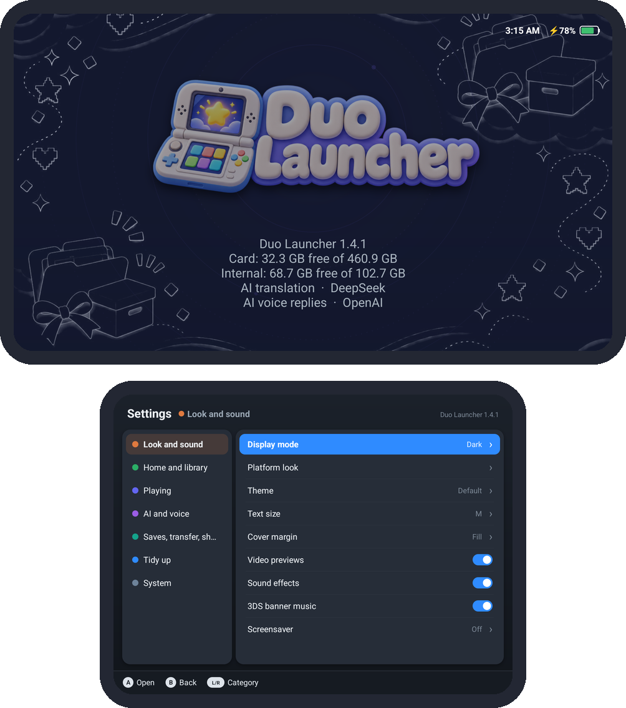
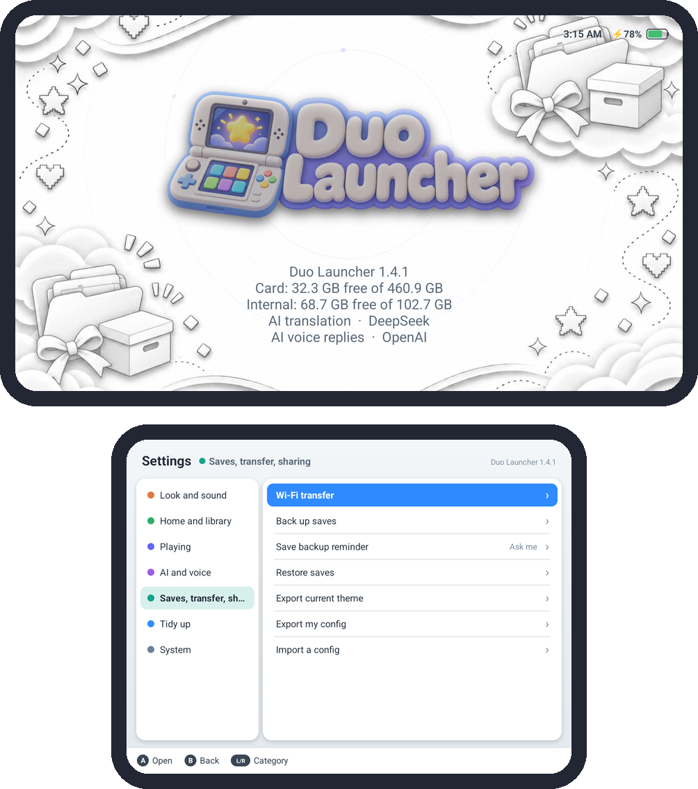

<p align="center"></p>

# Duo Launcher

<p align="center"><a href="README.md">English</a> · <a href="README.fr.md">Français</a> · <a href="README.zh-CN.md">简体中文</a> · <a href="README.zh-TW.md">繁體中文</a> · <b>日本語</b> · <a href="README.ko.md">한국어</a> · <a href="README.es.md">Español</a> · <a href="README.de.md">Deutsch</a> · <a href="README.it.md">Italiano</a> · <a href="README.pt.md">Português</a> · <a href="README.ru.md">Русский</a></p>

**Retroid Pocket Duo** をはじめ、2 画面を持つ Android 携帯ゲーム機のためのランチャーです。イメージは 3DS のホームメニュー。
ROM フォルダーを指定するだけでゲームを見つけ、機種・ジャンル・シリーズ別に整理します。下画面にゲームを並べ、上画面にアートワークを表示し、選んだエミュレーターでそのまま起動できます。

**ダウンロード:** 最新の APK は [Releases ページ](https://github.com/GenKnot/DuoLauncher/releases/latest) にあります（Android 11 以降）。古いバージョンの上から新しいバージョンをインストールしても、設定とプレイ時間はすべてそのまま残ります。

## なぜまた新しいランチャー？

Duo Launcher は、ひとりのプレイヤーが自分の携帯機のために作ったランチャーから始まりました。今でも、その携帯機を実際にどう使っているかをもとに少しずつ育っています。全体を通して、いくつかの考え方があります。

- **2 つの画面には別々の役目を。** 下画面は「選ぶ」ための画面です。大きなフォルダー、グリッド、リスト、メニュー。上画面は「見る」ための画面です。イラストの背景に置かれた機種、カバーに重ねたゲームのロゴ、動画プレビュー、プレイ時間、自分用のメモ、AI との会話。何かと何かが場所を取り合うことはありません。
- **まずはゲームパッドで。** すべての機能が画面に触れずに使えます。十字キー向けに作ったキーボード、押しっぱなしで続くスクロール、L / R でページ送り、L 長押しで音声検索、R 長押しで AI と会話。タッチ操作もできますが、必須ではありません。
- **今あるライブラリをそのまま。** すでに用意してある Pegasus や ES-DE のメタデータと画像を読み込みます。ランチャー独自の追加分は専用の `DuoLauncher` フォルダーにまとめ、ほかのフロントエンドのファイルを書き換えることはありません。
- **AI は自分のキーで、自分のために。** 翻訳、分類、画像生成、アドバイス、会話には、*あなた自身* が選んで直接料金を払うサービスを使います。キーは本体の中だけに保存され、リクエストはすべて推定費用とあわせて設定画面で数えられるので、知らないところで何かが動くことはありません。
- **何でも変えられる、隠せる、共有できる。** ホームのタイルはどれも名前、色、画像、位置を変えたり、隠したりできます。セットアップ全体を 1 つのファイルに書き出して友だちに渡すこともできます。キーやプレイ履歴は含まれません。

要望やバグ報告は [issue トラッカー](https://github.com/GenKnot/DuoLauncher/issues) へどうぞ。

## 主な特徴

- **2 つの画面で 1 つのランチャー** — 下画面で選び、上画面でロゴ、カバーアート、動画プレビュー、プレイ時間、説明を見られます。
- **すべてのエミュレーターを 1 か所に** — 3DS、NDS、GBA、GB/GBC、NES、SNES、N64、ゲームキューブ、Wii、メガドライブ、PS1、PS2、PSP、PS Vita、Switch に加えて、RetroArch で動く 22 の古い機種（マスターシステムからドリームキャストまで、PCエンジン、ネオジオ、ワンダースワン、Atari、アーケード、DOS など）に対応。エミュレーターは機種ごと、またはゲームごとに選べます。複数ディスクのゲームは 1 本として表示されます。
- **自動で整理** — すべてのゲームを 14 のジャンルのどれかと、シリーズ（イース、悪魔城ドラキュラ、スーパーロボット大戦 …）に振り分けます。ホームは機種別・ジャンル別・シリーズ別に切り替えられ、スマートフォルダーが「最近追加」「プレイ中」「やりたい」「クリア済み」「高評価」を常に最新の状態に保ちます。
- **AI のお供** — どこでも R を長押しして話しかけるだけ。手持ちのライブラリからおすすめを選んだり、ゲームの詰まったところの進め方を教えたり、ストーリーを解説したり、ただ雑談したりします。返事は読み上げることもできます。
- **チートの管理** — 3DS、NDS、PSP、GBA と RetroArch の全機種に対応した数千件の既成チートを用意。ワンタップで自分の言語に翻訳でき、編集も可能で、エミュレーター間で共有されます。
- **足りないものを補う** — libretro のサムネイルセットから本物のパッケージ画像を、公式の英語タイトルを、そしてランチャーのスタイルに合わせて AI が描いたカバー、ロゴ、背景を用意します。
- **携帯機のために** — OLED に優しいスクリーンセーバー、ブラウザからの Wi-Fi 転送、セーブのバックアップ、プレイ統計、RetroAchievements の進み具合、ストレージの概要、そして 1 秒で立ち上がるホーム画面。
- **自分好みに** — カラーテーマとテーマパック、ライト／ダークモード、文字サイズ、カバーの余白、ゲーム機風の設定画面、書き出して共有できる設定。インターフェースは 11 言語に対応しています。

## スクリーンショット

<p align="center"></p>

<table>
  <tr>
    <th>3DS 風の設定画面</th>
    <th>設定画面（ダーク）</th>
  </tr>
  <tr>
    <td></td>
    <td></td>
  </tr>
  <tr>
    <th>AI の使用量と費用</th>
    <th>設定のエクスポートとインポート</th>
  </tr>
  <tr>
    <td></td>
    <td></td>
  </tr>
  <tr>
    <th colspan="2">ダークモード用の手描きイラスト</th>
  </tr>
  <tr>
    <td colspan="2" align="center"></td>
  </tr>
  <tr>
    <th>ジャンル別のホーム（粘土風のジャンルアイコン）</th>
    <th>シリーズ別のホーム</th>
  </tr>
  <tr>
    <td></td>
    <td></td>
  </tr>
  <tr>
    <th>ゲーム画面に出るジャンルとシリーズ</th>
    <th>メモ、AI に聞く、状態、遊び方、セーブ</th>
  </tr>
  <tr>
    <td></td>
    <td></td>
  </tr>
  <tr>
    <th>ゲームパッド用キーボード（英語タイトルでもヒット）</th>
    <th>何を遊ぶか AI に相談</th>
  </tr>
  <tr>
    <td></td>
    <td></td>
  </tr>
  <tr>
    <th>AI ツール：シリーズ、おすすめ、ストレージ、休憩の通知</th>
    <th>ストレージ：機種ごとの容量、未プレイの大きなゲーム</th>
  </tr>
  <tr>
    <td></td>
    <td></td>
  </tr>
  <tr>
    <th>動画プレビュー付きのゲーム画面</th>
    <th>ロゴ・カバー・動画をゲームごとに選択</th>
  </tr>
  <tr>
    <td></td>
    <td></td>
  </tr>
  <tr>
    <th>リスト表示</th>
    <th>プレイ統計</th>
  </tr>
  <tr>
    <td></td>
    <td></td>
  </tr>
  <tr>
    <th>カラーテーマ</th>
    <th>テーマの色は背景にも反映</th>
  </tr>
  <tr>
    <td></td>
    <td></td>
  </tr>
  <tr>
    <th>ダークモード</th>
    <th>ダークモード</th>
  </tr>
  <tr>
    <td></td>
    <td></td>
  </tr>
  <tr>
    <th>Wi-Fi 転送</th>
    <th>整理ツール</th>
  </tr>
  <tr>
    <td></td>
    <td></td>
  </tr>
  <tr>
    <th>ゲームキューブ（Dolphin で起動）</th>
    <th>A 長押しでフォルダーを移動</th>
  </tr>
  <tr>
    <td></td>
    <td></td>
  </tr>
  <tr>
    <th>取り込む前にチートを選択（名前は翻訳済み）</th>
    <th>ゲームの詳細：サイズ、ディスク、スクリーンショット</th>
  </tr>
  <tr>
    <td></td>
    <td></td>
  </tr>
  <tr>
    <th>3DS のチートをワンタップで翻訳</th>
    <th>DraStic 用の NDS チート（中国語データベース）</th>
  </tr>
  <tr>
    <td></td>
    <td></td>
  </tr>
  <tr>
    <th>RetroArch のチート（GBA）</th>
    <th>編集・追加・ダウンロード</th>
  </tr>
  <tr>
    <td></td>
    <td></td>
  </tr>
  <tr>
    <th>チートの名前変更・削除</th>
    <th>すべてのチートをまとめて翻訳</th>
  </tr>
  <tr>
    <td></td>
    <td></td>
  </tr>
  <tr>
    <th>スクリーンセーバー（OLED に優しい）</th>
    <th>11 言語</th>
  </tr>
  <tr>
    <td></td>
    <td></td>
  </tr>
</table>

## はじめかた

1. [Releases ページ](https://github.com/GenKnot/DuoLauncher/releases/latest) から **APK をインストール** して開きます。
2. **はじめのガイドに沿って進めます。** 初回起動時に短いガイドが出て、1 ページずつ設定を案内します。
   - **以前の設定と記録が見つかりました** — ランチャーが自動で残したコピーがどこかのストレージで見つかったときだけ、最初に表示されます（再インストールしたあとや、同じカードを新しい携帯機に入れたときなど）。「元に戻す」を選ぶと、「設定を読み込む」と同じように戻す項目を選べます。「最初から始める」ならいつもどおりガイドが続きます。くわしくは[設定と共有](#設定と共有)を参照。
   - **言語。**
   - **権限**（1 ページにまとめてあります）。ファイルへのアクセス（ゲームを探すため）、使用状況へのアクセス（ゲームが実際に画面に出ている時間だけをプレイ時間として数えるため）、そして「任意」と書かれた「ホームアプリに設定（起動時に開く）」です。このページは「設定 → システム → 権限」にもあります。
   - **見つかったゲーム** — スキャンで見つかった機種とゲームの数、そしてどこを探したか（各ストレージの一番上にある `Roms` フォルダーと、自分で追加したフォルダー）。スキャンがまだ終わっていなければそう表示し、終わりしだい数字が入ります。振り分けられなかったものは、ここから[問題センター](#便利なツール)へ進めます。
   - **AI（任意）** — AI 機能で何ができるか、そして料金は使った分だけ自分で選んだサービスに払うこと。そのあと「スマホでキーを入力（Wi-Fi）」「本体で設定」「あとで」から選びます。
   - **ボタン操作** — 各ボタンの役割を 1 ページで。

   どのページにも「ガイドをスキップ」があり、B で 1 ページ戻ります。「設定 → システム → はじめのガイドをもう一度見る」で、もう一度最初から見られます。
   *なぜこうなっているか:* ランチャーが分かりやすいかどうかは、最初の数分で決まります。初めての人が、このページを読まないとそこまでたどり着けないのでは困ります。見つかったゲームの数がすぐに出るので、誰もが最初に気になる「ゲーム、ちゃんと見つかった？」にも答えられます。慣れている人は、どのページからでもスキップできます。
3. **ゲームを探してもらいます。** 本体ストレージや SD カードにある `Roms` フォルダーは自動で見つかります。それ以外のフォルダーは「設定 → ホームとライブラリ → ゲームフォルダー」で追加できます。機種はフォルダー名（`gba`、`Nintendo DS`、`psx` …）と拡張子から判別されます。
4. 標準以外を使いたいところだけ **エミュレーターを選びます**。機種フォルダーで Y を押せばその機種全体、ゲームで Y を押せばそのゲームだけの設定になります。選択肢に出るのはインストール済みのエミュレーターだけです。
5. **お好みで AI のキーを追加。** 「設定 → AI と音声 → AI サービスとキー」から本体で入力できますが、Wi-Fi 経由でパソコンやスマホから入力するほうが楽です（「設定 → セーブ・転送・共有 → Wi-Fi 転送」、または同じメニューの「PC やスマホで入力（Wi-Fi ページ）」）。AI 機能以外はキーがなくてもすべて使えます。
6. **お好みでホーム画面に。** 「設定 → システム → ホームアプリに設定」にすると、本体の起動と同時に立ち上がります。「Android ホーム」タイルからはいつでもシステムのホーム画面に戻れます。

## 基本

**ホーム**（下画面）には機種フォルダーと、いくつかの組み込みタイルが並びます。「続きから遊ぶ」（最後に遊んだゲームにすぐ戻る）、「最近遊んだゲーム」「お気に入り」「新しいフォルダー」「検索」「プレイ統計」「ストレージ」「今日は何で遊ぶ？」「設定」「Android ホーム」です。SELECT でホームの表示を機種別・ジャンル別・シリーズ別に切り替えます。

**フォルダー** を開くと、ゲームがカバーのグリッドで並びます。X でカバーが小さくなり、もう一度押すと名前、プレイ時間、前回遊んだ日付が並ぶリストになります。SELECT で並び替え（標準、名前、最近遊んだ順、プレイ時間順）ができ、簡体字中国語版・繁体字中国語版・英語版だけに絞り込むこともできます。L2 / R2 で前後の頭文字へジャンプします。中国語タイトルはピンインの頭文字で数えます。

**上画面** は選んでいるものに合わせて変わります。機種なら、その背景にゲーム数とエミュレーターを表示。ゲームなら、ぼかしたカバーアートの上にロゴを置き、機種、ジャンル · シリーズ、エミュレーター、プレイ時間、短い説明を表示します。少し待つと動画プレビューが始まるか、前回やめたところの画像が出ます。

**Y** は選んでいるもののメニューです。ゲームのメニューは短くまとめ、たまにしか使わない項目は一段奥に入れてあります。エミュレーター、お気に入り、フォルダーに追加 / フォルダーから外す、「チート」›、「AI ヘルプ」›（AI に聞く、遊び方）、「ゲーム情報」›（詳細、ジャンル、状態と評価、メモ、上画面の表示、「このゲームの AI 画像」）、「その他」›（セーブ、既読にする、隠す、「ゲームファイルを削除」）。機種フォルダーなら、標準のエミュレーター、名前を変更、「フォルダーを統合」›、すべて既読にする、隠す。組み込みタイルなら、名前、色、アイコン、背景です。選んでいる項目が何をするのかは、メニューの下に 1 行で表示されます。

*なぜこうなっているか:* 15 行もあるメニューは、携帯機では読みにくいからです。よく使う項目を手前に残し、残りは奥へ。1 行の説明があるので、押す前にその項目が何をするのか当て推量をする必要もありません。

**ゲームファイルを削除**（Y →「その他」）は、まず確認します。ファイルのサイズと、セーブは残ることも表示され、カーソルは最初「キャンセル」にあるので、A をうっかり素早く 2 回押しても何も消えません。複数ディスクのゲームはすべてのファイルが消えます。問題センターから開いたリスト（「重複したゲーム」など）で削除したゲームは、その場でリストから消えます。

*なぜこうなっているか:* 重複したゲームや遊び終えたゲームを、パソコンなしで片付けられるからです。

**一度だけのヒント。** ある機能が使える場面に初めて来ると、下画面のボタン案内のすぐ上に 1 行のヒントが出ます。表示は一度きりで、9 秒ほどたつか、ボタンを押すと消えます（ただし出てから 2 秒ほどは押しても消えないので、読む前に消えてしまうことはありません。押したボタンはふつうに働きます）。今のところヒントは 4 つです。

- ホームで：A 長押しでタイルを持ち上げて移動、Y でそのタイルのオプション。
- フォルダーからホームに戻ったとき：SELECT でホームを機種別・ジャンル別・シリーズ別に切り替え。
- 機種フォルダーで、標準の並び順のままゲームを選んでいるとき：A 長押しでゲームを好きな位置へ移動、Y でエミュレーター、チート、セーブなど。
- 「未判別」フォルダーで：ファイルで A を押して、どの機種のものかを指定。

「設定 → システム → 新機能のヒント」でオフにでき、「すべてのヒントをもう一度表示」で一度見たヒントがまた出るようになります。
*なぜこうなっているか:* A 長押しで移動する、ホームで SELECT を押す、といった操作は見落としやすく、自分ではまず思いつきません。使えるその瞬間に 1 行出るほうが、説明書よりずっと覚えやすい。そして一度で十分です。何度も出てくるヒントはただの雑音になります。

### 操作方法

| ボタン | 動作 |
|---|---|
| 十字キー / 左スティック | 移動。押しっぱなしで移動し続ける |
| リストやメニューで左 / 右、L / R | 1 ページずつ送る |
| A | 開く / 遊ぶ。ホームのフォルダーや、機種フォルダー内のゲームで A を長押しすると持ち上げて移動できる |
| B | 戻る |
| L / R | 前 / 次の機種（設定画面ではカテゴリ） |
| L 長押し | 音声で検索 |
| R 長押し | AI と話す |
| L2 / R2 | 前 / 次の頭文字 |
| X | カバーのサイズ、その次はリスト表示 |
| Y | 選んでいるゲーム・フォルダー・タイルのメニュー |
| START | 設定（ホームのどこからでも。「設定」タイルを隠していても開ける）。メニュー内では A と同じ |
| SELECT | ホームでは機種別 / ジャンル別 / シリーズ別、フォルダー内では並び替えと言語の絞り込み |
| R3 | 検索 |
| 検索キーボードで | A で入力、B で削除、X でスペース、Y でシステムキーボード、SELECT で消去、START か R3 で完了、L 長押しで音声入力 |
| AI チャットで | R 長押しで話す、Y で入力、X で新しい会話、SELECT で履歴、L2 / R2 でさかのぼる、B で閉じる。十字キーと A で下に並んだゲームから選ぶ |

タッチでも全部操作できます。タップで選択、もう一度タップで開く、フリックでスクロール。L、R、X、SELECT、検索の代わりに、画面上部のボタンをタップすることもできます。A/B と X/Y は入れ替えられるので、決定ボタンを任天堂式にも Xbox 式にもできます（「設定 → プレイ → ボタン設定」）。

## ライブラリ

- **ゲームを自分で見つけます。** 本体ストレージと SD カードから `Roms` フォルダーを探します。ほかのフォルダーは「設定 → ホームとライブラリ → ゲームフォルダー」で追加できます。前回のスキャン結果を覚えているのでホーム画面は 1 秒で表示され、次のスキャンは裏で静かに進みます。
- **対応機種** — 3DS、NDS、GBA（GBA 振動版・改造版のフォルダーも）、GBC、GB、NES、SNES、N64、ゲームキューブ、Wii、メガドライブ、PlayStation 1/2/3、PSP、PS Vita、Switch。PS4、PS5、Xbox 360、Xbox Series のアートワークもあります。Pegasus G パックにあるそのほかの機種もすべて認識します。バーチャルボーイ、マスターシステム、ゲームギア、スーパー32X、メガCD、セガサターン、ドリームキャスト、NAOMI、PCエンジンとその CD 版、PC-FX、ネオジオCD、ネオジオポケットカラー、ワンダースワンとワンダースワンカラー、ポケモンミニ、Atari Lynx、Atari 2600、ゲーム&ウオッチ、3DO、DOS、アーケードです。
- **複数ディスクのゲームは 1 本に。** 同じフォルダーにある `Disc A/B`、`Disc 1/2`、`CD1/CD2`、`(Disc 2 of 3)` や、Pegasus の `files:` リストは 1 つの項目にまとまります。RetroArch と DuckStation にはディスクの `.m3u` プレイリストを渡すので、ゲーム中にディスクを入れ替えられます。
- **Android のゲームとアプリ** — インストール済みのゲームは自動で専用フォルダーに入ります。それ以外のアプリ（動画、ブラウザ …）も「アプリ」フォルダーに追加できます。
- **今あるものをそのまま使えます。** Pegasus の `metadata.pegasus.txt`、ES-DE / EmulationStation の `gamelist.xml` と `downloaded_media`、RetroArch のサムネイル、ゲームの隣にある `media/`、`covers/`、`images/` フォルダーを読み込みます。それらのファイルには一切手を加えず、ランチャー独自の追加分は専用の `DuoLauncher` フォルダーに入れます（[自分でゲーム情報を加える](#自分でゲーム情報を加える) を参照）。
- **新しいゲームに気づきます。** カードにゲームをコピーすれば、次のスキャンで見つかります。新しいゲームには 1 週間（遊ぶまで）NEW マークが付き、ジャンルやシリーズへの振り分けを提案します。この確認はオフにもできます。 Y →「既読にする」で 1 本ずつ外せます。「すべて既読にする」（機種やフォルダーで Y、または「設定 → ホームとライブラリ」）ならまとめて外せ、そこの「NEW マーク」スイッチで表示そのものをオフにできます。
- **フォルダーを統合。** 別々の場所にある同じ機種のフォルダー（たとえば PS1 のフォルダーが 2 つ）を 1 つにまとめて表示できます。機種で Y →「フォルダーを統合」。ゲームごとのエミュレーター設定はそのまま残り、同じ名前のフォルダーは自動でまとまります。元に戻すには「（フォルダー名）を分ける」を選びます。
- **自分だけのフォルダー。** 「新しいフォルダー」タイルで、名前、色、アイコン、背景を自由に決めたフォルダーを作れます。ゲームやアプリは Y で追加し、Y →「このフォルダーから外す」で外せます。
- **スマートフォルダー** は中身を自分で集めます。「最近追加」（直近 30 日）、「未プレイ」「よく遊ぶ」「プレイ中」「やりたい」「クリア済み」「高評価」。Y を押すと、そのフォルダーの条件が表示されます。
- **続きとお気に入り。** ホームの最初のタイルで、最後に遊んだゲームにすぐ戻れます。Y →「お気に入りに追加」で星を付けたゲームは「お気に入り」フォルダーに集まります。
- **遊ばないものは隠す** — 機種フォルダーごと、あるいはゲームやアプリを 1 つずつ隠せます（Y →「このゲームを隠す」など）。「設定 → ホームとライブラリ」で元に戻せます。
- **ゲーム名を整える。** ROM ファイルからそのまま取った名前は、`0153 - Legend of Zelda, The - The Minish Cap (USA) [!]` のようになりがちです。「設定 → ホームとライブラリ → ゲーム名を整える」には 6 つのスイッチがあり、最初はすべてオフです。地域・言語タグを外す、版・ダンプのタグを外す、先頭の番号を外す、アンダーバーと点を空白にする、末尾の「, The」を頭に移す、括弧の中身をすべて外す、の 6 つです。各スイッチの横には、自分のライブラリにあるゲームを例に変更前と変更後の名前が表示され、「変更をすべて見る」で名前が変わるゲームを一覧できます。*なぜこうなっているか:* 変わるのは画面に出る名前だけです。カードのファイルはそのままなので、エミュレーターやセーブ、ほかのフロントエンドには影響しません。Pegasus や ES-DE から来たタイトルや、自分で編集した名前には手を付けません。誰かがすでに選んだ名前だからです。`(Beta)` や `(Hack)` のようにゲームを見分けるためのタグは、括弧のスイッチをオンにしない限り残ります。
- **ゲームを好きな順に並べる。** 機種フォルダーの中では、ゲームで A を長押し（またはロングタップ）すると持ち上がります。十字キーで動かし、離せばそこに置けます。並びは機種ごとに保存され、再スキャンしても消えず、完全バックアップにも含まれます。あとから追加したゲームは、いつもどおりの位置に入ります。元に戻すには、機種で Y →「ゲームの並びを元に戻す」。動かせるのは標準の並び順で、言語の絞り込みをしていないときだけです。名前順やプレイ時間順では、自分で決めた並びに意味がないからです。*なぜこうなっているか:* いま遊んでいるゲームや、発売順に並べたシリーズは、まとめていちばん上に置いておきたいものです。それはどんな自動の並び替えにも分かりません。
- **自分のカタログ。** スキャンのたびに、ライブラリ全体を `DuoLauncher/catalog.tsv` に書き出します（機種、ファイル、タイトル、英語タイトル、ジャンル、シリーズ、プレイ時間、状態、評価）。表計算ソフトやほかのツール、AI に渡すのに使えます。

### ジャンルとシリーズ

2,000 本のゲームを機種別だけで眺めるのは疲れます。そこで、すべてのゲームに 14 のジャンル（RPG、アクション、アドベンチャー、プラットフォーム、シミュレーションRPG、ストラテジー、シューティング、パズル、レース、スポーツ、格闘、シミュレーション、パーティー・音楽、その他）のどれか 1 つと、シリーズを割り当てます。

- **まずは内蔵の知識で。** ランチャーには表（`assets/gamedb.tsv`）が入っています。これらの機種向けの Pegasus G パックのリストに載っている全ゲームをカバーする 3,860 のファイル名を収録し、パックに `.iso` と `.cso` の両方がある場合は両方の名前を載せています。よく出回っている ROM セットなら、機種とファイル名からジャンル、シリーズ、公式の英語タイトルがすでに分かります。ここに載っているゲームには AI もインターネット接続も要りません。
- **残りは AI で。** 「設定 → AI と音声 → AI でライブラリを整理 → AI ジャンル分け」/「AI シリーズ分け」で、残りのゲームを振り分けます。結果はカードの `DuoLauncher/<console>/genres.txt` と `series.txt` に保存されるので、1 回やれば済み、再インストールしても消えません。Pegasus や ES-DE がすでに書き込んだジャンル（「Action RPG」「角色扮演」…）は、14 のジャンルに対応づけられます。
- **手動でも** — どのゲームでも Y →「ジャンル」で設定できます。
- **画面での表示。** 上画面にゲームのジャンル · シリーズが表示され、ホームで SELECT を押すとフォルダーがジャンル別やシリーズ別に切り替わります。シリーズ名はインターフェースの言語に合わせて表示されます。

### 検索

R3、「検索」タイル、または検索ボタンで、十字キー向けに作ったキーボードが上画面に開きます。上には最近の検索とジャンルのチップが並び、入力するそばから下画面に結果が出ます。中国語タイトルはピンイン、その頭文字、各音節の先頭でもヒットし（`kdyg`、`mlao` → 马里奥）、どのゲームも公式の英語タイトルでヒットするので、`zelda` で 塞尔达传说 が見つかります。機種フォルダーの中から開くとその機種だけを検索し、「すべてのプラットフォーム」ボタンで範囲を広げられます。L を長押しすれば、入力する代わりに名前を声で言えます。

### 画像は自動でそろう

- **本物のパッケージ画像** — 「設定 → 整理ツール → カバーをダウンロード」（問題センターの「カバーのないゲーム」の中にもあります）で、libretro のサムネイルセットからカバーを取得します。NDS と GBA は ROM 内のゲームコードで照合するので（zip 圧縮した ROM も対象で、タイトル画面も取得）、翻訳版や名前を変えたファイルでも画像が見つかります。PlayStation 1/2、PSP、N64、ゲームキューブ、Wii、3DS、GB/GBC、NES、SNES、メガドライブは英語タイトルで照合します。「カバーがない」の意味はどこでも同じで、パッケージ画像がないゲームのことです（ロゴや背景だけでは数えません）。そのため問題センターの「カバーのないゲーム」、「カバーをダウンロード」、AI 画像のメニューは同じ数を示します。
- **ROM から直接アイコンを** — NDS のバナーアイコンと 3DS の SMDH アイコン。インストール済みの 3DS タイトルは、インターフェースの言語で名前が表示されます。
- **カバーの見た目をそろえる** — カバーをタイルいっぱいに広げるか、すべて同じ小・中・大の余白で並べられます（「設定 → 外観とサウンド → カバーの余白」）。カバー画像に焼き込まれた白い枠は切り取られます。
- **AI 画像** — 画像用のキーがあれば、カバー、背景、タイトルロゴを AI に描いてもらえます。1 本ずつなら Y →「ゲーム情報」→「このゲームの AI 画像」。それぞれ今あるかどうかが表示され、新しい画像は今の画像と置き換わります。タイトルロゴには英語タイトルが必要です（「AI：ゲーム名と説明」で見つかります）。まとめてなら「設定 → AI と音声 → AI でライブラリを整理 → AI で足りないゲーム画像を描く」。種類ごとに足りないゲームの数が表示され、機種リストの先頭は「すべてのプラットフォーム」、同じ名前の機種が 2 つあるときはフォルダー名が出ます（GBA の改造版フォルダーなど）。詳しくは [AI](#ai) を参照してください。

## プレイ

- **エミュレーターはゲームごと、または機種ごとに**（Y）。インストール済みのものだけが選べます。

  | 機種 | エミュレーター（先頭が標準） |
  |---|---|
  | 3DS | AzaharPlus、Azahar、Citra MMJ、Citra MMJ（パフォーマンスモード） |
  | NDS | DraStic、DraStic（通常パス）、RetroArch · melonDS DS |
  | GB / GBC | RetroArch · Gambatte、mGBA |
  | GBA | RetroArch · mGBA、gpSP、gpSP Rumble |
  | NES | RetroArch · FCEUmm、Mesen |
  | SNES | RetroArch · Snes9x |
  | メガドライブ | RetroArch · Genesis Plus GX、PicoDrive |
  | N64 | RetroArch · Mupen64Plus-Next、Mupen64Plus FZ |
  | ゲームキューブ / Wii | Dolphin MMJR、Dolphin |
  | PS1 | RetroArch · PCSX ReARMed、SwanStation、DuckStation |
  | PS2 | ARMSX2、AetherSX2 |
  | PSP | PPSSPP、RetroArch · PPSSPP |
  | PS Vita | Vita3K（タイトル ID で起動。たとえば `PCSE00000.psvita` というファイル名、または名前にタイトル ID を含むファイル） |
  | Switch | Eden |
  | バーチャルボーイ | RetroArch · Beetle VB |
  | マスターシステム / ゲームギア | RetroArch · Genesis Plus GX、PicoDrive |
  | スーパー32X | RetroArch · PicoDrive |
  | メガCD | RetroArch · Genesis Plus GX、PicoDrive |
  | セガサターン | RetroArch · Yaba Sanshiro、Yabause |
  | ドリームキャスト / NAOMI | RetroArch · Flycast |
  | PCエンジン / PCエンジン CD | RetroArch · Beetle PCE Fast、Beetle PCE |
  | PC-FX | RetroArch · Beetle PC-FX |
  | ネオジオCD | RetroArch · NeoCD |
  | ネオジオポケットカラー | RetroArch · Beetle NeoPop、RACE |
  | ワンダースワン / カラー | RetroArch · Beetle Cygne |
  | ポケモンミニ | RetroArch · PokeMini |
  | Atari Lynx | RetroArch · Handy、Beetle Lynx |
  | Atari 2600 | RetroArch · Stella |
  | ゲーム&ウオッチ | RetroArch · Game & Watch |
  | 3DO | RetroArch · Opera |
  | DOS | RetroArch · DOSBox Pure |
  | アーケード | RetroArch · FinalBurn Neo、MAME 2003-Plus |

  Pegasus の `metadata.pegasus.txt` には、たいてい機種ごとの起動コマンドが書かれています。その場合はそれを最優先で使い、上のコアはその横に選択肢として並びます。

- **Citra MMJ（パフォーマンスモード）** — 同じ Citra MMJ を、ベンチマークアプリ AnTuTu のパッケージ名で作り直したものです。多くの Android システムはこのパッケージ名のアプリをフルクロックで動かします。そのパッケージの中身が本当に Citra の場合だけ選択肢に出ます。
- **プレイ時間と統計** — ゲームごとに遊んだ時間と前回遊んだ日を Switch 風に表示します。使用状況へのアクセスを許可しておけば、ゲームが実際に画面に出ていた時間だけを数えます。「プレイ統計」タイルでは合計、今週の日ごとの時間、機種ごとの時間、よく遊んだゲームが見られます。
- **前回やめたところ** — 遊んだゲームの一番新しいスクリーンショットやステートセーブの画像が、上画面の背景になります。
- **状態、評価、メモ** — ゲームを「プレイ中」「やりたい」「クリア済み」「やめた」に分け、星 1〜5 で評価できます（Y →「状態」）。どこまで進んだか、次に何をするかを一言書くか声で残せます（Y →「メモ」）。次にそのゲームを選んだとき、すべて上画面に表示されます。
- **ゲームの詳細**（Y →「詳細」）— ファイル、サイズ、ディスク、フォルダー、エミュレーター、プレイ時間、公式の英語タイトル、そして上画面にゲームのスクリーンショット。
- **動画プレビューとサウンド** — 少し待つと、上画面でゲームの動画が流れ始めます（ゲームごとにロゴやカバーにもできます：Y →「上画面の表示」）。控えめな操作音と、3DS ゲームごとのバナー音楽はオフにできます。
- **遊んでいる間は邪魔をしない。** ゲームが始まると、下画面はエミュレーターに明け渡され、動画、音楽、バナー曲は止まります。さらにランチャーは、メモリに抱えていた画像を手放し（実測で約 167 MB → 109 MB）、途中だったカードのスキャンはエミュレーターとカードの読み込みを取り合わないよう戻ってくるまで待たせ、上画面の時計の更新や動きも止めます。ランチャーに戻れば、1 秒以内にカバーがまた表示されます。
  *なぜこうなっているか:* メモリもカードも、エミュレーターが独り占めできるようにするためです。
- **ゲームが起動しないとき** — ファイルがない、エミュレーターがインストールされていない、そのファイル形式を開けない、ゲームがすぐ閉じてしまう。それぞれの場合に、どうすればいいかをメッセージで知らせます。エミュレーターがまだ入っていない機種は、実際に困る前に[問題センター](#便利なツール)が一覧で教えてくれます。
- **休憩の通知**（「設定 → プレイ」）— 1 つのゲームを 1・2・3 時間遊んだあと、戻ってきたときに休憩を勧めます。
- **RetroAchievements** — ユーザー名と Web API キーを入れると、最近遊んだゲームと実績の進み具合を表示し、実績のあるゲームには 🏆 マークが付きます。

## AI コンパニオン

ここにあるものはすべて任意で、自分で選んだ AI サービスを自分のキーで使います（[AI](#ai) を参照）。

- **どこでも話しかけられます。** ホーム、フォルダーの中、検索キーボードで R を長押しして話すだけ。Y で文字入力もできます。会話は上画面に表示され、AI がすすめたり見つけたりしたゲームは下画面に並び、A ですぐに始められます。何を遊ぶか聞いたり（「気軽な RPG で、あまり長くないの」）、条件を絞ったり（「もっとアクション寄りで」）、選んでいるゲームの詰まったところの進め方、ストーリーやキャラクターについて聞いたり、ただ雑談したりできます。会話は 30 分間覚えています。
  *なぜこうなっているか:* 下画面はゲームを選ぶ場所なので、AI のおすすめはそこに並びます。上画面は読むために空けておけます。それに携帯機では、肩ボタンを押しながら話すほうが、どんなメニューよりも速いからです。
- **新しい会話と履歴。** チャット中に X で新しい会話を始め、SELECT で過去の会話を新しい順に一覧。もう一度開く、1 件ずつ削除、まとめて削除ができます（「設定 → AI と音声 → AI チャット履歴」からも）。チャットを開いている間は、動画プレビュー、3DS のバナー曲、操作音が止まり、読み上げはメディア音量で流れます。
  *なぜこうなっているか:* 新しい質問に前の話題を引きずらせない、残したい答えを再起動で失わない、そしてゲームの予告編に読み上げがかき消されないためです。履歴は「人と共有」の書き出しには入りません。一方、`DuoLauncher/profile/` の自動コピーには含まれるので、再インストールしても消えません。また、「AI チャット履歴」の中にある「AI チャットを保存」スイッチでオフにできます。
- **返事を読み上げ** — 「設定 → AI と音声 → AI サービスとキー → AI の音声返答」。Soniox（専用のキー）か OpenAI（画像用のキー）を使い、声と話す速さを選べて、試聴ボタンもあります。オンにしない限りオフのままです。
- **今日は何で遊ぶ？** — 「今日は何で遊ぶ？」タイルで Y を押すと、AI があなたの好みに合わせてライブラリから 6 本を選び、それぞれに理由を添えます。普通に押すとランダムに 1 本選びます。まだ遊んだことのないゲームが選ばれやすくなっています。
- **ゲームについて聞く**（Y →「AI に聞く」）— 選んでいるゲームについての質問を入力か声で。答えは上画面に表示されます。
- **遊び方**（Y →「遊び方」）— 操作方法（日本版で決定とキャンセルが入れ替わっている点も含めて）と、初めての人に必要な基本を、ゲームごとに 1 回だけ書いて保存します。
- **まだキーがない？** R を長押しすると、キーの追加方法を説明します。本体で入力するか、Wi-Fi 経由でパソコンから入力できます。

## チート

ゲームで Y →「チート」を開くとチートの一覧が出ます。A で 1 つずつオン／オフを切り替えます。

| | 3DS（Azahar、Citra） | NDS（DraStic） | PSP（PPSSPP） | RetroArch（GBA、GB、GBC、NES、SNES、N64、MD、PS1 …） |
|---|---|---|---|---|
| 保存場所 | `azahar/cheats/` と `citra-emu/cheats/` の `<title ID>.txt`。両方に書き込むので、エミュレーターを替えてもチートはそのまま | 一覧全体は `DuoLauncher/cheats/NDS/` に。オンにしたものは DraStic 自身のカスタムチート（`DraStic/cheats/<game file name>.cht`）に書き込まれ、翻訳版 ROM でも使える | PPSSPP 自身のチートファイル `PSP/Cheats/<game ID>.ini`。ゲーム ID は ISO、CSO、EBOOT.PBP から読み取る | `RetroArch/cheats/<core>/<game file name>.cht`。ゲーム起動時に RetroArch が読み込む |
| 本体にすでにあるもの | – | DraStic の `usrcheat.dat`（Retroid の携帯機では中国語版）。ゲームコードだけで照合するので、DraStic 自身では何も出ないパッチ版や翻訳版の ROM でもチートが見つかる | PPSSPP の `cheat.db`。Retroid の携帯機では約 4,300 本分の中国語チートファイルも | Retroid は数百本分の中国語チートを同梱（`000 中文金手指` と各コアのフォルダー）。専用ファイルのないゲームには、名前で照合してコピーを用意 |
| ダウンロード | [Sharkive](https://github.com/FlagBrew/Sharkive)、約 650 本。ROM から読み取ったタイトル ID で照合 | [libretro-database](https://github.com/libretro/libretro-database)、約 4,200 本。ROM ヘッダーのゲームコードで照合 | [CWCheat-Database-Plus+](https://github.com/Saramagrean/CWCheat-Database-Plus-)、約 4,300 本。ゲーム ID で照合 | GBA は [libretro-database](https://github.com/libretro/libretro-database)。ROM ヘッダーのゲームコードで照合 |

- **取り込む前に選ぶ** — ダウンロードすると、見つかったチートがまず翻訳済みの一覧で表示されます。「すべて選択」/「すべて解除」もあり、チェックを入れたものだけが追加されます。*なぜこうなっているか:* データベースには 1 本のゲームに何十ものコードが入っていることがありますが、たいていのプレイヤーが使いたいのはそのうち 3 つくらいだからです。
- **翻訳** — 英語のチート名を、ワンタップでインターフェースの言語に訳します。1 本ずつでも、全ゲームまとめてでも（「設定 → 整理ツール」）。よくあるチート名は内蔵の用語集で訳し（中国語の場合：无限血量、金钱最大、主代码 …）、残りは無料の MyMemory サービスに送ります。だめなら Google の無料エンドポイントでもう一度試します。バージョン表記（`v1.2`）やボタンの指示（`(START+L)`）はそのまま残し、元の英語名はメモとしてファイルに残ります。
- **AI で翻訳** — AI のキーがあれば、ゲームのチートをゲーム名と一緒にモデルに渡すので、キャラクターやアイテムの公式名（鬼神リンク、ハートの器 …）で訳されます。
- **編集** — どのチートも名前の変更や削除ができ、1 本のゲームのチートをまとめて削除したり、コード付きで自分のチートを追加したりできます（3DS、NDS、PSP のコードは `XXXXXXXX YYYYYYYY` 形式かチェックします）。
- **DraStic でも安全に** — フラッシュカート用のパッチ（コピーガード回避、オーバーレイや Wi-Fi の修正）は、オンにすると DraStic が落ちるので NDS のダウンロードからは外しています。また、一度にオンにできるのは DraStic が読み込める上限の 256 行までです。
- **ファイルも安全に** — 手書きの 3DS チートファイルを初めて変更するとき、元のファイルを `.txt.bak` として残します。
- **RetroArch は最初に 1 回だけ** — RetroArch でクイックメニュー → チート →「Auto-Apply Cheats During Game Load」（ゲーム読み込み時に自動適用）を一度オンにしておけば、ここでオンにしたチートがゲーム開始の瞬間から有効になります。

## 見た目と使い心地

- **上画面（1920×1080）** — 機種ごとに切り絵風の背景、または選んだゲームのロゴをぼかしたカバーアートの上に表示し、タグと短い説明を添えます。隅には時計とバッテリー。
- **下画面（1280×960）** — 機種フォルダー、拡大縮小できるカバーのグリッド、リスト表示。下端のボタンガイドは短くまとめ、文字が大きいときは入りきらないものを省きます。
- **テーマ** — 7 つの配色、カスタムカラー、機種のアート・背景・フォント・サウンド・音楽を含むテーマパック。テーマの色は上画面の線画の背景にも付きます。詳しくは [テーマ](#テーマ) を参照してください。
- **ライト／ダークモード** — システムに合わせるか、自分で決められます。背景はそれぞれのモード用に別々に描いてあります。
- **ホームのすべてが自分のもの。** 組み込みタイルも機種フォルダーも、名前を変える、色を変える、アイコンを付ける（自分の画像か、画像サービスがランチャーの粘土風スタイルで描いたもの）、移動する（A 長押し、またはロングタップ）、隠す、がすべてできます。隠したものは「設定 → ホームとライブラリ → 非表示のフォルダー」で戻せます。「プレイ統計」「ストレージ」「今日は何で遊ぶ？」などの組み込みタイルには、上画面の専用背景も付けられます。
- **機種の外観** — 機種ごとの画像、ライト用とダーク用の背景、フォルダーの色を差し替えられます（「設定 → 外観とサウンド → 機種の外観」）。ダーク用の背景は、画像サービスにライト用から描き直してもらえるので、2 つがいつもそろいます。
- **文字サイズ** — 両画面とも 4 段階。
- **スクリーンセーバー** — 何分か操作がないと、上画面に時計付きでカバーを映し、下画面は真っ黒になります。文字は画像が替わるたびに別の隅へ移り、ゆっくり動くので、OLED パネルに焼き付きません。
- **軽量モード**（「設定 → 外観とサウンド」の一番上）— スイッチ 1 つで、動画プレビューと 3DS のバナー音楽、ゲームの後ろのぼかしたアートワーク、上画面を漂う小さな点、機種の画像のゆるやかな傾きと上下の揺れ、登場アニメーション、選択枠の点滅をまとめてオフにします。オンの間は「動画プレビュー」と「3DS バナーの音楽」のスイッチがオフと表示され、押すと理由を教えてくれます。軽量モードをオフにすれば、自分で選んでいた設定がそのまま戻ります。Duo での実測では、ホームで何もしていないとき、上画面は普段 5 秒で約 600 フレームを描き直しますが、軽量モードでは 1 フレームも描きません。
  *なぜこうなっているか:* バッテリーで長く遊ぶとき、あるいは単に動かない画面のほうが好きなときのためです。

## 設定と共有

- **ゲーム機のような設定画面。** START で 1 枚の設定画面が開きます。左にカテゴリ（「外観とサウンド」「ホームとライブラリ」「プレイ」「AI と音声」「セーブ・転送・共有」「整理ツール」「システム」）、右に選んだカテゴリの項目と現在の値やスイッチが並び、上画面にはバージョン、各ドライブの空き容量、オンになっている AI サービスが表示されます。L / R でカテゴリを切り替えます。
  項目の中には、小さなメニューへの「扉」になっているものがあります（「AI サービスとキー」「AI でライブラリを整理」「問題センター」…）。カーソルを合わせると、カードの一番下に中身を説明する 1 行が出ます。中から B で戻ると、元の項目に戻り、値もすでに更新されています。
  *なぜこうなっているか:* 十数行もあるカテゴリは、1280×960 の画面では壁のように見えます。あまり使わない設定を扉の奥にまとめれば、どのカテゴリも短く保てます。そして 1 行の説明があるので、扉を開ける前に何が入っているか分かります。
- **セットアップをバックアップ・共有。** 「設定 → セーブ・転送・共有 → 設定を書き出す」では、何を入れるかを選べます。設定と自分の画像、プレイ記録、ゲームの状態・評価・メモ、キーとアカウント、AI の使用記録とチャット、そして `DuoLauncher` フォルダーにあるゲームデータです。2 つのショートカット、*人と共有*（設定と画像だけ）と*完全バックアップ*（すべて）も用意しています。「設定を読み込む」では、Wi-Fi、チャットアプリ、カードなどで受け取った設定を `DuoLauncher/exports` か Download フォルダーから読み込み、中身を表示します。そのままにしておきたいものはチェックを外せます。Wi-Fi のページで「読み込む設定」にファイルを送ると、そのまま `DuoLauncher/exports` に入るので、「設定を読み込む」を開けばもう待っています。
  *なぜこうなっているか:* 友だちに渡す設定には、キーや履歴が絶対に入ってはいけません。一方、自分用のバックアップなら、新しい携帯機でも再インストール後でも、まったく同じランチャーに戻せるべきです。完全バックアップにはキーが含まれるので、書き出すときに人に渡さないよう注意が出ます。また、自分のキーが他人の設定から来たアドレスに向けられることはありません。
- **データの保存先**（「設定 → セーブ・転送・共有」）— `DuoLauncher` フォルダーをどこに置くかを決めます。中身は機種ごとのジャンル・シリーズ・AI が付けた名前、取得した画像や AI が描いた画像、セーブのバックアップ、書き出したファイル、テーマ、そして下で説明する設定のコピーです。「ゲームと同じ場所」が初期設定で、これまでどおりの動きです。機種ごとのデータはそのゲームがあるストレージに、バックアップはカードに置きます。「カード」はすべてを TF カードに置くので、カードを別の携帯機に差せばデータも一緒に移ります（カードが入っていない間は、ひとまず本体ストレージを使います）。「本体」はすべてを携帯機の中に残すので、カードを入れ替えても影響を受けません。切り替える前に書かれたデータも、置かれた場所からそのまま読み込みます。「カード」か「本体」を選んでいるときは、「既存のデータをここへ移動」でサイズを確認したうえで、ほかのストレージにある `DuoLauncher` フォルダーを移せます。移動先にすでにあるファイルは残し、NDS のチートリストと複数ディスクのプレイリストはエミュレーターが探す場所から動かしません。
  *なぜこうなっているか:* データをどこに置くかは自分で決めるものだからです。決め打ちの場所はどこにもありません。
- **設定と記録の自動コピー。** 「設定と記録のコピーを残す」（同じメニュー、初期設定でオン）は、設定、自分の画像、プレイ時間、状態・評価・メモ、ゲームの並び順、AI の使用記録とチャットを、選んだストレージの `DuoLauncher/profile/` にコピーします。最初は 1 分以内に、その後は何かが変わるたびにです。確認はランチャーが画面に出ている間におよそ 1 分ごとで、ゲーム中は一切しません。残るのはいつも最新のコピー 1 つだけです。API キーは、「コピーに API キーを含める」をオンにしない限り入りません（オンにするときは、カードを手にした人なら誰でも読めると警告が出ます）。「今すぐコピーを保存」ですぐにコピーを作れて、前回いつ保存したかも表示されます。再インストールしたあとや、同じカードを新しい携帯機に入れたときは、はじめのガイドが「以前の設定と記録が見つかりました」から始まります。「元に戻す」なら「設定を読み込む」と同じように戻す項目を選べ、「最初から始める」ならそのままにしておけます。
  *なぜこうなっているか:* これまでは、アンインストールや工場出荷状態へのリセットをすると、手で書き出しておかない限りプレイ時間もメモも設定も消えてしまっていたからです。
- **11 言語** — 简体中文、繁體中文、English、日本語、한국어、Français、Español、Deutsch、Italiano、Português、Русский。

## 便利なツール

- **問題センター** — 「設定 → 整理ツール」の一番上の項目です。開くたびにバックグラウンドでライブラリを調べ、一度見ておいたほうがよさそうなものを集めて、項目ごとに件数を表示します。
  - **足りない権限** — 権限のページを開きます。
  - **判別できないファイル** — 「未判別」フォルダーを開きます。ファイルで A を押すと機種を選べます。
  - **エミュレーターが入っていない機種** — 機種を選ぶと、インストール済みのエミュレーター（A で切り替え）と、入れれば使えるとランチャーが知っているエミュレーター、そして「この機種を開く」が出ます。
  - **開けないファイル** — 空のファイルと、Pegasus や ES-DE のゲームリストに載っているのにカードにないファイル。
  - **カバーのないゲーム** — 小さなメニューが開きます。「どの N 本か見る」、「カバーをダウンロード」（その場で始まって「オンラインでカバーを探しています…」と表示され、終わるとメニューに戻り、新しい数と見つかった数、またはオンラインで見つからなかったことを伝えます）、「この N 本のカバーを AI で描く」。
  - **重複したゲーム** — 同じ機種、同じ名前、同じサイズ。たいていは同じゲームを 2 回コピーしたものです。

  一番上の行には、どれもランチャーの動作には影響しないことが書いてあり、実際にある問題だけが並びます。はじめのガイドの「見つかったゲーム」のページからもここに来られます。問題センターから開いたリスト（カバーのないゲーム、重複したゲーム、開けないファイル）で B を押すと、ホームではなく問題センターに戻ります。
  *なぜこうなっているか:* こうしたチェックは以前は設定のあちこちに散らばっていて、エミュレーターが入っていないことも、ゲームが起動しなくて初めて分かるものでした。見に行ったときにだけチェックし、自分から出しゃばってこない場所が 1 つあれば、片付けたいときに片付けて、あとは放っておけます。
- **Wi-Fi 転送** — 「設定 → セーブ・転送・共有 → Wi-Fi 転送」を開くと、上画面にページのアドレスと QR コード、管理パスワード（ランダムな 6 桁か、自分で決めたもの）、そしてこのページで何ができるかの短いリストが出ます。スマホのカメラでコードを読み取るか、同じネットワークにあるブラウザでアドレスを入力します。QR コードは本体の中で作るので、インターネット接続は要りません。Wi-Fi のメニューで B を押すと、開く前にいた場所に戻ります。
  ページはスマホやパソコンのライト / ダークモードに合わせて表示されます。言語は、ブラウザの優先言語のうちランチャーの 11 言語で最初に当てはまるもの（台湾・香港・マカオでは繁体字中国語）になり、どれも当てはまらなければ英語です。ページはすべて翻訳済みで、名前もアプリと同じです。ロック解除前は管理パスワードを聞くだけで、何ができるページなのかを説明します。解除すると（再読み込みしてもパスワードは送り直されません）、次のものが使えます。
  - **ファイルを送る** — フォルダーを選んでファイルをドロップするだけ。ROM を好きな機種フォルダーに、テーマパックを、そして設定ファイルを「読み込む設定」に送れます。「読み込む設定」に送ったものは `DuoLauncher/exports` に入るので、「設定 → 設定を読み込む」に出てきます。
  - **AI 翻訳、AI 画像、AI の音声返答、RetroAchievements の設定。** 長いキーをパソコンから貼り付けられます。保存済みのキーは全部は表示されません。
  - **ダウンロード** — 書き出した設定、書き出したテーマ、セーブのバックアップがすべて新しい順に、サイズと日付つきで並びます。

  画面が消えるとページにつながらなくなるため、転送中は本体の画面がつきっぱなしになります。
  *なぜこうなっているか:* スマホでアドレスを打つのがいちばん面倒なところで、カメラなら一瞬です。ダウンロードをパスワードの奥に置いているのは、完全バックアップに API キーが入っていることがあるからです。同じ Wi-Fi にいる誰でも開けるページが、それを渡してしまってはいけません。
- **ストレージ** — ホームのタイルでカードの使用状況が、上画面で全ドライブの空き容量が分かります。中を開くと、機種ごとのゲームの容量、一度も遊んでいない大きなゲーム、そして確認のうえでゲームのファイルを削除する機能（全ディスクと、`.cue` や `.m3u` が指しているファイルも含めて）があります。
- **セーブのバックアップ** — DraStic、RetroArch、PPSSPP、AetherSX2、DuckStation、Mupen64Plus FZ、Azahar、Citra のセーブを 1 つの zip にバックアップ・復元します。保存先は SD カードの `DuoLauncher/backups`（カードがなければ本体ストレージ）。バックアップせずに 3 時間遊ぶと知らせてくれますが、お好みで自動バックアップにもできます（自動バックアップは新しいものから 10 個を残し、自分で作ったものは消しません）。復元では、各セーブはコピーが最後まで終わってから置き換えられます。Y →「セーブ」で、1 本のゲームだけをバックアップ・復元することもできます。
- **整理ツール** — 問題センター、ストレージ、カバーをダウンロード、すべてのチートを翻訳、そして診断情報のページ。「重複したゲーム」と「カバーのないゲーム」は問題センターの中に移りました。AI を使うもの（機種全体の名前と説明、ジャンル、シリーズ、ジャンルアイコン、足りない画像）は「AI と音声 → AI でライブラリを整理」にあります。
- **アップデート** — 「設定 → システム → 情報」で、1 日 1 回 GitHub の最新リリースを確認し、リンクを表示します。
- **ホーム画面** — 標準のホームアプリに設定すると、本体と一緒に起動します。「Android ホーム」タイル（または「設定 → システム → Android ホームに戻る」）でシステムのホーム画面に戻れ、「設定 → システム → Android の設定」でシステムの設定画面が開きます。

## AI

ここにあるものはすべて任意で、自分のアカウントを使います。キーは本体のランチャー設定の中に保存され、選んだサービスにしか送られません。キーは「設定 → AI と音声 → AI サービスとキー」か、パソコンやスマホから Wi-Fi のページで入力します。

「設定 → AI と音声」には 6 つの項目があります。

- **「AI と相談して選ぶ」** と **「AI 今日のおすすめ」** — チャットと 6 本のおすすめ（[AI コンパニオン](#ai-コンパニオン) を参照）。
- **AI サービスとキー** — AI 翻訳、AI 画像、AI の音声返答、それぞれのサービスとキー。それに「PC やスマホで入力（Wi-Fi ページ）」。
- **AI でライブラリを整理** — 「AI：ゲーム名と説明」「AI ジャンル分け」「AI シリーズ分け」「AI ジャンルアイコン」「AI で足りないゲーム画像を描く」。
- **AI チャット履歴** — 過去の会話と、「AI チャットを保存」スイッチ。
- **AI の利用量と費用。**

*なぜこうなっているか:* このカテゴリは以前、13 行が 1 列に並び、毎日使うものと一度入れるだけのキーが混ざっていました。今は、みんなが目当てにする 2 つを一番上に置き、一度きりの設定を 1 つの扉の奥に、ライブラリ全体を相手にする作業をもう 1 つの扉の奥にまとめています。

- **AI 翻訳** — DeepSeek、Qwen、OpenAI、Claude、Gemini、または OpenAI 互換の任意のアドレス。このキーが「しゃべる」部分を受け持ちます。チャット、ゲームのおすすめ、「AI に聞く」、「遊び方」、ジャンルとシリーズ、チート名（1 本のゲーム分を 1 回のリクエストで）、そして自分の言語でのゲーム名と説明です（公式の英語タイトルと一緒にランチャー独自のメタデータへ書き込むので、中国語タイトルばかりのライブラリも英語で自然に読め、その逆もできます）。キーがなくても、チートは無料サービスで翻訳されます。
- **AI 画像** — OpenAI の画像用キー（そのキーで使える一番新しい画像モデルを自動で選びます）。カバー、タイトルロゴ、背景、機種の画像、フォルダーやタイルのアイコンと背景を、内蔵アートと同じ粘土アイコン風・切り絵風のスタイルで描きます。アイコンは透明な背景で描くので、白い部分も消えずに残ります。1 枚あたり 30 秒ほどかかります。本体には音声認識の仕組みがないため、声を文字にするのにも同じキーを使います（`/audio/transcriptions`）。
- **AI の音声返答** — Soniox は専用のキーで、OpenAI は画像用のキーで。声と話す速さ（ふつう、速め、とても速い）を選べます。どちらも中国語の読み上げがゆっくりなので、標準は「速め」です。
- **AI の利用量と費用** — ランチャーが送ったリクエストはすべて本体で数えています。リクエスト数、トークン、画像の枚数、音声の分数を、今日・今週・今月・累計の推定費用とあわせて表示します。推定は、使った分を各サービスの公開価格で計算したものです。価格はそれぞれ自分の条件（別のモデル、代理店、割引）に合わせて変えられます。実際の金額はサービスからの請求がすべてです。

## ゲームの見つけかた

メタデータのファイルも、スクレイパーも、決まったフォルダー構成も、始めるのに必要ありません。カードにゲームをコピーすれば、あとはランチャーが判断します。ここではその仕組みを具体的に説明します。どこに何を置けばいいのか、あるゲームがなぜその場所に表示されるのかが分かるはずです。

### 探す場所

- **各ストレージの一番上にある `Roms` フォルダー** — 本体ストレージと、それぞれの SD カード。大文字・小文字は区別しません（`ROMs`、`roms`）。「設定 → ホームとライブラリ → ゲームフォルダー → Roms フォルダーを自動で探す」でオフにできます。
- **自分で追加したフォルダー** — ゲームを別の場所に置いている場合は、「設定 → ホームとライブラリ → ゲームフォルダー」で追加します。
- **そこから 3 階層下まで。** 画像やエミュレーターのファイルを入れるフォルダーは飛ばします。`media`、`images`、`videos`、`covers`、`boxart`、`screenshots`、`manuals`、`marquees`、`wheel`、`saves`、`states`、`savestates`、`bios`、`system`、`cheats`、`downloaded_media`。
- **Azahar や Citra にインストールした 3DS ゲーム**（それぞれの `sdmc` フォルダーから）と **Android のゲーム** も追加されます。

スキャンの結果は保存されるので、ホーム画面は 1 秒で表示されます。あとからコピーしたゲームは、次のスキャンで見つかります。

*なぜこうなっているか:* たいていの人は、ほかのフロントエンドや ROM パックから来た `Roms` フォルダーをすでに持っています。そこから始めれば、先に何かを移動したり、名前を変えたり、設定したりする必要がありません。

### おすすめのフォルダー構成

機種ごとに 1 つ、機種名を付けたフォルダーを作ります。

```
Roms/
  3DS/      NDS/      GBA/      GBC/      GB/
  NES/      SNES/     N64/      NGC/      WII/
  MD/       PS1/      PS2/      PSP/      PSV/
  SWITCH/   SATURN/   DC/       PCE/      ARCADE/  …
```

フォルダー名はゆるく照合され（スペース、ハイフン、大文字・小文字は無視）、Pegasus、ES-DE、RetroArch でよく使われる名前もそのまま使えます。

| 機種 | 認識するフォルダー名 | どこに置いても認識するファイル形式 |
|---|---|---|
| ニンテンドー3DS | `3ds`, `n3ds`, `nintendo3ds` | `.3ds` `.cci` `.cxi` `.cia` `.3dsx` |
| ニンテンドーDS | `nds`, `ds`, `nintendods` | `.nds` `.dsi` |
| ゲームボーイアドバンス | `gba`, `gameboyadvance` | `.gba` |
| ゲームボーイカラー | `gbc`, `gameboycolor` | `.gbc` |
| ゲームボーイ | `gb`, `gameboy` | `.gb` |
| NES / ファミコン | `nes`, `fc`, `famicom` | `.nes` `.fds` `.unf` |
| SNES / スーパーファミコン | `snes`, `sfc`, `superfamicom`, `supernintendo` | `.sfc` `.smc` |
| NINTENDO64 | `n64`, `nintendo64` | `.n64` `.z64` `.v64` |
| ゲームキューブ | `ngc`, `gc`, `gamecube`, `nintendogamecube` | `.gcm` `.gcz` `.rvz` `.ciso` |
| Wii | `wii`, `nintendowii` | `.wbfs` `.wad` |
| メガドライブ / Genesis | `md`, `genesis`, `megadrive`, `segagenesis` | `.md` `.gen` `.smd` |
| PlayStation | `ps1`, `psx`, `playstation` | `.pbp` |
| PlayStation 2 | `ps2`, `playstation2` | –（専用のフォルダーが必要） |
| PSP | `psp` | `.cso` |
| PS Vita | `psv`, `psvita`, `vita` | `.vpk` |
| Switch | `switch`, `ns`, `nintendoswitch` | `.nsp` `.xci` `.nsz` `.xcz` |
| バーチャルボーイ | `vb`, `virtualboy` | `.vb` `.vboy` |
| マスターシステム | `sms`, `mastersystem` | `.sms` |
| ゲームギア | `gg`, `gamegear` | `.gg` |
| スーパー32X | `32x`, `sega32x`, `md32x` | `.32x` |
| メガCD / Sega CD | `segacd`, `megacd`, `mdcd` | –（中身で判別） |
| セガサターン | `saturn`, `ss`, `segasaturn` | –（中身で判別） |
| ドリームキャスト | `dc`, `dreamcast` | `.cdi` `.gdi` |
| NAOMI / Atomiswave | `naomi`, `naomi2`, `atomiswave` | –（専用のフォルダーが必要） |
| PCエンジン / TurboGrafx-16 | `pce`, `pcengine`, `tg16` | `.pce` |
| PCエンジン CD | `pcecd`, `pcenginecd`, `tgcd` | –（専用のフォルダーが必要） |
| PC-FX | `pcfx` | –（専用のフォルダーが必要） |
| ネオジオCD | `neogeocd`, `ngcd` | –（専用のフォルダーが必要） |
| ネオジオポケットカラー | `ngpc`, `ngp`, `neogeopocket` | `.ngp` `.ngc` |
| ワンダースワン | `ws`, `wonderswan` | `.ws` |
| ワンダースワンカラー | `wsc`, `wonderswancolor` | `.wsc` |
| ポケモンミニ | `pokemini` | `.min` |
| Atari Lynx | `lynx`, `atarilynx` | `.lnx` |
| Atari 2600 | `atari`, `atari2600`, `2600` | `.a26` |
| ゲーム&ウオッチ | `gw`, `gameandwatch` | `.mgw` |
| 3DO | `3do` | –（中身で判別） |
| DOS | `dos`, `msdos`, `pc` | `.dosz` |
| アーケード | `arcade`, `mame`, `fbneo`, `fba`, `neogeo`, `cps1`/`cps2`/`cps3` | –（専用のフォルダーが必要） |

### ごちゃ混ぜのフォルダーと、専用フォルダーが必要なもの

全部を 1 つのフォルダーに入れてもかまいません。ランチャーはファイルごとに、次の順で確かめます。

1. **どの機種用か、自分で指定してあるか？**（下の最後の段落を参照）
2. **フォルダー名で分かるか？**
3. **1 つの機種にしか使われないファイル形式か？**（上の表の右端の列）
4. **ファイル自体には何と書いてあるか？** 複数の機種で使われるファイル形式は、ファイルの先頭から数バイトだけを読みます。大きなカードでもすぐに終わります。
   - `.iso` — ゲームキューブ、Wii、PSP、PlayStation、セガサターン、メガCD、3DO のディスクには、それぞれ自分の目印があります。900 MB を超える PlayStation のディスクは PS2 として扱います。
   - `.rvz`、`.wia`、`.ciso` — ディスクのヘッダーでゲームキューブか Wii かを見分けます（`.gcz` は見分けがつかないので、ゲームキューブとして扱います）。
   - `.cue` — 指している `.bin` の最初のトラックを見て、PlayStation、セガサターン、メガCD、3DO のどれかを判別します。
   - `.chd` — ドリームキャストの GD-ROM と PS2 の DVD を判別します。ほかの機種の CD イメージには専用のフォルダーが必要です。
   - `.zip` — 中にゲームが 1 本だけ（ファイル 4 つまで）入っていて、その形式が 1 つの機種専用なら認識します。たとえば `.zip` に入った `.gba` です。部品の多いアーケードのセットには、アーケード用のフォルダーが必要です。
   - `.m3u` — 最初のディスクと同じ機種として扱います。

それでも分からないもの（たとえば `.7z` や、アーケード用フォルダーの外にあるアーケードゲームの `.zip`）も、捨てはしません。ホームの **「未判別」** フォルダーに入ります。そのゲームで A か Y を押して、機種を一度選ぶだけです。選んだ機種は覚えていて、再スキャンしても消えず、Y →「どの機種のゲーム？」→「標準に戻す」で元に戻せます。PlayStation の `.cue` + `.bin` の組は、`.cue` だけが一覧に出ます。[問題センター](#便利なツール)は、こうしたファイルを「判別できないファイル」として数え、このフォルダーを開いてくれます。

*なぜこうなっているか:* 推測して外すくらいなら、推測しないほうがましです。PSP 用と判断された PS2 のゲームは起動しません。だからランチャーは、フォルダー、ファイル形式、ファイル自体のヘッダーのどれかがはっきり答えを出すときだけ機種を決め、それ以外は隠さずにあなたに尋ねます。

### 名前、画像、詳細の出どころ

ゲームごとに、次の順で最初に情報が見つかったものを使います。

1. **ランチャー専用の `DuoLauncher/` フォルダー**（下記参照）— 自分で直した内容、AI の翻訳、ジャンル、シリーズ。これより優先されるものはありません。
2. **Pegasus** — ゲームフォルダーにある `metadata.pegasus.txt`。タイトル、説明、画像、起動コマンド、複数ディスクのリストを使います。あとからコピーして項目のないゲームも、ちゃんと表示されます。
3. **ES-DE / EmulationStation** — ゲームの隣か `ES-DE/gamelists/` にある `gamelist.xml` と、`downloaded_media/` の画像。
4. **ゲームの隣にある画像** — `media/<file name without extension>/`、または `covers/`、`images/`、`boxart/` にある同じ名前の画像。
5. **RetroArch のサムネイル。**
6. **内蔵のゲーム表**（よく知られた 3,860 のファイル名）— 公式の英語タイトル、ジャンル、シリーズ。
7. **ファイル名** そのもの。

ほかのフロントエンドのファイルは読むだけで、書き換えることはありません。だから Pegasus、ES-DE、Duo Launcher で同じカードを共有できます。

*なぜこうなっているか:* 自分で直した内容はいつでも優先されるべきですが、自分やほかのフロントエンドがすでに集めたものも、捨てずに活かすべきだからです。

### `DuoLauncher` フォルダーの中身

ランチャーは自分のファイルを、ストレージのルートにある `DuoLauncher` フォルダーに置きます。初期設定では、機種に関するものはその機種のゲームがあるストレージ（たいていは SD カード）に置かれます。「設定 → セーブ・転送・共有 → データの保存先」で、すべてをカードか本体にまとめることもできます（[設定と共有](#設定と共有)を参照）。チートのリストとディスクのリストは常に本体ストレージに置かれます。

| パス | 中身 |
|---|---|
| `DuoLauncher/<console>/metadata.txt` | 自分や AI が加えた名前、説明、英語タイトル（Pegasus 形式。[自分でゲーム情報を加える](#自分でゲーム情報を加える) を参照） |
| `DuoLauncher/<console>/media/<file name without extension>/` | 自分で用意した、またはダウンロードしたロゴ、カバー、背景の画像 |
| `DuoLauncher/<console>/genres.txt`, `series.txt` | 各ゲームのジャンルとシリーズ |
| `DuoLauncher/cheats/NDS/` | NDS のチートリスト全体（本体ストレージ） |
| `DuoLauncher/m3u/` | 複数ディスクのゲームのディスクリスト（本体ストレージ） |
| `DuoLauncher/themes/` | テーマパック（どのストレージでも可） |
| `DuoLauncher/backups/` | セーブのバックアップ（SD カードに `DuoLauncher` フォルダーがあれば SD カード） |
| `DuoLauncher/exports/` | 書き出した設定とテーマ |
| `DuoLauncher/profile/` | 設定と記録の自動コピー（「データの保存先」で選んだストレージ） |
| `DuoLauncher/catalog.tsv` | ライブラリ全体の一覧。自分で使うために書き出したもの |

ホームのレイアウト、フォルダー、エミュレーターの選択、プレイ時間などの設定はアプリの中に保存され、そのコピーが `DuoLauncher/profile/` に自動で更新されます。「設定 → セーブ・転送・共有 → 設定を書き出す」で、ここまでのものと一緒に 1 つのファイルに保存できます（[設定と共有](#設定と共有)を参照）。

## 自分でゲーム情報を加える

SD カード（または本体ストレージ）のルートに `DuoLauncher` フォルダーを置くと、ほかのフロントエンドのファイルに触れずに、名前、説明、画像を追加・修正できます。ここに書いた内容は、Pegasus、ES-DE、ゲーム自体のデータより優先されます。

```
DuoLauncher/
  3DS/metadata.txt
  3DS/media/<file name without extension>/logo.png   (also cover.png, background.png)
  NDS/metadata.txt
```

`metadata.txt` は Pegasus の形式です。項目は `file:` で、エミュレーターにインストールした 3DS ゲームなら `titleid:` で照合します。

```
game: 勇者派遣会社
titleid: 0004000000065600
description: …
```

名前と説明は、`name.<language>:` と `description.<language>:` で言語ごとに書けます（`en`、`zh-CN`、`zh-TW`、`ja`、`ko`、`fr`、`es`、`de`、`it`、`pt`、`ru`。`zh` は中国語の両方に使われます）。ランチャーがその言語で動いているときに使われるので、1 つのフォルダーで複数の言語のプレイヤーに対応できます。

```
game: 塞尔达传说 姆祖拉的假面
file: 塞尔达传说 姆祖拉的假面 汉化版.cci
name.en: The Legend of Zelda: Majora's Mask 3D
description.en: Link has three days before the moon falls on Termina…
```

## テーマ

「設定 → 外観とサウンド → テーマ」には、7 つの組み込みカラーテーマ（スカイブルー、チェリーレッド、ミントグリーン、グレープパープル、オレンジ、さくらピンク、グラファイト）、**カスタムカラー**（メインカラーと背景色を選ぶと、ライト／ダークモードのすべての色合いをそこから計算します）、そしてインストール済みのテーマパックがあります。テーマは上画面の線画の背景も含めて、両方の画面に色を付けます。

テーマパックは、SD カードか本体ストレージの `DuoLauncher/themes/` に置くフォルダー（またはそれを固めた `.zip`。初回使用時に展開されます）です。中身はどれも任意で、テーマが用意していないものは組み込みの見た目が使われるので、数色だけの小さなテーマでもかまいません。

```
DuoLauncher/themes/my-theme/
  theme.txt                      name, author, colours (see below)
  consoles/<type>.png            console pictures      (3ds, nds, gba, ..., recent, search, settings, custom)
  backgrounds/<type>.jpg         upper-screen backdrops
  backgrounds/dark/<type>.jpg    backdrops for dark mode
  logo.png
  font.ttf, font-bold.ttf
  sounds/move|open|back|launch.ogg   (or .wav / .mp3)
  music.ogg (or music.mp3)       loops on the home screen (Settings → Background music appears when a theme has music)
```

`theme.txt` は `key: value` 形式の行で書きます。ライトモードは `color.<name>`、ダークモードは `dark.color.<name>` で、名前には `accent`、`shelf-top`、`shelf-bottom`、`card`、`text`、`pill`、`footer`、`backdrop-paper` / `backdrop-ink`（上画面の線画）、ホームのフォルダー用の `folder.<type>` などがあります。`base-color: #RRGGBB` だけ書けば、配色一式ができあがります。[themes/sakura](themes/sakura/theme.txt) は、すべてのキーに説明を付けた完全な例です。「設定 → セーブ・転送・共有 → 今のテーマを書き出す」で、今の設定を zip にして `DuoLauncher/exports/` に保存できます。ほかの人はそれを自分の `themes/` フォルダーに入れるだけで使えます。自分で用意した画像も `own/` に入って一緒に渡ります。テーマに音楽が入っていると、設定に「BGM」の項目が現れます。

## ビルド

Android Studio も Gradle も要りません。必要なのは Android SDK のコマンドラインツール（build-tools 35、platform android-35）と JDK 17 以降だけです。

```powershell
powershell -File build.ps1            # builds DuoLauncher.apk
powershell -File build.ps1 -Install   # also installs over adb, grants file access and starts it
```

デバッグ用の署名鍵（`debug.keystore`）は最初のビルドで生成され、リポジトリにはコミットされません。`shot.ps1` は adb でキー入力を送って両画面のスクリーンショットを保存するので、インターフェースをいじっているときに便利です。

## アートワーク

`assets/consoles/<type>.png`（粘土風の機種・タイルアイコン）と `assets/backgrounds/<type>.jpg`（切り絵風の線画の背景。ダークモード用は `backgrounds/dark/` に別に用意）は、このプロジェクトのために作ったものです。背景はグレースケールなので、カラーテーマで色を付けられます。画像のない機種は、描画したゲーム機の絵で代用します。

## 起動メモ

- AzaharPlus は、すでにアクセス権のあるフォルダー配下のツリー URI しか受け付けません。
  `content://com.android.externalstorage.documents/tree/<volume>%3ARoms%2F3DS/document/<volume>%3ARoms%2F3DS%2F<file>`
- Citra MMJ: `org.citra.emu/org.citra.emu.ui.EmulationActivity` に `-e GamePath <path>`。
- Citra MMJ（パフォーマンスモード）は、同じビルドを `com.antutu.ABenchMark` として作り直したものです。多くの Android ビルドは、このパッケージ名のアプリを CPU/GPU のフルクロックで動かします。そのパッケージの中身が本当に Citra の場合だけ選択肢に出ます。
- Retroid の携帯機に入っている DraStic は `-e GAMEPATH "/sf<path>"` を求めます。素の DraStic 向けに「通常パス」版も用意しています。
- RetroArch: `com.retroarch.aarch64/...RetroActivityFuture` に `-e ROM`、`-e LIBRETRO <core>`、`-e CONFIGFILE`。起動コマンドで指定する設定ファイルは変えていません。Duo では、RetroArch 自身の `retroarch.cfg` だと Retroid の機種別フレームが原寸で表示されますが、Retroid の画面サイズ別の `retroarch1920x1080.cfg` だとゲームがテレビ枠の中に小さく描かれてしまうからです。
- Dolphin（MMJR と公式版）: `.../ui.main.MainActivity` に `--es AutoStartFile <path>`。
- ARMSX2、AetherSX2、Eden、PPSSPP、Mupen64Plus FZ には、ゲームを読み取り専用の `content://com.duo.launcher.rom/...` リンクとして、1 回限りの読み取り許可付きで渡します。そのため、これらのエミュレーターに個別のフォルダーアクセスは要りません。
- Vita3K: `org.vita3k.emulator/.Emulator` に文字列配列の extra `AppStartParameters = ["-r", "<title ID>"]`。
- Pegasus のメタデータにある起動コマンドは、そのまま使います。

### 2 画面機での Citra MMJ

Citra MMJ は、初期設定ではタッチ画面を上のディスプレイに出します。メインの画面を上に出して画面上のボタンを隠すには、Citra を閉じてから `/sdcard/citra-emu/config/config-mmj.ini` に次のように設定します。

```ini
[Controls]
input_overlay_hide = True
[Layout]
landscape_swap_screen = True
```

## フィードバック

Duo Launcher は、使われ方に合わせて形を変えていきます。足りないもの、分かりにくいところ、動かないところがあれば、あるいは人に見せたいテーマができたら、[issue](https://github.com/GenKnot/DuoLauncher/issues) を立ててください。

## ライセンス

[MIT](LICENSE)
