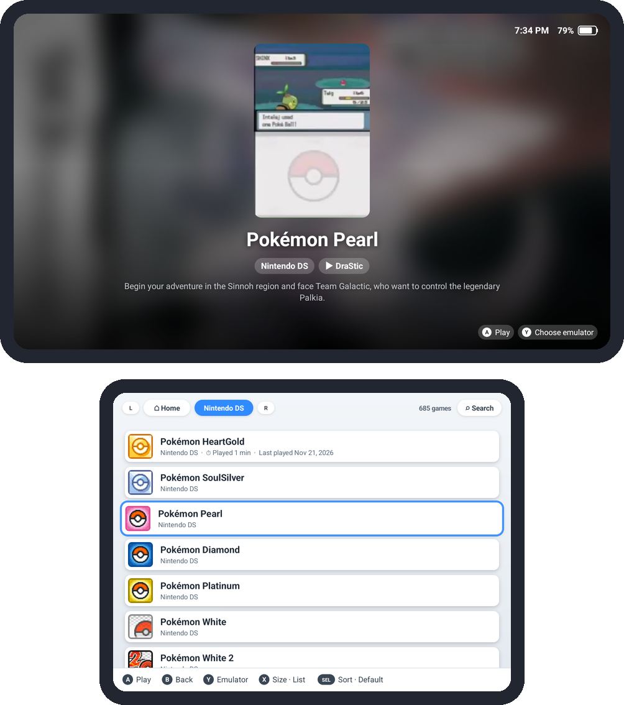
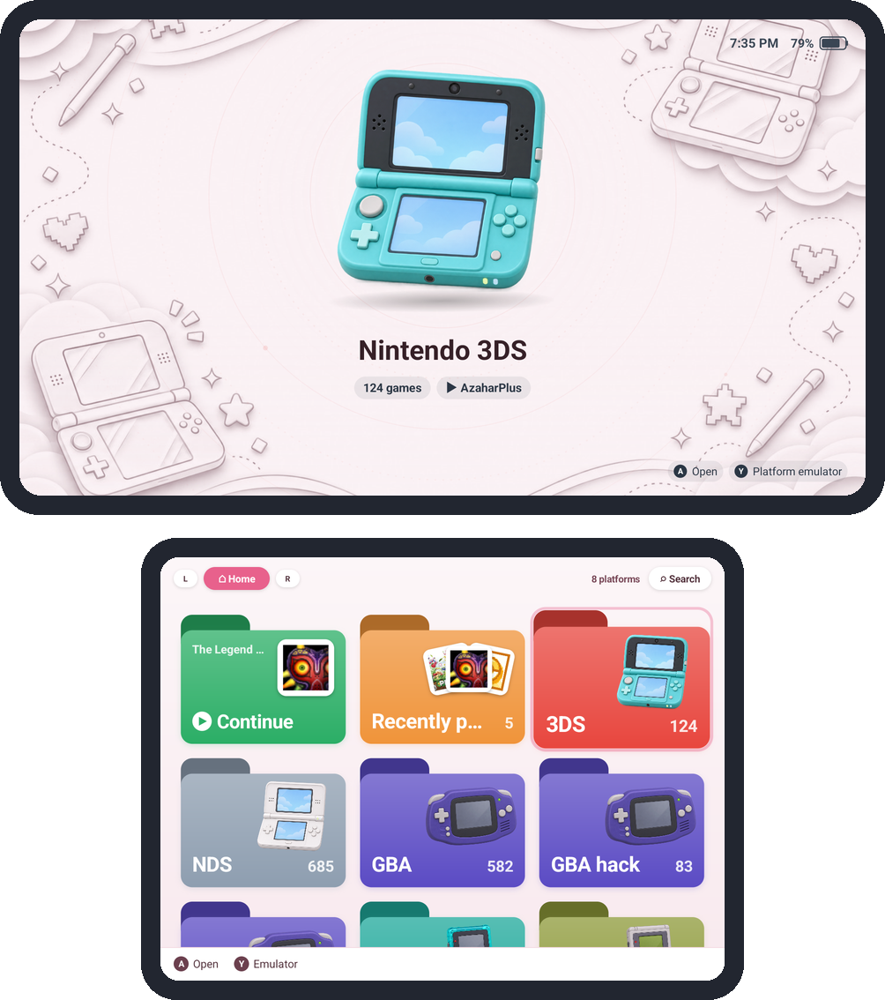
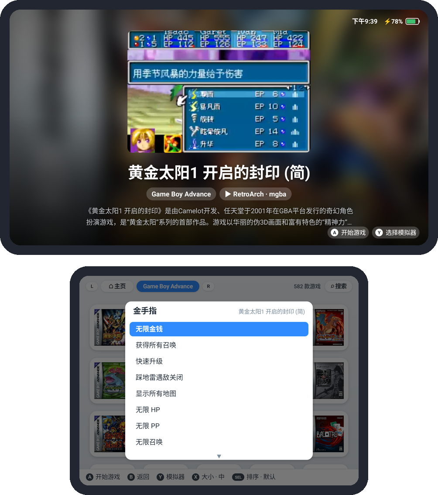

<p align="center"></p>

# Duo Launcher

<p align="center"><a href="README.md">English</a> · <a href="README.fr.md">Français</a> · <a href="README.zh-CN.md">简体中文</a> · <a href="README.zh-TW.md">繁體中文</a> · <b>日本語</b> · <a href="README.ko.md">한국어</a> · <a href="README.es.md">Español</a> · <a href="README.de.md">Deutsch</a> · <a href="README.it.md">Italiano</a> · <a href="README.pt.md">Português</a> · <a href="README.ru.md">Русский</a></p>

**Retroid Pocket Duo** をはじめ、2 画面を持つ Android 携帯ゲーム機のためのランチャーです。イメージは 3DS のホームメニュー。
ROM フォルダーを指定するだけでゲームを見つけ、機種・ジャンル・シリーズ別に整理します。下画面にゲームを並べ、上画面にアートワークを表示し、選んだエミュレーターでそのまま起動できます。

**ダウンロード:** 最新の APK は [Releases ページ](https://github.com/GenKnot/DuoLauncher/releases/latest) にあります（Android 11 以降）。古いバージョンの上から新しいバージョンをインストールしても、設定とプレイ時間はすべてそのまま残ります。

## なぜまた新しいランチャー？

Duo Launcher は、ひとりのプレイヤーが自分の携帯機のために作ったランチャーから始まりました。今でも、その携帯機を実際にどう使っているかをもとに少しずつ育っています。全体を通して、いくつかの考え方があります。

- **2 つの画面には別々の役目を。** 下画面は「選ぶ」ための画面です。大きなフォルダー、グリッド、リスト、メニュー。上画面は「見る」ための画面です。イラストの背景に置かれた機種、カバーに重ねたゲームのロゴ、動画プレビュー、プレイ時間、自分用のメモ、AI との会話。何かと何かが場所を取り合うことはありません。
- **まずはゲームパッドで。** すべての機能が画面に触れずに使えます。十字キー向けに作ったキーボード、押しっぱなしで続くスクロール、L / R でページ送り、L 長押しで音声検索、R 長押しで AI と会話。タッチ操作もできますが、必須ではありません。
- **今あるライブラリをそのまま。** すでに用意してある Pegasus や ES-DE のメタデータと画像を読み込みます。ランチャー独自の追加分は専用の `DuoLauncher` フォルダーにまとめ、ほかのフロントエンドのファイルを書き換えることはありません。
- **AI は自分のキーで、自分のために。** 翻訳、分類、画像生成、アドバイス、会話には、*あなた自身* が選んで直接料金を払うサービスを使います。キーは本体の中だけに保存され、リクエストはすべて推定費用とあわせて設定画面で数えられるので、知らないところで何かが動くことはありません。
- **何でも変えられる、隠せる、共有できる。** ホームのタイルはどれも名前、色、画像、位置を変えたり、隠したりできます。セットアップ全体を 1 つのファイルに書き出して友だちに渡すこともできます。キーやプレイ履歴は含まれません。

要望やバグ報告は [issue トラッカー](https://github.com/GenKnot/DuoLauncher/issues) へどうぞ。

## 主な特徴

- **2 つの画面で 1 つのランチャー** — 下画面で選び、上画面でロゴ、カバーアート、動画プレビュー、プレイ時間、説明を見られます。
- **すべてのエミュレーターを 1 か所に** — 3DS、NDS、GBA、GB/GBC、NES、SNES、N64、ゲームキューブ、Wii、メガドライブ、PS1、PS2、PSP、PS Vita、Switch に対応。エミュレーターは機種ごと、またはゲームごとに選べます。複数ディスクのゲームは 1 本として表示されます。
- **自動で整理** — すべてのゲームを 14 のジャンルのどれかと、シリーズ（イース、悪魔城ドラキュラ、スーパーロボット大戦 …）に振り分けます。ホームは機種別・ジャンル別・シリーズ別に切り替えられ、スマートフォルダーが「最近追加」「プレイ中」「やりたい」「クリア済み」「高評価」を常に最新の状態に保ちます。
- **AI のお供** — どこでも R を長押しして話しかけるだけ。手持ちのライブラリからおすすめを選んだり、ゲームの詰まったところの進め方を教えたり、ストーリーを解説したり、ただ雑談したりします。返事は読み上げることもできます。
- **チートの管理** — 3DS、NDS、PSP、GBA と RetroArch の全機種に対応した数千件の既成チートを用意。ワンタップで自分の言語に翻訳でき、編集も可能で、エミュレーター間で共有されます。
- **足りないものを補う** — libretro のサムネイルセットから本物のパッケージ画像を、公式の英語タイトルを、そしてランチャーのスタイルに合わせて AI が描いたカバー、ロゴ、背景を用意します。
- **携帯機のために** — OLED に優しいスクリーンセーバー、ブラウザからの Wi-Fi 転送、セーブのバックアップ、プレイ統計、RetroAchievements の進み具合、ストレージの概要、そして 1 秒で立ち上がるホーム画面。
- **自分好みに** — カラーテーマとテーマパック、ライト／ダークモード、文字サイズ、カバーの余白、ゲーム機風の設定画面、書き出して共有できる設定。インターフェースは 11 言語に対応しています。

## スクリーンショット

<p align="center"></p>

<table>
  <tr>
    <th>3DS 風の設定画面</th>
    <th>設定画面（ダーク）</th>
  </tr>
  <tr>
    <td></td>
    <td></td>
  </tr>
  <tr>
    <th>AI の使用量と費用</th>
    <th>設定のエクスポートとインポート</th>
  </tr>
  <tr>
    <td></td>
    <td></td>
  </tr>
  <tr>
    <th colspan="2">ダークモード用の手描きイラスト</th>
  </tr>
  <tr>
    <td colspan="2" align="center"></td>
  </tr>
  <tr>
    <th>ジャンル別のホーム（粘土風のジャンルアイコン）</th>
    <th>シリーズ別のホーム</th>
  </tr>
  <tr>
    <td></td>
    <td></td>
  </tr>
  <tr>
    <th>ゲーム画面に出るジャンルとシリーズ</th>
    <th>メモ、AI に聞く、状態、遊び方、セーブ</th>
  </tr>
  <tr>
    <td></td>
    <td></td>
  </tr>
  <tr>
    <th>ゲームパッド用キーボード（英語タイトルでもヒット）</th>
    <th>何を遊ぶか AI に相談</th>
  </tr>
  <tr>
    <td></td>
    <td></td>
  </tr>
  <tr>
    <th>AI ツール：シリーズ、おすすめ、ストレージ、休憩の通知</th>
    <th>ストレージ：機種ごとの容量、未プレイの大きなゲーム</th>
  </tr>
  <tr>
    <td></td>
    <td></td>
  </tr>
  <tr>
    <th>動画プレビュー付きのゲーム画面</th>
    <th>ロゴ・カバー・動画をゲームごとに選択</th>
  </tr>
  <tr>
    <td></td>
    <td></td>
  </tr>
  <tr>
    <th>リスト表示</th>
    <th>プレイ統計</th>
  </tr>
  <tr>
    <td></td>
    <td></td>
  </tr>
  <tr>
    <th>カラーテーマ</th>
    <th>テーマの色は背景にも反映</th>
  </tr>
  <tr>
    <td></td>
    <td></td>
  </tr>
  <tr>
    <th>ダークモード</th>
    <th>ダークモード</th>
  </tr>
  <tr>
    <td></td>
    <td></td>
  </tr>
  <tr>
    <th>Wi-Fi 転送</th>
    <th>整理ツール</th>
  </tr>
  <tr>
    <td></td>
    <td></td>
  </tr>
  <tr>
    <th>ゲームキューブ（Dolphin で起動）</th>
    <th>A 長押しでフォルダーを移動</th>
  </tr>
  <tr>
    <td></td>
    <td></td>
  </tr>
  <tr>
    <th>取り込む前にチートを選択（名前は翻訳済み）</th>
    <th>ゲームの詳細：サイズ、ディスク、スクリーンショット</th>
  </tr>
  <tr>
    <td></td>
    <td></td>
  </tr>
  <tr>
    <th>3DS のチートをワンタップで翻訳</th>
    <th>DraStic 用の NDS チート（中国語データベース）</th>
  </tr>
  <tr>
    <td></td>
    <td></td>
  </tr>
  <tr>
    <th>RetroArch のチート（GBA）</th>
    <th>編集・追加・ダウンロード</th>
  </tr>
  <tr>
    <td></td>
    <td></td>
  </tr>
  <tr>
    <th>チートの名前変更・削除</th>
    <th>すべてのチートをまとめて翻訳</th>
  </tr>
  <tr>
    <td></td>
    <td></td>
  </tr>
  <tr>
    <th>スクリーンセーバー（OLED に優しい）</th>
    <th>11 言語</th>
  </tr>
  <tr>
    <td></td>
    <td></td>
  </tr>
</table>

## はじめかた

1. [Releases ページ](https://github.com/GenKnot/DuoLauncher/releases/latest) から **APK をインストール** して開きます。
2. **言語を選び**、続く 1 ページで求められる権限を許可します。ファイルへのアクセス（ゲームを探すため）、使用状況へのアクセス（ゲームが実際に画面に出ている時間だけをプレイ時間として数えるため）、そしてお好みでホームアプリの役割です。このページには「設定 → システム → 権限」からいつでも戻れます。
3. **ゲームを探してもらいます。** 本体ストレージや SD カードにある `Roms` フォルダーは自動で見つかります。それ以外のフォルダーは「設定 → ホームとライブラリ → ゲームフォルダー」で追加できます。機種はフォルダー名（`gba`、`Nintendo DS`、`psx` …）と拡張子から判別されます。
4. 標準以外を使いたいところだけ **エミュレーターを選びます**。機種フォルダーで Y を押せばその機種全体、ゲームで Y を押せばそのゲームだけの設定になります。選択肢に出るのはインストール済みのエミュレーターだけです。
5. **お好みで AI のキーを追加。** 「設定 → AI と音声」から本体で入力できますが、Wi-Fi 経由でパソコンやスマホから入力するほうが楽です（「設定 → セーブ・転送・共有 → Wi-Fi 転送」）。AI 機能以外はキーがなくてもすべて使えます。
6. **お好みでホーム画面に。** 「設定 → システム → ホームアプリに設定」にすると、本体の起動と同時に立ち上がります。「Android ホーム」タイルからはいつでもシステムのホーム画面に戻れます。

## 基本

**ホーム**（下画面）には機種フォルダーと、いくつかの組み込みタイルが並びます。「続きから遊ぶ」（最後に遊んだゲームにすぐ戻る）、「最近遊んだゲーム」「お気に入り」「新しいフォルダー」「検索」「プレイ統計」「ストレージ」「今日は何で遊ぶ？」「設定」「Android ホーム」です。SELECT でホームの表示を機種別・ジャンル別・シリーズ別に切り替えます。

**フォルダー** を開くと、ゲームがカバーのグリッドで並びます。X でカバーが小さくなり、もう一度押すと名前、プレイ時間、前回遊んだ日付が並ぶリストになります。SELECT で並び替え（標準、名前、最近遊んだ順、プレイ時間順）ができ、簡体字中国語版・繁体字中国語版・英語版だけに絞り込むこともできます。L2 / R2 で前後の頭文字へジャンプします。中国語タイトルはピンインの頭文字で数えます。

**上画面** は選んでいるものに合わせて変わります。機種なら、その背景にゲーム数とエミュレーターを表示。ゲームなら、ぼかしたカバーアートの上にロゴを置き、機種、ジャンル · シリーズ、エミュレーター、プレイ時間、短い説明を表示します。少し待つと動画プレビューが始まるか、前回やめたところの画像が出ます。

**Y** は選んでいるもののメニューです。ゲームなら、エミュレーター、お気に入り、フォルダー、チート、詳細、ジャンル、メモ、AI に聞く、状態と評価、遊び方、セーブ、上画面の表示、隠す。機種フォルダーなら、標準のエミュレーター、名前を変更、フォルダーを統合、隠す。組み込みタイルなら、名前、色、アイコン、背景です。

### 操作方法

| ボタン | 動作 |
|---|---|
| 十字キー / 左スティック | 移動。押しっぱなしで移動し続ける |
| リストやメニューで左 / 右、L / R | 1 ページずつ送る |
| A | 開く / 遊ぶ。ホームのフォルダーで A を長押しすると持ち上げて移動できる |
| B | 戻る |
| L / R | 前 / 次の機種（設定画面ではカテゴリ） |
| L 長押し | 音声で検索 |
| R 長押し | AI と話す |
| L2 / R2 | 前 / 次の頭文字 |
| X | カバーのサイズ、その次はリスト表示 |
| Y | 選んでいるゲーム・フォルダー・タイルのメニュー |
| START | 設定（ホームのどこからでも。「設定」タイルを隠していても開ける）。メニュー内では A と同じ |
| SELECT | ホームでは機種別 / ジャンル別 / シリーズ別、フォルダー内では並び替えと言語の絞り込み |
| R3 | 検索 |
| 検索キーボードで | A で入力、B で削除、X でスペース、Y でシステムキーボード、SELECT で消去、START か R3 で完了、L 長押しで音声入力 |
| AI チャットで | R 長押しで話す、Y で入力、L2 / R2 でさかのぼる、B で閉じる。十字キーと A で下に並んだゲームから選ぶ |

タッチでも全部操作できます。タップで選択、もう一度タップで開く、フリックでスクロール。L、R、X、SELECT、検索の代わりに、画面上部のボタンをタップすることもできます。A/B と X/Y は入れ替えられるので、決定ボタンを任天堂式にも Xbox 式にもできます（「設定 → プレイ → ボタン設定」）。

## ライブラリ

- **ゲームを自分で見つけます。** 本体ストレージと SD カードから `Roms` フォルダーを探します。ほかのフォルダーは「設定 → ホームとライブラリ → ゲームフォルダー」で追加できます。前回のスキャン結果を覚えているのでホーム画面は 1 秒で表示され、次のスキャンは裏で静かに進みます。
- **対応機種** — 3DS、NDS、GBA（GBA 振動版・改造版のフォルダーも）、GBC、GB、NES、SNES、N64、ゲームキューブ、Wii、メガドライブ、PlayStation 1/2/3、PSP、PS Vita、Switch。PS4、PS5、Xbox 360、Xbox Series のアートワークもあります。
- **複数ディスクのゲームは 1 本に。** 同じフォルダーにある `Disc A/B`、`Disc 1/2`、`CD1/CD2`、`(Disc 2 of 3)` や、Pegasus の `files:` リストは 1 つの項目にまとまります。RetroArch と DuckStation にはディスクの `.m3u` プレイリストを渡すので、ゲーム中にディスクを入れ替えられます。
- **Android のゲームとアプリ** — インストール済みのゲームは自動で専用フォルダーに入ります。それ以外のアプリ（動画、ブラウザ …）も「アプリ」フォルダーに追加できます。
- **今あるものをそのまま使えます。** Pegasus の `metadata.pegasus.txt`、ES-DE / EmulationStation の `gamelist.xml` と `downloaded_media`、RetroArch のサムネイル、ゲームの隣にある `media/`、`covers/`、`images/` フォルダーを読み込みます。それらのファイルには一切手を加えず、ランチャー独自の追加分は専用の `DuoLauncher` フォルダーに入れます（[自分でゲーム情報を加える](#自分でゲーム情報を加える) を参照）。
- **新しいゲームに気づきます。** カードにゲームをコピーすれば、次のスキャンで見つかります。新しいゲームには 1 週間（遊ぶまで）NEW マークが付き、ジャンルやシリーズへの振り分けを提案します。この確認はオフにもできます。
- **フォルダーを統合。** 別々の場所にある同じ機種のフォルダー（たとえば PS1 のフォルダーが 2 つ）を 1 つにまとめて表示できます。機種で Y →「フォルダーを統合」。ゲームごとのエミュレーター設定はそのまま残り、同じ名前のフォルダーは自動でまとまります。元に戻すには「（フォルダー名）を分ける」を選びます。
- **自分だけのフォルダー。** 「新しいフォルダー」タイルで、名前、色、アイコン、背景を自由に決めたフォルダーを作れます。ゲームやアプリは Y で追加し、Y →「このフォルダーから外す」で外せます。
- **スマートフォルダー** は中身を自分で集めます。「最近追加」（直近 30 日）、「未プレイ」「よく遊ぶ」「プレイ中」「やりたい」「クリア済み」「高評価」。Y を押すと、そのフォルダーの条件が表示されます。
- **続きとお気に入り。** ホームの最初のタイルで、最後に遊んだゲームにすぐ戻れます。Y →「お気に入りに追加」で星を付けたゲームは「お気に入り」フォルダーに集まります。
- **遊ばないものは隠す** — 機種フォルダーごと、あるいはゲームやアプリを 1 つずつ隠せます（Y →「このゲームを隠す」など）。「設定 → ホームとライブラリ」で元に戻せます。
- **自分のカタログ。** スキャンのたびに、ライブラリ全体を `DuoLauncher/catalog.tsv` に書き出します（機種、ファイル、タイトル、英語タイトル、ジャンル、シリーズ、プレイ時間、状態、評価）。表計算ソフトやほかのツール、AI に渡すのに使えます。

### ジャンルとシリーズ

2,000 本のゲームを機種別だけで眺めるのは疲れます。そこで、すべてのゲームに 14 のジャンル（RPG、アクション、アドベンチャー、プラットフォーム、シミュレーションRPG、ストラテジー、シューティング、パズル、レース、スポーツ、格闘、シミュレーション、パーティー・音楽、その他）のどれか 1 つと、シリーズを割り当てます。

- **まずは内蔵の知識で。** ランチャーには表（`assets/gamedb.tsv`）が入っています。これらの機種向けの Pegasus G パックのリストに載っている全ゲームをカバーする 3,860 のファイル名を収録し、パックに `.iso` と `.cso` の両方がある場合は両方の名前を載せています。よく出回っている ROM セットなら、機種とファイル名からジャンル、シリーズ、公式の英語タイトルがすでに分かります。ここに載っているゲームには AI もインターネット接続も要りません。
- **残りは AI で。** 「設定 → AI と音声 → AI ジャンル分け」/「AI シリーズ分け」で、残りのゲームを振り分けます。結果はカードの `DuoLauncher/<console>/genres.txt` と `series.txt` に保存されるので、1 回やれば済み、再インストールしても消えません。Pegasus や ES-DE がすでに書き込んだジャンル（「Action RPG」「角色扮演」…）は、14 のジャンルに対応づけられます。
- **手動でも** — どのゲームでも Y →「ジャンル」で設定できます。
- **画面での表示。** 上画面にゲームのジャンル · シリーズが表示され、ホームで SELECT を押すとフォルダーがジャンル別やシリーズ別に切り替わります。シリーズ名はインターフェースの言語に合わせて表示されます。

### 検索

R3、「検索」タイル、または検索ボタンで、十字キー向けに作ったキーボードが上画面に開きます。上には最近の検索とジャンルのチップが並び、入力するそばから下画面に結果が出ます。中国語タイトルはピンイン、その頭文字、各音節の先頭でもヒットし（`kdyg`、`mlao` → 马里奥）、どのゲームも公式の英語タイトルでヒットするので、`zelda` で 塞尔达传说 が見つかります。機種フォルダーの中から開くとその機種だけを検索し、「すべてのプラットフォーム」ボタンで範囲を広げられます。L を長押しすれば、入力する代わりに名前を声で言えます。

### 画像は自動でそろう

- **本物のパッケージ画像** — 「設定 → 整理ツール → カバーをダウンロード」で、libretro のサムネイルセットからカバーを取得します。NDS と GBA は ROM 内のゲームコードで照合するので（zip 圧縮した ROM も対象で、タイトル画面も取得）、翻訳版や名前を変えたファイルでも画像が見つかります。PlayStation 1/2、PSP、N64、ゲームキューブ、Wii、3DS、GB/GBC、NES、SNES、メガドライブは英語タイトルで照合します。
- **ROM から直接アイコンを** — NDS のバナーアイコンと 3DS の SMDH アイコン。インストール済みの 3DS タイトルは、インターフェースの言語で名前が表示されます。
- **カバーの見た目をそろえる** — カバーをタイルいっぱいに広げるか、すべて同じ小・中・大の余白で並べられます（「設定 → 外観とサウンド → カバーの余白」）。カバー画像に焼き込まれた白い枠は切り取られます。
- **AI 画像** — 画像用のキーがあれば、カバー、タイトルロゴ、背景のないゲームのために描いてもらえます（Y →「詳細」→「AI でカバーを作成」、または機種全体をまとめて「設定 → AI と音声 → AI 画像」）。詳しくは [AI](#ai) を参照してください。

## プレイ

- **エミュレーターはゲームごと、または機種ごとに**（Y）。インストール済みのものだけが選べます。

  | 機種 | エミュレーター（先頭が標準） |
  |---|---|
  | 3DS | AzaharPlus、Azahar、Citra MMJ、Citra MMJ（パフォーマンスモード） |
  | NDS | DraStic、DraStic（通常パス）、RetroArch · melonDS DS |
  | GB / GBC | RetroArch · Gambatte、mGBA |
  | GBA | RetroArch · mGBA、gpSP、gpSP Rumble |
  | NES | RetroArch · FCEUmm、Mesen |
  | SNES | RetroArch · Snes9x |
  | メガドライブ | RetroArch · Genesis Plus GX、PicoDrive |
  | N64 | RetroArch · Mupen64Plus-Next、Mupen64Plus FZ |
  | ゲームキューブ / Wii | Dolphin MMJR、Dolphin |
  | PS1 | RetroArch · PCSX ReARMed、SwanStation、DuckStation |
  | PS2 | ARMSX2、AetherSX2 |
  | PSP | PPSSPP、RetroArch · PPSSPP |
  | PS Vita | Vita3K（タイトル ID で起動。たとえば `PCSE00000.psvita` というファイル名、または名前にタイトル ID を含むファイル） |
  | Switch | Eden |

- **Citra MMJ（パフォーマンスモード）** — 同じ Citra MMJ を、ベンチマークアプリ AnTuTu のパッケージ名で作り直したものです。多くの Android システムはこのパッケージ名のアプリをフルクロックで動かします。そのパッケージの中身が本当に Citra の場合だけ選択肢に出ます。
- **プレイ時間と統計** — ゲームごとに遊んだ時間と前回遊んだ日を Switch 風に表示します。使用状況へのアクセスを許可しておけば、ゲームが実際に画面に出ていた時間だけを数えます。「プレイ統計」タイルでは合計、今週の日ごとの時間、機種ごとの時間、よく遊んだゲームが見られます。
- **前回やめたところ** — 遊んだゲームの一番新しいスクリーンショットやステートセーブの画像が、上画面の背景になります。
- **状態、評価、メモ** — ゲームを「プレイ中」「やりたい」「クリア済み」「やめた」に分け、星 1〜5 で評価できます（Y →「状態」）。どこまで進んだか、次に何をするかを一言書くか声で残せます（Y →「メモ」）。次にそのゲームを選んだとき、すべて上画面に表示されます。
- **ゲームの詳細**（Y →「詳細」）— ファイル、サイズ、ディスク、フォルダー、エミュレーター、プレイ時間、公式の英語タイトル、そして上画面にゲームのスクリーンショット。
- **動画プレビューとサウンド** — 少し待つと、上画面でゲームの動画が流れ始めます（ゲームごとにロゴやカバーにもできます：Y →「上画面の表示」）。控えめな操作音と、3DS ゲームごとのバナー音楽はオフにできます。
- **ゲームが起動しないとき** — ファイルがない、エミュレーターがインストールされていない、そのファイル形式を開けない、ゲームがすぐ閉じてしまう。それぞれの場合に、どうすればいいかをメッセージで知らせます。
- **休憩の通知**（「設定 → プレイ」）— 1 つのゲームを 1・2・3 時間遊んだあと、戻ってきたときに休憩を勧めます。
- **RetroAchievements** — ユーザー名と Web API キーを入れると、最近遊んだゲームと実績の進み具合を表示し、実績のあるゲームには 🏆 マークが付きます。

## AI コンパニオン

ここにあるものはすべて任意で、自分で選んだ AI サービスを自分のキーで使います（[AI](#ai) を参照）。

- **どこでも話しかけられます。** ホーム、フォルダーの中、検索キーボードで R を長押しして話すだけ。Y で文字入力もできます。会話は上画面に表示され、AI がすすめたり見つけたりしたゲームは下画面に並び、A ですぐに始められます。何を遊ぶか聞いたり（「気軽な RPG で、あまり長くないの」）、条件を絞ったり（「もっとアクション寄りで」）、選んでいるゲームの詰まったところの進め方、ストーリーやキャラクターについて聞いたり、ただ雑談したりできます。会話は 30 分間覚えています。
  *なぜこうなっているか:* 下画面はゲームを選ぶ場所なので、AI のおすすめはそこに並びます。上画面は読むために空けておけます。それに携帯機では、肩ボタンを押しながら話すほうが、どんなメニューよりも速いからです。
- **返事を読み上げ** — 「設定 → AI と音声 → AI の音声返答」。Soniox（専用のキー）か OpenAI（画像用のキー）を使い、声と話す速さを選べて、試聴ボタンもあります。オンにしない限りオフのままです。
- **今日は何で遊ぶ？** — 「今日は何で遊ぶ？」タイルで Y を押すと、AI があなたの好みに合わせてライブラリから 6 本を選び、それぞれに理由を添えます。普通に押すとランダムに 1 本選びます。まだ遊んだことのないゲームが選ばれやすくなっています。
- **ゲームについて聞く**（Y →「AI に聞く」）— 選んでいるゲームについての質問を入力か声で。答えは上画面に表示されます。
- **遊び方**（Y →「遊び方」）— 操作方法（日本版で決定とキャンセルが入れ替わっている点も含めて）と、初めての人に必要な基本を、ゲームごとに 1 回だけ書いて保存します。
- **まだキーがない？** R を長押しすると、キーの追加方法を説明します。本体で入力するか、Wi-Fi 経由でパソコンから入力できます。

## チート

ゲームで Y →「チート」を開くとチートの一覧が出ます。A で 1 つずつオン／オフを切り替えます。

| | 3DS（Azahar、Citra） | NDS（DraStic） | PSP（PPSSPP） | RetroArch（GBA、GB、GBC、NES、SNES、N64、MD、PS1 …） |
|---|---|---|---|---|
| 保存場所 | `azahar/cheats/` と `citra-emu/cheats/` の `<title ID>.txt`。両方に書き込むので、エミュレーターを替えてもチートはそのまま | 一覧全体は `DuoLauncher/cheats/NDS/` に。オンにしたものは DraStic 自身のカスタムチート（`DraStic/cheats/<game file name>.cht`）に書き込まれ、翻訳版 ROM でも使える | PPSSPP 自身のチートファイル `PSP/Cheats/<game ID>.ini`。ゲーム ID は ISO、CSO、EBOOT.PBP から読み取る | `RetroArch/cheats/<core>/<game file name>.cht`。ゲーム起動時に RetroArch が読み込む |
| 本体にすでにあるもの | – | DraStic の `usrcheat.dat`（Retroid の携帯機では中国語版）。ゲームコードだけで照合するので、DraStic 自身では何も出ないパッチ版や翻訳版の ROM でもチートが見つかる | PPSSPP の `cheat.db`。Retroid の携帯機では約 4,300 本分の中国語チートファイルも | Retroid は数百本分の中国語チートを同梱（`000 中文金手指` と各コアのフォルダー）。専用ファイルのないゲームには、名前で照合してコピーを用意 |
| ダウンロード | [Sharkive](https://github.com/FlagBrew/Sharkive)、約 650 本。ROM から読み取ったタイトル ID で照合 | [libretro-database](https://github.com/libretro/libretro-database)、約 4,200 本。ROM ヘッダーのゲームコードで照合 | [CWCheat-Database-Plus+](https://github.com/Saramagrean/CWCheat-Database-Plus-)、約 4,300 本。ゲーム ID で照合 | GBA は [libretro-database](https://github.com/libretro/libretro-database)。ROM ヘッダーのゲームコードで照合 |

- **取り込む前に選ぶ** — ダウンロードすると、見つかったチートがまず翻訳済みの一覧で表示されます。「すべて選択」/「すべて解除」もあり、チェックを入れたものだけが追加されます。*なぜこうなっているか:* データベースには 1 本のゲームに何十ものコードが入っていることがありますが、たいていのプレイヤーが使いたいのはそのうち 3 つくらいだからです。
- **翻訳** — 英語のチート名を、ワンタップでインターフェースの言語に訳します。1 本ずつでも、全ゲームまとめてでも（「設定 → 整理ツール」）。よくあるチート名は内蔵の用語集で訳し（中国語の場合：无限血量、金钱最大、主代码 …）、残りは無料の MyMemory サービスに送ります。だめなら Google の無料エンドポイントでもう一度試します。バージョン表記（`v1.2`）やボタンの指示（`(START+L)`）はそのまま残し、元の英語名はメモとしてファイルに残ります。
- **AI で翻訳** — AI のキーがあれば、ゲームのチートをゲーム名と一緒にモデルに渡すので、キャラクターやアイテムの公式名（鬼神リンク、ハートの器 …）で訳されます。
- **編集** — どのチートも名前の変更や削除ができ、1 本のゲームのチートをまとめて削除したり、コード付きで自分のチートを追加したりできます（3DS、NDS、PSP のコードは `XXXXXXXX YYYYYYYY` 形式かチェックします）。
- **DraStic でも安全に** — フラッシュカート用のパッチ（コピーガード回避、オーバーレイや Wi-Fi の修正）は、オンにすると DraStic が落ちるので NDS のダウンロードからは外しています。また、一度にオンにできるのは DraStic が読み込める上限の 256 行までです。
- **ファイルも安全に** — 手書きの 3DS チートファイルを初めて変更するとき、元のファイルを `.txt.bak` として残します。
- **RetroArch は最初に 1 回だけ** — RetroArch でクイックメニュー → チート →「Auto-Apply Cheats During Game Load」（ゲーム読み込み時に自動適用）を一度オンにしておけば、ここでオンにしたチートがゲーム開始の瞬間から有効になります。

## 見た目と使い心地

- **上画面（1920×1080）** — 機種ごとに切り絵風の背景、または選んだゲームのロゴをぼかしたカバーアートの上に表示し、タグと短い説明を添えます。隅には時計とバッテリー。
- **下画面（1280×960）** — 機種フォルダー、拡大縮小できるカバーのグリッド、リスト表示。下端のボタンガイドは短くまとめ、文字が大きいときは入りきらないものを省きます。
- **テーマ** — 7 つの配色、カスタムカラー、機種のアート・背景・フォント・サウンド・音楽を含むテーマパック。テーマの色は上画面の線画の背景にも付きます。詳しくは [テーマ](#テーマ) を参照してください。
- **ライト／ダークモード** — システムに合わせるか、自分で決められます。背景はそれぞれのモード用に別々に描いてあります。
- **ホームのすべてが自分のもの。** 組み込みタイルも機種フォルダーも、名前を変える、色を変える、アイコンを付ける（自分の画像か、画像サービスがランチャーの粘土風スタイルで描いたもの）、移動する（A 長押し、またはロングタップ）、隠す、がすべてできます。隠したものは「設定 → ホームとライブラリ → 非表示のフォルダー」で戻せます。「プレイ統計」「ストレージ」「今日は何で遊ぶ？」などの組み込みタイルには、上画面の専用背景も付けられます。
- **機種の外観** — 機種ごとの画像、ライト用とダーク用の背景、フォルダーの色を差し替えられます（「設定 → 外観とサウンド → 機種の外観」）。ダーク用の背景は、画像サービスにライト用から描き直してもらえるので、2 つがいつもそろいます。
- **文字サイズ** — 両画面とも 4 段階。
- **スクリーンセーバー** — 何分か操作がないと、上画面に時計付きでカバーを映し、下画面は真っ黒になります。文字は画像が替わるたびに別の隅へ移り、ゆっくり動くので、OLED パネルに焼き付きません。

## 設定と共有

- **ゲーム機のような設定画面。** START で 1 枚の設定画面が開きます。左にカテゴリ（「外観とサウンド」「ホームとライブラリ」「プレイ」「AI と音声」「セーブ・転送・共有」「整理ツール」「システム」）、右に選んだカテゴリの項目と現在の値やスイッチが並び、上画面にはバージョン、各ドライブの空き容量、オンになっている AI サービスが表示されます。L / R でカテゴリを切り替えます。
- **セットアップを共有。** 「設定 → セーブ・転送・共有 → 設定を書き出す」で、すべての設定（外観、ホームの配置と並び順、フォルダー、隠したもの、エミュレーターの選択、AI サービス）と自分で用意した画像を 1 つの zip にまとめます。「設定を読み込む」では、Wi-Fi、チャットアプリ、カードなどで受け取った設定を `DuoLauncher/exports` か Download フォルダーから読み込みます。
  *共有しても安全な理由:* キー、パスワード、プレイ履歴は設定ファイルに一切含まれません。読み込んでも自分のものはそのまま残り、自分のキーが他人の設定から来たアドレスに向けられることもありません。
- **11 言語** — 简体中文、繁體中文、English、日本語、한국어、Français、Español、Deutsch、Italiano、Português、Русский。

## 便利なツール

- **Wi-Fi 転送** — 「設定 → セーブ・転送・共有 → Wi-Fi 転送」でアドレスと PIN が表示されます。同じネットワークにあるブラウザでそのアドレスを開いて PIN を入れれば、ROM やテーマパックを好きな機種フォルダーに直接ドロップできます。同じページには AI、音声、RetroAchievements の設定もあり、管理パスワード（ランダムな 6 桁か、自分で決めたもの）で守られているので、長いキーをパソコンから貼り付けられます。画面が消えるとページにつながらなくなるため、転送中は本体の画面がつきっぱなしになります。
- **ストレージ** — ホームのタイルでカードの使用状況が、上画面で全ドライブの空き容量が分かります。中を開くと、機種ごとのゲームの容量、一度も遊んでいない大きなゲーム、そして確認のうえでゲームのファイルを削除する機能（全ディスクと、`.cue` や `.m3u` が指しているファイルも含めて）があります。
- **セーブのバックアップ** — DraStic、RetroArch、PPSSPP、AetherSX2、DuckStation、Mupen64Plus FZ、Azahar、Citra のセーブを 1 つの zip にバックアップ・復元します。保存先は SD カードの `DuoLauncher/backups`（カードがなければ本体ストレージ）。バックアップせずに 3 時間遊ぶと知らせてくれますが、お好みで自動バックアップにもできます（自動バックアップは新しいものから 10 個を残し、自分で作ったものは消しません）。復元では、各セーブはコピーが最後まで終わってから置き換えられます。Y →「セーブ」で、1 本のゲームだけをバックアップ・復元することもできます。
- **整理ツール** — 重複したゲームを探す、カバーのないゲームを一覧にする、足りないカバーを取ってくる、すべてのチートをまとめて翻訳する、そして診断情報のページ。AI を使うもの（機種全体の名前と説明、ジャンル、シリーズ、画像、ジャンルアイコン）は「AI と音声」にあります。
- **アップデート** — 「設定 → システム → 情報」で、1 日 1 回 GitHub の最新リリースを確認し、リンクを表示します。
- **ホーム画面** — 標準のホームアプリに設定すると、本体と一緒に起動します。「Android ホーム」タイル（または「設定 → システム → Android ホームに戻る」）でシステムのホーム画面に戻れ、「設定 → システム → Android の設定」でシステムの設定画面が開きます。

## AI

ここにあるものはすべて任意で、自分のアカウントを使います。キーは本体のランチャー設定の中に保存され、選んだサービスにしか送られません。キーは「設定 → AI と音声」か、パソコンやスマホから Wi-Fi のページで入力します。

- **AI 翻訳** — DeepSeek、Qwen、OpenAI、Claude、Gemini、または OpenAI 互換の任意のアドレス。このキーが「しゃべる」部分を受け持ちます。チャット、ゲームのおすすめ、「AI に聞く」、「遊び方」、ジャンルとシリーズ、チート名（1 本のゲーム分を 1 回のリクエストで）、そして自分の言語でのゲーム名と説明です（公式の英語タイトルと一緒にランチャー独自のメタデータへ書き込むので、中国語タイトルばかりのライブラリも英語で自然に読め、その逆もできます）。キーがなくても、チートは無料サービスで翻訳されます。
- **AI 画像** — OpenAI の画像用キー（そのキーで使える一番新しい画像モデルを自動で選びます）。カバー、タイトルロゴ、背景、機種の画像、フォルダーやタイルのアイコンと背景を、内蔵アートと同じ粘土アイコン風・切り絵風のスタイルで描きます。アイコンは透明な背景で描くので、白い部分も消えずに残ります。1 枚あたり 30 秒ほどかかります。本体には音声認識の仕組みがないため、声を文字にするのにも同じキーを使います（`/audio/transcriptions`）。
- **AI の音声返答** — Soniox は専用のキーで、OpenAI は画像用のキーで。声と話す速さ（ふつう、速め、とても速い）を選べます。どちらも中国語の読み上げがゆっくりなので、標準は「速め」です。
- **AI の利用量と費用** — ランチャーが送ったリクエストはすべて本体で数えています。リクエスト数、トークン、画像の枚数、音声の分数を、今日・今週・今月・累計の推定費用とあわせて表示します。推定は、使った分を各サービスの公開価格で計算したものです。価格はそれぞれ自分の条件（別のモデル、代理店、割引）に合わせて変えられます。実際の金額はサービスからの請求がすべてです。

## 自分でゲーム情報を加える

SD カード（または本体ストレージ）のルートに `DuoLauncher` フォルダーを置くと、ほかのフロントエンドのファイルに触れずに、名前、説明、画像を追加・修正できます。ここに書いた内容は、Pegasus、ES-DE、ゲーム自体のデータより優先されます。

```
DuoLauncher/
  3DS/metadata.txt
  3DS/media/<file name without extension>/logo.png   (also cover.png, background.png)
  NDS/metadata.txt
```

`metadata.txt` は Pegasus の形式です。項目は `file:` で、エミュレーターにインストールした 3DS ゲームなら `titleid:` で照合します。

```
game: 勇者派遣会社
titleid: 0004000000065600
description: …
```

名前と説明は、`name.<language>:` と `description.<language>:` で言語ごとに書けます（`en`、`zh-CN`、`zh-TW`、`ja`、`ko`、`fr`、`es`、`de`、`it`、`pt`、`ru`。`zh` は中国語の両方に使われます）。ランチャーがその言語で動いているときに使われるので、1 つのフォルダーで複数の言語のプレイヤーに対応できます。

```
game: 塞尔达传说 姆祖拉的假面
file: 塞尔达传说 姆祖拉的假面 汉化版.cci
name.en: The Legend of Zelda: Majora's Mask 3D
description.en: Link has three days before the moon falls on Termina…
```

## テーマ

「設定 → 外観とサウンド → テーマ」には、7 つの組み込みカラーテーマ（スカイブルー、チェリーレッド、ミントグリーン、グレープパープル、オレンジ、さくらピンク、グラファイト）、**カスタムカラー**（メインカラーと背景色を選ぶと、ライト／ダークモードのすべての色合いをそこから計算します）、そしてインストール済みのテーマパックがあります。テーマは上画面の線画の背景も含めて、両方の画面に色を付けます。

テーマパックは、SD カードか本体ストレージの `DuoLauncher/themes/` に置くフォルダー（またはそれを固めた `.zip`。初回使用時に展開されます）です。中身はどれも任意で、テーマが用意していないものは組み込みの見た目が使われるので、数色だけの小さなテーマでもかまいません。

```
DuoLauncher/themes/my-theme/
  theme.txt                      name, author, colours (see below)
  consoles/<type>.png            console pictures      (3ds, nds, gba, ..., recent, search, settings, custom)
  backgrounds/<type>.jpg         upper-screen backdrops
  backgrounds/dark/<type>.jpg    backdrops for dark mode
  logo.png
  font.ttf, font-bold.ttf
  sounds/move|open|back|launch.ogg   (or .wav / .mp3)
  music.ogg (or music.mp3)       loops on the home screen (Settings → Background music appears when a theme has music)
```

`theme.txt` は `key: value` 形式の行で書きます。ライトモードは `color.<name>`、ダークモードは `dark.color.<name>` で、名前には `accent`、`shelf-top`、`shelf-bottom`、`card`、`text`、`pill`、`footer`、`backdrop-paper` / `backdrop-ink`（上画面の線画）、ホームのフォルダー用の `folder.<type>` などがあります。`base-color: #RRGGBB` だけ書けば、配色一式ができあがります。[themes/sakura](themes/sakura/theme.txt) は、すべてのキーに説明を付けた完全な例です。「設定 → セーブ・転送・共有 → 今のテーマを書き出す」で、今の設定を zip にして `DuoLauncher/exports/` に保存できます。ほかの人はそれを自分の `themes/` フォルダーに入れるだけで使えます。自分で用意した画像も `own/` に入って一緒に渡ります。テーマに音楽が入っていると、設定に「BGM」の項目が現れます。

## ビルド

Android Studio も Gradle も要りません。必要なのは Android SDK のコマンドラインツール（build-tools 35、platform android-35）と JDK 17 以降だけです。

```powershell
powershell -File build.ps1            # builds DuoLauncher.apk
powershell -File build.ps1 -Install   # also installs over adb, grants file access and starts it
```

デバッグ用の署名鍵（`debug.keystore`）は最初のビルドで生成され、リポジトリにはコミットされません。`shot.ps1` は adb でキー入力を送って両画面のスクリーンショットを保存するので、インターフェースをいじっているときに便利です。

## アートワーク

`assets/consoles/<type>.png`（粘土風の機種・タイルアイコン）と `assets/backgrounds/<type>.jpg`（切り絵風の線画の背景。ダークモード用は `backgrounds/dark/` に別に用意）は、このプロジェクトのために作ったものです。背景はグレースケールなので、カラーテーマで色を付けられます。画像のない機種は、描画したゲーム機の絵で代用します。

## 起動メモ

- AzaharPlus は、すでにアクセス権のあるフォルダー配下のツリー URI しか受け付けません。
  `content://com.android.externalstorage.documents/tree/<volume>%3ARoms%2F3DS/document/<volume>%3ARoms%2F3DS%2F<file>`
- Citra MMJ: `org.citra.emu/org.citra.emu.ui.EmulationActivity` に `-e GamePath <path>`。
- Citra MMJ（パフォーマンスモード）は、同じビルドを `com.antutu.ABenchMark` として作り直したものです。多くの Android ビルドは、このパッケージ名のアプリを CPU/GPU のフルクロックで動かします。そのパッケージの中身が本当に Citra の場合だけ選択肢に出ます。
- Retroid の携帯機に入っている DraStic は `-e GAMEPATH "/sf<path>"` を求めます。素の DraStic 向けに「通常パス」版も用意しています。
- RetroArch: `com.retroarch.aarch64/...RetroActivityFuture` に `-e ROM`、`-e LIBRETRO <core>`、`-e CONFIGFILE`。起動コマンドで指定する設定ファイルは変えていません。Duo では、RetroArch 自身の `retroarch.cfg` だと Retroid の機種別フレームが原寸で表示されますが、Retroid の画面サイズ別の `retroarch1920x1080.cfg` だとゲームがテレビ枠の中に小さく描かれてしまうからです。
- Dolphin（MMJR と公式版）: `.../ui.main.MainActivity` に `--es AutoStartFile <path>`。
- ARMSX2、AetherSX2、Eden、PPSSPP、Mupen64Plus FZ には、ゲームを読み取り専用の `content://com.duo.launcher.rom/...` リンクとして、1 回限りの読み取り許可付きで渡します。そのため、これらのエミュレーターに個別のフォルダーアクセスは要りません。
- Vita3K: `org.vita3k.emulator/.Emulator` に文字列配列の extra `AppStartParameters = ["-r", "<title ID>"]`。
- Pegasus のメタデータにある起動コマンドは、そのまま使います。

### 2 画面機での Citra MMJ

Citra MMJ は、初期設定ではタッチ画面を上のディスプレイに出します。メインの画面を上に出して画面上のボタンを隠すには、Citra を閉じてから `/sdcard/citra-emu/config/config-mmj.ini` に次のように設定します。

```ini
[Controls]
input_overlay_hide = True
[Layout]
landscape_swap_screen = True
```

## フィードバック

Duo Launcher は、使われ方に合わせて形を変えていきます。足りないもの、分かりにくいところ、動かないところがあれば、あるいは人に見せたいテーマができたら、[issue](https://github.com/GenKnot/DuoLauncher/issues) を立ててください。

## ライセンス

[MIT](LICENSE)
