<p align="center"></p>

# Duo Launcher

<p align="center"><a href="README.md">English</a> · <a href="README.fr.md">Français</a> · <a href="README.zh-CN.md">简体中文</a> · <a href="README.zh-TW.md">繁體中文</a> · <a href="README.ja.md">日本語</a> · <b>한국어</b> · <a href="README.es.md">Español</a> · <a href="README.de.md">Deutsch</a> · <a href="README.it.md">Italiano</a> · <a href="README.pt.md">Português</a> · <a href="README.ru.md">Русский</a></p>

**Retroid Pocket Duo**처럼 화면이 두 개 달린 안드로이드 휴대용 게임기를 위한 듀얼 스크린 게임 런처입니다. 3DS 홈 메뉴를 떠올리며 만들었습니다.
ROM 폴더만 알려 주면 게임을 찾아내서 기기·장르·시리즈별로 정리하고, 아래 화면에는 게임 목록을, 위 화면에는 아트워크를 보여 주며, 게임마다 원하는 에뮬레이터로 실행해 줍니다.
치트도 기본으로 들어 있습니다. 기기에 치트가 없는 게임은 많이 쓰이는 치트 데이터베이스(Sharkive, libretro, CWCheat)에서 내려받아 원하는 것만 골라 가져오고, 이름은 한 번 탭으로 인터페이스 언어로 번역됩니다. 에뮬레이터가 읽는 위치에 바로 써 주므로 게임을 켜면 곧바로 쓸 수 있습니다.

**다운로드:** 최신 APK는 [Releases 페이지](https://github.com/GenKnot/DuoLauncher/releases/latest)에 있습니다(Android 11 이상). 새 버전을 기존 버전 위에 그대로 설치하면 모든 설정과 플레이 시간이 유지됩니다.

## 왜 또 런처인가요?

Duo Launcher는 한 사람이 자기 기기 하나에 쓰려고 만든 런처에서 시작했고, 지금도 그 기기를 실제로 어떻게 쓰는지에 맞춰 조금씩 자라고 있습니다. 바탕에는 네 가지 약속이 있습니다.

1. **이미 갖춘 라이브러리 그대로** – 어떤 프런트엔드로 정리해 두었든 다시 할 일이 없습니다. 지금은 Pegasus와 ES-DE를 읽고, 다른 프런트엔드도 지원할 예정입니다.
2. **AI는 원할 때, 원하는 방식으로** – 여러 서비스 중 아무거나, 내 키로, 비용은 눈에 보이게. AI 기능은 하나하나 모두 선택 사항입니다.
3. **귀찮은 일은 런처가** – 치트, 그림, 번역, 파일 옮기기, 정리까지.
4. **모든 것을 내 마음대로** – 거의 모든 세부 사항을 고를 수 있고, 화면에 무언가를 보여 주는 기능은 전부 끌 수 있습니다.

게임을 찾아 실행하는 것에 더해, 이 약속들이 모이면 이렇게 됩니다.

- **치트, 내려받기부터 첫 화면까지.** 기기에 치트가 없는 게임이면 많이 쓰이는 커뮤니티 데이터베이스에서 받아 옵니다. 3DS는 Sharkive, NDS와 GBA는 libretro, PSP는 CWCheat입니다. 원하는 것만 골라 체크하면 이름을 한 번 탭으로 내 언어로 번역하고(AI를 쓰면 캐릭터와 아이템의 공식 명칭까지 맞춰 줍니다), 각 에뮬레이터 자체의 치트 파일에 써 넣습니다. Azahar와 Citra, DraStic, PPSSPP, RetroArch 모두요. 자세한 내용은 [치트](#치트)를 보세요.
- **내 라이브러리를 아는 AI.** R을 길게 누르고 다음에 뭘 할지, 보스를 어떻게 넘길지, 이야기가 어떤 내용인지 물어보세요. 내가 실제로 가진 게임을 바탕으로 답합니다. 같은 AI가 게임 이름과 설명을 번역하고, 모든 게임을 장르와 시리즈로 나누고, 빠진 표지·로고·배경을 그려 줍니다. *내가* 고른 서비스에서 내 키로 돌아가고, 모든 요청은 예상 비용과 함께 설정에 기록됩니다. [AI 게임 도우미](#ai-게임-도우미)와 [AI](#ai)를 보세요.
- **휴대폰으로 설정.** Wi-Fi 전송을 켜면 위 화면에 QR 코드가 뜹니다. 찍기만 하면 휴대폰 언어로 된 페이지가 열리고, 거기서 게임을 보내고, API 키를 제대로 된 키보드로 입력하고, 설정을 가져오거나 내보내고, 백업을 내려받을 수 있습니다. 케이블도 파일 관리자도 필요 없습니다. [편리한 도구](#편리한-도구)를 보세요.
- **내 컬렉션을 전시하듯.** Duo Library는 라이브러리 전체를 컴퓨터나 휴대폰 브라우저에서 세 가지 모습으로 보여 줍니다. 휴대용 기기 그대로의 스타일, 어두운 스토어, 그리고 기기마다 전시관이 있고 액자에 든 표지마다 명판이 붙은 박물관입니다. 거기서 이름을 바꾸고, 정렬하고, 평점을 매기고, 메모를 남기고, 그림을 끌어다 놓아 표지를 바꾸거나 여러 게임을 한꺼번에 고칠 수 있습니다. 고친 내용은 모두 기기에 저장됩니다. [Duo Library](#duo-library-브라우저에서-보는-내-게임)를 보세요.
- **내 플레이를 돌아보는 리포트.** 한 달, 한 해가 보기 좋은 몇 장의 페이지로 정리됩니다. 지난달과 비교한 총 플레이 시간, 게임을 한 날을 표시한 달력, 가장 많이 한 게임·기기·장르, 그리고 내가 아침형인지 올빼미형인지까지. 원하면 그림 한 장으로 저장해 공유할 수 있습니다. 게임마다 최근 30일 기록도 따로 볼 수 있습니다. [플레이](#플레이)를 보세요.
- **손볼 것은 한곳에.** 문제 센터가 인식하지 못한 파일, 에뮬레이터가 없는 기기, 표지가 없는 게임, 중복된 게임을 모아 보여 주고, 대부분은 그 자리에서 고칩니다. [편리한 도구](#편리한-도구)를 보세요.
- **다른 프런트엔드의 데이터는 쓰되 건드리지 않습니다.** Pegasus와 ES-DE의 메타데이터와 이미지를 함께 읽고, 런처가 덧붙이는 내용은 따로 `DuoLauncher` 폴더에 보관하며, 다른 프런트엔드의 파일은 절대 고쳐 쓰지 않습니다. 그래서 카드 하나를 모두 함께 쓸 수 있습니다. [이름, 그림, 상세 정보는 어디서 오나](#이름-그림-상세-정보는-어디서-오나)를 보세요.
- **세세한 부분까지 내 마음대로.** 색 테마와 나눌 수 있는 테마 팩, 라이트·다크 모드, 타일마다 내 그림과 색, 글자 크기, 표지 여백, 게임 이름 정리 규칙, 내가 정한 게임 순서, 데이터 저장 위치, 그리고 모든 화면의 부담을 덜어 주는 경량 모드까지. 내 설정 전체를 파일 하나로 내보내 친구에게 줄 수도 있습니다. 키와 플레이 기록은 빼고요. [화면과 꾸미기](#화면과-꾸미기)와 [테마](#테마)를 보세요.
- **기기별만이 아니라 시리즈별로.** 이스, 악마성 드라큘라, 슈퍼로봇대전 … 모든 게임이 같은 시리즈끼리 묶이고, 14개 장르 중 하나로 분류됩니다. 내장 게임 표나 AI가 해 줍니다. [장르와 시리즈](#장르와-시리즈)를 보세요.

그리고 전체를 관통하는 생각 몇 가지:

- **화면이 두 개면 할 일도 두 가지.** 아래 화면은 고르는 곳입니다. 큼직한 폴더, 그리드, 목록, 메뉴가 여기에 있습니다. 위 화면은 보는 곳입니다. 일러스트 배경 위의 기기, 표지 위에 얹힌 게임 로고, 영상 미리보기, 지금까지 플레이한 시간, 나에게 남긴 메모, AI와 나누는 대화가 여기에 뜹니다. 어느 것도 다른 것과 자리를 나눠 쓸 필요가 없습니다.
- **게임패드가 먼저.** 모든 기능을 화면을 건드리지 않고 쓸 수 있습니다. 방향키용으로 만든 키보드, 누르고 있으면 계속 넘어가는 스크롤, 한 페이지씩 넘기는 L / R, 길게 누르면 음성 검색이 되는 L, 길게 누르면 AI와 대화하는 R. 터치도 되지만 꼭 필요하지는 않습니다.

### 다른 프런트엔드와 나란히 보면

| | Duo Launcher | 다른 프런트엔드 |
|---|:-:|:-:|
| 치트를 내려받아 고르고, 번역해서 에뮬레이터마다 설정 | ✅ | 드묾 |
| 라이브러리를 아는 내장 AI | ✅ | 드묾 |
| 휴대폰에서 Wi-Fi로 설정, QR 코드로 접속 | ✅ | 드묾 |
| 라이브러리 전체를 브라우저에서, 세 가지 모습으로, 편집까지 | ✅ | 드묾 |
| 월간·연간 플레이 리포트, 그림으로 저장 | ✅ | 드묾 |
| 문제 센터 | ✅ | 드묾 |
| Pegasus와 ES-DE 데이터를 함께 읽기 | ✅ | 드묾 |
| 시리즈별 분류 | ✅ | 드묾 |
| 장르별 분류 | ✅ | 흔함 |
| 게임 목록과 그림을 두 화면에 | ✅ | 흔함 |
| 플레이 시간과 RetroAchievements | ✅ | 흔함 |

2026년 11월 기준으로 다른 프런트엔드가 제공하던 기능을 바탕으로 한 대략적인 비교입니다. 많은 프런트엔드가 저마다 집중하는 부분에서는 훌륭하고, Duo Launcher는 위에 적은 것들에 힘을 쏟을 뿐입니다. 오래된 내용이 있으면 [이슈 트래커](https://github.com/GenKnot/DuoLauncher/issues)에 알려 주세요.

제안이나 버그 제보는 [이슈 트래커](https://github.com/GenKnot/DuoLauncher/issues)에 남겨 주세요.

## 주요 기능

- **바로 쓰는 치트** – 3DS, NDS, PSP, GBA와 RetroArch의 모든 기기용 치트 수천 개. 기기에 있는 것은 그대로 쓰고, 없는 게임은 많이 쓰이는 치트 데이터베이스(Sharkive, libretro, CWCheat)에서 내려받아 원하는 것만 골라 가져옵니다. 이름은 한 번 탭으로 내 언어로 번역되고, 모든 치트를 편집할 수 있으며, 에뮬레이터 자체의 치트 파일에 써 주므로 게임을 켜자마자 적용됩니다.
- **AI 게임 도우미** – 어디서든 R을 누른 채 말하면 됩니다. 내 라이브러리에서 할 게임을 추천해 주고, 막힌 구간을 넘는 법을 알려 주고, 스토리를 설명해 주고, 그냥 수다도 받아 줍니다. 답변을 소리 내어 읽어 주게 할 수도 있습니다.
- **브라우저로 보는 Duo Library** – 라이브러리 전체를 컴퓨터나 휴대폰에서 세 가지 모습(Duo, 스토어, 박물관)으로 보고, 이름, 장르, 상태, 평점, 메모, 그림을 그 자리에서 고치면 기기에 저장됩니다.
- **화면은 두 개, 런처는 하나** – 아래 화면에서 고르고, 위 화면에서 로고, 표지, 영상 미리보기, 플레이 시간, 게임 설명을 봅니다.
- **모든 에뮬레이터를 한곳에** – 3DS, NDS, GBA, GB/GBC, NES, SNES, N64, 게임큐브, Wii, 메가 드라이브, PS1, PS2, PSP, PS Vita, Switch에 더해 RetroArch로 돌리는 옛 기기 22종(마스터 시스템부터 드림캐스트까지, PC 엔진, 네오지오, 원더스완, 아타리, 아케이드, DOS …)을 지원하며, 에뮬레이터는 기기별로도 게임별로도 정할 수 있습니다. 여러 장짜리 디스크 게임은 하나로 보입니다.
- **알아서 정리** – 모든 게임을 14개 장르 중 하나와 시리즈(이스, 악마성 드라큘라, 슈퍼로봇대전 …)로 분류합니다. 홈에서는 라이브러리를 기기별, 장르별, 시리즈별로 볼 수 있고, 스마트 폴더가 '최근 추가', '플레이 중', '하고 싶음', '클리어', '높은 평가'를 늘 최신 상태로 채워 줍니다.
- **빠진 것은 채워서** – libretro 썸네일 세트의 실제 박스 아트, 공식 영어 제목, 그리고 런처 화풍에 맞춰 AI가 그린 표지, 로고, 배경까지.
- **휴대용 기기에 맞춰** – OLED에 안전한 화면 보호기, 브라우저로 하는 Wi-Fi 전송, 세이브 백업, 월간·연간 리포트가 있는 플레이 통계, RetroAchievements 진행도, 저장 공간 현황, 그리고 1초면 뜨는 홈 화면.
- **내 마음대로** – 색상 테마와 테마 팩, 라이트·다크 모드, 글자 크기, 커버 여백, 게임기 같은 설정 화면, 내보내서 나눌 수 있는 설정. 인터페이스 언어는 11개입니다.

## 스크린샷

<p align="center"></p>

### Duo Library

같은 Wi-Fi에 연결된 컴퓨터나 휴대폰에서 엽니다. 라이브러리는 하나, 모습은 세 가지입니다. 휴대용 기기 그대로의 스타일, 어두운 스토어, 그리고 박물관. [Duo Library](#duo-library-브라우저에서-보는-내-게임)를 보세요.

<table>
  <tr>
    <th>Duo 스타일: 일러스트 배경 위의 기기</th>
    <th>스토어 스타일: 어두운 화면, 큼직한 표지, 기록된 플레이 시간</th>
  </tr>
  <tr>
    <td></td>
    <td></td>
  </tr>
  <tr>
    <th>박물관 스타일: 가장 많이 한 게임은 받침대 위에</th>
    <th>기기마다 전시관 하나, 액자에 든 표지와 명판</th>
  </tr>
  <tr>
    <td>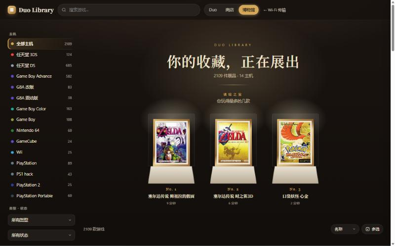</td>
    <td>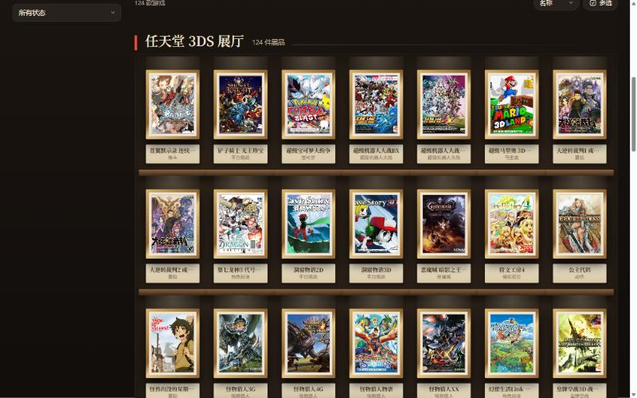</td>
  </tr>
  <tr>
    <th>게임마다: 상세 정보, 편집, 그림 바꾸기</th>
    <th>휴대폰에서</th>
  </tr>
  <tr>
    <td></td>
    <td></td>
  </tr>
</table>

### 월간·연간 플레이 리포트

<table>
  <tr>
    <th>한눈에 보는 한 달, 그리고 가장 많이 한 게임</th>
    <th>한 달의 하루하루</th>
  </tr>
  <tr>
    <td>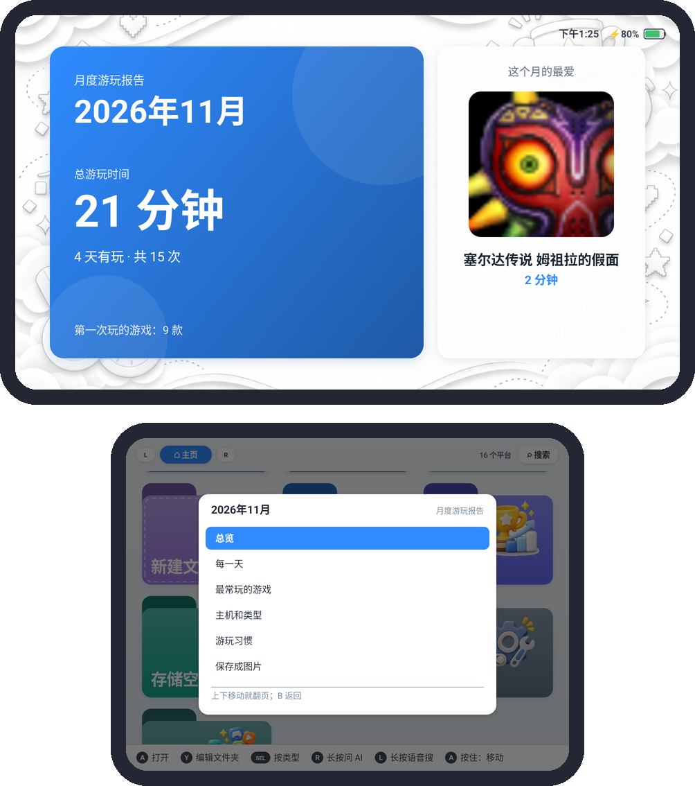</td>
    <td>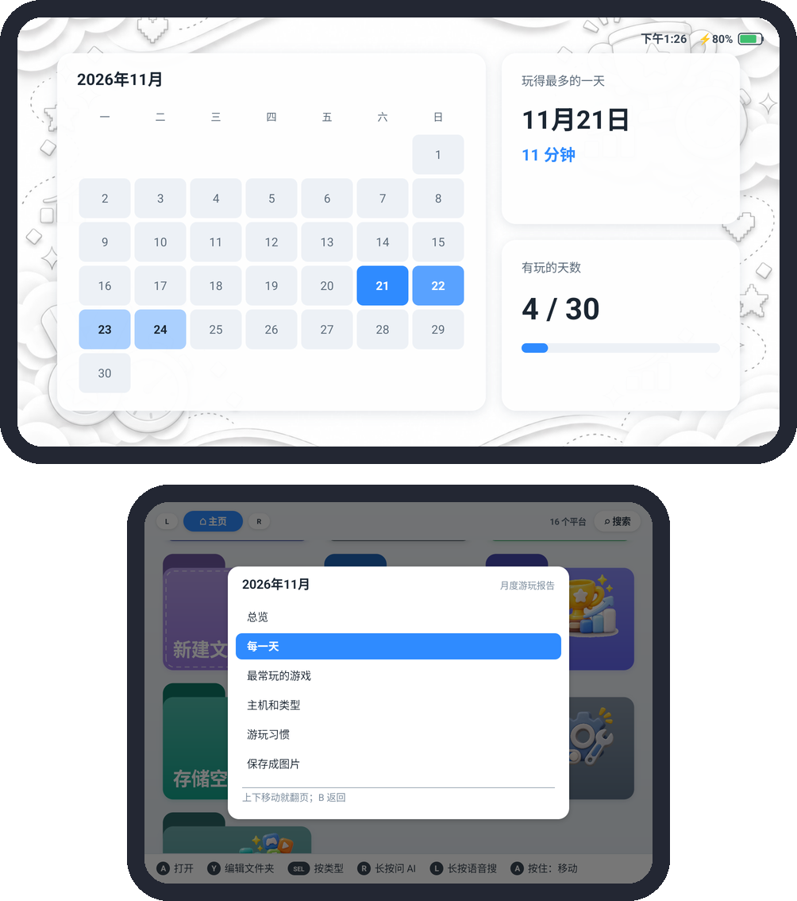</td>
  </tr>
  <tr>
    <th>기기와 장르</th>
    <th>플레이 습관: 아침형인지 올빼미형인지</th>
  </tr>
  <tr>
    <td></td>
    <td></td>
  </tr>
  <tr>
    <th colspan="2">그림 한 장으로 저장해서 바로 공유</th>
  </tr>
  <tr>
    <td colspan="2" align="center"></td>
  </tr>
</table>

### 치트, 내려받기부터 첫 화면까지

<table>
  <tr>
    <th>가져오기 전에 치트 고르기, 이름은 번역된 상태로</th>
    <th>탭 한 번으로 번역되는 3DS 치트</th>
  </tr>
  <tr>
    <td></td>
    <td></td>
  </tr>
  <tr>
    <th>DraStic용 NDS 치트, 중국어 데이터베이스</th>
    <th>RetroArch 치트(GBA)</th>
  </tr>
  <tr>
    <td></td>
    <td></td>
  </tr>
  <tr>
    <th>편집, 추가, 다운로드</th>
    <th>치트 이름 바꾸기·삭제</th>
  </tr>
  <tr>
    <td></td>
    <td></td>
  </tr>
</table>

### 플레이 기록, 문제 센터, Wi-Fi, 그리고 내 데이터

<table>
  <tr>
    <th>게임 하나의 최근 30일, 플레이 횟수, 가장 오래 한 시간</th>
    <th>문제 센터: 손볼 것은 한곳에</th>
  </tr>
  <tr>
    <td>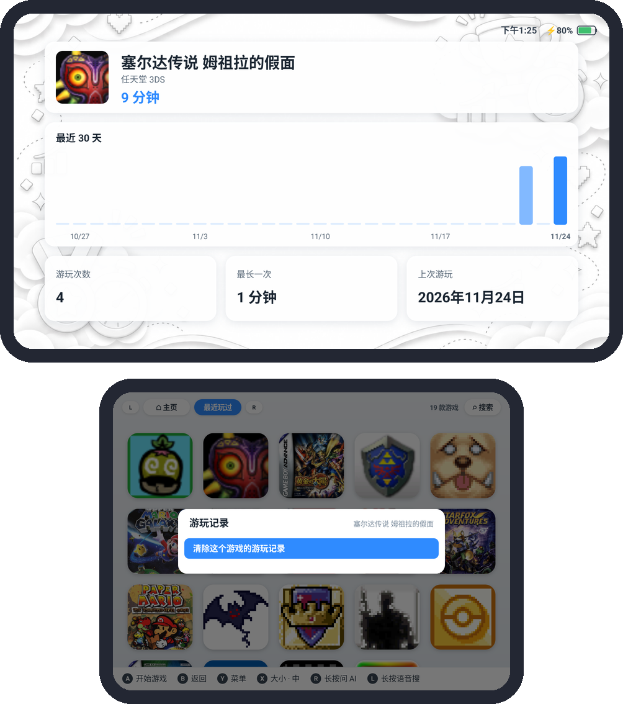</td>
    <td>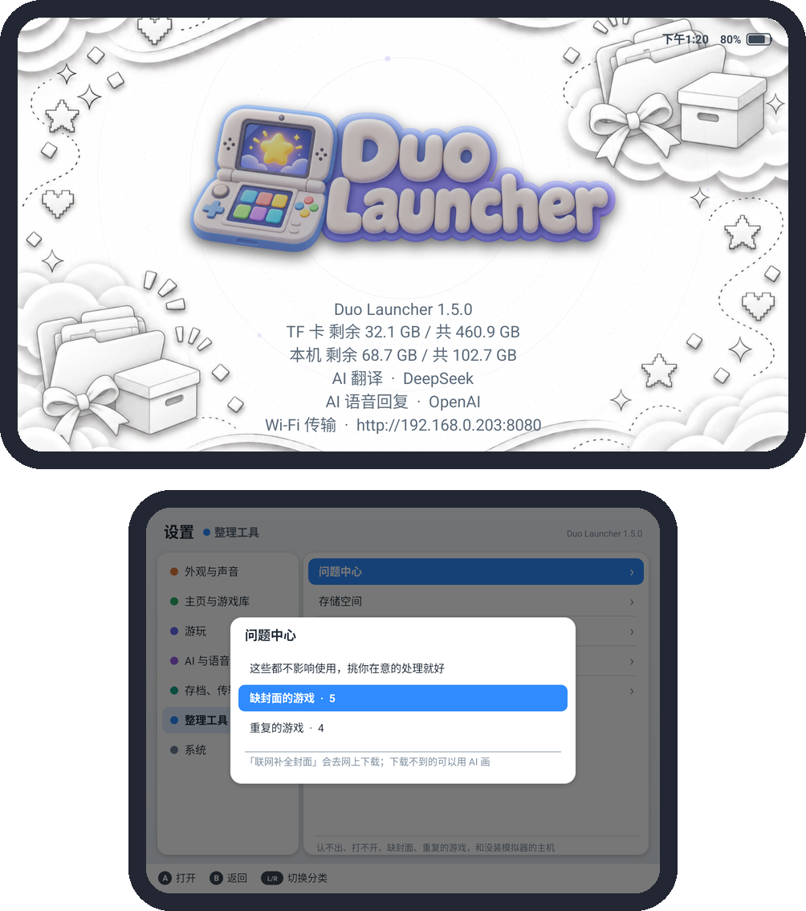</td>
  </tr>
  <tr>
    <th>Wi-Fi: 휴대폰으로 코드 찍기</th>
    <th>런처 데이터를 두는 곳과 자동 사본</th>
  </tr>
  <tr>
    <td></td>
    <td>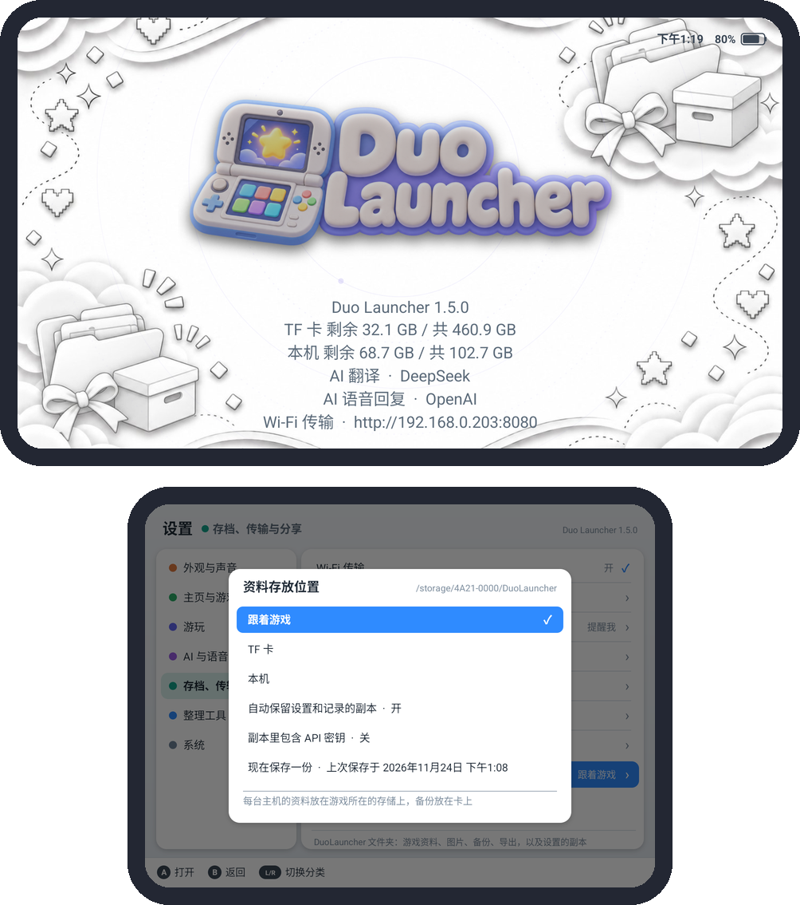</td>
  </tr>
</table>

### 더 보기

<table>
  <tr>
    <th>3DS 스타일 설정</th>
    <th>설정 (다크 모드)</th>
  </tr>
  <tr>
    <td></td>
    <td></td>
  </tr>
  <tr>
    <th>AI 사용량과 비용</th>
    <th>설정 내보내기와 가져오기</th>
  </tr>
  <tr>
    <td></td>
    <td></td>
  </tr>
  <tr>
    <th colspan="2">다크 모드 전용 손그림 배경</th>
  </tr>
  <tr>
    <td colspan="2" align="center">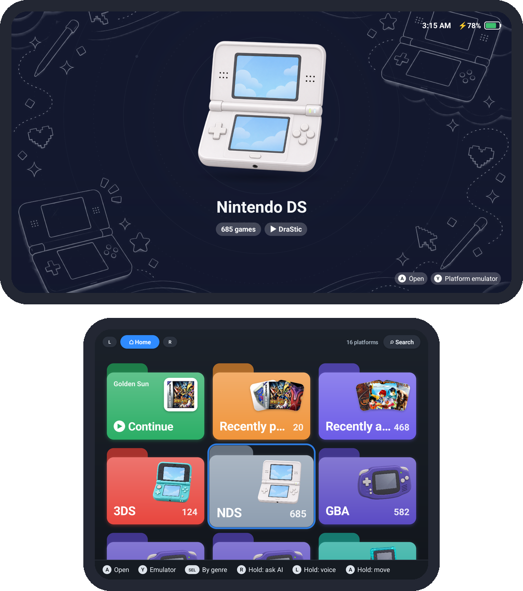</td>
  </tr>
  <tr>
    <th>장르별 홈, 점토 느낌의 장르 아이콘</th>
    <th>시리즈별 홈</th>
  </tr>
  <tr>
    <td></td>
    <td></td>
  </tr>
  <tr>
    <th>게임 화면에 표시되는 장르와 시리즈</th>
    <th>메모, AI에게 묻기, 상태, 조작 방법, 세이브</th>
  </tr>
  <tr>
    <td></td>
    <td></td>
  </tr>
  <tr>
    <th>게임패드 키보드, 영어 제목으로도 찾아짐</th>
    <th>AI에게 뭘 할지 물어보기</th>
  </tr>
  <tr>
    <td></td>
    <td>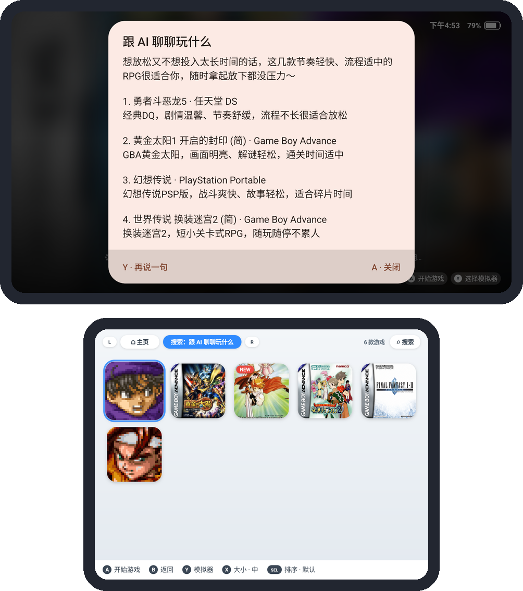</td>
  </tr>
  <tr>
    <th>AI 도구: 시리즈, 추천, 저장 공간, 휴식 알림</th>
    <th>저장 공간: 기기별 용량, 안 해 본 큰 게임</th>
  </tr>
  <tr>
    <td></td>
    <td></td>
  </tr>
  <tr>
    <th>영상 미리보기가 나오는 게임 화면</th>
    <th>게임마다 로고, 표지, 영상 중에서 선택</th>
  </tr>
  <tr>
    <td></td>
    <td></td>
  </tr>
  <tr>
    <th>목록 보기</th>
    <th>플레이 통계</th>
  </tr>
  <tr>
    <td></td>
    <td></td>
  </tr>
  <tr>
    <th>색상 테마</th>
    <th>테마 색이 배경에도 입혀짐</th>
  </tr>
  <tr>
    <td></td>
    <td></td>
  </tr>
  <tr>
    <th>다크 모드</th>
    <th>다크 모드</th>
  </tr>
  <tr>
    <td></td>
    <td></td>
  </tr>
  <tr>
    <th>Wi-Fi 전송</th>
    <th>정리 도구</th>
  </tr>
  <tr>
    <td></td>
    <td>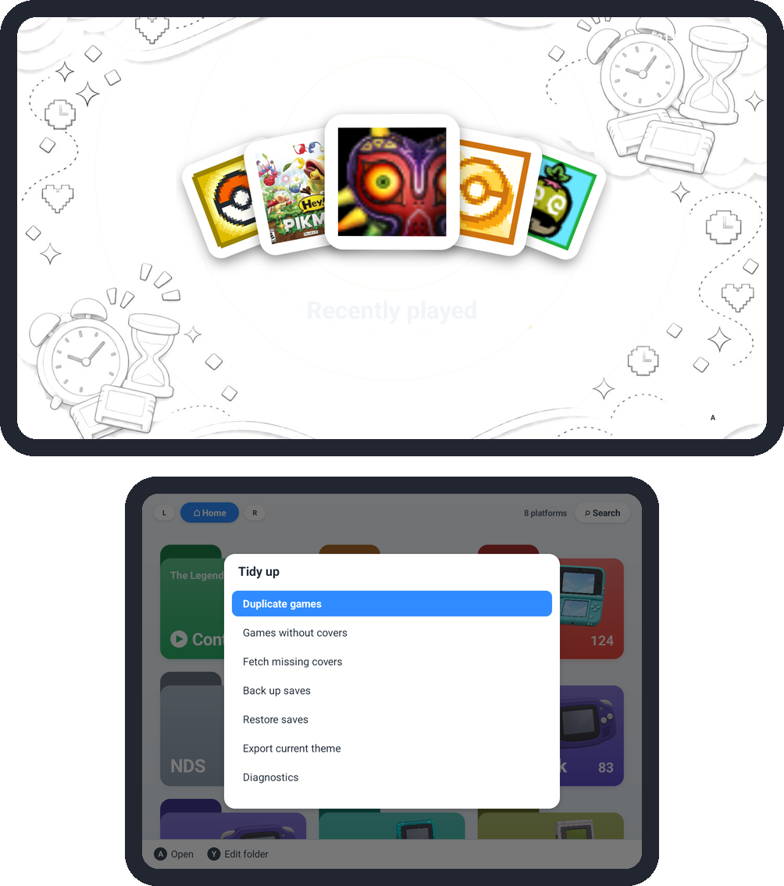</td>
  </tr>
  <tr>
    <th>Dolphin으로 돌리는 게임큐브</th>
    <th>A를 길게 눌러 폴더 옮기기</th>
  </tr>
  <tr>
    <td></td>
    <td></td>
  </tr>
  <tr>
    <th>상세 정보: 크기, 디스크, 스크린샷</th>
    <th>모든 치트를 한 번에 번역</th>
  </tr>
  <tr>
    <td></td>
    <td></td>
  </tr>
  <tr>
    <th>화면 보호기(OLED 안전)</th>
    <th>11개 언어</th>
  </tr>
  <tr>
    <td>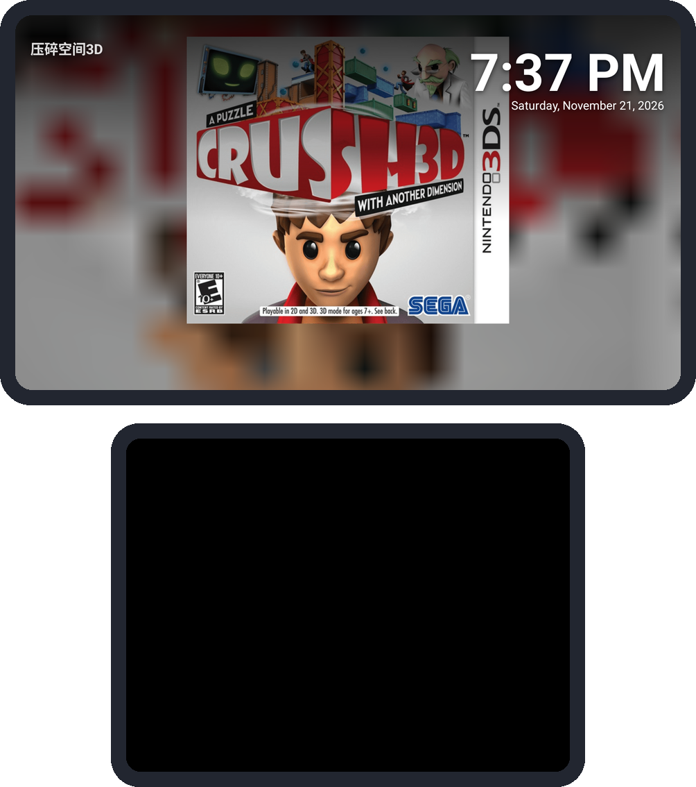</td>
    <td></td>
  </tr>
</table>

## 시작하기

1. [Releases 페이지](https://github.com/GenKnot/DuoLauncher/releases/latest)에서 **APK를 설치**하고 실행합니다.
2. **시작 안내를 따라갑니다.** 처음 켜면 짧은 안내가 나와 한 화면씩 설정을 도와줍니다.
   - **이전 설정과 기록을 찾았습니다** – 런처가 자동으로 남긴 사본이 어느 저장소에서 발견될 때만, 맨 먼저 나옵니다(다시 설치한 뒤나 같은 카드를 새 기기에 꽂았을 때 등). '복원하기'를 고르면 '설정 가져오기'처럼 되살릴 항목을 고를 수 있고, '처음부터 시작'을 고르면 평소대로 안내가 이어집니다. 자세한 내용은 [설정과 공유](#설정과-공유)를 참고하세요.
   - **언어.**
   - **권한** – 한 화면에 모두 모았습니다. 파일 접근(게임을 찾기 위해), 사용 정보 접근(게임이 실제로 화면에 떠 있는 시간만 플레이 시간으로 세기 위해), 그리고 '선택'으로 표시된 '기본 홈 화면으로 설정(부팅 시 실행)'까지. 이 화면은 설정 → 시스템 → 권한에도 있습니다.
   - **찾은 게임** – 검색으로 찾은 기기와 게임 수, 그리고 어디를 찾아봤는지(저장소마다 맨 위에 있는 `Roms` 폴더와 직접 추가한 폴더). 검색이 아직 끝나지 않았으면 그렇다고 알려 주고, 끝나면 숫자가 채워집니다. 어디에도 넣지 못한 파일은 여기서 바로 [문제 센터](#편리한-도구)로 갈 수 있습니다.
   - **AI (선택)** – AI 기능으로 무엇을 할 수 있는지, 그리고 요금은 쓴 만큼 내가 고른 서비스에 낸다는 것. 그다음 '휴대폰으로 키 입력 (Wi-Fi)', '기기에서 설정', '나중에' 중에서 고릅니다.
   - **버튼** – 버튼마다 하는 일을 한 화면에 정리했습니다.

   어느 화면에서나 '안내 건너뛰기'를 누를 수 있고, B를 누르면 한 화면 뒤로 갑니다. 설정 → 시스템 → 시작 안내 다시 보기로 한 번 더 볼 수 있습니다.
   *이렇게 만든 이유:* 런처가 쓸 만한지는 처음 몇 분에 판가름 납니다. 처음 쓰는 사람이 이 문서를 다 읽어야 거기까지 갈 수 있으면 안 됩니다. 찾은 게임 수가 바로 나오니, 누구나 가장 먼저 궁금해하는 "내 게임 찾았어?"에도 곧바로 답이 됩니다. 이미 익숙한 사람은 어느 화면에서든 건너뛰면 됩니다.
3. **게임은 알아서 찾습니다.** 내장 저장소나 SD 카드에 있는 `Roms` 폴더는 자동으로 잡힙니다. 다른 폴더는 설정 → 홈과 라이브러리 → 게임 폴더에서 추가하면 됩니다. 기기 종류는 폴더 이름(`gba`, `Nintendo DS`, `psx` …)과 파일 확장자로 알아냅니다.
4. 기본값 말고 다른 걸 쓰고 싶다면 **에뮬레이터를 고릅니다.** 기기 폴더에서 Y를 누르면 그 기기 전체, 게임에서 Y를 누르면 그 게임만 바뀝니다. 설치된 에뮬레이터만 목록에 나옵니다.
5. **선택: AI 키 넣기.** 설정 → AI와 음성 → AI 서비스와 키에서 기기로 직접 넣어도 되고, Wi-Fi로 컴퓨터나 휴대폰에서 넣으면 훨씬 편합니다(설정 → 세이브·전송·공유 → Wi-Fi 전송, 또는 같은 메뉴의 '컴퓨터나 휴대폰으로 입력 (Wi-Fi 페이지)'). AI 기능만 빼면 키가 없어도 전부 동작합니다.
6. **선택: 홈 화면으로 지정**하면(설정 → 시스템 → 기본 홈 화면으로 설정) 기기를 켤 때 바로 실행됩니다. '안드로이드 홈' 타일을 누르면 언제든 시스템 홈 화면으로 돌아갈 수 있습니다.

## 기본 사용법

**홈**(아래 화면)에는 기기 폴더와 몇 가지 기본 타일이 있습니다. '이어서 하기'(마지막 게임으로 바로 복귀), '최근 플레이', '즐겨찾기', '새 폴더', '검색', '플레이 통계', '저장 공간', '오늘 뭐 하지?', '설정', '안드로이드 홈'. SELECT를 누르면 홈 화면이 기기별, 장르별, 시리즈별로 바뀝니다.

**폴더**를 열면 게임이 표지 그리드로 나옵니다. X를 누르면 표지가 작아지고, 한 번 더 누르면 그리드가 이름, 플레이 시간, 마지막 플레이 날짜가 보이는 목록으로 바뀝니다. SELECT로는 정렬(기본, 이름, 최근 플레이, 플레이 시간순)을 바꾸고, 중국어 간체·중국어 번체·영어판만 골라 볼 수도 있습니다. L2 / R2는 이전·다음 첫 글자로 건너뜁니다. 중국어 제목은 병음 첫 글자 기준입니다.

**위 화면**은 지금 선택한 것을 따라갑니다. 기기를 고르면 배경 위에 게임 수와 에뮬레이터가 나오고, 게임을 고르면 흐리게 깔린 표지 위에 로고가 얹히고 기기, 장르 · 시리즈, 에뮬레이터, 플레이 시간, 짧은 설명이 나옵니다. 잠시 기다리면 영상 미리보기가 재생되거나, 마지막으로 멈춘 장면의 그림이 나옵니다.

**Y**는 선택한 항목의 메뉴입니다. 게임 메뉴는 짧게 줄이고, 가끔 쓰는 기능은 한 단계 안쪽에 넣었습니다. 에뮬레이터, 즐겨찾기, 폴더에 추가 / 폴더에서 빼기, 치트 ›, AI 도우미 ›(AI에게 묻기, 조작 방법), 게임 정보 ›(상세 정보, 장르, 상태와 평가, 플레이 기록, 메모, 위 화면 표시, 이 게임의 AI 그림), 더 보기 ›(세이브, 확인함으로 표시, 숨기기, 게임 파일 삭제). 기기 폴더에서는 기본 에뮬레이터, 이름 바꾸기, 폴더 합치기 ›, 모두 확인함으로 표시, 숨기기가, 기본 타일에서는 이름, 색상, 아이콘, 배경이 있습니다. 선택한 줄이 무슨 일을 하는지는 메뉴 아래에 한 줄로 나옵니다.

*이렇게 만든 이유:* 열다섯 줄짜리 메뉴는 휴대용 기기에서 읽기 힘듭니다. 자주 쓰는 항목은 앞에 두고 나머지는 안쪽으로 넣었으며, 한 줄 설명이 있으니 누르기 전에 무슨 기능인지 짐작할 필요가 없습니다.

**게임 파일 삭제**(Y → 더 보기)는 먼저 물어봅니다. 파일 크기와 세이브는 남는다는 점을 함께 보여 주고, 커서가 '취소'에서 시작하므로 A를 실수로 빠르게 두 번 눌러도 아무것도 지워지지 않습니다. 여러 장짜리 디스크 게임은 모든 파일이 함께 지워집니다. 문제 센터에서 연 목록(예: 중복된 게임)에서 지운 게임은 그 자리에서 목록에서 사라집니다.

*이렇게 만든 이유:* 중복된 게임이나 다 끝낸 게임을 컴퓨터 없이 정리할 수 있습니다.

**한 번만 나오는 도움말.** 어떤 기능을 쓸 수 있는 곳에 처음 오면, 아래 화면의 버튼 안내 바로 위에 한 줄짜리 도움말이 뜹니다. 한 번만 나오고, 9초쯤 지나거나 버튼을 누르면 사라집니다(뜬 뒤 2초 남짓은 눌러도 사라지지 않아서, 읽기도 전에 없어지지는 않습니다. 누른 버튼은 원래 일을 그대로 합니다). 지금은 네 가지가 있습니다.

- 홈에서: A를 길게 눌러 타일을 집어 옮기고, Y로 그 타일의 옵션을 엽니다.
- 폴더에서 홈으로 돌아왔을 때: SELECT로 홈을 기기별, 장르별, 시리즈별로 바꿉니다.
- 기기 폴더에서 기본 정렬 상태로 게임을 골랐을 때: A를 길게 눌러 게임을 원하는 자리로 옮기고, Y로 에뮬레이터, 치트, 세이브 등을 엽니다.
- '인식 안 됨' 폴더에서: 파일에서 A를 눌러 어느 기기용인지 정해 줍니다.

설정 → 시스템 → 새 기능 도움말로 끌 수 있고, '모든 도움말 다시 보기'를 누르면 이미 본 도움말이 다시 나옵니다.
*이렇게 만든 이유:* A를 길게 눌러 옮기기, 홈에서 SELECT 누르기 같은 조작은 놓치기 쉽고 스스로 알아채기도 어렵습니다. 바로 쓸 수 있는 순간에 한 줄 알려 주는 편이 설명서보다 훨씬 잘 기억되고, 한 번이면 충분합니다. 계속 나오는 도움말은 소음이 될 뿐입니다.

### 조작

| 버튼 | 동작 |
|---|---|
| 방향키 / 왼쪽 스틱 | 이동, 누르고 있으면 계속 이동 |
| 목록이나 메뉴에서 좌 / 우, L / R | 한 페이지씩 넘기기 |
| A | 열기 / 플레이, 홈 폴더나 기기 폴더 안의 게임에서 A를 길게 누르면 집어서 옮기기 |
| B | 뒤로 |
| L / R | 이전 / 다음 기기(설정에서는 분류) |
| L 길게 | 음성 검색 |
| R 길게 | AI와 대화 |
| L2 / R2 | 이전 / 다음 첫 글자 |
| X | 표지 크기, 그다음 목록 보기 |
| Y | 선택한 게임, 폴더, 타일의 메뉴 |
| START | 설정(홈 어디서든, '설정' 타일을 숨겨도 열림), 메뉴 안에서는 A와 같음 |
| SELECT | 홈에서는 기기 / 장르 / 시리즈, 폴더에서는 정렬과 언어 필터 |
| R3 | 검색 |
| 검색 키보드에서 | A 입력, B 삭제, X 스페이스, Y 시스템 키보드, SELECT 지우기, START나 R3 완료, L 길게 눌러 말하기 |
| AI 채팅에서 | R 길게 눌러 말하기, Y 입력, X 새 대화, SELECT 기록, L2 / R2 이전 대화 스크롤, B 닫기, 방향키와 A로 아래 게임 고르기 |

모든 조작은 터치로도 됩니다. 한 번 탭하면 선택, 다시 탭하면 열기, 휙 밀면 스크롤이고, L, R, X, SELECT, 검색 대신 위쪽에 늘어선 알약 모양 버튼을 탭해도 됩니다. A/B와 X/Y는 닌텐도식이나 Xbox식 확인 버튼에 맞게 바꿀 수 있습니다(설정 → 플레이 → 버튼 설정).

## 라이브러리

- **게임을 알아서 찾습니다.** 내장 저장소와 SD 카드에서 `Roms` 폴더를 찾고, 다른 폴더는 설정 → 홈과 라이브러리 → 게임 폴더에서 더할 수 있습니다. 마지막 검색 결과를 저장해 두기 때문에 홈 화면은 1초 만에 뜨고, 다음 검색은 뒤에서 조용히 돌아갑니다.
- **지원 기기** – 3DS, NDS, GBA(GBA 진동판·개조판 폴더 포함), GBC, GB, NES, SNES, N64, 게임큐브, Wii, 메가 드라이브, 플레이스테이션 1/2/3, PSP, PS Vita, Switch. PS4, PS5, Xbox 360, Xbox Series용 아트워크도 들어 있습니다. Pegasus G 팩에 있는 나머지 기기도 모두 알아봅니다. 버추얼 보이, 마스터 시스템, 게임 기어, 32X, 메가 CD, 새턴, 드림캐스트, NAOMI, PC 엔진과 PC 엔진 CD, PC-FX, 네오지오 CD, 네오지오 포켓 컬러, 원더스완과 원더스완 컬러, 포켓몬 미니, 아타리 링스, 아타리 2600, 게임 & 워치, 3DO, DOS, 아케이드.
- **여러 장짜리 디스크 게임은 하나로.** 한 폴더 안의 `Disc A/B`, `Disc 1/2`, `CD1/CD2`, `(Disc 2 of 3)`이나 Pegasus의 `files:` 목록은 항목 하나로 합쳐집니다. RetroArch와 DuckStation에는 디스크를 묶은 `.m3u` 재생 목록을 넘겨 주니 게임 안에서 디스크를 바꿀 수 있습니다.
- **안드로이드 게임과 앱** – 설치된 게임은 저절로 전용 폴더에 모입니다. 그 밖의 앱(동영상, 브라우저 …)은 '앱' 폴더에 넣을 수 있습니다.
- **이미 가진 것과 함께.** Pegasus의 `metadata.pegasus.txt`, ES-DE / EmulationStation의 `gamelist.xml`과 `downloaded_media`, RetroArch 썸네일, 게임 옆의 `media/`, `covers/`, `images/` 폴더를 읽습니다. 이 파일들은 하나도 건드리지 않고, 런처가 덧붙이는 내용은 전용 `DuoLauncher` 폴더에 들어갑니다([나만의 게임 정보](#나만의-게임-정보) 참고).
- **새 게임을 알아챕니다.** 카드에 게임을 복사하면 다음 검색 때 잡힙니다. 일주일 동안(혹은 한 번 플레이할 때까지) NEW 표시가 붙고, 장르와 시리즈로 분류할지 물어봅니다. 이 질문은 끌 수 있습니다. Y → "확인함으로 표시"로 게임 하나씩 지울 수 있고, "모두 확인함으로 표시"(기종이나 폴더에서 Y, 또는 설정 → 홈과 라이브러리)로 한꺼번에 지우며, 거기 있는 "NEW 표시" 스위치로 아예 끌 수 있습니다.
- **폴더 합치기.** 서로 다른 곳에 있는 같은 기기의 폴더 두 개(예를 들어 PS1 폴더 두 개)를 하나로 보여 줄 수 있습니다. 기기에서 Y → 폴더 합치기. 게임마다 에뮬레이터 설정은 그대로이고, 이름이 같은 폴더는 저절로 합쳐지며, '분리'로 되돌릴 수 있습니다.
- **나만의 폴더.** '새 폴더' 타일로 이름, 색, 아이콘, 배경을 따로 정한 폴더를 만듭니다. 게임이나 앱은 Y로 넣고, Y → 이 폴더에서 제거로 다시 뺍니다.
- **스마트 폴더**는 알아서 채워집니다. 최근 추가(최근 30일), 아직 안 해 본 게임, 가장 많이 한 게임, 플레이 중, 하고 싶음, 클리어, 높은 평가. 스마트 폴더에서 Y를 누르면 어떤 규칙인지 보여 줍니다.
- **이어서 하기와 즐겨찾기.** 홈의 첫 타일은 마지막 게임으로 바로 돌아갑니다. Y로 별표를 달면 그 게임이 '즐겨찾기' 폴더에 모입니다.
- **안 하는 건 숨기기** – 기기 폴더 통째로, 또는 게임이나 앱 하나만(Y → 이 게임 숨기기). 설정 → 홈과 라이브러리에서 다시 꺼낼 수 있습니다.
- **게임 이름 정리.** ROM 파일에서 그대로 가져온 이름은 `0153 - Legend of Zelda, The - The Minish Cap (USA) [!]`처럼 되어 있기 일쑤입니다. 설정 → 홈과 라이브러리 → 게임 이름 정리에는 스위치가 여섯 개 있고, 처음에는 모두 꺼져 있습니다. 지역·언어 표시 빼기, 버전·덤프 표시 빼기, 앞의 번호 빼기, 밑줄과 점을 공백으로 바꾸기, 끝에 붙은 ", The"를 앞으로 옮기기, 괄호 안 내용 모두 빼기입니다. 스위치마다 옆에 내 라이브러리의 게임 하나를 예로 들어 바뀌기 전과 후의 이름을 보여 주고, '바뀌는 이름 모두 보기'를 누르면 이름이 바뀔 게임이 전부 나옵니다. *이렇게 만든 이유:* 바뀌는 건 화면에 보이는 이름뿐입니다. 카드에 있는 파일은 그대로라서 에뮬레이터, 세이브, 다른 프런트엔드에는 아무 영향이 없습니다. Pegasus나 ES-DE에서 온 제목, 직접 고친 이름은 건드리지 않습니다. 누군가 이미 골라 둔 이름이기 때문입니다. `(Beta)`나 `(Hack)`처럼 게임을 구별해 주는 표시는 괄호 스위치를 켜지 않는 한 그대로 남습니다.
- **게임을 내 순서대로.** 기기 폴더 안에서 게임에 대고 A를 길게 누르면(또는 길게 터치하면) 집어 들 수 있고, 방향키로 옮긴 다음 놓으면 그 자리에 들어갑니다. 순서는 기기별로 저장되고, 다시 검색해도 그대로이며, 전체 백업에도 들어갑니다. 나중에 추가한 게임은 원래 들어갈 자리에 들어갑니다. 되돌리려면 기기에서 Y → 게임 순서 원래대로를 고르면 됩니다. 옮기기는 기본 정렬에서 언어 필터를 쓰지 않을 때만 됩니다. 이름순이나 플레이 시간순으로 정렬하면 내가 정한 순서가 아무 의미가 없기 때문입니다. *이렇게 만든 이유:* 지금 하고 있는 게임이나 발매 순서대로 늘어놓은 시리즈는 맨 위에 모여 있어야 하는데, 그건 어떤 자동 정렬도 알 수 없습니다.
- **나의 게임 목록.** 검색이 끝날 때마다 라이브러리 전체가 `DuoLauncher/catalog.tsv`(기기, 파일, 제목, 영어 제목, 장르, 시리즈, 플레이 시간, 상태, 평가)로 저장됩니다. 스프레드시트나 다른 도구, AI에 넘길 때 쓰세요.

### 장르와 시리즈

게임이 2천 개쯤 되면 기기별로만 훑어보기가 지칩니다. 그래서 모든 게임에 14개 장르(RPG, 액션, 어드벤처, 플랫포머, 전략 RPG, 전략, 슈팅, 퍼즐, 레이싱, 스포츠, 격투, 시뮬레이션, 파티·음악, 기타) 중 하나와 시리즈를 붙여 둡니다.

- **먼저 내장 데이터로.** 런처 안의 표(`assets/gamedb.tsv`, 파일 이름 3,860개. 이 기기들용 Pegasus G 팩 목록에 있는 게임을 모두 담았고, 팩에 `.iso`와 `.cso`가 다 있으면 두 이름 모두 들어 있습니다)가 흔한 ROM 세트의 장르, 시리즈, 공식 영어 제목을 기기와 파일 이름으로 이미 알고 있습니다. 표에 있는 게임은 AI도 인터넷도 전혀 필요 없습니다.
- **나머지는 AI로.** 설정 → AI와 음성 → AI로 라이브러리 정리 → AI 장르 분류 / AI 시리즈 분류로 남은 게임을 정리합니다. 결과는 카드의 `DuoLauncher/<console>/genres.txt`와 `series.txt`에 저장되니, 한 번만 하면 되고 다시 설치해도 남아 있습니다. Pegasus나 ES-DE에 이미 적힌 장르("Action RPG", "角色扮演" …)는 14개 장르에 맞춰 연결됩니다.
- **직접 지정** – 아무 게임에서나 Y → 장르.
- **화면에서.** 위 화면에 게임의 장르 · 시리즈가 나오고, 홈에서 SELECT를 누르면 폴더가 장르별이나 시리즈별로 바뀝니다. 시리즈 이름은 인터페이스 언어를 따릅니다.

### 검색

R3, '검색' 타일, 검색 버튼 중 하나를 누르면 위 화면에 방향키로 쓰기 좋은 키보드가 열리고, 그 위에 최근 검색어와 장르 칩이 한 줄 놓입니다. 입력하는 대로 아래 화면에 결과가 채워집니다. 중국어 제목은 병음 전체, 병음 첫 글자, 음절 앞부분으로도 찾아지고(`kdyg`, `mlao` → 马里奥), 모든 게임이 공식 영어 제목으로도 찾아지기 때문에 `zelda`라고 치면 塞尔达传说(젤다의 전설)이 나옵니다. 기기 폴더 안에서 열면 그 기기에서만 찾고, '모든 플랫폼' 버튼으로 범위를 넓힐 수 있습니다. 입력하는 대신 L을 누른 채 제목을 말해도 됩니다.

### 알아서 채워지는 그림

- **실제 박스 아트** – 설정 → 정리 도구 → 표지 내려받기(문제 센터의 '표지가 없는 게임' 안에도 있습니다)를 누르면 libretro 썸네일 세트에서 표지를 받아 옵니다. NDS와 GBA 게임은 ROM 안의 게임 코드로 맞추기 때문에(압축된 ROM도 되고, 타이틀 화면도 받아 옵니다) 한글화되거나 이름을 바꾼 파일도 제 그림을 찾습니다. 플레이스테이션 1/2, PSP, N64, 게임큐브, Wii, 3DS, GB/GBC, NES, SNES, 메가 드라이브 게임은 영어 제목으로 맞춥니다. '표지가 없다'는 어디서나 같은 뜻으로, 박스 아트가 없는 게임을 말합니다(로고나 배경만 있으면 치지 않습니다). 그래서 문제 센터의 '표지가 없는 게임', '표지 내려받기', AI 그림 메뉴가 모두 같은 수를 보여 줍니다.
- **ROM에서 바로 꺼낸 아이콘** – NDS 배너 아이콘과 3DS SMDH 아이콘. 에뮬레이터에 설치한 3DS 타이틀은 이름도 인터페이스 언어로 나옵니다.
- **고르게 정돈된 표지** – 표지가 타일을 꽉 채우게 하거나, 모두 같은 작은·중간·큰 여백을 두게 할 수 있습니다(설정 → 화면과 소리 → 커버 여백). 표지 그림에 박혀 있는 흰 테두리는 잘라 냅니다.
- **AI 그림** – 이미지용 키가 있으면 AI가 표지, 배경, 타이틀 로고를 그려 줍니다. 게임 하나는 Y → 게임 정보 → 이 게임의 AI 그림에서 그리며, 각 그림이 이미 있는지 표시됩니다. 새 그림은 지금 그림을 대신하고, 타이틀 로고에는 영어 제목이 필요합니다('AI: 게임 이름과 설명'이 찾아 줍니다). 여러 게임은 설정 → AI와 음성 → AI로 라이브러리 정리 → AI로 빠진 게임 그림 그리기에서 그리며, 종류마다 그 그림이 없는 게임 수가 나옵니다. 기기 목록은 '모든 플랫폼'이 맨 앞이고, 이름이 같은 기기가 둘이면 폴더 이름을 보여 줍니다(예: GBA 핵 폴더). 자세한 내용은 [AI](#ai)를 보세요.

## 플레이

- **에뮬레이터는 게임별로도, 기기별로도**(Y). 설치된 에뮬레이터만 나옵니다.

  | 기기 | 에뮬레이터(첫 번째가 기본값) |
  |---|---|
  | 3DS | AzaharPlus, Azahar, Citra MMJ, Citra MMJ (성능 모드) |
  | NDS | DraStic, DraStic (일반 경로), RetroArch · melonDS DS |
  | GB / GBC | RetroArch · Gambatte, mGBA |
  | GBA | RetroArch · mGBA, gpSP, gpSP Rumble |
  | NES | RetroArch · FCEUmm, Mesen |
  | SNES | RetroArch · Snes9x |
  | 메가 드라이브 | RetroArch · Genesis Plus GX, PicoDrive |
  | N64 | RetroArch · Mupen64Plus-Next, Mupen64Plus FZ |
  | 게임큐브 / Wii | Dolphin MMJR, Dolphin |
  | PS1 | RetroArch · PCSX ReARMed, SwanStation, DuckStation |
  | PS2 | ARMSX2, AetherSX2 |
  | PSP | PPSSPP, RetroArch · PPSSPP |
  | PS Vita | Vita3K(타이틀 ID로 실행. 예: `PCSE00000.psvita`라는 파일, 또는 이름에 이 ID가 들어간 파일) |
  | Switch | Eden |
  | 버추얼 보이 | RetroArch · Beetle VB |
  | 마스터 시스템 / 게임 기어 | RetroArch · Genesis Plus GX, PicoDrive |
  | 32X | RetroArch · PicoDrive |
  | 메가 CD | RetroArch · Genesis Plus GX, PicoDrive |
  | 새턴 | RetroArch · Yaba Sanshiro, Yabause |
  | 드림캐스트 / NAOMI | RetroArch · Flycast |
  | PC 엔진 / PC 엔진 CD | RetroArch · Beetle PCE Fast, Beetle PCE |
  | PC-FX | RetroArch · Beetle PC-FX |
  | 네오지오 CD | RetroArch · NeoCD |
  | 네오지오 포켓 컬러 | RetroArch · Beetle NeoPop, RACE |
  | 원더스완 / 컬러 | RetroArch · Beetle Cygne |
  | 포켓몬 미니 | RetroArch · PokeMini |
  | 아타리 링스 | RetroArch · Handy, Beetle Lynx |
  | 아타리 2600 | RetroArch · Stella |
  | 게임 & 워치 | RetroArch · Game & Watch |
  | 3DO | RetroArch · Opera |
  | DOS | RetroArch · DOSBox Pure |
  | 아케이드 | RetroArch · FinalBurn Neo, MAME 2003-Plus |

  Pegasus의 `metadata.pegasus.txt`에는 보통 기기마다 실행 명령이 들어 있습니다. 그 명령을 먼저 쓰고, 위의 코어는 그 옆에 선택지로 나옵니다.

- **Citra MMJ (성능 모드)** – 똑같은 Citra MMJ 빌드를 벤치마크 앱 AnTuTu의 패키지 이름으로 다시 포장한 것입니다. 많은 안드로이드 시스템이 이 패키지를 최고 클럭으로 돌려 줍니다. 그 패키지가 정말 Citra일 때만 목록에 나옵니다.
- **플레이 시간과 통계** – 게임마다 얼마나 했는지, 언제 마지막으로 했는지를 Switch처럼 보여 줍니다. 사용 정보 접근을 허용해 두면 게임이 실제로 화면에 떠 있던 시간만 셉니다. '플레이 통계' 타일에서는 총 플레이 시간, 이번 주 하루하루의 기록, 기기별 시간, 가장 많이 한 게임을 볼 수 있습니다. 게임 하나는 Y → 게임 정보 → 플레이 기록에서 최근 30일의 하루하루 기록, 플레이 횟수, 가장 길게 한 시간, 마지막으로 한 날을 보여 주고, 그 게임의 기록을 지울 수도 있습니다('취소'가 먼저 나옵니다).
- **월간·연간 플레이 리포트** – '플레이 통계' 타일에서 A를 누르면 이번 달, 지난달, 올해, 그리고 예전에 게임을 했던 모든 달과 해의 리포트가 열립니다. 리포트는 위 화면에 다섯 페이지로 나오고, 커서를 움직여 넘깁니다. 총 플레이 시간과 지난달(또는 지난해)보다 얼마나 늘거나 줄었는지, 그리고 가장 아낀 게임. 달력(연간 리포트는 열두 달)과 가장 많이 한 날. 가장 많이 한 게임 다섯 개. 기기별 도넛 차트와 장르별 막대그래프. 마지막으로 플레이 습관 – 아침, 오후, 저녁, 심야 중 언제 주로 하는지, 가장 길게 한 시간, 처음 해 본 게임들. '이미지로 저장'을 누르면 모든 페이지가 이미지 한 장으로 Pictures/DuoLauncher에 저장되어 바로 공유할 수 있습니다. 매달 초에는 지난달 리포트가 나왔다고 한 번 알려 줍니다. 설정 → 플레이 → 플레이 리포트에서 월간·연간 리포트와 이 알림을 켜고 끌 수 있고, 두 리포트를 모두 끄면 타일을 눌렀을 때 바로 플레이한 게임 목록으로 갑니다. *이렇게 만든 이유:* 플레이 시간은 어차피 기록하고 있으니, 나중에 돌아볼 수 있는 이야기로 만들어 두면 좋습니다. 물론 보고 싶을 때만요.
- **마지막으로 멈춘 곳** – 플레이한 적 있는 게임은 가장 최근 스크린샷이나 상태 저장 그림이 위 화면 배경이 됩니다.
- **상태, 평가, 메모** – 게임을 플레이 중, 하고 싶음, 클리어, 포기로 표시하고 별 1~5개로 평가합니다(Y → 상태). 지금 어디까지 했고 다음에 뭘 해야 하는지 한 줄 적거나 말로 남겨 둘 수도 있습니다(Y → 메모). 다음에 그 게임을 고르면 전부 위 화면에 나옵니다.
- **상세 정보**(Y → 상세 정보) – 파일, 크기, 디스크, 폴더, 에뮬레이터, 플레이 시간, 공식 영어 제목, 그리고 위 화면에 그 게임의 스크린샷.
- **영상 미리보기와 소리** – 잠시 기다리면 위 화면에서 게임 영상이 재생됩니다(게임마다 로고나 표지로 바꿀 수도 있습니다. Y → 위 화면 표시). 은은한 인터페이스 효과음과 3DS 게임마다 들어 있는 배너 음악은 끌 수 있습니다.
- **게임하는 동안은 비켜 줍니다.** 게임이 시작되면 아래 화면은 에뮬레이터에 넘어가고 영상, 음악, 배너 음악은 멈춥니다. 여기에 더해 런처는 메모리에 들고 있던 그림을 놓아 주고(실측 약 167 MB → 109 MB), 진행 중이던 카드 검색은 에뮬레이터와 카드 읽기를 다투지 않도록 돌아올 때까지 미뤄 두며, 위 화면의 시계 갱신과 움직임도 멈춥니다. 런처로 돌아오면 1초 안에 표지가 다시 화면에 나옵니다.
  *이렇게 만든 이유:* 메모리와 카드를 에뮬레이터가 혼자 쓸 수 있게 하려고요.
- **게임이 안 켜질 때** – 파일이 없거나, 에뮬레이터가 설치되어 있지 않거나, 그 형식의 파일을 열지 못하거나, 게임이 바로 꺼져 버리면 각각 어떻게 하면 되는지 알려 주는 메시지가 뜹니다. 에뮬레이터가 설치되지 않은 기기는 [문제 센터](#편리한-도구)가 미리 목록으로 보여 주니, 막히기 전에 알 수 있습니다.
- **휴식 알림**(설정 → 플레이) – 한 게임을 1시간, 2시간, 3시간 하고 돌아오면 잠깐 쉬어 가라고 알려 줍니다.
- **RetroAchievements** – 사용자 이름과 Web API 키를 넣으면 최근 플레이한 게임의 업적 진행도를 보여 주고, 업적이 있는 게임에는 🏆 표시를 붙입니다.

## AI 게임 도우미

전부 선택 사항이고, 내가 고른 AI 서비스를 내 키로 씁니다([AI](#ai) 참고).

- **어디서든 말을 걸면 됩니다.** 홈, 폴더, 검색 키보드에서 R을 누른 채 말하세요. 입력하고 싶으면 Y를 누르면 됩니다. 대화는 위 화면에 나오고, AI가 추천하거나 찾아낸 게임은 아래 화면에 깔려서 A로 바로 시작할 수 있습니다. 뭘 할지 묻고("가볍고 너무 길지 않은 RPG"), 범위를 좁히고("좀 더 액션이 많은 걸로"), 지금 고른 게임의 막힌 구간을 어떻게 넘는지, 스토리나 캐릭터는 어떤지 물어보거나, 그냥 수다를 떨어도 됩니다. 대화 내용은 30분 동안 기억합니다.
  *이렇게 만든 이유:* 게임을 고르는 곳은 아래 화면이니 AI의 추천도 거기로 갑니다. 위 화면은 읽는 데에만 쓰면 되고요. 그리고 휴대용 기기에서는 어깨 버튼을 누른 채 말하는 편이 어떤 메뉴보다 빠릅니다.
- **새 대화와 대화 기록.** 채팅에서 X를 누르면 새 대화를 시작하고, SELECT를 누르면 이전 대화가 최신 순으로 나옵니다. 다시 열거나 하나씩 지우거나 한꺼번에 지울 수 있습니다(설정 → AI와 음성 → AI 대화 기록에서도). 채팅이 열려 있는 동안에는 동영상 미리보기, 3DS 배너 음악, 버튼 소리가 멈추고, 음성 답변은 미디어 음량으로 재생됩니다.
  *이렇게 만든 이유:* 새 질문이 이전 주제를 끌고 가지 않도록, 남겨 둘 만한 답이 재시작으로 사라지지 않도록, 그리고 게임 예고편이 음성 답변을 덮지 않도록 하기 위해서입니다. 기록은 '다른 사람과 공유'로 내보낸 설정에는 들어가지 않지만, `DuoLauncher/profile/`의 자동 사본에는 들어가서 다시 설치해도 사라지지 않습니다. 그리고 "AI 대화 기록" 안의 "AI 대화 저장" 스위치로 끌 수 있습니다.
- **답변 읽어 주기** – 설정 → AI와 음성 → AI 서비스와 키 → AI 음성 답변. Soniox(전용 키) 또는 OpenAI(이미지용 키) 중에서 고르고, 목소리와 말하기 속도를 정하고, 미리 들어 볼 수 있습니다. 직접 켜기 전에는 꺼져 있습니다.
- **오늘 뭐 하지** – '오늘 뭐 하지?' 타일에서 Y를 누르면 AI가 내 취향에 맞춰 라이브러리에서 게임 여섯 개를 골라 주고, 하나하나 왜 골랐는지도 알려 줍니다. 타일을 그냥 누르면 한 번도 안 해 본 게임을 우선으로 하나를 무작위로 고릅니다.
- **게임에 대해 묻기**(Y → AI에게 묻기) – 선택한 게임에 대한 질문을 입력하거나 말로 하면 위 화면에 답이 나옵니다.
- **조작 방법**(Y → 조작 방법) – 조작법(일본판에서 확인 / 취소 버튼이 반대인 것까지)과 처음 하는 사람이 알아야 할 기본기를 게임마다 한 번 써 두고 보관합니다.
- **아직 키가 없다면?** R을 길게 누르면 키 넣는 방법을 알려 줍니다. 기기에서 직접, 또는 Wi-Fi로 컴퓨터에서.

## 치트

게임에서 Y → 치트를 누르면 그 게임의 치트 목록이 나오고, A로 하나씩 켜고 끕니다.

| | 3DS (Azahar, Citra) | NDS (DraStic) | PSP (PPSSPP) | RetroArch (GBA, GB, GBC, NES, SNES, N64, MD, PS1, …) |
|---|---|---|---|---|
| 저장 위치 | `azahar/cheats/`와 `citra-emu/cheats/`의 `<title ID>.txt` – 양쪽에 다 쓰기 때문에 에뮬레이터를 바꿔도 그대로 | 전체 목록은 `DuoLauncher/cheats/NDS/`에, 켠 치트는 DraStic 자체 사용자 치트(`DraStic/cheats/<game file name>.cht`)로 들어가서 한글화 ROM에서도 동작 | PPSSPP 자체 치트 파일 `PSP/Cheats/<game ID>.ini`, 게임 ID는 ISO, CSO, EBOOT.PBP에서 읽음 | `RetroArch/cheats/<core>/<game file name>.cht`, 게임을 시작할 때 RetroArch가 불러옴 |
| 기기에 이미 있는 것 | – | DraStic의 `usrcheat.dat`(Retroid 기기에서는 중국어). 게임 코드로만 맞추기 때문에 패치·한글화 ROM도 치트를 찾음. DraStic 자체에서는 하나도 안 보이는 경우에도 | PPSSPP의 `cheat.db`, Retroid 기기에서는 게임 약 4,300개 분량의 중국어 치트 파일 | Retroid에는 게임 수백 개 분량의 중국어 치트가 들어 있음(`000 中文金手指`와 코어별 폴더). 자기 파일이 없는 게임은 이름으로 맞춰 복사본을 받음 |
| 다운로드 | [Sharkive](https://github.com/FlagBrew/Sharkive), 게임 약 650개, ROM에서 읽은 타이틀 ID로 | [libretro-database](https://github.com/libretro/libretro-database), 게임 약 4,200개, ROM 헤더의 게임 코드로 | [CWCheat-Database-Plus+](https://github.com/Saramagrean/CWCheat-Database-Plus-), 게임 약 4,300개, 게임 ID로 | GBA는 [libretro-database](https://github.com/libretro/libretro-database), ROM 헤더의 게임 코드로 |

- **가져오기 전에 고르기** – 다운로드하면 먼저 찾은 치트를 이미 번역된 상태로 보여 주고, '모두 선택' / '모두 해제'도 있습니다. 체크한 것만 추가됩니다. *이렇게 만든 이유:* 데이터베이스에는 게임 하나에 코드가 수십 개씩 있기도 하지만, 대부분은 그중 세 개쯤만 씁니다.
- **번역** – 영어 치트 이름을 탭 한 번에 인터페이스 언어로 바꿉니다. 게임 하나씩도, 모든 게임을 한꺼번에도 됩니다(설정 → 정리 도구). 자주 쓰는 치트는 내장 용어집에서 가져오고(无限血量, 金钱最大, 主代码 …), 나머지는 무료 서비스 MyMemory로 보내며, 안 되면 Google의 무료 엔드포인트로 한 번 더 시도합니다. 버전 표시(`v1.2`)와 버튼 안내(`(START+L)`)는 그대로 두고, 원래 영어 이름은 파일 안에 주석으로 남겨 둡니다.
- **AI로 번역** – AI 키가 있으면 게임 하나의 치트를 게임 이름과 함께 모델에 보내기 때문에, 캐릭터와 아이템의 공식 이름을 씁니다(鬼神林克, 心之容器 …).
- **편집** – 아무 치트나 이름을 바꾸거나 지우고, 한 게임의 치트를 한꺼번에 지우고, 코드를 넣어 직접 추가할 수 있습니다(3DS, NDS, PSP 코드는 `XXXXXXXX YYYYYYYY` 형식인지 확인합니다).
- **DraStic에 안전하게** – 플래시 카트용 패치(복제 방지 우회, 오버레이, Wi-Fi 수정)는 켜면 DraStic이 멈추기 때문에 NDS 다운로드에서 뺍니다. 또 한 번에 켤 수 있는 코드는 DraStic이 불러올 수 있는 최대치인 256줄까지입니다.
- **내 파일에 안전하게** – 손으로 쓴 3DS 치트 파일을 처음 고칠 때 원본을 `.txt.bak`으로 남겨 둡니다.
- **RetroArch는 한 번만** – RetroArch에서 Quick Menu(빠른 메뉴) → Cheats(치트) → "Auto-Apply Cheats During Game Load"(게임 로드 시 자동 적용)를 한 번 켜 두면, 여기서 켠 치트가 게임 시작과 동시에 적용됩니다.

## 화면과 꾸미기

- **위 화면(1920×1080)** – 기기마다 종이를 오려 붙인 듯한 배경이 있고, 게임을 고르면 흐린 표지 위에 로고와 태그, 짧은 설명이 나옵니다. 시계와 배터리는 구석에 있습니다.
- **아래 화면(1280×960)** – 기기 폴더, 확대·축소되는 표지 그리드, 목록 보기. 맨 아래의 버튼 안내는 짧게 유지하고, 글자가 커서 다 안 들어갈 때는 넘치는 부분을 뺍니다.
- **테마** – 색 구성 일곱 가지, 사용자 색상, 그리고 기기 그림, 배경, 글꼴, 효과음, 음악이 들어 있는 테마 팩. 테마 색은 위 화면의 선화 배경에도 입혀집니다. [테마](#테마)를 보세요.
- **라이트·다크 모드** – 시스템을 따르거나 직접 고르면 되고, 모드마다 배경을 따로 그려 두었습니다.
- **홈 화면은 전부 내 것.** 기본 타일과 기기 폴더 하나하나의 이름, 색, 아이콘(내 그림, 또는 이미지 서비스가 런처의 점토 화풍으로 그린 그림)을 바꾸고, 옮기고(A 길게, 또는 길게 터치), 숨길 수 있습니다. 숨긴 것은 설정 → 홈과 라이브러리 → 숨긴 폴더에서 되살립니다. '플레이 통계', '저장 공간', '오늘 뭐 하지?' 같은 기본 타일에도 위 화면 배경을 따로 줄 수 있습니다.
- **기기 외관** – 기기마다 그림, 라이트·다크 배경, 폴더 색을 바꿀 수 있습니다(설정 → 화면과 소리 → 플랫폼 외관). 다크 배경은 이미지 서비스가 라이트 배경을 바탕으로 다시 그려 줄 수 있어서 둘이 늘 어울립니다.
- **글자 크기** – 두 화면 모두 네 단계.
- **화면 보호기** – 몇 분 동안 손을 대지 않으면 위 화면에는 시계와 함께 표지들이 나오고 아래 화면은 꺼집니다. 글자는 그림이 바뀔 때마다 다른 구석으로 옮겨 가고 천천히 움직이기 때문에 OLED 패널에 잔상이 남지 않습니다.
- **경량 모드**(설정 → 화면과 소리의 첫 줄) – 스위치 하나로 영상 미리보기와 3DS 배너 음악, 게임 뒤의 흐린 아트워크, 위 화면에 떠다니는 작은 점들, 기기 그림이 살짝 기울고 흔들리는 움직임, 등장 애니메이션, 깜빡이는 선택 테두리를 모두 끕니다. 켜져 있는 동안 '영상 미리보기'와 '3DS 배너 음악' 스위치는 꺼짐으로 보이고, 누르면 이유를 알려 줍니다. 경량 모드를 끄면 원래 골라 두었던 설정이 그대로 돌아옵니다. Duo에서 실제로 재 보니, 홈 화면에 가만히 두었을 때 위 화면은 보통 5초에 약 600프레임을 다시 그리지만 경량 모드에서는 한 프레임도 그리지 않았습니다.
  *이렇게 만든 이유:* 배터리로 오래 할 때, 또는 그냥 움직이지 않는 화면이 더 좋을 때를 위해서입니다.

## 설정과 공유

- **게임기 같은 설정 화면.** START를 누르면 한 화면짜리 설정이 열립니다. 왼쪽에는 분류(화면과 소리, 홈과 라이브러리, 플레이, AI와 음성, 세이브·전송·공유, 정리 도구, 시스템), 오른쪽에는 그 분류의 항목들이 현재 값, 스위치와 함께 나오고, 위 화면에는 버전, 저장소마다 남은 공간, 켜져 있는 AI 서비스가 나옵니다. L / R로 분류를 바꿉니다.
  어떤 줄은 작은 메뉴로 들어가는 '문'입니다(AI 서비스와 키, AI로 라이브러리 정리, 문제 센터 …). 커서를 올리면 카드 맨 아래에 그 안에 무엇이 있는지 한 줄로 나오고, 안에서 B를 누르면 원래 줄로 돌아오며 값도 이미 바뀌어 있습니다.
  *이렇게 만든 이유:* 한 분류에 열몇 줄이 들어가면 1280×960 화면에서는 벽처럼 보입니다. 덜 쓰는 설정을 문 뒤로 모으면 분류마다 짧게 유지할 수 있고, 한 줄 설명 덕분에 문을 열기 전에 안에 무엇이 있는지 알 수 있습니다.
- **내 설정 백업하고 나누기.** 설정 → 세이브·전송·공유 → 내 설정 내보내기를 누르면 무엇을 넣을지 고를 수 있습니다. 설정과 내 이미지, 플레이 기록, 게임 상태·평점·메모, 키와 계정, AI 사용 기록과 대화, 그리고 `DuoLauncher` 폴더에 있는 게임 자료입니다. 바로 고를 수 있는 묶음도 두 가지 있습니다. *다른 사람과 공유*(설정과 이미지만)와 *전체 백업*(모든 항목)입니다. '설정 가져오기'는 `DuoLauncher/exports`나 Download 폴더에서 설정 파일을 찾아 불러옵니다. Wi-Fi로 받았든, 메신저로 받았든, 카드로 옮겼든 상관없습니다. 안에 든 항목을 먼저 보여 주니, 그대로 두고 싶은 것은 체크를 해제하면 됩니다. Wi-Fi 페이지에서 '가져올 설정'으로 파일을 보내면 바로 `DuoLauncher/exports`에 들어가니, '설정 가져오기'를 열면 이미 기다리고 있습니다.
  *이렇게 만든 이유:* 친구에게 건네는 설정에는 내 키나 기록이 절대 들어가면 안 되고, 내 백업은 새 기기에서든 다시 설치한 뒤든 똑같은 런처를 그대로 되살려야 합니다. 전체 백업에는 키가 들어 있어서 내보낼 때 나만 보관하라고 알려 주고, 다른 사람의 설정에서 온 주소로 내 키가 보내지는 일은 없습니다.
- **데이터 저장 위치**(설정 → 세이브·전송·공유) – `DuoLauncher` 폴더를 어디에 둘지 정합니다. 기기별 장르·시리즈·AI가 붙인 이름, 받아 온 그림과 AI가 그린 그림, 세이브 백업, 내보낸 파일, 테마, 그리고 아래에서 설명하는 설정 사본이 여기에 들어갑니다. '게임과 같은 곳'이 기본값이자 지금까지의 방식으로, 기기별 데이터는 그 게임이 있는 저장소에, 백업은 카드에 둡니다. '카드'는 모든 것을 TF 카드에 두므로, 카드를 다른 기기에 꽂으면 데이터도 함께 따라갑니다(카드가 없을 때는 잠시 내장 저장소를 씁니다). '내장'은 모든 것을 기기 안에 두어서 카드를 바꿔 끼워도 그대로입니다. 바꾸기 전에 저장된 데이터도 있던 자리에서 그대로 읽어 옵니다. '카드'나 '내장'을 골랐다면 '기존 데이터를 여기로 옮기기'가 먼저 크기를 보여 준 뒤 다른 저장소의 `DuoLauncher` 폴더를 옮겨 옵니다. 이미 있는 파일은 그대로 두고, NDS 치트 목록과 여러 장짜리 디스크 목록은 에뮬레이터가 찾는 자리에 남겨 둡니다.
  *이렇게 만든 이유:* 데이터를 어디에 둘지는 쓰는 사람이 정할 일입니다. 정해 놓고 바꿀 수 없는 위치는 하나도 없습니다.
- **설정과 기록 자동 사본.** '설정과 기록 사본 보관'(같은 메뉴, 기본으로 켜짐)은 설정, 내 이미지, 플레이 시간, 상태·평점·메모, 게임 순서, AI 사용 기록과 대화를 고른 저장소의 `DuoLauncher/profile/`에 복사합니다. 처음에는 1분 안에, 그 뒤로는 뭔가 바뀔 때마다입니다. 런처가 화면에 떠 있는 동안 1분쯤마다 확인하고, 게임 중에는 절대 확인하지 않으며, 가장 최근 사본 하나만 남깁니다. API 키는 '사본에 API 키 포함'을 켜지 않는 한 들어가지 않습니다(켤 때는 카드를 가진 사람이면 누구나 읽을 수 있다고 경고합니다). '지금 사본 저장'은 바로 사본을 만들고, 마지막으로 저장한 때를 보여 줍니다. 다시 설치한 뒤나 같은 카드를 새 기기에 꽂으면 시작 안내가 '이전 설정과 기록을 찾았습니다'로 시작합니다. '복원하기'는 '설정 가져오기'처럼 되살릴 항목을 고르게 해 주고, '처음부터 시작'은 그대로 둡니다.
  *이렇게 만든 이유:* 예전에는 앱을 지우거나 공장 초기화를 하면, 미리 손으로 내보내 두지 않은 이상 플레이 시간도 메모도 설정도 다 사라졌기 때문입니다.
- **11개 언어** – 简体中文, 繁體中文, English, 日本語, 한국어, Français, Español, Deutsch, Italiano, Português, Русский.

## 편리한 도구

- **문제 센터** – 설정 → 정리 도구의 첫 줄입니다. 열 때마다 백그라운드에서 라이브러리를 살펴보고, 한번 볼 만한 것들을 모아 줄마다 개수를 붙여 보여 줍니다.
  - **빠진 권한** – 권한 화면을 엽니다.
  - **인식 안 된 파일** – '인식 안 됨' 폴더를 엽니다. 파일에서 A를 누르면 기기를 고를 수 있습니다.
  - **에뮬레이터가 설치되지 않은 기종** – 기기를 고르면 설치된 에뮬레이터(A로 바꿔 쓰기)와, 설치하면 쓸 수 있다고 런처가 아는 에뮬레이터, 그리고 '이 기종 열기'가 나옵니다.
  - **열 수 없는 파일** – 빈 파일, 그리고 Pegasus나 ES-DE 게임 목록에는 있지만 카드에는 없는 파일.
  - **표지가 없는 게임** – 작은 메뉴가 열립니다. '어떤 게임 N개인지 보기', '표지 내려받기'(그 자리에서 '온라인에서 표지를 찾는 중…'이라고 표시하며 진행하고, 끝나면 메뉴로 돌아와 새 개수와 찾은 수를, 또는 온라인에서 찾지 못했다고 알려 줍니다), 그리고 '이 게임 N개의 표지를 AI로 그리기'.
  - **중복된 게임** – 같은 기기, 같은 이름, 같은 크기. 대개 같은 게임을 두 번 복사한 것입니다.

  첫 줄에는 이 중 어느 것도 런처 사용에는 지장이 없다고 적혀 있고, 실제로 있는 문제만 나옵니다. 시작 안내의 '찾은 게임' 화면에서도 여기로 올 수 있습니다. 문제 센터에서 연 목록(표지가 없는 게임, 중복된 게임, 열 수 없는 파일)에서 B를 누르면 홈이 아니라 문제 센터로 돌아갑니다.
  *이렇게 만든 이유:* 이런 점검은 예전에는 설정 여기저기에 흩어져 있었고, 에뮬레이터가 없다는 것도 게임이 안 켜지고 나서야 알 수 있었습니다. 들어갈 때만 점검하고 먼저 튀어나오는 일은 없는 한곳이 있으면, 정리하고 싶을 때 정리하고 나머지는 그냥 둘 수 있습니다.
- **Wi-Fi 전송** – 설정 → 세이브·전송·공유 → Wi-Fi 전송을 누르면 위 화면에 페이지 주소와 그 옆의 QR 코드, 관리 비밀번호(무작위 숫자 6자리, 또는 직접 정한 것), 그리고 이 페이지로 무엇을 할 수 있는지 짧은 목록이 나옵니다. 휴대폰 카메라로 코드를 찍거나, 같은 네트워크에 있는 브라우저에 주소를 입력하면 됩니다. QR 코드는 기기 안에서 만들기 때문에 인터넷 연결이 필요 없습니다. Wi-Fi 메뉴에서 B를 누르면 열기 전에 있던 곳으로 돌아갑니다.
  페이지는 휴대폰이나 컴퓨터의 라이트 / 다크 모드를 따라가고, 브라우저가 선호하는 언어 가운데 런처의 11개 언어에 있는 첫 번째 언어로 나옵니다(대만·홍콩·마카오는 번체 중국어). 맞는 언어가 없으면 영어로 나옵니다. 페이지 전체가 번역되어 있고, 이름도 앱과 같습니다. 잠금을 풀기 전에는 관리 비밀번호만 묻고 여기서 무엇을 할 수 있는지 설명합니다. 잠금을 풀면(새로 고침해도 비밀번호를 다시 보내지 않습니다) 다음이 있습니다.
  - **파일 보내기** – 폴더를 고르고 파일을 끌어다 놓으면 됩니다. ROM은 원하는 기기 폴더로, 테마 팩도 보낼 수 있고, 설정 파일은 '가져올 설정'으로 보내면 `DuoLauncher/exports`에 들어가 설정 → 설정 가져오기에 나타납니다.
  - **AI 번역, AI 이미지, AI 음성 답변, RetroAchievements 설정** – 긴 키를 컴퓨터에서 붙여 넣을 수 있습니다. 저장된 키는 전부 보여 주지 않습니다.
  - **다운로드** – 내보낸 설정, 내보낸 테마, 세이브 백업이 모두 최신순으로, 크기와 날짜와 함께 나옵니다.

  화면이 꺼지면 페이지에 접속할 수 없으므로 전송하는 동안에는 기기 화면이 켜진 채로 유지됩니다.
  *이렇게 만든 이유:* 휴대폰으로 주소를 치는 게 가장 번거로운 부분인데, 카메라로는 1초면 됩니다. 다운로드를 비밀번호 뒤에 둔 것은 전체 백업에 API 키가 들어 있을 수 있기 때문입니다. 같은 Wi-Fi에 있는 누구나 열 수 있는 페이지가 그것을 내줘서는 안 됩니다.
- **저장 공간** – 홈 타일에서 카드가 얼마나 찼는지 보여 주고, 위 화면에는 모든 저장소의 남은 공간이 나옵니다. 안으로 들어가면 기기별 게임 용량, 한 번도 안 해 본 큰 게임 목록이 있고, 확인을 거쳐 게임 파일(모든 디스크, 그리고 `.cue`나 `.m3u`가 가리키는 파일까지)을 지울 수 있습니다.
- **세이브 백업** – DraStic, RetroArch, PPSSPP, AetherSX2, DuckStation, Mupen64Plus FZ, Azahar, Citra의 세이브를 zip 하나로 백업하고 복원합니다. 백업은 SD 카드의 `DuoLauncher/backups`에 보관됩니다(카드가 없으면 내장 저장소). 백업 없이 3시간을 플레이하면 알려 주고, 원하면 알아서 백업하게 할 수도 있습니다(자동 백업은 최근 10개까지 남기고, 직접 만든 백업은 절대 지우지 않습니다). 복원할 때는 복사가 끝까지 완료된 뒤에야 세이브를 하나씩 바꿔 넣습니다. Y → 세이브로 게임 하나만 따로 백업·복원할 수도 있습니다.
- **정리 도구** – 문제 센터, 저장 공간, 표지 내려받기, 모든 치트 번역, 진단 정보 화면. '중복된 게임'과 '표지가 없는 게임'은 이제 문제 센터 안에 있습니다. AI를 쓰는 도구(기기 전체의 이름과 설명, 장르, 시리즈, 장르 아이콘, 빠진 그림 그리기)는 'AI와 음성 → AI로 라이브러리 정리'에 있습니다.
- **업데이트** – 설정 → 시스템 → 정보에서 하루에 한 번 GitHub의 최신 릴리스를 확인하고 링크를 보여 줍니다.
- **홈 화면** – 기본 홈 앱으로 지정하면 기기와 함께 켜집니다. '안드로이드 홈' 타일(또는 설정 → 시스템 → 안드로이드 홈으로 나가기)로 시스템 홈 화면에 돌아가고, 설정 → 시스템 → 안드로이드 설정으로 시스템 자체 설정을 엽니다.

## Duo Library: 브라우저에서 보는 내 게임

설정 → 세이브·전송·공유 → Wi-Fi 전송을 누른 뒤, 컴퓨터나 휴대폰에서 페이지를 열고(위 화면의 QR 코드를 찍으면 됩니다) 기기에 표시된 비밀번호를 입력하세요. **게임 라이브러리** 카드를 누르면 Duo Library가 열립니다. 모든 게임이 표지, 플레이 시간, 상태와 함께, 전부 둘러볼 수 있을 만큼 큰 화면에 나옵니다.

- **라이브러리는 하나, 모습은 세 가지.** 오른쪽 위에서 바꿀 수 있고, 고른 스타일은 브라우저가 기억합니다.
  - **Duo** – 휴대용 기기 그대로의 스타일입니다. 목록에는 점토 느낌의 기기 아이콘이 있고, 게임 위쪽에는 선택한 기기가 일러스트 배경 위에 살며시 떠 있습니다. 위 화면과 똑같이요. 컴퓨터의 라이트·다크 모드를 따라갑니다.
  - **스토어** – 어두운 화면에 큼직한 세로 표지. 포인터를 올리면 표지가 살짝 떠오르며 빛나고, 지금 하고 있는 게임은 배너로 나오며, 게임마다 아래에 기록된 플레이 시간이 붙습니다.
  - **박물관** – 입구에는 가장 많이 한 게임 세 개가 조명을 받은 받침대 위에 놓여 있고, 그 뒤로 기기마다 전시관이 이어집니다('Game Boy Advance 전시관 · 전시품 582점'). 표지는 하나하나 금빛 액자에 담겨 작은 명판과 함께 나무 선반에 놓입니다.
- **무엇이든 찾기.** 이름으로 검색하고(영어 제목과 시리즈로도 찾아집니다), 기기, 장르, 상태로 거르고, 이름, 플레이 시간, 최근 플레이, 최근 추가, 평점 순으로 정렬합니다.
- **게임마다, 세세한 정보까지.** 게임을 누르면 표지와 배경, 설명, 플레이 시간, 마지막 플레이, 파일 크기가 나옵니다. 거기서 이름, 장르, 상태, 평점, 메모, 설명을 고칠 수 있고, 그림을 '커버', '배경', '타이틀 로고' 칸에 끌어다 놓으면 그 그림으로 바뀝니다. 바꾼 것만 런처 자체 파일에 바로 저장되므로 기기에도 곧바로 나타나고, 다시 스캔해도 사라지지 않습니다. 직접 붙인 이름은 그 이름을 입력한 언어에서만 쓰이고, 다른 언어는 원래 이름을 그대로 씁니다.
- **여러 게임을 한 번에.** 여러 개를 골라 장르나 상태를 한꺼번에 정합니다.
- **휴대폰에도 맞게.** 폭이 좁은 화면에서는 기기 목록이 옆으로 밀어 넘기는 칩 한 줄이 되고, 필터는 나란히 놓입니다.
- **빠르고, 나만 열 수 있게.** Wi-Fi 전송을 시작하는 순간 라이브러리를 미리 준비해 두기 때문에, 게임이 수천 개라도 페이지가 금방 열립니다. 설정이나 다운로드와 마찬가지로 기기에 표시된 비밀번호가 있어야 볼 수 있습니다.

*이렇게 만든 이유:* 휴대용 기기 화면은 게임을 하기에 좋은 곳이지, 게임 2000개를 정리하기에 좋은 곳은 아닙니다. 그리고 몇 년에 걸쳐 모은 컬렉션이라면 제대로 구경할 가치가 있습니다. 큰 화면에서, 컬렉션에 어울리는 스타일로요.

## AI

여기 있는 기능은 모두 선택 사항이고 내 계정을 씁니다. 키는 기기 안 런처 설정에 보관되며, 내가 고른 서비스로만 전송됩니다. 설정 → AI와 음성 → AI 서비스와 키에서 넣거나, 컴퓨터나 휴대폰으로 Wi-Fi 페이지에서 넣으세요.

설정 → AI와 음성에는 여섯 줄이 있습니다.

- **AI와 무엇을 할지 상의**와 **AI 오늘 뭐 하지** – 대화와 여섯 가지 추천([AI 게임 도우미](#ai-게임-도우미) 참고).
- **AI 서비스와 키** – AI 번역, AI 이미지, AI 음성 답변의 서비스와 키를 각각 정하고, '컴퓨터나 휴대폰으로 입력 (Wi-Fi 페이지)'도 여기 있습니다.
- **AI로 라이브러리 정리** – AI: 게임 이름과 설명, AI 장르 분류, AI 시리즈 분류, AI 장르 아이콘, AI로 빠진 게임 그림 그리기.
- **AI 대화 기록** – 예전 대화와 'AI 대화 저장' 스위치.
- **AI 사용량과 비용.**

*이렇게 만든 이유:* 이 분류는 예전에 열세 줄이 한 목록에 늘어서 있어서, 매일 쓰는 기능과 한 번 넣고 마는 키가 뒤섞여 있었습니다. 이제는 사람들이 가장 많이 찾는 두 가지를 맨 위에 두고, 한 번만 하는 설정은 문 하나 뒤에, 라이브러리 전체를 훑는 작업은 또 다른 문 뒤에 모았습니다.

- **AI 번역** – DeepSeek, Qwen, OpenAI, Claude, Gemini, 또는 OpenAI 호환 주소 아무거나. 말로 하는 일은 이 키가 다 맡습니다. 채팅, 게임 추천, 'AI에게 묻기', '조작 방법', 장르와 시리즈, 치트 이름(게임 하나를 요청 한 번에), 내 언어로 된 게임 이름과 설명(공식 영어 제목과 함께 런처 자체 메타데이터에 적어 두기 때문에, 중국어 제목뿐인 라이브러리도 영어로 자연스럽게 읽히고 그 반대도 마찬가지입니다). 키가 없으면 치트는 무료 서비스로 번역됩니다.
- **AI 이미지** – OpenAI 이미지 키(그 키로 쓸 수 있는 가장 최신 이미지 모델을 자동으로 고릅니다). 표지, 타이틀 로고, 배경, 기기 그림, 폴더와 타일 아이콘, 배경까지 모두 내장 아트와 같은 점토 아이콘·종이 오리기 화풍으로 그립니다. 아이콘은 배경을 투명하게 그려서 흰 부분이 지워지지 않습니다. 그림 한 장에 30초쯤 걸립니다. 기기에 자체 음성 인식기가 없기 때문에, 같은 키로 내 목소리를 글자로 바꿉니다(`/audio/transcriptions`).
- **AI 음성 답변** – 전용 키를 쓰는 Soniox, 또는 이미지 키를 쓰는 OpenAI. 목소리와 말하기 속도(보통, 빠르게, 아주 빠르게. 두 서비스 모두 중국어를 느리게 읽기 때문에 기본값은 '빠르게')를 고릅니다.
- **AI 사용량과 비용** – 런처가 보내는 모든 요청을 기기 안에서 셉니다. 요청 수, 토큰, 그림 장수, 음성 시간(분)을 오늘, 이번 주, 이번 달, 전체로 나눠 예상 비용과 함께 보여 줍니다. 예상 비용은 각 서비스가 공개한 가격으로 계산하며, 가격은 항목마다 직접 바꿀 수 있습니다(다른 모델, 리셀러, 할인). 실제 금액은 서비스 제공자의 청구서가 기준입니다.

## 게임을 찾는 방법

메타데이터 파일도, 스크레이퍼도, 정해진 폴더 구조도 없이 바로 시작할 수 있습니다. 게임을 카드에 복사하기만 하면 나머지는 런처가 알아서 합니다. 이 섹션에서는 그 과정을 정확히 설명합니다. 무엇을 어디에 두면 되는지, 게임이 왜 그 자리에 나타나는지 알 수 있습니다.

### 찾는 곳

- **각 저장소 맨 위의 모든 `Roms` 폴더** – 내장 저장소와 SD 카드 하나하나. 대소문자는 가리지 않습니다(`ROMs`, `roms`). 설정 → 홈과 라이브러리 → 게임 폴더 → Roms 폴더 자동 찾기에서 끌 수 있습니다.
- **직접 추가한 폴더** – 다른 곳에 둔 게임은 설정 → 홈과 라이브러리 → 게임 폴더에서 추가합니다.
- **거기서 세 단계 아래 폴더까지** 찾습니다. 그림이나 에뮬레이터 파일이 든 폴더는 건너뜁니다. `media`, `images`, `videos`, `covers`, `boxart`, `screenshots`, `manuals`, `marquees`, `wheel`, `saves`, `states`, `savestates`, `bios`, `system`, `cheats`, `downloaded_media`.
- **Azahar나 Citra에 설치한 3DS 게임**(각 에뮬레이터의 `sdmc` 폴더에서)과 **안드로이드 게임**도 함께 추가됩니다.

검색 결과는 저장해 두기 때문에 홈 화면은 1초 만에 뜹니다. 나중에 복사한 게임은 다음 검색 때 찾아냅니다.

*이렇게 만든 이유:* 대부분은 다른 프런트엔드나 ROM 팩에서 쓰던 `Roms` 폴더를 이미 갖고 있습니다. 거기서 시작하면 미리 옮기거나, 이름을 바꾸거나, 설정할 것이 하나도 없습니다.

### 추천하는 폴더 구조

기기마다 폴더 하나, 이름은 기기 이름으로:

```
Roms/
  3DS/      NDS/      GBA/      GBC/      GB/
  NES/      SNES/     N64/      NGC/      WII/
  MD/       PS1/      PS2/      PSP/      PSV/
  SWITCH/   SATURN/   DC/       PCE/      ARCADE/  …
```

폴더 이름은 느슨하게 맞춥니다(띄어쓰기, 하이픈, 대소문자는 무시합니다). Pegasus, ES-DE, RetroArch에서 흔히 쓰는 이름도 그대로 통합니다.

| 기기 | 알아듣는 폴더 이름 | 어디에 있든 알아보는 파일 형식 |
|---|---|---|
| Nintendo 3DS | `3ds`, `n3ds`, `nintendo3ds` | `.3ds` `.cci` `.cxi` `.cia` `.3dsx` |
| Nintendo DS | `nds`, `ds`, `nintendods` | `.nds` `.dsi` |
| Game Boy Advance | `gba`, `gameboyadvance` | `.gba` |
| Game Boy Color | `gbc`, `gameboycolor` | `.gbc` |
| Game Boy | `gb`, `gameboy` | `.gb` |
| NES / Famicom | `nes`, `fc`, `famicom` | `.nes` `.fds` `.unf` |
| SNES / Super Famicom | `snes`, `sfc`, `superfamicom`, `supernintendo` | `.sfc` `.smc` |
| Nintendo 64 | `n64`, `nintendo64` | `.n64` `.z64` `.v64` |
| GameCube | `ngc`, `gc`, `gamecube`, `nintendogamecube` | `.gcm` `.gcz` `.rvz` `.ciso` |
| Wii | `wii`, `nintendowii` | `.wbfs` `.wad` |
| Mega Drive / Genesis | `md`, `genesis`, `megadrive`, `segagenesis` | `.md` `.gen` `.smd` |
| PlayStation | `ps1`, `psx`, `playstation` | `.pbp` |
| PlayStation 2 | `ps2`, `playstation2` | – (전용 폴더 필요) |
| PSP | `psp` | `.cso` |
| PS Vita | `psv`, `psvita`, `vita` | `.vpk` |
| Switch | `switch`, `ns`, `nintendoswitch` | `.nsp` `.xci` `.nsz` `.xcz` |
| Virtual Boy | `vb`, `virtualboy` | `.vb` `.vboy` |
| Master System | `sms`, `mastersystem` | `.sms` |
| Game Gear | `gg`, `gamegear` | `.gg` |
| 32X | `32x`, `sega32x`, `md32x` | `.32x` |
| Mega-CD / Sega CD | `segacd`, `megacd`, `mdcd` | – (내용으로 판별) |
| Saturn | `saturn`, `ss`, `segasaturn` | – (내용으로 판별) |
| Dreamcast | `dc`, `dreamcast` | `.cdi` `.gdi` |
| NAOMI / Atomiswave | `naomi`, `naomi2`, `atomiswave` | – (전용 폴더 필요) |
| PC Engine / TurboGrafx-16 | `pce`, `pcengine`, `tg16` | `.pce` |
| PC Engine CD | `pcecd`, `pcenginecd`, `tgcd` | – (전용 폴더 필요) |
| PC-FX | `pcfx` | – (전용 폴더 필요) |
| Neo Geo CD | `neogeocd`, `ngcd` | – (전용 폴더 필요) |
| Neo Geo Pocket Color | `ngpc`, `ngp`, `neogeopocket` | `.ngp` `.ngc` |
| WonderSwan | `ws`, `wonderswan` | `.ws` |
| WonderSwan Color | `wsc`, `wonderswancolor` | `.wsc` |
| Pokémon Mini | `pokemini` | `.min` |
| Atari Lynx | `lynx`, `atarilynx` | `.lnx` |
| Atari 2600 | `atari`, `atari2600`, `2600` | `.a26` |
| Game & Watch | `gw`, `gameandwatch` | `.mgw` |
| 3DO | `3do` | – (내용으로 판별) |
| DOS | `dos`, `msdos`, `pc` | `.dosz` |
| Arcade | `arcade`, `mame`, `fbneo`, `fba`, `neogeo`, `cps1`/`cps2`/`cps3` | – (전용 폴더 필요) |

### 섞어 둔 폴더, 그리고 전용 폴더가 필요한 것

모든 게임을 폴더 하나에 몰아 넣어도 됩니다. 런처는 파일마다 다음 순서로 확인합니다.

1. **어느 기기용인지 직접 정해 두었나?**(아래 마지막 문단 참고)
2. **폴더 이름에 드러나나?**
3. **한 기기에서만 쓰는 파일 형식인가?**(위 표의 오른쪽 열)
4. **파일 스스로는 뭐라고 하나?** 여러 기기가 함께 쓰는 형식이면 파일 앞부분 몇 바이트만 읽어 봅니다. 큰 카드에서도 금방 끝납니다.
   - `.iso` – 게임큐브, Wii, PSP, 플레이스테이션, 새턴, 메가 CD, 3DO 디스크에는 저마다 표시가 있습니다. 900MB가 넘는 플레이스테이션 디스크는 PS2로 칩니다.
   - `.rvz`, `.wia`, `.ciso` – 디스크 헤더로 게임큐브인지 Wii인지 가립니다. (`.gcz`는 구별할 수 없어서 게임큐브로 칩니다.)
   - `.cue` – 가리키는 `.bin`의 첫 트랙을 보고 플레이스테이션, 새턴, 메가 CD, 3DO 중 무엇인지 알아냅니다.
   - `.chd` – 드림캐스트 GD-ROM이나 PS2 DVD를 알아봅니다. 다른 기기의 CD 이미지는 전용 폴더가 필요합니다.
   - `.zip` – 안에 게임이 하나(파일 네 개까지)만 들어 있고 그 형식이 한 기기 전용이면 알아봅니다. `.zip`에 든 `.gba`처럼요. 파일이 여러 개로 나뉜 아케이드 세트는 아케이드 폴더가 필요합니다.
   - `.m3u` – 첫 번째 디스크를 따릅니다.

그래도 알 수 없는 파일(`.7z`나, 아케이드 폴더 밖에 있는 아케이드 게임 `.zip` 같은 것)도 버리지 않고 홈의 **인식 안 됨** 폴더에 넣습니다. 그 게임에서 A나 Y를 누르고 기기를 한 번 골라 주면 됩니다. 고른 기기는 기억되고, 다시 검색해도 남으며, Y → "어느 기종 게임인가요?" → "기본값으로 복원"으로 되돌릴 수 있습니다. 플레이스테이션의 `.cue` + `.bin` 쌍은 `.cue`만 목록에 나옵니다. [문제 센터](#편리한-도구)는 이런 파일을 '인식 안 된 파일'로 세고, 이 폴더를 바로 열어 줍니다.

*이렇게 만든 이유:* 잘못 짐작하느니 짐작하지 않는 편이 낫습니다. PSP용으로 잘못 분류된 PS2 게임은 실행되지 않으니까요. 그래서 런처는 폴더, 파일 형식, 파일 자체의 헤더 중 하나가 분명한 답을 줄 때만 기기를 정하고, 나머지는 숨기는 대신 직접 물어봅니다.

### 이름, 그림, 상세 정보는 어디서 오나

게임마다 아래 순서대로 살펴서, 정보가 있는 첫 번째 출처를 씁니다.

1. **런처 전용 폴더 `DuoLauncher/`**(아래 참고) – 내가 고친 내용, AI 번역, 장르와 시리즈. 이보다 앞서는 것은 없습니다.
2. **Pegasus** – 게임 폴더의 `metadata.pegasus.txt`. 제목, 설명, 그림, 실행 명령, 여러 장짜리 디스크 목록을 읽습니다. 나중에 복사해서 항목이 없는 게임도 그대로 나옵니다.
3. **ES-DE / EmulationStation** – 게임 옆이나 `ES-DE/gamelists/`에 있는 `gamelist.xml`, 그리고 `downloaded_media/`의 그림.
4. **게임 옆의 그림** – `media/<file name without extension>/`, 또는 `covers/`, `images/`, `boxart/` 안에서 이름이 같은 그림.
5. **RetroArch 썸네일.**
6. **내장 게임 표**(잘 알려진 파일 이름 3,860개) – 공식 영어 제목, 장르, 시리즈.
7. **파일 이름** 그 자체.

다른 프런트엔드의 파일은 읽기만 하고 절대 바꾸지 않으므로, Pegasus, ES-DE, Duo Launcher가 카드 하나를 함께 쓸 수 있습니다.

*이렇게 만든 이유:* 내가 직접 고친 내용은 언제나 이겨야 하지만, 나나 다른 프런트엔드가 이미 모아 둔 것은 버리지 않고 살려 써야 합니다.

### `DuoLauncher` 폴더에 들어 있는 것

런처는 저장소 맨 위의 `DuoLauncher` 폴더에 자기 파일을 둡니다. 기본으로는 기기별 파일이 그 기기의 게임이 있는 저장소(보통 SD 카드)에 들어가고, 설정 → 세이브·전송·공유 → 데이터 저장 위치에서 전부 카드나 내장 저장소로 모을 수도 있습니다([설정과 공유](#설정과-공유) 참고). 치트 목록과 디스크 목록은 언제나 내장 저장소에 들어갑니다.

| 경로 | 내용 |
|---|---|
| `DuoLauncher/<console>/metadata.txt` | 내가 또는 AI가 넣은 이름, 설명, 영어 제목(Pegasus 형식, [나만의 게임 정보](#나만의-게임-정보) 참고) |
| `DuoLauncher/<console>/media/<file name without extension>/` | 직접 넣었거나 내려받은 로고, 표지, 배경 그림 |
| `DuoLauncher/<console>/genres.txt`, `series.txt` | 게임마다의 장르와 시리즈 |
| `DuoLauncher/cheats/NDS/` | NDS 전체 치트 목록(내장 저장소) |
| `DuoLauncher/m3u/` | 여러 장짜리 디스크 게임의 디스크 목록(내장 저장소) |
| `DuoLauncher/themes/` | 테마 팩(어느 저장소든) |
| `DuoLauncher/backups/` | 세이브 백업(SD 카드에 `DuoLauncher` 폴더가 있으면 SD 카드) |
| `DuoLauncher/exports/` | 내보낸 설정과 테마 |
| `DuoLauncher/profile/` | 설정과 기록의 자동 사본('데이터 저장 위치'에서 고른 저장소) |
| `DuoLauncher/catalog.tsv` | 라이브러리 전체 목록, 직접 쓰라고 만들어 두는 파일 |

홈 배치, 폴더, 에뮬레이터 선택, 플레이 시간 같은 설정은 앱 안에 보관되고, 그 사본이 `DuoLauncher/profile/`에 저절로 최신 상태로 유지됩니다. 설정 → 세이브·전송·공유 → 내 설정 내보내기로 위의 모든 것과 함께 파일 하나에 저장할 수 있습니다([설정과 공유](#설정과-공유) 참고).

## 나만의 게임 정보

SD 카드(또는 내장 저장소) 맨 위에 `DuoLauncher` 폴더를 만들면, 다른 프런트엔드의 파일은 건드리지 않고 이름, 설명, 그림을 추가하거나 고칠 수 있습니다. 여기 적은 내용은 Pegasus, ES-DE, 게임 자체 데이터보다 우선합니다.

```
DuoLauncher/
  3DS/metadata.txt
  3DS/media/<file name without extension>/logo.png   (also cover.png, background.png)
  NDS/metadata.txt
```

`metadata.txt`는 Pegasus 형식입니다. 항목은 `file:`로, 에뮬레이터에 설치한 3DS 게임이라면 `titleid:`로 맞춥니다.

```
game: 勇者派遣会社
titleid: 0004000000065600
description: …
```

이름과 설명은 `name.<language>:`, `description.<language>:`로 언어별로 따로 쓸 수 있습니다(`en`, `zh-CN`, `zh-TW`, `ja`, `ko`, `fr`, `es`, `de`, `it`, `pt`, `ru`, `zh`는 중국어 두 가지 모두). 런처가 그 언어로 실행 중일 때 쓰이므로, 폴더 하나로 여러 언어 사용자를 다 챙길 수 있습니다.

```
game: 塞尔达传说 姆祖拉的假面
file: 塞尔达传说 姆祖拉的假面 汉化版.cci
name.en: The Legend of Zelda: Majora's Mask 3D
description.en: Link has three days before the moon falls on Termina…
```

## 테마

설정 → 화면과 소리 → 테마에는 기본 색상 테마 일곱 가지(스카이 블루, 체리 레드, 민트 그린, 그레이프 퍼플, 탠저린, 벚꽃 핑크, 그래파이트), **사용자 색상**(주 색상과 배경 색상만 고르면 라이트·다크 모드의 모든 색조를 거기서 계산합니다), 그리고 설치한 테마 팩이 있습니다. 테마는 두 화면 모두에, 위 화면의 선화 배경까지 색을 입힙니다.

테마 팩은 SD 카드나 내장 저장소의 `DuoLauncher/themes/` 안에 두는 폴더(또는 그 폴더를 묶은 `.zip`. 처음 쓸 때 풀립니다)입니다. 모든 항목은 선택 사항이고, 테마가 빼먹은 부분은 기본 외관을 따르기 때문에 색 몇 개만 바꾸는 작은 테마도 됩니다.

```
DuoLauncher/themes/my-theme/
  theme.txt                      name, author, colours (see below)
  consoles/<type>.png            console pictures      (3ds, nds, gba, ..., recent, search, settings, custom)
  backgrounds/<type>.jpg         upper-screen backdrops
  backgrounds/dark/<type>.jpg    backdrops for dark mode
  logo.png
  font.ttf, font-bold.ttf
  sounds/move|open|back|launch.ogg   (or .wav / .mp3)
  music.ogg (or music.mp3)       loops on the home screen (Settings → Background music appears when a theme has music)
```

`theme.txt`는 `key: value` 형식의 줄로 씁니다. 라이트 모드는 `color.<name>`, 다크 모드는 `dark.color.<name>`이고, 이름으로는 `accent`, `shelf-top`, `shelf-bottom`, `card`, `text`, `pill`, `footer`, `backdrop-paper` / `backdrop-ink`(위 화면의 선화), 홈 폴더용 `folder.<type>` 등이 있습니다. `base-color: #RRGGBB` 한 줄만 있어도 색 구성 전체가 만들어집니다. [themes/sakura](themes/sakura/theme.txt)는 모든 키에 설명을 달아 둔 완전한 예시입니다. 테마에 음악이 있으면 설정에 '배경 음악' 항목이 나타납니다. 설정 → 세이브·전송·공유 → 현재 테마 내보내기를 누르면 지금 꾸며 둔 것을 `DuoLauncher/exports/`에 zip으로 저장하며, 다른 사람은 이걸 자기 `themes/` 폴더에 넣기만 하면 됩니다. 내가 넣은 그림은 `own/` 아래에 함께 들어갑니다.

## 빌드

Android Studio도 Gradle도 필요 없습니다. Android SDK 명령줄 도구(build-tools 35, platform android-35)와 JDK 17 이상만 있으면 됩니다.

```powershell
powershell -File build.ps1            # builds DuoLauncher.apk
powershell -File build.ps1 -Install   # also installs over adb, grants file access and starts it
```

디버그 서명 키(`debug.keystore`)는 첫 빌드 때 만들어지며 저장소에 커밋되지 않습니다. `shot.ps1`은 adb로 키 입력을 보내고 두 화면의 스크린샷을 저장해 주기 때문에 인터페이스를 손볼 때 편리합니다.

## 아트워크

`assets/consoles/<type>.png`(점토 느낌의 기기·타일 아이콘)와 `assets/backgrounds/<type>.jpg`(종이 오리기 느낌의 선화 배경, 다크 모드용은 `backgrounds/dark/`에 따로)는 이 프로젝트를 위해 만든 것입니다. 배경은 흑백이라 색상 테마로 물들일 수 있습니다. 그림이 없는 기기는 직접 그린 게임기 그림으로 대신합니다.

## 실행 참고 사항

- AzaharPlus는 이미 접근 권한이 있는 폴더 아래의 tree URI만 받아들입니다.
  `content://com.android.externalstorage.documents/tree/<volume>%3ARoms%2F3DS/document/<volume>%3ARoms%2F3DS%2F<file>`
- Citra MMJ: `org.citra.emu/org.citra.emu.ui.EmulationActivity`에 `-e GamePath <path>`.
- Citra MMJ (성능 모드)는 같은 빌드를 `com.antutu.ABenchMark`로 다시 포장한 것입니다. 많은 안드로이드 빌드가 이 패키지 이름을 CPU/GPU 최고 클럭으로 돌립니다. 그 패키지 안에 정말 Citra가 들어 있을 때만 목록에 나옵니다.
- Retroid 기기에 들어 있는 DraStic은 `-e GAMEPATH "/sf<path>"`를 요구합니다. 일반 빌드용으로 '일반 경로' 버전도 있습니다.
- RetroArch: `com.retroarch.aarch64/...RetroActivityFuture`에 `-e ROM`, `-e LIBRETRO <core>`, `-e CONFIGFILE`. 실행 명령에 지정된 설정 파일을 그대로 씁니다. Duo에서는 RetroArch 자체의 `retroarch.cfg`가 Retroid의 기기별 테두리를 원래 크기로 보여 주는 반면, Retroid의 화면별 설정 `retroarch1920x1080.cfg`는 TV 테두리 안에 게임을 작게 그리기 때문입니다.
- Dolphin(MMJR과 공식판): `.../ui.main.MainActivity`에 `--es AutoStartFile <path>`.
- ARMSX2, AetherSX2, Eden, PPSSPP, Mupen64Plus FZ에는 게임을 읽기 전용 `content://com.duo.launcher.rom/...` 링크와 일회성 읽기 권한으로 넘기기 때문에, 이 에뮬레이터들은 따로 폴더 접근 권한이 없어도 됩니다.
- Vita3K: `org.vita3k.emulator/.Emulator`에 문자열 배열 extra `AppStartParameters = ["-r", "<title ID>"]`.
- Pegasus 메타데이터에 적힌 실행 명령은 그대로 씁니다.

### 듀얼 스크린 기기에서 Citra MMJ 쓰기

Citra MMJ는 기본적으로 터치 화면을 위쪽 디스플레이에 띄웁니다. 메인 화면을 위로 올리고 화면 버튼을 숨기려면 Citra를 끈 다음 `/sdcard/citra-emu/config/config-mmj.ini`에서 다음과 같이 설정하세요.

```ini
[Controls]
input_overlay_hide = True
[Layout]
landscape_swap_screen = True
```

## 피드백

Duo Launcher는 쓰는 사람들이 어떻게 쓰느냐에 따라 모양이 잡혀 갑니다. 빠진 기능, 헷갈리는 부분, 고장 난 곳이 있거나 나눌 만한 테마를 만들었다면 [이슈](https://github.com/GenKnot/DuoLauncher/issues)를 열어 주세요.

## 라이선스

[MIT](LICENSE)
