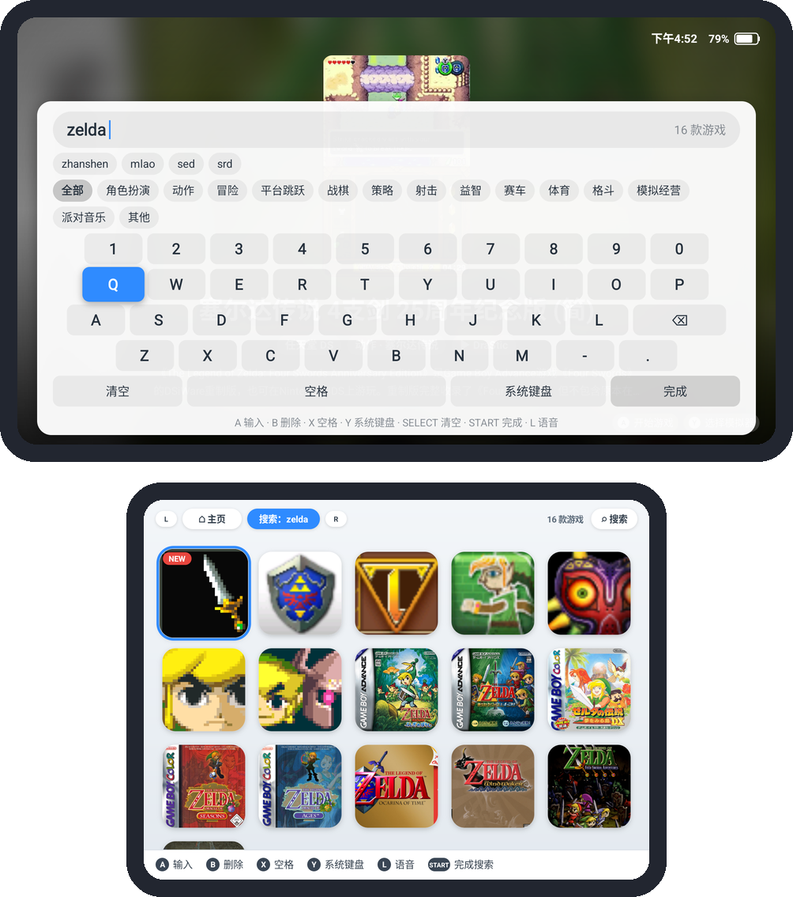
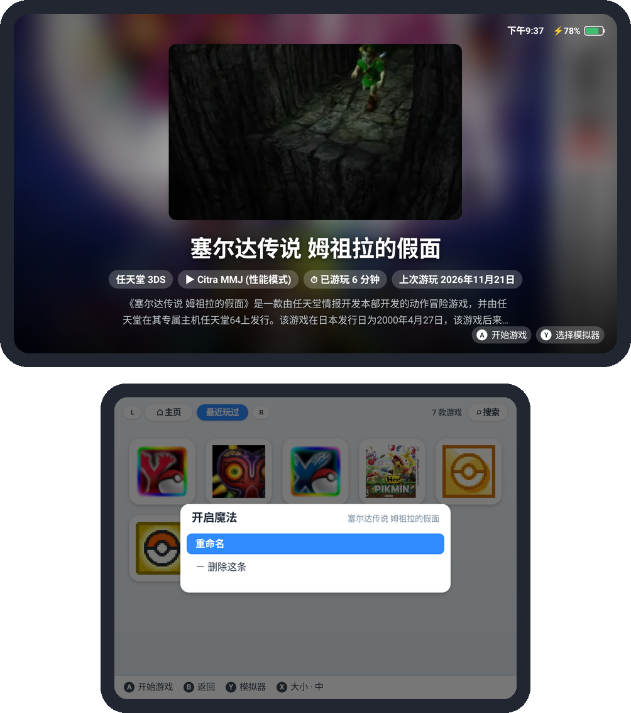

<p align="center"></p>

# Duo Launcher

<p align="center"><a href="README.md">English</a> · <a href="README.fr.md">Français</a> · <a href="README.zh-CN.md">简体中文</a> · <a href="README.zh-TW.md">繁體中文</a> · <a href="README.ja.md">日本語</a> · <b>한국어</b> · <a href="README.es.md">Español</a> · <a href="README.de.md">Deutsch</a> · <a href="README.it.md">Italiano</a> · <a href="README.pt.md">Português</a> · <a href="README.ru.md">Русский</a></p>

**Retroid Pocket Duo**처럼 화면이 두 개 달린 안드로이드 휴대용 게임기를 위한 듀얼 스크린 게임 런처입니다. 3DS 홈 메뉴를 떠올리며 만들었습니다.
ROM 폴더만 알려 주면 게임을 찾아내서 기기·장르·시리즈별로 정리하고, 아래 화면에는 게임 목록을, 위 화면에는 아트워크를 보여 주며, 게임마다 원하는 에뮬레이터로 실행해 줍니다.

**다운로드:** 최신 APK는 [Releases 페이지](https://github.com/GenKnot/DuoLauncher/releases/latest)에 있습니다(Android 11 이상). 새 버전을 기존 버전 위에 그대로 설치하면 모든 설정과 플레이 시간이 유지됩니다.

## 왜 또 런처인가요?

Duo Launcher는 한 사람이 자기 기기 하나에 쓰려고 만든 런처에서 시작했고, 지금도 그 기기를 실제로 어떻게 쓰는지에 맞춰 조금씩 자라고 있습니다. 전체를 관통하는 생각은 몇 가지뿐입니다.

- **화면이 두 개면 할 일도 두 가지.** 아래 화면은 고르는 곳입니다. 큼직한 폴더, 그리드, 목록, 메뉴가 여기에 있습니다. 위 화면은 보는 곳입니다. 일러스트 배경 위의 기기, 표지 위에 얹힌 게임 로고, 영상 미리보기, 지금까지 플레이한 시간, 나에게 남긴 메모, AI와 나누는 대화가 여기에 뜹니다. 어느 것도 다른 것과 자리를 나눠 쓸 필요가 없습니다.
- **게임패드가 먼저.** 모든 기능을 화면을 건드리지 않고 쓸 수 있습니다. 방향키용으로 만든 키보드, 누르고 있으면 계속 넘어가는 스크롤, 한 페이지씩 넘기는 L / R, 길게 누르면 음성 검색이 되는 L, 길게 누르면 AI와 대화하는 R. 터치도 되지만 꼭 필요하지는 않습니다.
- **지금 가진 라이브러리 그대로.** 이미 갖춰 둔 Pegasus나 ES-DE의 메타데이터와 이미지를 그대로 읽고, 런처가 덧붙이는 내용은 따로 `DuoLauncher` 폴더에 보관합니다. 다른 프런트엔드의 파일은 절대 고쳐 쓰지 않습니다.
- **내 키로, 나를 위해 일하는 AI.** 번역, 분류, 그림, 조언, 대화는 *내가* 고르고 직접 요금을 내는 서비스를 씁니다. 키는 기기 안에만 있고, 모든 요청은 예상 비용과 함께 설정에 기록되니 몰래 돌아가는 것은 하나도 없습니다.
- **무엇이든 바꾸고, 숨기고, 나눌 수 있게.** 홈의 모든 타일은 이름, 색, 그림, 위치를 바꾸거나 숨길 수 있습니다. 내 설정 전체를 파일 하나로 내보내 친구에게 줄 수도 있습니다. 키와 플레이 기록은 빼고요.

제안이나 버그 제보는 [이슈 트래커](https://github.com/GenKnot/DuoLauncher/issues)에 남겨 주세요.

## 주요 기능

- **화면은 두 개, 런처는 하나** – 아래 화면에서 고르고, 위 화면에서 로고, 표지, 영상 미리보기, 플레이 시간, 게임 설명을 봅니다.
- **모든 에뮬레이터를 한곳에** – 3DS, NDS, GBA, GB/GBC, NES, SNES, N64, 게임큐브, Wii, 메가 드라이브, PS1, PS2, PSP, PS Vita, Switch를 지원하며, 에뮬레이터는 기기별로도 게임별로도 정할 수 있습니다. 여러 장짜리 디스크 게임은 하나로 보입니다.
- **알아서 정리** – 모든 게임을 14개 장르 중 하나와 시리즈(이스, 악마성 드라큘라, 슈퍼로봇대전 …)로 분류합니다. 홈에서는 라이브러리를 기기별, 장르별, 시리즈별로 볼 수 있고, 스마트 폴더가 '최근 추가', '플레이 중', '하고 싶음', '클리어', '높은 평가'를 늘 최신 상태로 채워 줍니다.
- **AI 게임 도우미** – 어디서든 R을 누른 채 말하면 됩니다. 내 라이브러리에서 할 게임을 추천해 주고, 막힌 구간을 넘는 법을 알려 주고, 스토리를 설명해 주고, 그냥 수다도 받아 줍니다. 답변을 소리 내어 읽어 주게 할 수도 있습니다.
- **치트 관리** – 3DS, NDS, PSP, GBA와 RetroArch의 모든 기기용 치트 수천 개를 바로 쓸 수 있고, 한 번 탭으로 내 언어로 번역되며, 편집도 되고, 에뮬레이터끼리 공유됩니다.
- **빠진 것은 채워서** – libretro 썸네일 세트의 실제 박스 아트, 공식 영어 제목, 그리고 런처 화풍에 맞춰 AI가 그린 표지, 로고, 배경까지.
- **휴대용 기기에 맞춰** – OLED에 안전한 화면 보호기, 브라우저로 하는 Wi-Fi 전송, 세이브 백업, 플레이 통계, RetroAchievements 진행도, 저장 공간 현황, 그리고 1초면 뜨는 홈 화면.
- **내 마음대로** – 색상 테마와 테마 팩, 라이트·다크 모드, 글자 크기, 커버 여백, 게임기 같은 설정 화면, 내보내서 나눌 수 있는 설정. 인터페이스 언어는 11개입니다.

## 스크린샷

<p align="center"></p>

<table>
  <tr>
    <th>장르별 홈, 점토 느낌의 장르 아이콘</th>
    <th>시리즈별 홈</th>
  </tr>
  <tr>
    <td></td>
    <td></td>
  </tr>
  <tr>
    <th>게임 화면에 표시되는 장르와 시리즈</th>
    <th>메모, AI에게 묻기, 상태, 조작 방법, 세이브</th>
  </tr>
  <tr>
    <td></td>
    <td></td>
  </tr>
  <tr>
    <th>게임패드 키보드, 영어 제목으로도 찾아짐</th>
    <th>AI에게 뭘 할지 물어보기</th>
  </tr>
  <tr>
    <td></td>
    <td></td>
  </tr>
  <tr>
    <th>AI 도구: 시리즈, 추천, 저장 공간, 휴식 알림</th>
    <th>저장 공간: 기기별 용량, 안 해 본 큰 게임</th>
  </tr>
  <tr>
    <td></td>
    <td></td>
  </tr>
  <tr>
    <th>영상 미리보기가 나오는 게임 화면</th>
    <th>게임마다 로고, 표지, 영상 중에서 선택</th>
  </tr>
  <tr>
    <td></td>
    <td></td>
  </tr>
  <tr>
    <th>목록 보기</th>
    <th>플레이 통계</th>
  </tr>
  <tr>
    <td></td>
    <td></td>
  </tr>
  <tr>
    <th>색상 테마</th>
    <th>테마 색이 배경에도 입혀짐</th>
  </tr>
  <tr>
    <td></td>
    <td></td>
  </tr>
  <tr>
    <th>다크 모드</th>
    <th>다크 모드</th>
  </tr>
  <tr>
    <td></td>
    <td></td>
  </tr>
  <tr>
    <th>Wi-Fi 전송</th>
    <th>정리 도구</th>
  </tr>
  <tr>
    <td></td>
    <td></td>
  </tr>
  <tr>
    <th>Dolphin으로 돌리는 게임큐브</th>
    <th>A를 길게 눌러 폴더 옮기기</th>
  </tr>
  <tr>
    <td></td>
    <td></td>
  </tr>
  <tr>
    <th>가져오기 전에 치트 고르기, 이름은 번역된 상태로</th>
    <th>상세 정보: 크기, 디스크, 스크린샷</th>
  </tr>
  <tr>
    <td></td>
    <td></td>
  </tr>
  <tr>
    <th>탭 한 번으로 번역되는 3DS 치트</th>
    <th>DraStic용 NDS 치트, 중국어 데이터베이스</th>
  </tr>
  <tr>
    <td></td>
    <td></td>
  </tr>
  <tr>
    <th>RetroArch 치트(GBA)</th>
    <th>편집, 추가, 다운로드</th>
  </tr>
  <tr>
    <td></td>
    <td></td>
  </tr>
  <tr>
    <th>치트 이름 바꾸기·삭제</th>
    <th>모든 치트를 한 번에 번역</th>
  </tr>
  <tr>
    <td></td>
    <td></td>
  </tr>
  <tr>
    <th>화면 보호기(OLED 안전)</th>
    <th>11개 언어</th>
  </tr>
  <tr>
    <td></td>
    <td></td>
  </tr>
</table>

## 시작하기

1. [Releases 페이지](https://github.com/GenKnot/DuoLauncher/releases/latest)에서 **APK를 설치**하고 실행합니다.
2. **언어를 고른 다음**, 한 화면에 모아 둔 권한을 허용합니다. 파일 접근(게임을 찾기 위해), 사용 정보 접근(게임이 실제로 화면에 떠 있는 시간만 플레이 시간으로 세기 위해), 그리고 원하면 홈 화면 역할까지. 이 화면은 나중에도 설정 → 시스템 → 권한에서 언제든 다시 열 수 있습니다.
3. **게임은 알아서 찾습니다.** 내장 저장소나 SD 카드에 있는 `Roms` 폴더는 자동으로 잡힙니다. 다른 폴더는 설정 → 홈과 라이브러리 → 게임 폴더에서 추가하면 됩니다. 기기 종류는 폴더 이름(`gba`, `Nintendo DS`, `psx` …)과 파일 확장자로 알아냅니다.
4. 기본값 말고 다른 걸 쓰고 싶다면 **에뮬레이터를 고릅니다.** 기기 폴더에서 Y를 누르면 그 기기 전체, 게임에서 Y를 누르면 그 게임만 바뀝니다. 설치된 에뮬레이터만 목록에 나옵니다.
5. **선택: AI 키 넣기.** 설정 → AI와 음성에서 기기로 직접 넣어도 되고, Wi-Fi로 컴퓨터나 휴대폰에서 넣으면 훨씬 편합니다(설정 → 세이브·전송·공유 → Wi-Fi 전송). AI 기능만 빼면 키가 없어도 전부 동작합니다.
6. **선택: 홈 화면으로 지정**하면(설정 → 시스템 → 기본 홈 화면으로 설정) 기기를 켤 때 바로 실행됩니다. '안드로이드 홈' 타일을 누르면 언제든 시스템 홈 화면으로 돌아갈 수 있습니다.

## 기본 사용법

**홈**(아래 화면)에는 기기 폴더와 몇 가지 기본 타일이 있습니다. '이어서 하기'(마지막 게임으로 바로 복귀), '최근 플레이', '즐겨찾기', '새 폴더', '검색', '플레이 통계', '저장 공간', '오늘 뭐 하지?', '설정', '안드로이드 홈'. SELECT를 누르면 홈 화면이 기기별, 장르별, 시리즈별로 바뀝니다.

**폴더**를 열면 게임이 표지 그리드로 나옵니다. X를 누르면 표지가 작아지고, 한 번 더 누르면 그리드가 이름, 플레이 시간, 마지막 플레이 날짜가 보이는 목록으로 바뀝니다. SELECT로는 정렬(기본, 이름, 최근 플레이, 플레이 시간순)을 바꾸고, 중국어 간체·중국어 번체·영어판만 골라 볼 수도 있습니다. L2 / R2는 이전·다음 첫 글자로 건너뜁니다. 중국어 제목은 병음 첫 글자 기준입니다.

**위 화면**은 지금 선택한 것을 따라갑니다. 기기를 고르면 배경 위에 게임 수와 에뮬레이터가 나오고, 게임을 고르면 흐리게 깔린 표지 위에 로고가 얹히고 기기, 장르 · 시리즈, 에뮬레이터, 플레이 시간, 짧은 설명이 나옵니다. 잠시 기다리면 영상 미리보기가 재생되거나, 마지막으로 멈춘 장면의 그림이 나옵니다.

**Y**는 선택한 항목의 메뉴입니다. 게임에서는 에뮬레이터, 즐겨찾기, 폴더, 치트, 상세 정보, 장르, 메모, AI에게 묻기, 상태와 평가, 조작 방법, 세이브, 위 화면 표시, 숨기기가 있습니다. 기기 폴더에서는 기본 에뮬레이터, 이름 바꾸기, 폴더 합치기, 숨기기가, 기본 타일에서는 이름, 색상, 아이콘, 배경이 있습니다.

### 조작

| 버튼 | 동작 |
|---|---|
| 방향키 / 왼쪽 스틱 | 이동, 누르고 있으면 계속 이동 |
| 목록이나 메뉴에서 좌 / 우, L / R | 한 페이지씩 넘기기 |
| A | 열기 / 플레이, 홈 폴더에서 A를 길게 누르면 집어서 옮기기 |
| B | 뒤로 |
| L / R | 이전 / 다음 기기(설정에서는 분류) |
| L 길게 | 음성 검색 |
| R 길게 | AI와 대화 |
| L2 / R2 | 이전 / 다음 첫 글자 |
| X | 표지 크기, 그다음 목록 보기 |
| Y | 선택한 게임, 폴더, 타일의 메뉴 |
| START | 설정(홈 어디서든, '설정' 타일을 숨겨도 열림), 메뉴 안에서는 A와 같음 |
| SELECT | 홈에서는 기기 / 장르 / 시리즈, 폴더에서는 정렬과 언어 필터 |
| R3 | 검색 |
| 검색 키보드에서 | A 입력, B 삭제, X 스페이스, Y 시스템 키보드, SELECT 지우기, START나 R3 완료, L 길게 눌러 말하기 |
| AI 채팅에서 | R 길게 눌러 말하기, Y 입력, L2 / R2 이전 대화 스크롤, B 닫기, 방향키와 A로 아래 게임 고르기 |

모든 조작은 터치로도 됩니다. 한 번 탭하면 선택, 다시 탭하면 열기, 휙 밀면 스크롤이고, L, R, X, SELECT, 검색 대신 위쪽에 늘어선 알약 모양 버튼을 탭해도 됩니다. A/B와 X/Y는 닌텐도식이나 Xbox식 확인 버튼에 맞게 바꿀 수 있습니다(설정 → 플레이 → 버튼 설정).

## 라이브러리

- **게임을 알아서 찾습니다.** 내장 저장소와 SD 카드에서 `Roms` 폴더를 찾고, 다른 폴더는 설정 → 홈과 라이브러리 → 게임 폴더에서 더할 수 있습니다. 마지막 검색 결과를 저장해 두기 때문에 홈 화면은 1초 만에 뜨고, 다음 검색은 뒤에서 조용히 돌아갑니다.
- **지원 기기** – 3DS, NDS, GBA(GBA 진동판·개조판 폴더 포함), GBC, GB, NES, SNES, N64, 게임큐브, Wii, 메가 드라이브, 플레이스테이션 1/2/3, PSP, PS Vita, Switch. PS4, PS5, Xbox 360, Xbox Series용 아트워크도 들어 있습니다.
- **여러 장짜리 디스크 게임은 하나로.** 한 폴더 안의 `Disc A/B`, `Disc 1/2`, `CD1/CD2`, `(Disc 2 of 3)`이나 Pegasus의 `files:` 목록은 항목 하나로 합쳐집니다. RetroArch와 DuckStation에는 디스크를 묶은 `.m3u` 재생 목록을 넘겨 주니 게임 안에서 디스크를 바꿀 수 있습니다.
- **안드로이드 게임과 앱** – 설치된 게임은 저절로 전용 폴더에 모입니다. 그 밖의 앱(동영상, 브라우저 …)은 '앱' 폴더에 넣을 수 있습니다.
- **이미 가진 것과 함께.** Pegasus의 `metadata.pegasus.txt`, ES-DE / EmulationStation의 `gamelist.xml`과 `downloaded_media`, RetroArch 썸네일, 게임 옆의 `media/`, `covers/`, `images/` 폴더를 읽습니다. 이 파일들은 하나도 건드리지 않고, 런처가 덧붙이는 내용은 전용 `DuoLauncher` 폴더에 들어갑니다([나만의 게임 정보](#나만의-게임-정보) 참고).
- **새 게임을 알아챕니다.** 카드에 게임을 복사하면 다음 검색 때 잡힙니다. 일주일 동안(혹은 한 번 플레이할 때까지) NEW 표시가 붙고, 장르와 시리즈로 분류할지 물어봅니다. 이 질문은 끌 수 있습니다.
- **폴더 합치기.** 서로 다른 곳에 있는 같은 기기의 폴더 두 개(예를 들어 PS1 폴더 두 개)를 하나로 보여 줄 수 있습니다. 기기에서 Y → 폴더 합치기. 게임마다 에뮬레이터 설정은 그대로이고, 이름이 같은 폴더는 저절로 합쳐지며, '분리'로 되돌릴 수 있습니다.
- **나만의 폴더.** '새 폴더' 타일로 이름, 색, 아이콘, 배경을 따로 정한 폴더를 만듭니다. 게임이나 앱은 Y로 넣고, Y → 이 폴더에서 제거로 다시 뺍니다.
- **스마트 폴더**는 알아서 채워집니다. 최근 추가(최근 30일), 아직 안 해 본 게임, 가장 많이 한 게임, 플레이 중, 하고 싶음, 클리어, 높은 평가. 스마트 폴더에서 Y를 누르면 어떤 규칙인지 보여 줍니다.
- **이어서 하기와 즐겨찾기.** 홈의 첫 타일은 마지막 게임으로 바로 돌아갑니다. Y로 별표를 달면 그 게임이 '즐겨찾기' 폴더에 모입니다.
- **안 하는 건 숨기기** – 기기 폴더 통째로, 또는 게임이나 앱 하나만(Y → 이 게임 숨기기). 설정 → 홈과 라이브러리에서 다시 꺼낼 수 있습니다.
- **나의 게임 목록.** 검색이 끝날 때마다 라이브러리 전체가 `DuoLauncher/catalog.tsv`(기기, 파일, 제목, 영어 제목, 장르, 시리즈, 플레이 시간, 상태, 평가)로 저장됩니다. 스프레드시트나 다른 도구, AI에 넘길 때 쓰세요.

### 장르와 시리즈

게임이 2천 개쯤 되면 기기별로만 훑어보기가 지칩니다. 그래서 모든 게임에 14개 장르(RPG, 액션, 어드벤처, 플랫포머, 전략 RPG, 전략, 슈팅, 퍼즐, 레이싱, 스포츠, 격투, 시뮬레이션, 파티·음악, 기타) 중 하나와 시리즈를 붙여 둡니다.

- **먼저 내장 데이터로.** 런처 안의 표(`assets/gamedb.tsv`, 파일 이름 3,860개. 이 기기들용 Pegasus G 팩 목록에 있는 게임을 모두 담았고, 팩에 `.iso`와 `.cso`가 다 있으면 두 이름 모두 들어 있습니다)가 흔한 ROM 세트의 장르, 시리즈, 공식 영어 제목을 기기와 파일 이름으로 이미 알고 있습니다. 표에 있는 게임은 AI도 인터넷도 전혀 필요 없습니다.
- **나머지는 AI로.** 설정 → AI와 음성 → AI 장르 분류 / AI 시리즈 분류로 남은 게임을 정리합니다. 결과는 카드의 `DuoLauncher/<console>/genres.txt`와 `series.txt`에 저장되니, 한 번만 하면 되고 다시 설치해도 남아 있습니다. Pegasus나 ES-DE에 이미 적힌 장르("Action RPG", "角色扮演" …)는 14개 장르에 맞춰 연결됩니다.
- **직접 지정** – 아무 게임에서나 Y → 장르.
- **화면에서.** 위 화면에 게임의 장르 · 시리즈가 나오고, 홈에서 SELECT를 누르면 폴더가 장르별이나 시리즈별로 바뀝니다. 시리즈 이름은 인터페이스 언어를 따릅니다.

### 검색

R3, '검색' 타일, 검색 버튼 중 하나를 누르면 위 화면에 방향키로 쓰기 좋은 키보드가 열리고, 그 위에 최근 검색어와 장르 칩이 한 줄 놓입니다. 입력하는 대로 아래 화면에 결과가 채워집니다. 중국어 제목은 병음 전체, 병음 첫 글자, 음절 앞부분으로도 찾아지고(`kdyg`, `mlao` → 马里奥), 모든 게임이 공식 영어 제목으로도 찾아지기 때문에 `zelda`라고 치면 塞尔达传说(젤다의 전설)이 나옵니다. 기기 폴더 안에서 열면 그 기기에서만 찾고, '모든 플랫폼' 버튼으로 범위를 넓힐 수 있습니다. 입력하는 대신 L을 누른 채 제목을 말해도 됩니다.

### 알아서 채워지는 그림

- **실제 박스 아트** – 설정 → 정리 도구 → 표지 내려받기를 누르면 libretro 썸네일 세트에서 표지를 받아 옵니다. NDS와 GBA 게임은 ROM 안의 게임 코드로 맞추기 때문에(압축된 ROM도 되고, 타이틀 화면도 받아 옵니다) 한글화되거나 이름을 바꾼 파일도 제 그림을 찾습니다. 플레이스테이션 1/2, PSP, N64, 게임큐브, Wii, 3DS, GB/GBC, NES, SNES, 메가 드라이브 게임은 영어 제목으로 맞춥니다.
- **ROM에서 바로 꺼낸 아이콘** – NDS 배너 아이콘과 3DS SMDH 아이콘. 에뮬레이터에 설치한 3DS 타이틀은 이름도 인터페이스 언어로 나옵니다.
- **고르게 정돈된 표지** – 표지가 타일을 꽉 채우게 하거나, 모두 같은 작은·중간·큰 여백을 두게 할 수 있습니다(설정 → 화면과 소리 → 커버 여백). 표지 그림에 박혀 있는 흰 테두리는 잘라 냅니다.
- **AI 그림** – 이미지용 키가 있으면 그림이 없는 게임의 표지, 타이틀 로고, 배경을 그려 줍니다(Y → 상세 정보 → AI로 표지 만들기, 또는 기기 하나를 통째로 설정 → AI와 음성 → AI 이미지에서). 자세한 내용은 [AI](#ai)를 보세요.

## 플레이

- **에뮬레이터는 게임별로도, 기기별로도**(Y). 설치된 에뮬레이터만 나옵니다.

  | 기기 | 에뮬레이터(첫 번째가 기본값) |
  |---|---|
  | 3DS | AzaharPlus, Azahar, Citra MMJ, Citra MMJ (성능 모드) |
  | NDS | DraStic, DraStic (일반 경로), RetroArch · melonDS DS |
  | GB / GBC | RetroArch · Gambatte, mGBA |
  | GBA | RetroArch · mGBA, gpSP, gpSP Rumble |
  | NES | RetroArch · FCEUmm, Mesen |
  | SNES | RetroArch · Snes9x |
  | 메가 드라이브 | RetroArch · Genesis Plus GX, PicoDrive |
  | N64 | RetroArch · Mupen64Plus-Next, Mupen64Plus FZ |
  | 게임큐브 / Wii | Dolphin MMJR, Dolphin |
  | PS1 | RetroArch · PCSX ReARMed, SwanStation, DuckStation |
  | PS2 | ARMSX2, AetherSX2 |
  | PSP | PPSSPP, RetroArch · PPSSPP |
  | PS Vita | Vita3K(타이틀 ID로 실행. 예: `PCSE00000.psvita`라는 파일, 또는 이름에 이 ID가 들어간 파일) |
  | Switch | Eden |

- **Citra MMJ (성능 모드)** – 똑같은 Citra MMJ 빌드를 벤치마크 앱 AnTuTu의 패키지 이름으로 다시 포장한 것입니다. 많은 안드로이드 시스템이 이 패키지를 최고 클럭으로 돌려 줍니다. 그 패키지가 정말 Citra일 때만 목록에 나옵니다.
- **플레이 시간과 통계** – 게임마다 얼마나 했는지, 언제 마지막으로 했는지를 Switch처럼 보여 줍니다. 사용 정보 접근을 허용해 두면 게임이 실제로 화면에 떠 있던 시간만 셉니다. '플레이 통계' 타일에서는 총 플레이 시간, 이번 주 하루하루의 기록, 기기별 시간, 가장 많이 한 게임을 볼 수 있습니다.
- **마지막으로 멈춘 곳** – 플레이한 적 있는 게임은 가장 최근 스크린샷이나 상태 저장 그림이 위 화면 배경이 됩니다.
- **상태, 평가, 메모** – 게임을 플레이 중, 하고 싶음, 클리어, 포기로 표시하고 별 1~5개로 평가합니다(Y → 상태). 지금 어디까지 했고 다음에 뭘 해야 하는지 한 줄 적거나 말로 남겨 둘 수도 있습니다(Y → 메모). 다음에 그 게임을 고르면 전부 위 화면에 나옵니다.
- **상세 정보**(Y → 상세 정보) – 파일, 크기, 디스크, 폴더, 에뮬레이터, 플레이 시간, 공식 영어 제목, 그리고 위 화면에 그 게임의 스크린샷.
- **영상 미리보기와 소리** – 잠시 기다리면 위 화면에서 게임 영상이 재생됩니다(게임마다 로고나 표지로 바꿀 수도 있습니다. Y → 위 화면 표시). 은은한 인터페이스 효과음과 3DS 게임마다 들어 있는 배너 음악은 끌 수 있습니다.
- **게임이 안 켜질 때** – 파일이 없거나, 에뮬레이터가 설치되어 있지 않거나, 그 형식의 파일을 열지 못하거나, 게임이 바로 꺼져 버리면 각각 어떻게 하면 되는지 알려 주는 메시지가 뜹니다.
- **휴식 알림**(설정 → 플레이) – 한 게임을 1시간, 2시간, 3시간 하고 돌아오면 잠깐 쉬어 가라고 알려 줍니다.
- **RetroAchievements** – 사용자 이름과 Web API 키를 넣으면 최근 플레이한 게임의 업적 진행도를 보여 주고, 업적이 있는 게임에는 🏆 표시를 붙입니다.

## AI 게임 도우미

전부 선택 사항이고, 내가 고른 AI 서비스를 내 키로 씁니다([AI](#ai) 참고).

- **어디서든 말을 걸면 됩니다.** 홈, 폴더, 검색 키보드에서 R을 누른 채 말하세요. 입력하고 싶으면 Y를 누르면 됩니다. 대화는 위 화면에 나오고, AI가 추천하거나 찾아낸 게임은 아래 화면에 깔려서 A로 바로 시작할 수 있습니다. 뭘 할지 묻고("가볍고 너무 길지 않은 RPG"), 범위를 좁히고("좀 더 액션이 많은 걸로"), 지금 고른 게임의 막힌 구간을 어떻게 넘는지, 스토리나 캐릭터는 어떤지 물어보거나, 그냥 수다를 떨어도 됩니다. 대화 내용은 30분 동안 기억합니다.
  *이렇게 만든 이유:* 게임을 고르는 곳은 아래 화면이니 AI의 추천도 거기로 갑니다. 위 화면은 읽는 데에만 쓰면 되고요. 그리고 휴대용 기기에서는 어깨 버튼을 누른 채 말하는 편이 어떤 메뉴보다 빠릅니다.
- **답변 읽어 주기** – 설정 → AI와 음성 → AI 음성 답변. Soniox(전용 키) 또는 OpenAI(이미지용 키) 중에서 고르고, 목소리와 말하기 속도를 정하고, 미리 들어 볼 수 있습니다. 직접 켜기 전에는 꺼져 있습니다.
- **오늘 뭐 하지** – '오늘 뭐 하지?' 타일에서 Y를 누르면 AI가 내 취향에 맞춰 라이브러리에서 게임 여섯 개를 골라 주고, 하나하나 왜 골랐는지도 알려 줍니다. 타일을 그냥 누르면 한 번도 안 해 본 게임을 우선으로 하나를 무작위로 고릅니다.
- **게임에 대해 묻기**(Y → AI에게 묻기) – 선택한 게임에 대한 질문을 입력하거나 말로 하면 위 화면에 답이 나옵니다.
- **조작 방법**(Y → 조작 방법) – 조작법(일본판에서 확인 / 취소 버튼이 반대인 것까지)과 처음 하는 사람이 알아야 할 기본기를 게임마다 한 번 써 두고 보관합니다.
- **아직 키가 없다면?** R을 길게 누르면 키 넣는 방법을 알려 줍니다. 기기에서 직접, 또는 Wi-Fi로 컴퓨터에서.

## 치트

게임에서 Y → 치트를 누르면 그 게임의 치트 목록이 나오고, A로 하나씩 켜고 끕니다.

| | 3DS (Azahar, Citra) | NDS (DraStic) | PSP (PPSSPP) | RetroArch (GBA, GB, GBC, NES, SNES, N64, MD, PS1, …) |
|---|---|---|---|---|
| 저장 위치 | `azahar/cheats/`와 `citra-emu/cheats/`의 `<title ID>.txt` – 양쪽에 다 쓰기 때문에 에뮬레이터를 바꿔도 그대로 | 전체 목록은 `DuoLauncher/cheats/NDS/`에, 켠 치트는 DraStic 자체 사용자 치트(`DraStic/cheats/<game file name>.cht`)로 들어가서 한글화 ROM에서도 동작 | PPSSPP 자체 치트 파일 `PSP/Cheats/<game ID>.ini`, 게임 ID는 ISO, CSO, EBOOT.PBP에서 읽음 | `RetroArch/cheats/<core>/<game file name>.cht`, 게임을 시작할 때 RetroArch가 불러옴 |
| 기기에 이미 있는 것 | – | DraStic의 `usrcheat.dat`(Retroid 기기에서는 중국어). 게임 코드로만 맞추기 때문에 패치·한글화 ROM도 치트를 찾음. DraStic 자체에서는 하나도 안 보이는 경우에도 | PPSSPP의 `cheat.db`, Retroid 기기에서는 게임 약 4,300개 분량의 중국어 치트 파일 | Retroid에는 게임 수백 개 분량의 중국어 치트가 들어 있음(`000 中文金手指`와 코어별 폴더). 자기 파일이 없는 게임은 이름으로 맞춰 복사본을 받음 |
| 다운로드 | [Sharkive](https://github.com/FlagBrew/Sharkive), 게임 약 650개, ROM에서 읽은 타이틀 ID로 | [libretro-database](https://github.com/libretro/libretro-database), 게임 약 4,200개, ROM 헤더의 게임 코드로 | [CWCheat-Database-Plus+](https://github.com/Saramagrean/CWCheat-Database-Plus-), 게임 약 4,300개, 게임 ID로 | GBA는 [libretro-database](https://github.com/libretro/libretro-database), ROM 헤더의 게임 코드로 |

- **가져오기 전에 고르기** – 다운로드하면 먼저 찾은 치트를 이미 번역된 상태로 보여 주고, '모두 선택' / '모두 해제'도 있습니다. 체크한 것만 추가됩니다. *이렇게 만든 이유:* 데이터베이스에는 게임 하나에 코드가 수십 개씩 있기도 하지만, 대부분은 그중 세 개쯤만 씁니다.
- **번역** – 영어 치트 이름을 탭 한 번에 인터페이스 언어로 바꿉니다. 게임 하나씩도, 모든 게임을 한꺼번에도 됩니다(설정 → 정리 도구). 자주 쓰는 치트는 내장 용어집에서 가져오고(无限血量, 金钱最大, 主代码 …), 나머지는 무료 서비스 MyMemory로 보내며, 안 되면 Google의 무료 엔드포인트로 한 번 더 시도합니다. 버전 표시(`v1.2`)와 버튼 안내(`(START+L)`)는 그대로 두고, 원래 영어 이름은 파일 안에 주석으로 남겨 둡니다.
- **AI로 번역** – AI 키가 있으면 게임 하나의 치트를 게임 이름과 함께 모델에 보내기 때문에, 캐릭터와 아이템의 공식 이름을 씁니다(鬼神林克, 心之容器 …).
- **편집** – 아무 치트나 이름을 바꾸거나 지우고, 한 게임의 치트를 한꺼번에 지우고, 코드를 넣어 직접 추가할 수 있습니다(3DS, NDS, PSP 코드는 `XXXXXXXX YYYYYYYY` 형식인지 확인합니다).
- **DraStic에 안전하게** – 플래시 카트용 패치(복제 방지 우회, 오버레이, Wi-Fi 수정)는 켜면 DraStic이 멈추기 때문에 NDS 다운로드에서 뺍니다. 또 한 번에 켤 수 있는 코드는 DraStic이 불러올 수 있는 최대치인 256줄까지입니다.
- **내 파일에 안전하게** – 손으로 쓴 3DS 치트 파일을 처음 고칠 때 원본을 `.txt.bak`으로 남겨 둡니다.
- **RetroArch는 한 번만** – RetroArch에서 Quick Menu(빠른 메뉴) → Cheats(치트) → "Auto-Apply Cheats During Game Load"(게임 로드 시 자동 적용)를 한 번 켜 두면, 여기서 켠 치트가 게임 시작과 동시에 적용됩니다.

## 화면과 꾸미기

- **위 화면(1920×1080)** – 기기마다 종이를 오려 붙인 듯한 배경이 있고, 게임을 고르면 흐린 표지 위에 로고와 태그, 짧은 설명이 나옵니다. 시계와 배터리는 구석에 있습니다.
- **아래 화면(1280×960)** – 기기 폴더, 확대·축소되는 표지 그리드, 목록 보기. 맨 아래의 버튼 안내는 짧게 유지하고, 글자가 커서 다 안 들어갈 때는 넘치는 부분을 뺍니다.
- **테마** – 색 구성 일곱 가지, 사용자 색상, 그리고 기기 그림, 배경, 글꼴, 효과음, 음악이 들어 있는 테마 팩. 테마 색은 위 화면의 선화 배경에도 입혀집니다. [테마](#테마)를 보세요.
- **라이트·다크 모드** – 시스템을 따르거나 직접 고르면 되고, 모드마다 배경을 따로 그려 두었습니다.
- **홈 화면은 전부 내 것.** 기본 타일과 기기 폴더 하나하나의 이름, 색, 아이콘(내 그림, 또는 이미지 서비스가 런처의 점토 화풍으로 그린 그림)을 바꾸고, 옮기고(A 길게, 또는 길게 터치), 숨길 수 있습니다. 숨긴 것은 설정 → 홈과 라이브러리 → 숨긴 폴더에서 되살립니다. '플레이 통계', '저장 공간', '오늘 뭐 하지?' 같은 기본 타일에도 위 화면 배경을 따로 줄 수 있습니다.
- **기기 외관** – 기기마다 그림, 라이트·다크 배경, 폴더 색을 바꿀 수 있습니다(설정 → 화면과 소리 → 플랫폼 외관). 다크 배경은 이미지 서비스가 라이트 배경을 바탕으로 다시 그려 줄 수 있어서 둘이 늘 어울립니다.
- **글자 크기** – 두 화면 모두 네 단계.
- **화면 보호기** – 몇 분 동안 손을 대지 않으면 위 화면에는 시계와 함께 표지들이 나오고 아래 화면은 꺼집니다. 글자는 그림이 바뀔 때마다 다른 구석으로 옮겨 가고 천천히 움직이기 때문에 OLED 패널에 잔상이 남지 않습니다.

## 설정과 공유

- **게임기 같은 설정 화면.** START를 누르면 한 화면짜리 설정이 열립니다. 왼쪽에는 분류(화면과 소리, 홈과 라이브러리, 플레이, AI와 음성, 세이브·전송·공유, 정리 도구, 시스템), 오른쪽에는 그 분류의 항목들이 현재 값, 스위치와 함께 나오고, 위 화면에는 버전, 저장소마다 남은 공간, 켜져 있는 AI 서비스가 나옵니다. L / R로 분류를 바꿉니다.
- **내 설정 나누기.** 설정 → 세이브·전송·공유 → 내 설정 내보내기를 누르면 모든 설정(외관, 홈 배치와 순서, 폴더, 숨긴 항목, 에뮬레이터 선택, AI 서비스)과 내가 넣은 그림이 zip 하나로 저장됩니다. '설정 가져오기'는 `DuoLauncher/exports`나 Download 폴더에서 설정 파일을 찾아 불러옵니다. Wi-Fi로 받았든, 메신저로 받았든, 카드로 옮겼든 상관없습니다.
  *나눠도 안전한 이유:* 키, 비밀번호, 플레이 기록은 설정 파일에 절대 들어가지 않고, 가져와도 내 것은 그대로 남습니다. 또 다른 사람의 설정에서 온 주소로 내 키가 보내지는 일은 없습니다.
- **11개 언어** – 简体中文, 繁體中文, English, 日本語, 한국어, Français, Español, Deutsch, Italiano, Português, Русский.

## 편리한 도구

- **Wi-Fi 전송** – 설정 → 세이브·전송·공유 → Wi-Fi 전송을 누르면 주소와 PIN이 나옵니다. 같은 네트워크에 있는 브라우저로 그 주소를 열고 PIN을 넣은 다음, ROM이나 테마 팩을 원하는 기기 폴더에 바로 끌어다 놓으면 됩니다. 같은 페이지에 AI, 음성, RetroAchievements 설정도 관리 비밀번호(무작위 숫자 6자리, 또는 직접 정한 것) 뒤에 있어서, 긴 키를 컴퓨터에서 붙여 넣을 수 있습니다. 화면이 꺼지면 페이지에 접속할 수 없으므로 전송하는 동안에는 기기 화면이 켜진 채로 유지됩니다.
- **저장 공간** – 홈 타일에서 카드가 얼마나 찼는지 보여 주고, 위 화면에는 모든 저장소의 남은 공간이 나옵니다. 안으로 들어가면 기기별 게임 용량, 한 번도 안 해 본 큰 게임 목록이 있고, 확인을 거쳐 게임 파일(모든 디스크, 그리고 `.cue`나 `.m3u`가 가리키는 파일까지)을 지울 수 있습니다.
- **세이브 백업** – DraStic, RetroArch, PPSSPP, AetherSX2, DuckStation, Mupen64Plus FZ, Azahar, Citra의 세이브를 zip 하나로 백업하고 복원합니다. 백업은 SD 카드의 `DuoLauncher/backups`에 보관됩니다(카드가 없으면 내장 저장소). 백업 없이 3시간을 플레이하면 알려 주고, 원하면 알아서 백업하게 할 수도 있습니다(자동 백업은 최근 10개까지 남기고, 직접 만든 백업은 절대 지우지 않습니다). 복원할 때는 복사가 끝까지 완료된 뒤에야 세이브를 하나씩 바꿔 넣습니다. Y → 세이브로 게임 하나만 따로 백업·복원할 수도 있습니다.
- **정리 도구** – 중복된 게임 찾기, 그림 없는 게임 목록, 빠진 표지 받기, 모든 치트 한꺼번에 번역, 진단 정보 화면. AI를 쓰는 도구(기기 전체의 이름과 설명, 장르, 시리즈, 그림, 장르 아이콘)는 'AI와 음성'에 있습니다.
- **업데이트** – 설정 → 시스템 → 정보에서 하루에 한 번 GitHub의 최신 릴리스를 확인하고 링크를 보여 줍니다.
- **홈 화면** – 기본 홈 앱으로 지정하면 기기와 함께 켜집니다. '안드로이드 홈' 타일(또는 설정 → 시스템 → 안드로이드 홈으로 나가기)로 시스템 홈 화면에 돌아가고, 설정 → 시스템 → 안드로이드 설정으로 시스템 자체 설정을 엽니다.

## AI

여기 있는 기능은 모두 선택 사항이고 내 계정을 씁니다. 키는 기기 안 런처 설정에 보관되며, 내가 고른 서비스로만 전송됩니다. 설정 → AI와 음성에서 넣거나, 컴퓨터나 휴대폰으로 Wi-Fi 페이지에서 넣으세요.

- **AI 번역** – DeepSeek, Qwen, OpenAI, Claude, Gemini, 또는 OpenAI 호환 주소 아무거나. 말로 하는 일은 이 키가 다 맡습니다. 채팅, 게임 추천, 'AI에게 묻기', '조작 방법', 장르와 시리즈, 치트 이름(게임 하나를 요청 한 번에), 내 언어로 된 게임 이름과 설명(공식 영어 제목과 함께 런처 자체 메타데이터에 적어 두기 때문에, 중국어 제목뿐인 라이브러리도 영어로 자연스럽게 읽히고 그 반대도 마찬가지입니다). 키가 없으면 치트는 무료 서비스로 번역됩니다.
- **AI 이미지** – OpenAI 이미지 키(그 키로 쓸 수 있는 가장 최신 이미지 모델을 자동으로 고릅니다). 표지, 타이틀 로고, 배경, 기기 그림, 폴더와 타일 아이콘, 배경까지 모두 내장 아트와 같은 점토 아이콘·종이 오리기 화풍으로 그립니다. 아이콘은 배경을 투명하게 그려서 흰 부분이 지워지지 않습니다. 그림 한 장에 30초쯤 걸립니다. 기기에 자체 음성 인식기가 없기 때문에, 같은 키로 내 목소리를 글자로 바꿉니다(`/audio/transcriptions`).
- **AI 음성 답변** – 전용 키를 쓰는 Soniox, 또는 이미지 키를 쓰는 OpenAI. 목소리와 말하기 속도(보통, 빠르게, 아주 빠르게. 두 서비스 모두 중국어를 느리게 읽기 때문에 기본값은 '빠르게')를 고릅니다.
- **AI 사용량과 비용** – 런처가 보내는 모든 요청을 기기 안에서 셉니다. 요청 수, 토큰, 그림 장수, 음성 시간(분)을 오늘, 이번 주, 이번 달, 전체로 나눠 예상 비용과 함께 보여 줍니다. 예상 비용은 각 서비스가 공개한 가격으로 계산하며, 가격은 항목마다 직접 바꿀 수 있습니다(다른 모델, 리셀러, 할인). 실제 금액은 서비스 제공자의 청구서가 기준입니다.

## 나만의 게임 정보

SD 카드(또는 내장 저장소) 맨 위에 `DuoLauncher` 폴더를 만들면, 다른 프런트엔드의 파일은 건드리지 않고 이름, 설명, 그림을 추가하거나 고칠 수 있습니다. 여기 적은 내용은 Pegasus, ES-DE, 게임 자체 데이터보다 우선합니다.

```
DuoLauncher/
  3DS/metadata.txt
  3DS/media/<file name without extension>/logo.png   (also cover.png, background.png)
  NDS/metadata.txt
```

`metadata.txt`는 Pegasus 형식입니다. 항목은 `file:`로, 에뮬레이터에 설치한 3DS 게임이라면 `titleid:`로 맞춥니다.

```
game: 勇者派遣会社
titleid: 0004000000065600
description: …
```

이름과 설명은 `name.<language>:`, `description.<language>:`로 언어별로 따로 쓸 수 있습니다(`en`, `zh-CN`, `zh-TW`, `ja`, `ko`, `fr`, `es`, `de`, `it`, `pt`, `ru`, `zh`는 중국어 두 가지 모두). 런처가 그 언어로 실행 중일 때 쓰이므로, 폴더 하나로 여러 언어 사용자를 다 챙길 수 있습니다.

```
game: 塞尔达传说 姆祖拉的假面
file: 塞尔达传说 姆祖拉的假面 汉化版.cci
name.en: The Legend of Zelda: Majora's Mask 3D
description.en: Link has three days before the moon falls on Termina…
```

## 테마

설정 → 화면과 소리 → 테마에는 기본 색상 테마 일곱 가지(스카이 블루, 체리 레드, 민트 그린, 그레이프 퍼플, 탠저린, 벚꽃 핑크, 그래파이트), **사용자 색상**(주 색상과 배경 색상만 고르면 라이트·다크 모드의 모든 색조를 거기서 계산합니다), 그리고 설치한 테마 팩이 있습니다. 테마는 두 화면 모두에, 위 화면의 선화 배경까지 색을 입힙니다.

테마 팩은 SD 카드나 내장 저장소의 `DuoLauncher/themes/` 안에 두는 폴더(또는 그 폴더를 묶은 `.zip`. 처음 쓸 때 풀립니다)입니다. 모든 항목은 선택 사항이고, 테마가 빼먹은 부분은 기본 외관을 따르기 때문에 색 몇 개만 바꾸는 작은 테마도 됩니다.

```
DuoLauncher/themes/my-theme/
  theme.txt                      name, author, colours (see below)
  consoles/<type>.png            console pictures      (3ds, nds, gba, ..., recent, search, settings, custom)
  backgrounds/<type>.jpg         upper-screen backdrops
  backgrounds/dark/<type>.jpg    backdrops for dark mode
  logo.png
  font.ttf, font-bold.ttf
  sounds/move|open|back|launch.ogg   (or .wav / .mp3)
  music.ogg (or music.mp3)       loops on the home screen (Settings → Background music appears when a theme has music)
```

`theme.txt`는 `key: value` 형식의 줄로 씁니다. 라이트 모드는 `color.<name>`, 다크 모드는 `dark.color.<name>`이고, 이름으로는 `accent`, `shelf-top`, `shelf-bottom`, `card`, `text`, `pill`, `footer`, `backdrop-paper` / `backdrop-ink`(위 화면의 선화), 홈 폴더용 `folder.<type>` 등이 있습니다. `base-color: #RRGGBB` 한 줄만 있어도 색 구성 전체가 만들어집니다. [themes/sakura](themes/sakura/theme.txt)는 모든 키에 설명을 달아 둔 완전한 예시입니다. 테마에 음악이 있으면 설정에 '배경 음악' 항목이 나타납니다. 설정 → 세이브·전송·공유 → 현재 테마 내보내기를 누르면 지금 꾸며 둔 것을 `DuoLauncher/exports/`에 zip으로 저장하며, 다른 사람은 이걸 자기 `themes/` 폴더에 넣기만 하면 됩니다. 내가 넣은 그림은 `own/` 아래에 함께 들어갑니다.

## 빌드

Android Studio도 Gradle도 필요 없습니다. Android SDK 명령줄 도구(build-tools 35, platform android-35)와 JDK 17 이상만 있으면 됩니다.

```powershell
powershell -File build.ps1            # builds DuoLauncher.apk
powershell -File build.ps1 -Install   # also installs over adb, grants file access and starts it
```

디버그 서명 키(`debug.keystore`)는 첫 빌드 때 만들어지며 저장소에 커밋되지 않습니다. `shot.ps1`은 adb로 키 입력을 보내고 두 화면의 스크린샷을 저장해 주기 때문에 인터페이스를 손볼 때 편리합니다.

## 아트워크

`assets/consoles/<type>.png`(점토 느낌의 기기·타일 아이콘)와 `assets/backgrounds/<type>.jpg`(종이 오리기 느낌의 선화 배경, 다크 모드용은 `backgrounds/dark/`에 따로)는 이 프로젝트를 위해 만든 것입니다. 배경은 흑백이라 색상 테마로 물들일 수 있습니다. 그림이 없는 기기는 직접 그린 게임기 그림으로 대신합니다.

## 실행 참고 사항

- AzaharPlus는 이미 접근 권한이 있는 폴더 아래의 tree URI만 받아들입니다.
  `content://com.android.externalstorage.documents/tree/<volume>%3ARoms%2F3DS/document/<volume>%3ARoms%2F3DS%2F<file>`
- Citra MMJ: `org.citra.emu/org.citra.emu.ui.EmulationActivity`에 `-e GamePath <path>`.
- Citra MMJ (성능 모드)는 같은 빌드를 `com.antutu.ABenchMark`로 다시 포장한 것입니다. 많은 안드로이드 빌드가 이 패키지 이름을 CPU/GPU 최고 클럭으로 돌립니다. 그 패키지 안에 정말 Citra가 들어 있을 때만 목록에 나옵니다.
- Retroid 기기에 들어 있는 DraStic은 `-e GAMEPATH "/sf<path>"`를 요구합니다. 일반 빌드용으로 '일반 경로' 버전도 있습니다.
- RetroArch: `com.retroarch.aarch64/...RetroActivityFuture`에 `-e ROM`, `-e LIBRETRO <core>`, `-e CONFIGFILE`. 실행 명령에 지정된 설정 파일을 그대로 씁니다. Duo에서는 RetroArch 자체의 `retroarch.cfg`가 Retroid의 기기별 테두리를 원래 크기로 보여 주는 반면, Retroid의 화면별 설정 `retroarch1920x1080.cfg`는 TV 테두리 안에 게임을 작게 그리기 때문입니다.
- Dolphin(MMJR과 공식판): `.../ui.main.MainActivity`에 `--es AutoStartFile <path>`.
- ARMSX2, AetherSX2, Eden, PPSSPP, Mupen64Plus FZ에는 게임을 읽기 전용 `content://com.duo.launcher.rom/...` 링크와 일회성 읽기 권한으로 넘기기 때문에, 이 에뮬레이터들은 따로 폴더 접근 권한이 없어도 됩니다.
- Vita3K: `org.vita3k.emulator/.Emulator`에 문자열 배열 extra `AppStartParameters = ["-r", "<title ID>"]`.
- Pegasus 메타데이터에 적힌 실행 명령은 그대로 씁니다.

### 듀얼 스크린 기기에서 Citra MMJ 쓰기

Citra MMJ는 기본적으로 터치 화면을 위쪽 디스플레이에 띄웁니다. 메인 화면을 위로 올리고 화면 버튼을 숨기려면 Citra를 끈 다음 `/sdcard/citra-emu/config/config-mmj.ini`에서 다음과 같이 설정하세요.

```ini
[Controls]
input_overlay_hide = True
[Layout]
landscape_swap_screen = True
```

## 피드백

Duo Launcher는 쓰는 사람들이 어떻게 쓰느냐에 따라 모양이 잡혀 갑니다. 빠진 기능, 헷갈리는 부분, 고장 난 곳이 있거나 나눌 만한 테마를 만들었다면 [이슈](https://github.com/GenKnot/DuoLauncher/issues)를 열어 주세요.

## 라이선스

[MIT](LICENSE)
