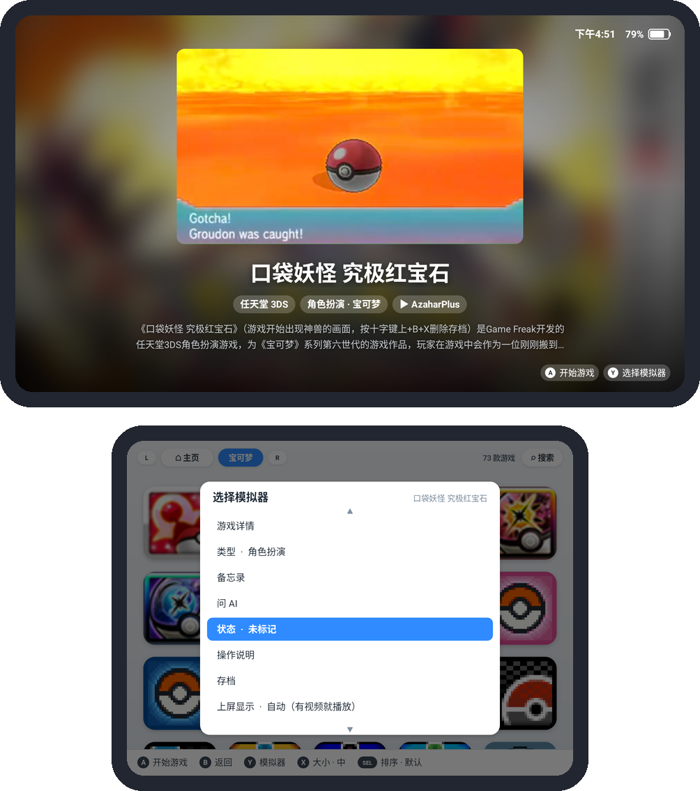
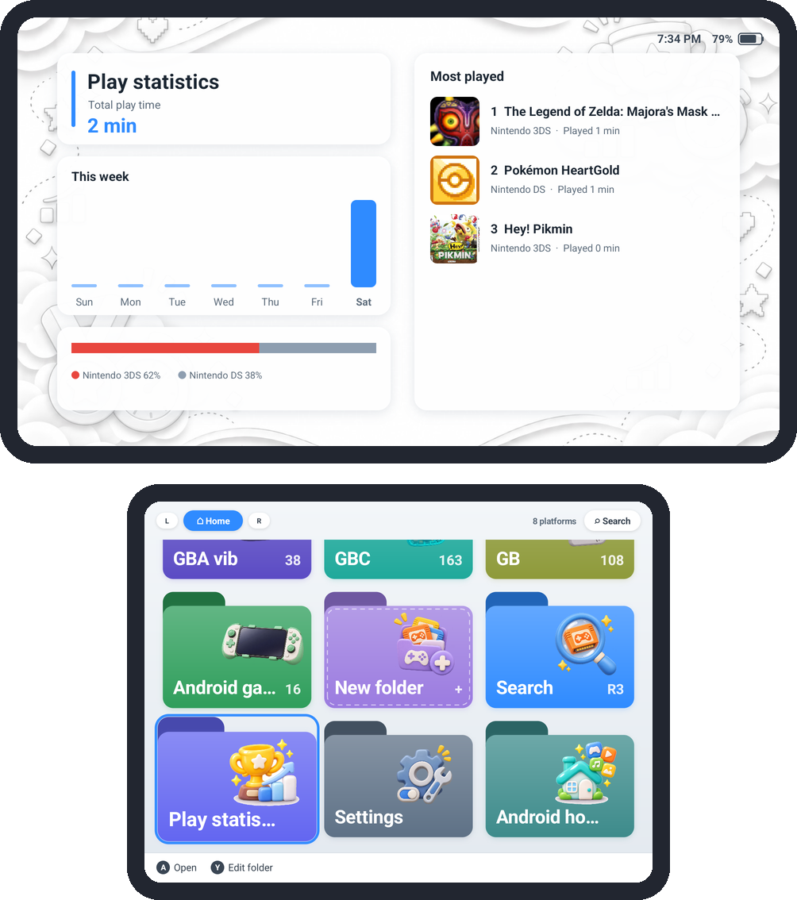
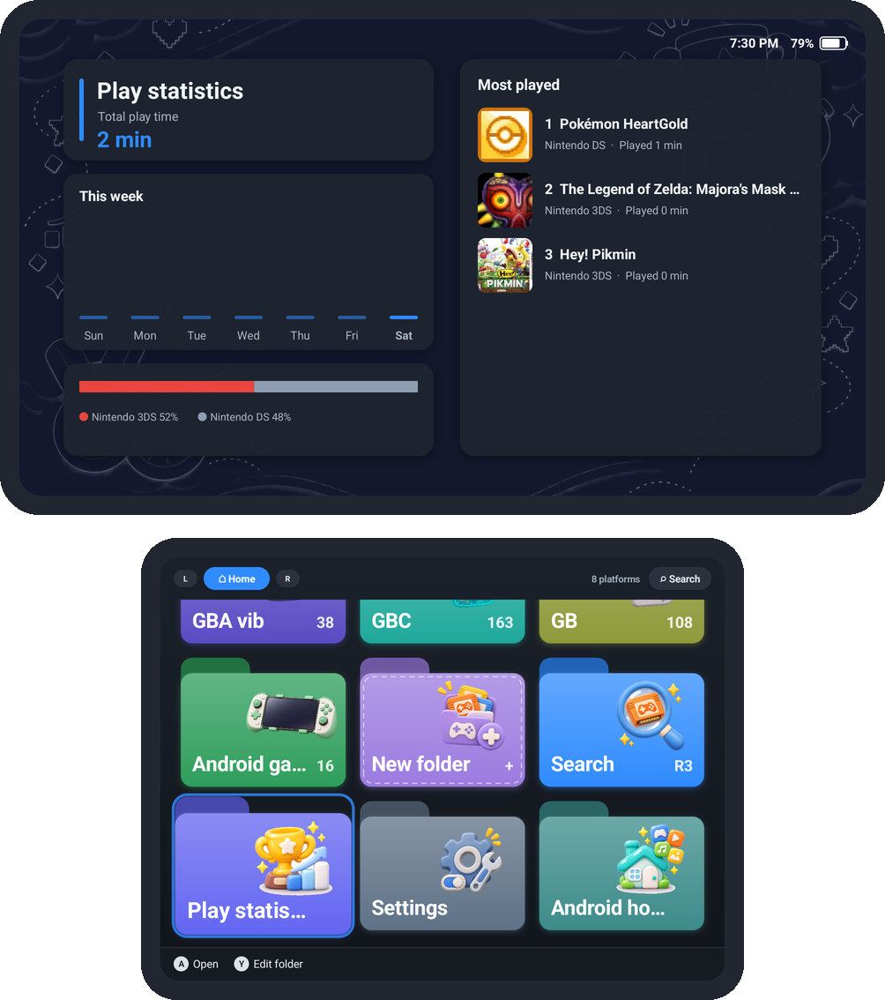

<p align="center"></p>

# Duo Launcher

<p align="center"><b>English</b> · <a href="README.fr.md">Français</a> · <a href="README.zh-CN.md">简体中文</a> · <a href="README.zh-TW.md">繁體中文</a> · <a href="README.ja.md">日本語</a> · <a href="README.ko.md">한국어</a> · <a href="README.es.md">Español</a> · <a href="README.de.md">Deutsch</a> · <a href="README.it.md">Italiano</a> · <a href="README.pt.md">Português</a> · <a href="README.ru.md">Русский</a></p>

A dual-screen game launcher for the **Retroid Pocket Duo** and other Android handhelds with a second display, in the spirit of the 3DS home menu.
Point it at your ROM folders and it finds the games, sorts them by console, genre and series, shows them on the lower screen with the artwork on the upper one, and starts each game in the emulator you choose.

**Download:** the latest APK is on the [Releases page](https://github.com/GenKnot/DuoLauncher/releases/latest) (Android 11 or newer). Installing a new version over the old one keeps every setting and your play time.

## Why another launcher?

Duo Launcher started as one player's launcher for one handheld, and it still grows from how that handheld is actually used. A few ideas run through all of it:

- **Two screens are two jobs.** The lower screen is for choosing: big folders, a grid, a list, menus. The upper screen is for looking: the console on its own illustrated backdrop, a game's logo over its cover, a video preview, how long you have played, a note to yourself, or a conversation with the AI. Nothing has to share space with anything else.
- **The gamepad comes first.** Every feature works without touching the screen: a keyboard made for the d-pad, held directions that keep scrolling, L / R that turn pages, hold L to search by voice, hold R to talk to the AI. Touch works too, it just isn't required.
- **Your library, as it already is.** It reads the Pegasus and ES-DE metadata and pictures you may already have, keeps its own additions in its own `DuoLauncher` folder, and never rewrites another frontend's files.
- **AI that works for you, with your key.** Translation, sorting, pictures, advice and conversation use the service *you* choose and pay for directly. Keys stay on the handheld, and every request is counted in Settings with an estimated cost, so nothing runs behind your back.
- **Everything can be changed, hidden, or shared.** Every home tile can be renamed, recoloured, given a new picture, moved or hidden. Your whole setup can be exported as one file and handed to a friend – without your keys or your play history.

Suggestions and bug reports are welcome on the [issue tracker](https://github.com/GenKnot/DuoLauncher/issues).

## Highlights

- **Two screens, one launcher** – choose on the lower screen; see logos, cover art, video previews, play time and descriptions on the upper one.
- **Every emulator in one place** – 3DS, NDS, GBA, GB/GBC, NES, SNES, N64, GameCube, Wii, Mega Drive, PS1, PS2, PSP, PS Vita and Switch, with the emulator chosen per console or per game. Multi-disc games show as one.
- **Sorted for you** – every game filed under one of 14 genres and under its series (Ys, Castlevania, Super Robot Wars …). The home page shows your library by console, genre or series, and smart folders keep "recently added", "playing", "want to play", "finished" and "top rated" up to date.
- **An AI companion** – hold R anywhere and talk: it recommends from your own library, explains how to get past a part of a game, tells you about a story, or just chats. The answers can be read aloud.
- **Cheats, managed** – thousands of ready-made cheats for 3DS, NDS, PSP, GBA and every RetroArch system, translated into your language in one tap, editable, and shared between emulators.
- **Fills in what is missing** – real box art from the libretro thumbnail sets, official English titles, and AI-drawn covers, logos and backdrops in the launcher's own style.
- **Made for a handheld** – OLED-safe screensaver, Wi-Fi transfer from a browser, save backups, play statistics, RetroAchievements progress, a storage overview, and a home screen that is up in a second.
- **Yours to change** – colour themes and theme packs, light and dark mode, text size, cover margins, a settings page like a console's, and configs you can export and share. 11 interface languages.

## Screenshots

<p align="center"></p>

<table>
  <tr>
    <th>Settings, 3DS-style</th>
    <th>Settings in dark mode</th>
  </tr>
  <tr>
    <td></td>
    <td></td>
  </tr>
  <tr>
    <th>AI usage and cost</th>
    <th>Export and import your config</th>
  </tr>
  <tr>
    <td></td>
    <td></td>
  </tr>
  <tr>
    <th colspan="2">Hand-drawn dark backdrops</th>
  </tr>
  <tr>
    <td colspan="2" align="center"></td>
  </tr>
  <tr>
    <th>Home by genre, with clay genre icons</th>
    <th>Home by series</th>
  </tr>
  <tr>
    <td></td>
    <td></td>
  </tr>
  <tr>
    <th>Genre and series on the game page</th>
    <th>Note, Ask AI, status, how to play, saves</th>
  </tr>
  <tr>
    <td></td>
    <td></td>
  </tr>
  <tr>
    <th>Gamepad keyboard; English titles match too</th>
    <th>Ask the AI what to play</th>
  </tr>
  <tr>
    <td></td>
    <td></td>
  </tr>
  <tr>
    <th>AI tools: series, picks, storage, break reminder</th>
    <th>Storage: size per console, unplayed big games</th>
  </tr>
  <tr>
    <td></td>
    <td></td>
  </tr>
  <tr>
    <th>Game page with video preview</th>
    <th>Logo, cover or video, per game</th>
  </tr>
  <tr>
    <td></td>
    <td></td>
  </tr>
  <tr>
    <th>List view</th>
    <th>Play statistics</th>
  </tr>
  <tr>
    <td></td>
    <td></td>
  </tr>
  <tr>
    <th>Colour themes</th>
    <th>Theme colours reach the backdrops</th>
  </tr>
  <tr>
    <td></td>
    <td></td>
  </tr>
  <tr>
    <th>Dark mode</th>
    <th>Dark mode</th>
  </tr>
  <tr>
    <td></td>
    <td></td>
  </tr>
  <tr>
    <th>Wi-Fi transfer</th>
    <th>Tidy-up tools</th>
  </tr>
  <tr>
    <td></td>
    <td></td>
  </tr>
  <tr>
    <th>GameCube, with Dolphin</th>
    <th>Hold A to move a folder</th>
  </tr>
  <tr>
    <td></td>
    <td></td>
  </tr>
  <tr>
    <th>Choose cheats before importing, names translated</th>
    <th>Game details: size, discs, screenshots</th>
  </tr>
  <tr>
    <td></td>
    <td></td>
  </tr>
  <tr>
    <th>3DS cheats, translated in one tap</th>
    <th>NDS cheats for DraStic, Chinese database</th>
  </tr>
  <tr>
    <td></td>
    <td></td>
  </tr>
  <tr>
    <th>RetroArch cheats (GBA)</th>
    <th>Edit, add, download</th>
  </tr>
  <tr>
    <td></td>
    <td></td>
  </tr>
  <tr>
    <th>Rename or delete a cheat</th>
    <th>Translate every cheat at once</th>
  </tr>
  <tr>
    <td></td>
    <td></td>
  </tr>
  <tr>
    <th>Screensaver (OLED-safe)</th>
    <th>11 languages</th>
  </tr>
  <tr>
    <td></td>
    <td></td>
  </tr>
</table>

## Getting started

1. **Install the APK** from the [Releases page](https://github.com/GenKnot/DuoLauncher/releases/latest) and open it.
2. **Pick a language**, then grant the permissions it asks for on one page: file access (to find your games), usage access (so play time counts only the time a game is really on screen) and, if you like, the home screen role. You can come back to this page any time under Settings → System → Permissions.
3. **Let it find your games.** Any `Roms` folder on internal storage or an SD card is picked up by itself. Other folders can be added under Settings → Home and library → Game folders. Consoles are recognised from folder names (`gba`, `Nintendo DS`, `psx` …) and file extensions.
4. **Choose emulators** where you want something other than the default: press Y on a console folder for the whole console, or on a game for that game only. Only emulators that are installed are offered.
5. **Optional: add an AI key** under Settings → AI and voice – on the handheld, or more comfortably from a computer or phone over Wi-Fi (Settings → Saves, transfer, sharing → Wi-Fi transfer). Everything except the AI features works without one.
6. **Optional: make it your home screen** (Settings → System → Set as home screen) so it starts when the handheld does. The Android home tile always leads back to the system home screen.

## The basics

**The home page** (lower screen) holds your console folders and a few built-in tiles: Continue (jump straight back into the last game), Recently played, Favorites, New folder, Search, Play statistics, Storage, What to play?, Settings and Android home. SELECT switches the home page between consoles, genres and series.

**A folder** shows its games as a grid of covers. X makes the covers smaller, and once more turns the grid into a list with names, play time and when you last played. SELECT sorts (default order, name, recently played, most played) and can show only Simplified Chinese, Traditional Chinese or English releases. L2 / R2 jump to the previous or next first letter – Chinese titles count by their pinyin initial.

**The upper screen** follows whatever is selected: a console on its backdrop with its game count and emulator; a game's logo over its blurred cover art with its console, genre · series, emulator, play time and a short description, a video preview after a moment, or the picture of where you left off.

**Y** is the menu for whatever is selected – on a game: emulator, favorite, folders, cheats, details, genre, note, ask AI, status and rating, how to play, saves, what the upper screen shows, hide. On a console folder: default emulator, rename, merge folders, hide. On a built-in tile: name, colour, icon and backdrop.

### Controls

| Button | Action |
|---|---|
| D-pad / left stick | Move; hold to keep moving |
| Left / right, L / R in a list or menu | A page at a time |
| A | Open / play; hold A on a home folder to pick it up and move it |
| B | Back |
| L / R | Previous / next console (in Settings: category) |
| Hold L | Search by voice |
| Hold R | Talk to the AI |
| L2 / R2 | Previous / next first letter |
| X | Cover size, then list view |
| Y | Menu for the selected game, folder or tile |
| START | Settings (from anywhere on the home page, even with the Settings tile hidden); in a menu, the same as A |
| SELECT | On the home page: consoles / genres / series; in a folder: sort and language filter |
| R3 | Search |
| In the search keyboard | A types, B deletes, X space, Y system keyboard, SELECT clears, START or R3 done, hold L to speak |
| In the AI chat | Hold R to speak, Y to type, X for a new conversation, SELECT for the history, L2 / R2 to scroll back, B to close; the d-pad and A pick from the games below |

Everything also works by touch: tap to select, tap again to open, flick to scroll, and tap the pills along the top instead of L, R, X, SELECT or Search. A/B and X/Y can be swapped for Nintendo- or Xbox-style confirm buttons (Settings → Playing → Buttons).

## Your library

- **Finds your games by itself.** Internal storage and SD cards are searched for `Roms` folders; more can be added under Settings → Home and library → Game folders. The last scan is cached, so the home screen is up in a second and the next scan runs quietly in the background.
- **Consoles** – 3DS, NDS, GBA (and GBA rumble and hack folders), GBC, GB, NES, SNES, N64, GameCube, Wii, Mega Drive, PlayStation 1/2/3, PSP, PS Vita and Switch, with artwork for PS4, PS5, Xbox 360 and Xbox Series too.
- **Multi-disc games as one.** `Disc A/B`, `Disc 1/2`, `CD1/CD2`, `(Disc 2 of 3)` in one folder, or a Pegasus `files:` list, become a single entry. RetroArch and DuckStation get an `.m3u` playlist of the discs so you can change discs in-game.
- **Android games and apps** – installed games get their own folder automatically; any other apps (video, browser …) can be added to an Apps folder.
- **Works with what you already have.** It reads Pegasus `metadata.pegasus.txt`, ES-DE / EmulationStation `gamelist.xml` and `downloaded_media`, RetroArch thumbnails, and `media/`, `covers/` and `images/` folders next to the games. Nothing of theirs is changed; the launcher's own additions go into its own `DuoLauncher` folder (see [Your own game info](#your-own-game-info)).
- **Notices new games.** Copy games to the card and the next scan finds them; they carry a NEW badge for a week (until played) and are offered for sorting into genres and series. The question can be turned off. Y → Mark as seen takes the badge off one game; Mark all as seen (Y on a console or folder, or Settings → Home and library) clears many at once, and the NEW badges switch there turns them off entirely.
- **Merge folders.** Two folders of the same console from different places (two PS1 folders, say) can be shown as one: Y → Merge folders on a console. Each game keeps its own emulator, folders with the same name merge by themselves, and "Split off" undoes it.
- **Your own folders.** The New folder tile makes a folder with its own name, colour, icon and backdrop. Add any game or app to it with Y, and take it out again with Y → Remove from this folder.
- **Smart folders** fill themselves: recently added (the last 30 days), not played yet, most played, playing, want to play, finished and top rated. Y on one shows its rule.
- **Continue and favorites.** The first home tile jumps straight back into the last game. Star games with Y to collect them in a Favorites folder.
- **Hide what you don't play** – a console folder, or a single game or app (Y → Hide); bring them back under Settings → Home and library.
- **Your catalogue.** After every scan the whole library is written to `DuoLauncher/catalog.tsv` (console, file, title, English title, genre, series, play time, status, rating) – for spreadsheets, other tools, or the AI.

### Genres and series

Browsing two thousand games by console alone gets tiring, so every game also gets one of 14 genres (role-playing, action, adventure, platformer, tactics, strategy, shooter, puzzle, racing, sports, fighting, simulation, party and music, other) and its series.

- **Built-in knowledge first.** A table inside the launcher (`assets/gamedb.tsv`, 3,860 file names covering every game in the Pegasus G pack lists for these consoles, with both the `.iso` and `.cso` names where a pack has both) already knows the genre, series and official English title of common ROM sets by console and file name. Games it knows need no AI and no internet at all.
- **AI for the rest.** Settings → AI and voice → AI: sort into genres / find game series files the remaining games, and the results are kept in `DuoLauncher/<console>/genres.txt` and `series.txt` on the card, so it is done once and survives reinstalls. Genres already written by Pegasus or ES-DE ("Action RPG", "角色扮演" …) are mapped onto the 14 genres.
- **By hand** – Y → Genre on any game.
- **On screen.** The upper screen shows a game's genre · series, and SELECT on the home page turns the folders into genres or series. Series names follow the interface language.

### Search

R3, the Search tile, or the search button opens a keyboard on the upper screen that is made for the d-pad, with your recent searches and a row of genre chips above it; results fill the lower screen as you type. Chinese titles match their pinyin, its initials and the start of each syllable (`kdyg`, `mlao` → 马里奥), and every game also matches its official English title, so `zelda` finds 塞尔达传说. Opened from inside a console it searches only that console, with an "All platforms" button to widen it. Hold L to say a name instead of typing it.

### Pictures that fill themselves in

- **Real box art** – Settings → Tidy up → Fetch missing covers downloads covers from the libretro thumbnail sets. NDS and GBA games are matched by the game code inside the ROM (zipped ROMs too, with title screens), so translated and renamed files still find their pictures; PlayStation 1/2, PSP, N64, GameCube, Wii, 3DS, GB/GBC, NES, SNES and Mega Drive games are matched by their English title.
- **Icons straight from the ROMs** – NDS banner icons and 3DS SMDH icons; installed 3DS titles show their name in the interface language.
- **Covers that look alike** – covers fill their tiles, or all sit with the same small, medium or large margin (Settings → Look and sound → Cover margin); white frames baked into cover pictures are trimmed.
- **AI pictures** – with an image key, covers, title logos and backgrounds can be drawn for games that have none (Y → Details → Make a cover with AI, or a whole console at once under Settings → AI and voice → AI pictures). See [AI](#ai).

## Playing

- **Emulator per game or per console** (Y). Only installed emulators are offered:

  | Console | Emulators (the first is the default) |
  |---|---|
  | 3DS | AzaharPlus, Azahar, Citra MMJ, Citra MMJ (performance mode) |
  | NDS | DraStic, DraStic (plain path), RetroArch · melonDS DS |
  | GB / GBC | RetroArch · Gambatte, mGBA |
  | GBA | RetroArch · mGBA, gpSP, gpSP Rumble |
  | NES | RetroArch · FCEUmm, Mesen |
  | SNES | RetroArch · Snes9x |
  | Mega Drive | RetroArch · Genesis Plus GX, PicoDrive |
  | N64 | RetroArch · Mupen64Plus-Next, Mupen64Plus FZ |
  | GameCube / Wii | Dolphin MMJR, Dolphin |
  | PS1 | RetroArch · PCSX ReARMed, SwanStation, DuckStation |
  | PS2 | ARMSX2, AetherSX2 |
  | PSP | PPSSPP, RetroArch · PPSSPP |
  | PS Vita | Vita3K (by title ID, e.g. a file named `PCSE00000.psvita` or a name containing it) |
  | Switch | Eden |

- **Citra MMJ (performance mode)** – the same Citra MMJ build repackaged under the AnTuTu benchmark's package name, which many Android systems run at full clocks. It is offered only when that package really is Citra.
- **Play time and statistics** – how long and when you last played each game, Switch-style; with usage access granted it counts only the time the game was really on screen. The Play statistics tile shows the total, this week day by day, time per console and the most played games.
- **Where you left off** – a played game's newest screenshot or save-state picture becomes its upper-screen background.
- **Status, rating and notes** – mark a game as playing, want to play, finished or dropped and give it one to five stars (Y → Status); write or say a line about where you are and what to do next (Y → Note). All of it shows on the upper screen next time you pick the game up.
- **Game details** (Y → Details) – file, size, discs, folder, emulator, play time, the official English title, and the game's screenshots on the upper screen.
- **Video previews and sounds** – a game's video snap starts on the upper screen after a moment (or choose logo or cover per game: Y → Top screen). Soft interface sounds and each 3DS game's own banner tune can be switched off.
- **When a game does not start** – a missing file, an emulator that is not installed, one that cannot open that kind of file, or a game that closes at once each get a message saying what to do.
- **Break reminder** (Settings → Playing) – after one, two or three hours in a game, the launcher suggests a break when you come back.
- **RetroAchievements** – with your user name and Web API key, recently played games with their achievement progress, and a 🏆 tag on games that have achievements.

## Your AI companion

All of this is optional and uses the AI service you choose with your own key (see [AI](#ai)).

- **Talk to it anywhere.** Hold R on the home page, in a folder or in the search keyboard and speak – or press Y to type. The conversation fills the upper screen; the games it recommends or finds fill the lower one, ready to start with A. Ask what to play ("a relaxed RPG, not too long"), narrow it down ("something with more action"), ask how to get past the part of the game you have selected, about a story or a character, or just chat. It remembers the conversation for half an hour.
  *Why:* the lower screen is where games are chosen, so the AI's picks land there; the upper screen is free for reading. And on a handheld, holding a shoulder button and talking is quicker than any menu.
- **New conversation, saved history.** X in the chat starts a new conversation; SELECT lists the earlier ones, newest first, to open again, delete one by one or clear all (also Settings → AI and voice → AI chat history). While the chat is open, video previews, 3DS banner tunes and click sounds stay quiet, and spoken answers play at media volume.
  *Why:* a new question should not drag the old topic along, an answer worth keeping should not vanish with a restart, and a spoken reply is no use when a game trailer plays over it. The history stays on the handheld, is never part of an exported config, and Save AI chats turns it off.
- **Answers read aloud** – Settings → AI and voice → AI voice replies: Soniox (its own key) or OpenAI (the image key), with a choice of voice and pace and a test button. Off unless you turn it on.
- **What to play today** – Y on the What to play? tile has the AI pick six games from your library to match your taste, with a reason for each. A plain press of the tile picks one at random, favouring games you have never played.
- **Ask about a game** (Y → Ask AI) – a question about the selected game, typed or spoken, answered on the upper screen.
- **How to play** (Y → How to play) – the controls (including the swapped confirm / cancel buttons of Japanese releases) and the basics a newcomer needs, written once per game and kept.
- **No key yet?** Holding R explains how to add one – on the handheld, or from a computer over Wi-Fi.

## Cheats

Y → Cheats on a game lists its cheats; A switches one on or off.

| | 3DS (Azahar, Citra) | NDS (DraStic) | PSP (PPSSPP) | RetroArch (GBA, GB, GBC, NES, SNES, N64, MD, PS1, …) |
|---|---|---|---|---|
| Where they live | `azahar/cheats/` and `citra-emu/cheats/`, `<title ID>.txt` – written for both, so switching emulators keeps them | the whole list in `DuoLauncher/cheats/NDS/`; the ones switched on go to DraStic's own custom cheats (`DraStic/cheats/<game file name>.cht`), which work for translated ROMs too | `PSP/Cheats/<game ID>.ini`, PPSSPP's own cheat files; the game ID is read from the ISO, CSO or EBOOT.PBP | `RetroArch/cheats/<core>/<game file name>.cht`, loaded by RetroArch when the game starts |
| Already on the device | – | DraStic's `usrcheat.dat` (Chinese on Retroid handhelds), matched by the game code only, so patched and translated ROMs find their cheats even where DraStic itself shows none | PPSSPP's `cheat.db`, and on Retroid handhelds Chinese cheat files for about 4,300 games | Retroid ships Chinese cheats for hundreds of games (`000 中文金手指` and the core folders); a game without its own file gets a copy, matched by name |
| Download | [Sharkive](https://github.com/FlagBrew/Sharkive), about 650 games, by title ID read from the ROM | [libretro-database](https://github.com/libretro/libretro-database), about 4,200 games, by the game code in the ROM header | [CWCheat-Database-Plus+](https://github.com/Saramagrean/CWCheat-Database-Plus-), about 4,300 games, by game ID | [libretro-database](https://github.com/libretro/libretro-database) for GBA, by the game code in the ROM header |

- **Choose before importing** – a download first lists what it found, already translated, with Select all / Select none; only the ticked ones are added. *Why:* a database can hold dozens of codes per game, and most players want three of them.
- **Translate** – English cheat names become your interface language in one tap, for one game or for every game at once (Settings → Tidy up). Common cheats come from a built-in glossary (无限血量, 金钱最大, 主代码 …); the rest go to the free MyMemory service, with Google's free endpoint as a second try. Version tags (`v1.2`) and button hints (`(START+L)`) are kept, and the original English name stays in the file as a note.
- **Translate with AI** – with an AI key, a game's cheats go to the model together with the game's name, so it uses the official names of characters and items (鬼神林克, 心之容器 …).
- **Edit** – rename or delete any cheat, delete all of a game's cheats at once, or add your own with its codes (3DS, NDS and PSP codes are checked as `XXXXXXXX YYYYYYYY`).
- **Safe for DraStic** – flash-cart patches (anti-piracy bypasses, overlay and Wi-Fi fixes) are left out of NDS downloads because DraStic crashes with them switched on, and at most 256 code lines can be on at once, the most DraStic can load.
- **Safe for your files** – the first time a hand-written 3DS cheat file is changed, the original is kept as `.txt.bak`.
- **RetroArch, once** – switch on Quick Menu → Cheats → "Auto-Apply Cheats During Game Load" in RetroArch once, and the cheats you turn on here are active from the moment a game starts.

## Look and feel

- **The upper screen (1920×1080)** – each console on its own paper-cut backdrop, or the selected game's logo over its blurred cover art, with tags and a short description; the clock and battery sit in the corner.
- **The lower screen (1280×960)** – console folders, a zoomable cover grid and a list view, with key hints along the bottom that stay short and leave out what does not fit when the text is large.
- **Themes** – seven colour schemes, custom colours, and theme packs with console art, backdrops, a font, sounds and music. A theme also colours the line-art backdrops on the upper screen. See [Themes](#themes).
- **Light and dark mode** – follows the system or set it yourself, with a separate set of backdrops drawn for each.
- **Everything on the home page is yours.** Every built-in tile and every console folder can be renamed, recoloured, given its own icon (a picture of yours, or one drawn by the image service in the launcher's clay style), moved (hold A, or long-press) or hidden, and brought back under Settings → Home and library → Hidden folders. Built-in tiles such as Play statistics, Storage and What to play? can have their own upper-screen backdrop too.
- **Console look** – each console's picture, light and dark backdrop and folder colour can be replaced (Settings → Look and sound → Platform look). A dark backdrop can be redrawn by the image service from the light one, so the two always match.
- **Text size** – four sizes for both screens.
- **Screensaver** – after a few idle minutes the upper screen shows your covers with a clock and the lower screen goes black. The text changes corner with every picture and drifts slowly, so nothing burns into an OLED panel.

## Settings and sharing

- **A settings page like a console's.** START opens one page: the categories on the left (Look and sound, Home and library, Playing, AI and voice, Saves, transfer, sharing, Tidy up, System), the rows of one on the right with their current values and switches, and the upper screen showing the version, the free space on each drive and which AI services are on. L / R change category.
- **Share your setup.** Settings → Saves, transfer, sharing → Export my config writes one zip with every setting (look, home layout and order, folders, hidden things, emulator choices, AI services) and your own pictures. Import a config picks one up from `DuoLauncher/exports` or the Download folder – sent over Wi-Fi, a chat app or a card.
  *Why it is safe to share:* keys, passwords and play history never go into a config, importing one keeps yours, and a key of yours is never pointed at an address that came from someone else's config.
- **11 languages** – 简体中文, 繁體中文, English, 日本語, 한국어, Français, Español, Deutsch, Italiano, Português, Русский.

## Handy tools

- **Wi-Fi transfer** – Settings → Saves, transfer, sharing → Wi-Fi transfer shows an address and a PIN. Open the address in a browser on the same network, enter the PIN, and drop ROMs or theme packs straight into any console folder. The same page holds the AI, voice and RetroAchievements settings behind an admin password (six random digits, or your own), so long keys can be pasted from a computer. The handheld's screen stays on while the transfer runs, because the page cannot be reached once the screen is off.
- **Storage** – a home tile shows how full the card is, and the free space of every drive on the upper screen. Inside: the size of each console's games, the biggest games never played, and deleting a game's files (all discs, and the files a `.cue` or `.m3u` names) after a confirmation.
- **Save backups** – back up and restore the saves of DraStic, RetroArch, PPSSPP, AetherSX2, DuckStation, Mupen64Plus FZ, Azahar and Citra in one zip, kept in `DuoLauncher/backups` on the SD card (internal storage when there is no card). After three hours of play without a backup the launcher reminds you, or makes one by itself if you prefer (the newest ten automatic backups are kept; yours are never removed). A restore replaces each save only once its copy is complete. Y → Saves backs up and restores one game on its own.
- **Tidy up** – find duplicate games, list games without pictures, fetch missing covers, translate every cheat at once, and a diagnostics page; the AI ones (names and descriptions for a whole console, genres, series, pictures, genre icons) are under AI and voice.
- **Updates** – Settings → System → About checks the latest GitHub release once a day and links to it.
- **Home screen** – set it as the default home app so it starts with the handheld; the Android home tile (or Settings → System → Exit to Android home) leads back to the system home screen, and Settings → System → Android settings opens the system's own settings.

## AI

Everything here is optional and uses your own account. Keys are kept in the launcher's settings on the handheld and sent only to the service you chose. Enter them in Settings → AI and voice, or on the Wi-Fi page from a computer or phone.

- **AI translation** – DeepSeek, Qwen, OpenAI, Claude, Gemini or any OpenAI-compatible address. This key does the talking: the chat, game picks, "Ask AI", "How to play", genres and series, cheat names (a whole game in one request), and game names and descriptions in your language (written into the launcher's own metadata together with the official English title, so a library of Chinese titles reads naturally in English and the other way round). Without a key, cheats are translated by free services.
- **AI pictures** – an OpenAI image key (the newest image model the key can use is chosen automatically). Covers, title logos, backgrounds, console pictures, folder and tile icons and backdrops, all in the same clay-icon and paper-cut style as the built-in art; icons are drawn with a transparent background so their white parts stay. A picture takes about half a minute. The same key turns your voice into text (`/audio/transcriptions`), since the handheld has no speech recognizer of its own.
- **AI voice replies** – Soniox with its own key, or OpenAI with the image key; voice and pace (normal, brisk, fast – brisk by default, as both read Chinese slowly).
- **AI usage and cost** – every request the launcher makes is counted on the handheld: requests, tokens, pictures and minutes of speech, with an estimated cost for today, this week, this month and all time. The estimate uses the services' published prices for what you use; each price can be set to your own (another model, a reseller, a discount). Your provider's bill is what counts.

## Your own game info

Put a `DuoLauncher` folder at the root of the SD card (or internal storage) to add or correct names, descriptions and pictures without touching other frontends' files. Anything here wins over Pegasus, ES-DE and the game's own data.

```
DuoLauncher/
  3DS/metadata.txt
  3DS/media/<file name without extension>/logo.png   (also cover.png, background.png)
  NDS/metadata.txt
```

`metadata.txt` uses the Pegasus format. Entries are matched by `file:`, or by `titleid:` for 3DS games installed into an emulator:

```
game: 勇者派遣会社
titleid: 0004000000065600
description: …
```

Names and descriptions can be given per language with `name.<language>:` and `description.<language>:` (`en`, `zh-CN`, `zh-TW`, `ja`, `ko`, `fr`, `es`, `de`, `it`, `pt`, `ru`; `zh` covers both Chinese). They are used while the launcher runs in that language, so one folder can serve players of several languages:

```
game: 塞尔达传说 姆祖拉的假面
file: 塞尔达传说 姆祖拉的假面 汉化版.cci
name.en: The Legend of Zelda: Majora's Mask 3D
description.en: Link has three days before the moon falls on Termina…
```

## Themes

Settings → Look and sound → Theme offers seven built-in colour themes (blue, red, green, purple, orange, pink, graphite), **custom colours** (pick a main colour and a background colour; every shade for light and dark mode is worked out from them), and any installed theme packs. A theme colours both screens, including the line-art backdrops on the upper screen.

A theme pack is a folder (or a `.zip` of one, unpacked on first use) in `DuoLauncher/themes/` on the SD card or internal storage. Everything is optional; whatever a theme leaves out comes from the built-in look, so a theme can be as small as a few colours.

```
DuoLauncher/themes/my-theme/
  theme.txt                      name, author, colours (see below)
  consoles/<type>.png            console pictures      (3ds, nds, gba, ..., recent, search, settings, custom)
  backgrounds/<type>.jpg         upper-screen backdrops
  backgrounds/dark/<type>.jpg    backdrops for dark mode
  logo.png
  font.ttf, font-bold.ttf
  sounds/move|open|back|launch.ogg   (or .wav / .mp3)
  music.ogg (or music.mp3)       loops on the home screen (Settings → Background music appears when a theme has music)
```

`theme.txt` uses `key: value` lines: `color.<name>` for light mode and `dark.color.<name>` for dark mode, with names such as `accent`, `shelf-top`, `shelf-bottom`, `card`, `text`, `pill`, `footer`, `backdrop-paper` / `backdrop-ink` (the upper-screen line art) and `folder.<type>` for the home folders. `base-color: #RRGGBB` alone is enough for a complete colour scheme. [themes/sakura](themes/sakura/theme.txt) is a complete example with every key explained. Settings → Saves, transfer, sharing → Export current theme saves whatever you have set up as a zip in `DuoLauncher/exports/` that others can drop into their own `themes/` folder; your own pictures go along under `own/`.

## Building

No Android Studio or Gradle needed – only the Android SDK command-line tools (build-tools 35, platform android-35) and JDK 17 or newer:

```powershell
powershell -File build.ps1            # builds DuoLauncher.apk
powershell -File build.ps1 -Install   # also installs over adb, grants file access and starts it
```

A debug signing key (`debug.keystore`) is generated on the first build and is not committed. `shot.ps1` sends key presses over adb and saves screenshots of both screens, which is handy while working on the interface.

## Artwork

`assets/consoles/<type>.png` (clay console and tile icons) and `assets/backgrounds/<type>.jpg` (paper-cut line-art backdrops, with their own dark-mode versions in `backgrounds/dark/`) were made for this project. The backdrops are greyscale, so a colour theme can tint them. Consoles without a picture fall back to a drawn console.

## Launch notes

- AzaharPlus only accepts a tree URI under a folder it already has access to:
  `content://com.android.externalstorage.documents/tree/<volume>%3ARoms%2F3DS/document/<volume>%3ARoms%2F3DS%2F<file>`
- Citra MMJ: `org.citra.emu/org.citra.emu.ui.EmulationActivity` with `-e GamePath <path>`.
- Citra MMJ (performance mode) is the same build repackaged as `com.antutu.ABenchMark`; many Android builds run that package name at full CPU/GPU clocks. It is only offered when that package really contains Citra.
- DraStic as shipped on Retroid handhelds wants `-e GAMEPATH "/sf<path>"`; a "plain path" variant is offered for stock builds.
- RetroArch: `com.retroarch.aarch64/...RetroActivityFuture` with `-e ROM`, `-e LIBRETRO <core>` and `-e CONFIGFILE`. The config file named in the launch line is kept: on the Duo, RetroArch's own `retroarch.cfg` shows Retroid's per-system frames at full size, while Retroid's per-screen `retroarch1920x1080.cfg` draws games small inside a TV frame.
- Dolphin (MMJR and official): `.../ui.main.MainActivity` with `--es AutoStartFile <path>`.
- ARMSX2, AetherSX2, Eden, PPSSPP and Mupen64Plus FZ get the game as a read-only `content://com.duo.launcher.rom/...` link with a one-time read grant, so they need no folder access of their own.
- Vita3K: `org.vita3k.emulator/.Emulator` with the string array extra `AppStartParameters = ["-r", "<title ID>"]`.
- Launch lines in Pegasus metadata are used unchanged.

### Citra MMJ on a dual-screen handheld

Citra MMJ puts the touch screen on the upper display by default. To get the main picture on top and hide the on-screen buttons, close Citra and set in `/sdcard/citra-emu/config/config-mmj.ini`:

```ini
[Controls]
input_overlay_hide = True
[Layout]
landscape_swap_screen = True
```

## Feedback

Duo Launcher is shaped by how it gets used. If something is missing, confusing or broken – or you have made a theme worth sharing – open an [issue](https://github.com/GenKnot/DuoLauncher/issues).

## License

[MIT](LICENSE)
