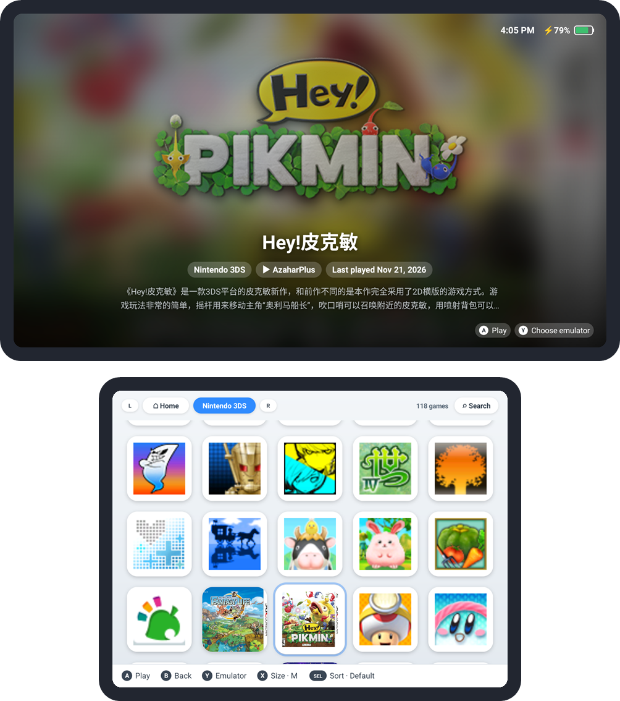
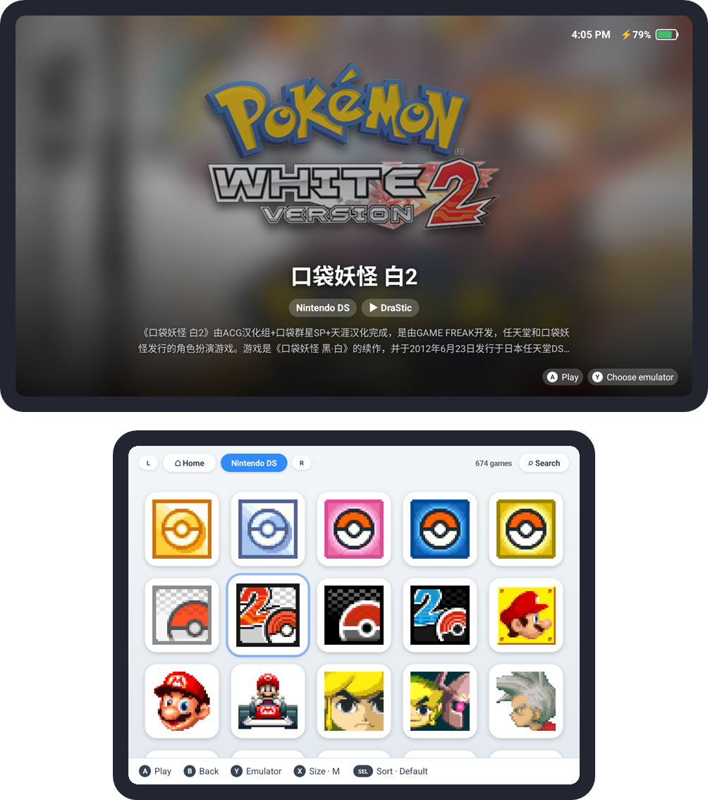
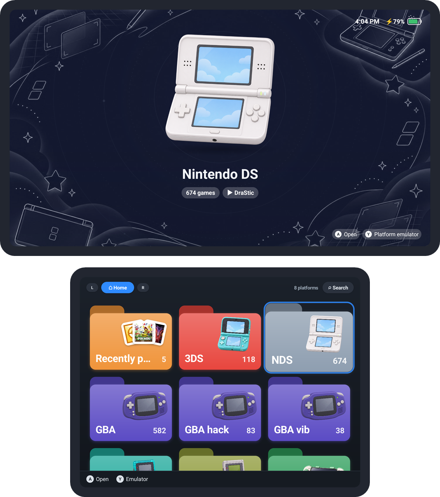
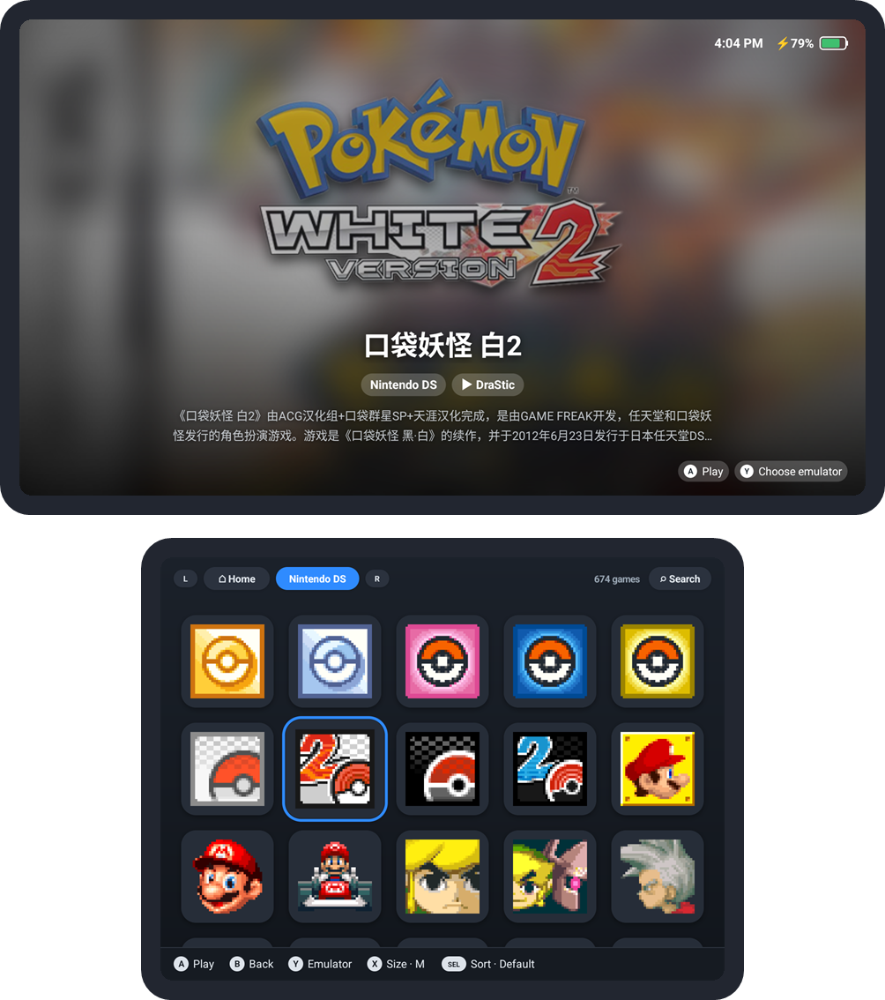
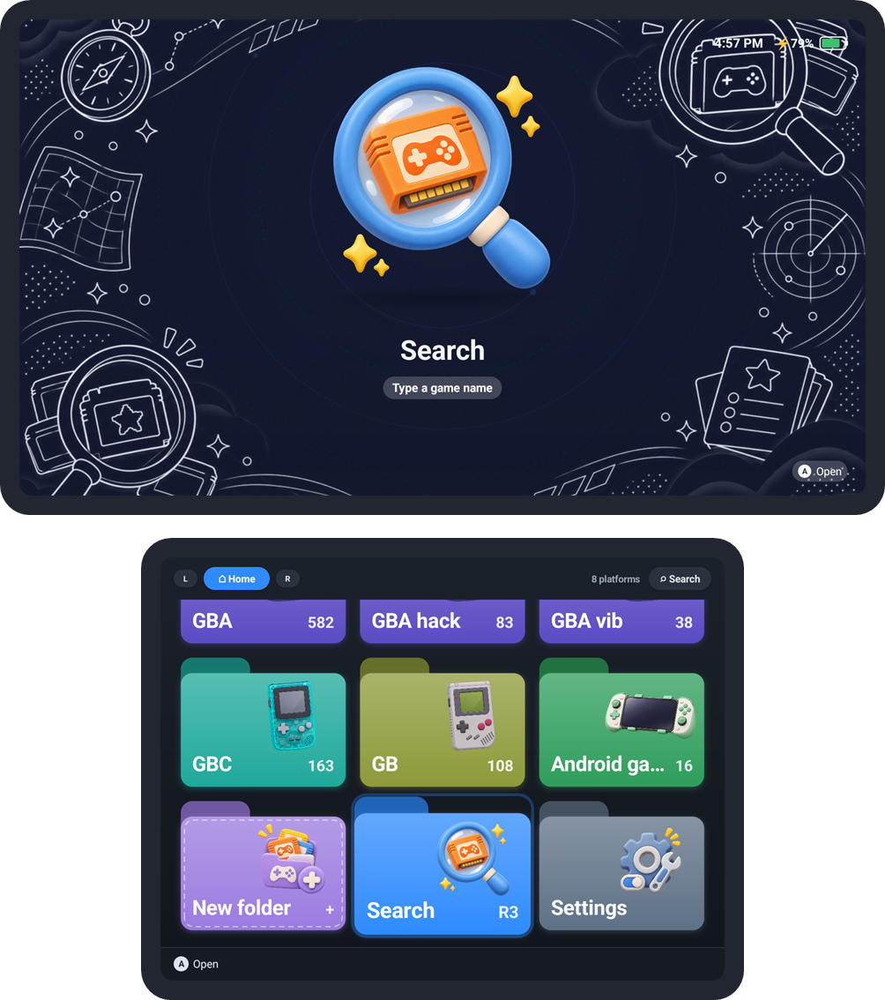
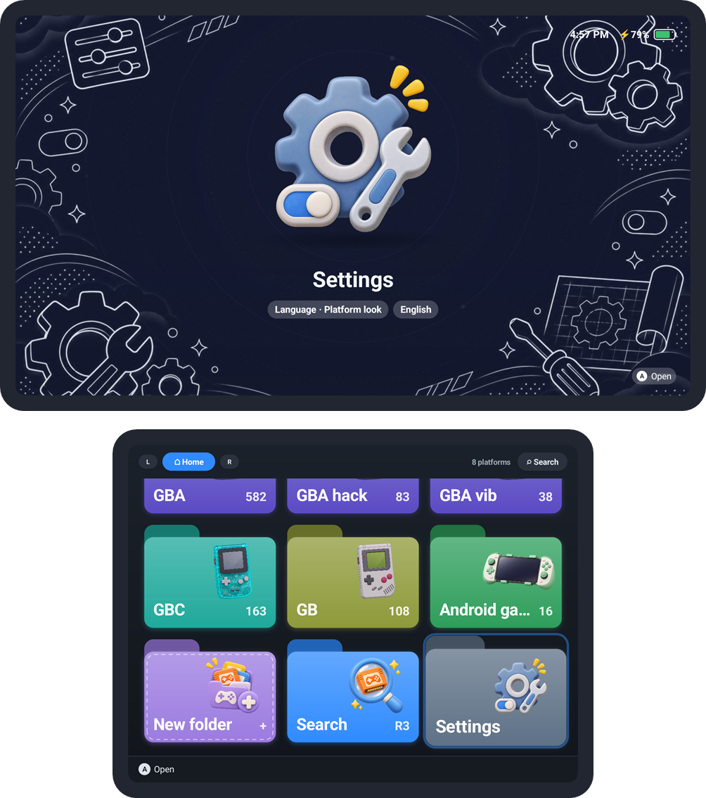
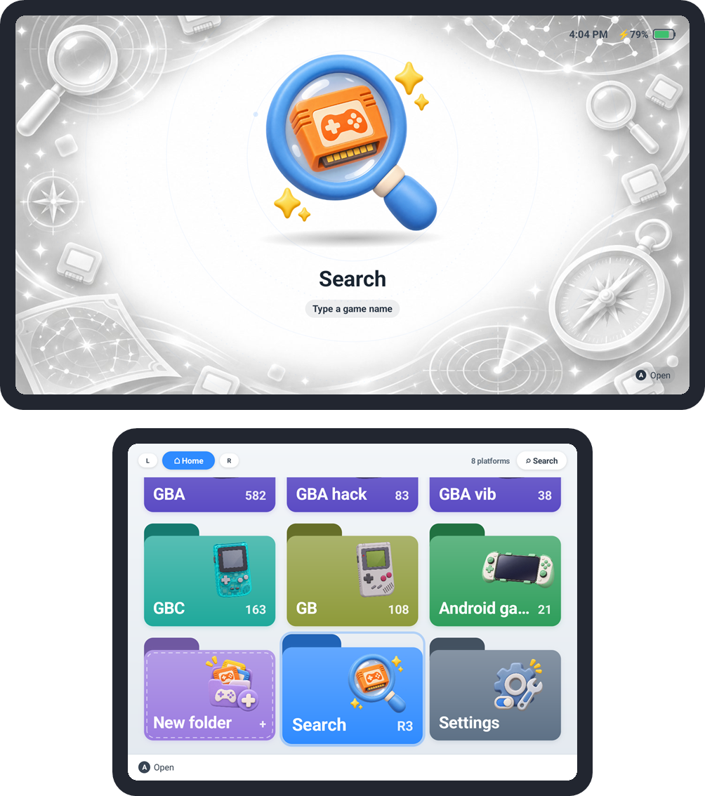
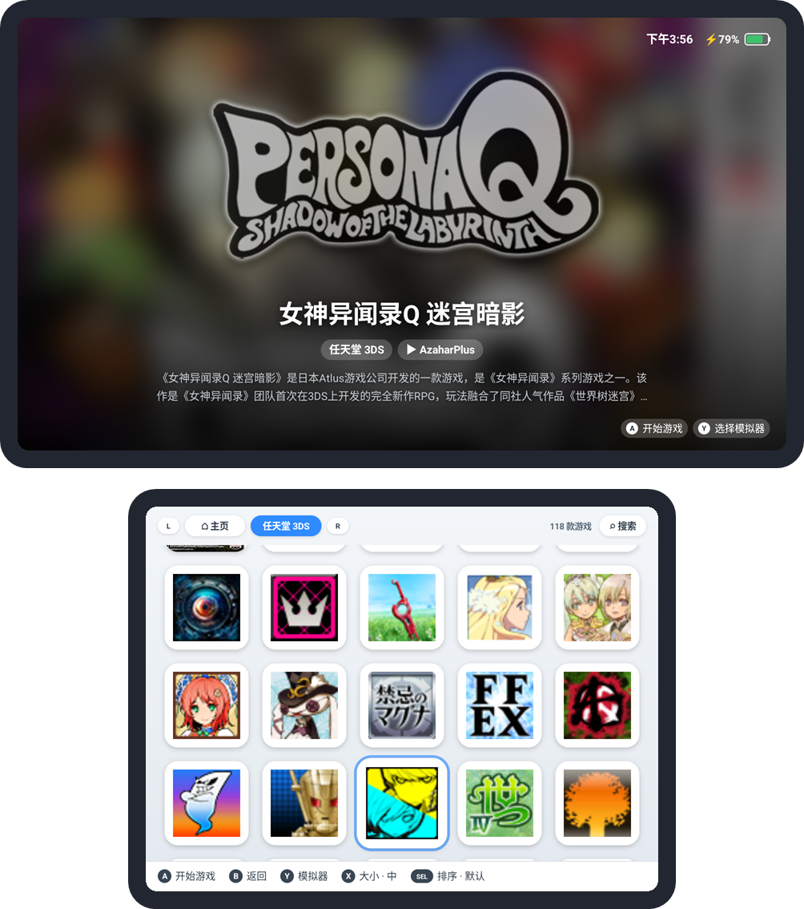
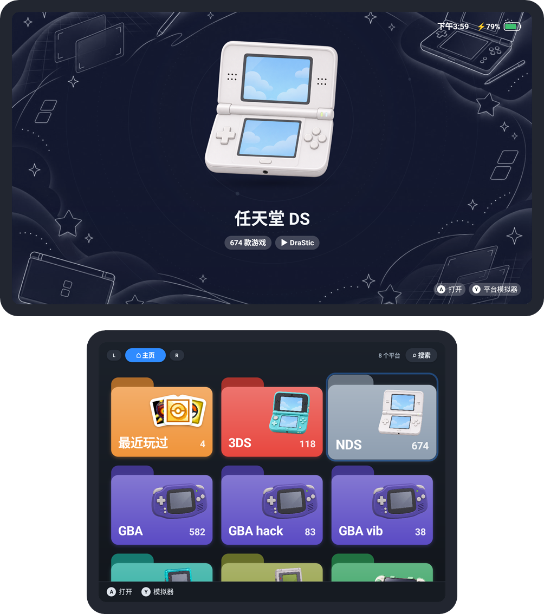

<p align="center"></p>

# Duo Launcher

A dual-screen, 3DS-style game launcher for the **Retroid Pocket Duo** and other Android handhelds with a second display.
Point it at your ROM folders and it finds the games, shows them on the lower screen and the artwork on the upper one, and starts each game in the emulator you pick.

一个给 Retroid Pocket Duo 等双屏安卓掌机做的 3DS 风格游戏前端：选好放游戏的文件夹，它会自己扫描、按平台归类，下屏选游戏、上屏展示，每款游戏都能指定用哪个模拟器。

## Screenshots

<p align="center"></p>

<table>
  <tr>
    <th>Game page with play time · 游戏页与游玩时间</th>
    <th>Icons read from the ROMs · ROM 自带图标</th>
  </tr>
  <tr>
    <td></td>
    <td></td>
  </tr>
  <tr>
    <th>Dark mode · 深色模式</th>
    <th>Dark mode · 深色模式</th>
  </tr>
  <tr>
    <td></td>
    <td></td>
  </tr>
  <tr>
    <td></td>
    <td></td>
  </tr>
  <tr>
    <th>Search, your own folders, settings · 搜索、自定义文件夹、设置</th>
    <th>11 languages · 11 种语言</th>
  </tr>
  <tr>
    <td></td>
    <td></td>
  </tr>
  <tr>
    <th>简体中文</th>
    <th>简体中文 · 深色</th>
  </tr>
  <tr>
    <td></td>
    <td></td>
  </tr>
</table>

## Features

- **Finds your games by itself** – add folders in Settings → Game folders, or let it pick up any `Roms` folder on internal storage and SD cards. Platforms are recognised from folder names (`gba`, `Nintendo DS`, `psx`, …) and file extensions.
- **Platforms** – 3DS, NDS, GBA, GBC, GB, NES, SNES, N64, Mega Drive, PlayStation 1/2/3, PSP, PS Vita, Switch, plus artwork for PS4, PS5, Xbox 360 and Xbox Series.
- **Your own folders** – the "+" tile makes a folder with its own name, colour, icon and backdrop (from the bundled art or your own pictures); add any game or app to it with Y.
- **Android games and apps** – installed games get their own page automatically; pick any apps (video, browser, …) to show on the Apps page.
- **Upper screen (1920×1080)** – each platform's console on its own illustrated backdrop, or the selected game's logo over its blurred cover art, with platform, emulator and play-time tags and a short description.
- **Lower screen (1280×960)** – platform folders and a zoomable icon grid. Works with the gamepad and with touch.
- **Play time** – how long and when you last played each game, Switch-style. With Usage access granted it counts only the time the game was really on screen.
- **Search** – R3 or the search button; results update as you type. Chinese titles also match pinyin and its initials (`kdyg` → 口袋妖怪), opened from inside a platform it searches only that platform, and recent searches are one tap away.
- **Hide what you don't play** – hide a platform folder, or a single game or app (Y → Hide); bring them back in Settings.
- **First-start setup** – language, then every permission it uses (file access, usage access for play time, home screen) on one page, also under Settings → Permissions.
- **Light and dark mode** – follows the system or set it yourself.
- **Icons straight from the ROMs** – NDS banner icons and 3DS SMDH icons (decrypted dumps).
- **Emulator per game or per platform** (Y button) – only installed emulators are offered:

  | Platform | Emulators (first one is the default) |
  |---|---|
  | 3DS | AzaharPlus, Azahar, Citra MMJ |
  | NDS | DraStic, RetroArch · melonDS DS |
  | GB / GBC / GBA | RetroArch · Gambatte, mGBA, gpSP |
  | NES / SNES / MD | RetroArch · FCEUmm, Mesen, Snes9x, Genesis Plus GX, PicoDrive |
  | N64 | RetroArch · Mupen64Plus-Next, Mupen64Plus FZ |
  | PS1 | RetroArch · PCSX ReARMed, SwanStation, DuckStation |
  | PS2 | ARMSX2, AetherSX2 |
  | PSP | PPSSPP, RetroArch · PPSSPP |
  | PS Vita | Vita3K (by title ID, e.g. a file named `PCSE00000.psvita` or a name containing it) |
  | Switch | Eden |
- **Custom artwork** – replace any platform's console picture or backdrop in Settings → Platform look.
- **Works with existing setups** – reads Pegasus `metadata.pegasus.txt`, ES-DE / EmulationStation `gamelist.xml` and `downloaded_media`, RetroArch thumbnails, and `media/`, `covers/`, `images/` folders next to the games.
- **Home screen** – can be set as the default home app so it starts on boot.
- **11 languages** – 简体中文, 繁體中文, English, 日本語, 한국어, Français, Español, Deutsch, Italiano, Português, Русский.

## Your own game info

Put a `DuoLauncher` folder at the root of the SD card (or internal storage) to add or correct names, descriptions and pictures without touching other frontends' files. Anything here wins over Pegasus, ES-DE and the game's own data.

```
DuoLauncher/
  3DS/metadata.txt
  3DS/media/<file name without extension>/logo.png   (also cover.png, background.png)
  NDS/metadata.txt
```

`metadata.txt` uses the Pegasus format. Entries are matched by `file:`, or by `titleid:` for 3DS games installed into an emulator:

```
game: 勇者派遣会社
titleid: 0004000000065600
description: …
```

## Controls

| Button | Action |
|---|---|
| D-pad / left stick | Move |
| A | Open / play |
| B | Back |
| L / R | Previous / next platform |
| X | Icon size |
| Y | Choose emulator, add to a folder, hide, or edit a folder |
| SELECT | Sort (default / by name) |
| R3 | Search |

## Building

No Android Studio or Gradle needed – only the Android SDK command-line tools (build-tools 35, platform android-35) and JDK 17+:

```powershell
powershell -File build.ps1            # builds DuoLauncher.apk
powershell -File build.ps1 -Install   # also installs over adb, grants file access and starts it
```

A debug signing key (`debug.keystore`) is generated on the first build and is not committed.
`shot.ps1` sends key presses over adb and saves screenshots of both screens, which is handy while tweaking the UI.

## Artwork

`assets/consoles/<type>.png` (chibi console renders) and `assets/backgrounds/<type>.jpg` (monochrome backdrops, inverted automatically in dark mode) were made for this project.
Platforms without a picture fall back to a drawn console.

## Launch notes

- AzaharPlus only accepts a tree URI under a folder it already has access to:
  `content://com.android.externalstorage.documents/tree/<volume>%3ARoms%2F3DS/document/<volume>%3ARoms%2F3DS%2F<file>`
- Citra MMJ: `org.citra.emu/org.citra.emu.ui.EmulationActivity` with `-e GamePath <path>`
- DraStic as shipped on Retroid handhelds wants `-e GAMEPATH "/sf<path>"`; a "plain path" variant is offered for stock builds.
- RetroArch: `com.retroarch.aarch64/...RetroActivityFuture` with `-e ROM`, `-e LIBRETRO <core>` and `-e CONFIGFILE`.
- ARMSX2, AetherSX2, Eden, PPSSPP and Mupen64Plus FZ get the game as a read-only `content://com.duo.launcher.rom/...` link with a one-time read grant, so they need no folder access of their own.
- Vita3K: `org.vita3k.emulator/.Emulator` with the string array extra `AppStartParameters = ["-r", "<title ID>"]`.
- Launch lines in Pegasus metadata are used unchanged.

### Citra MMJ on a dual-screen handheld

Citra MMJ puts the touch screen on the upper display by default. To get the main picture on top and hide the on-screen buttons, close Citra and set in `/sdcard/citra-emu/config/config-mmj.ini`:

```ini
[Controls]
input_overlay_hide = True
[Layout]
landscape_swap_screen = True
```

## License

[MIT](LICENSE)
