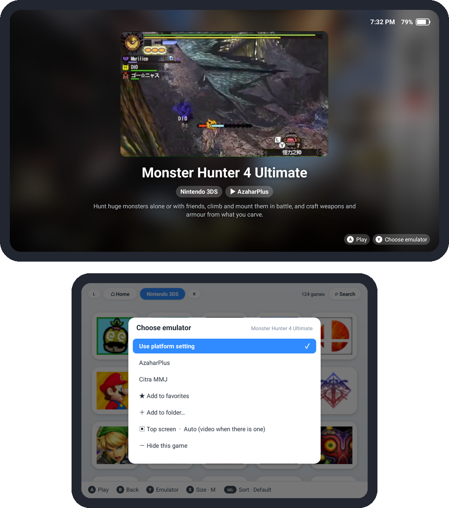
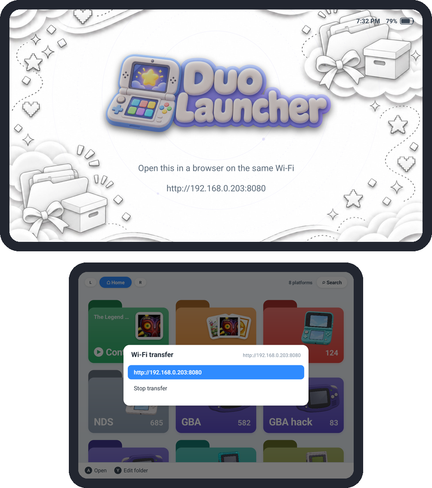
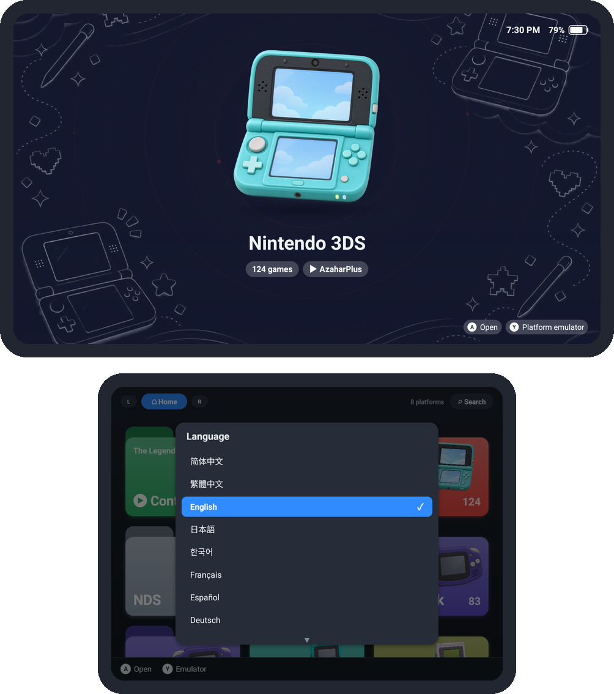
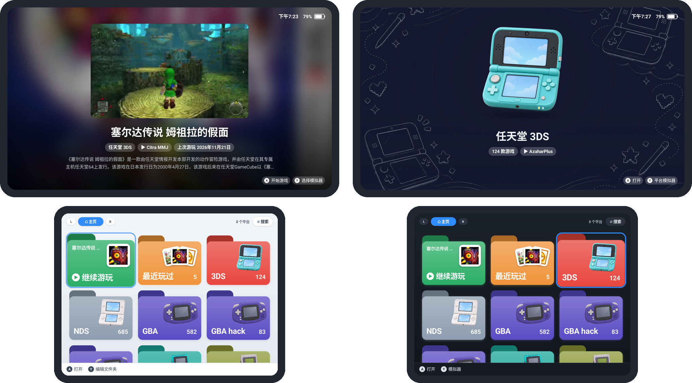
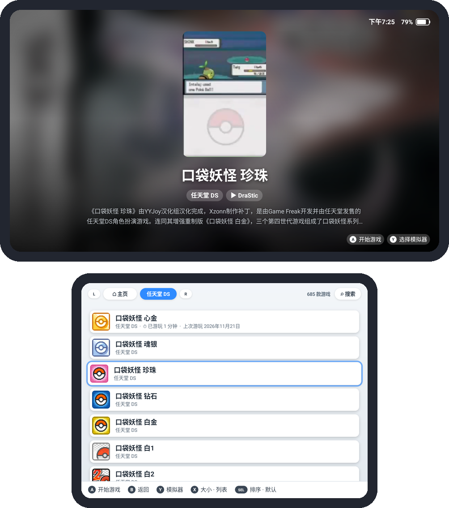

<p align="center"></p>

# Duo Launcher

A dual-screen, 3DS-style game launcher for the **Retroid Pocket Duo** and other Android handhelds with a second display.
Point it at your ROM folders and it finds the games, shows them on the lower screen and the artwork on the upper one, and starts each game in the emulator you pick.

一个给 Retroid Pocket Duo 等双屏安卓掌机做的 3DS 风格游戏前端：选好放游戏的文件夹，它会自己扫描、按平台归类，下屏选游戏、上屏展示，每款游戏都能指定用哪个模拟器。

## Screenshots

<p align="center"></p>

<table>
  <tr>
    <th>Game page with video preview · 游戏页与视频预览</th>
    <th>Logo, cover or video, per game · 每个游戏可选上屏显示</th>
  </tr>
  <tr>
    <td></td>
    <td></td>
  </tr>
  <tr>
    <th>List view · 列表视图</th>
    <th>Play statistics · 游玩统计</th>
  </tr>
  <tr>
    <td></td>
    <td></td>
  </tr>
  <tr>
    <th>Colour themes · 颜色主题</th>
    <th>Theme colours reach the backdrops · 主题色会染到上屏背景</th>
  </tr>
  <tr>
    <td></td>
    <td></td>
  </tr>
  <tr>
    <th>Dark mode · 深色模式</th>
    <th>Dark mode · 深色模式</th>
  </tr>
  <tr>
    <td></td>
    <td></td>
  </tr>
  <tr>
    <th>Wi-Fi transfer · Wi-Fi 传输</th>
    <th>Tidy-up tools · 整理工具</th>
  </tr>
  <tr>
    <td></td>
    <td></td>
  </tr>
  <tr>
    <th>Screensaver (OLED-safe) · 屏保（防烧屏）</th>
    <th>11 languages · 11 种语言</th>
  </tr>
  <tr>
    <td></td>
    <td></td>
  </tr>
</table>

<details>
<summary><b>简体中文截图</b></summary>

<p align="center"></p>

<table>
  <tr>
    <th>主页</th>
    <th>游戏页</th>
  </tr>
  <tr>
    <td></td>
    <td></td>
  </tr>
  <tr>
    <th>上屏显示：Logo / 封面 / 视频</th>
    <th>列表视图</th>
  </tr>
  <tr>
    <td></td>
    <td></td>
  </tr>
  <tr>
    <th>游玩统计</th>
    <th>游玩统计 · 深色</th>
  </tr>
  <tr>
    <td></td>
    <td></td>
  </tr>
  <tr>
    <th>颜色主题</th>
    <th>樱花粉主题</th>
  </tr>
  <tr>
    <td></td>
    <td></td>
  </tr>
  <tr>
    <th>Wi-Fi 传输</th>
    <th>整理工具</th>
  </tr>
  <tr>
    <td></td>
    <td></td>
  </tr>
  <tr>
    <th>深色模式</th>
    <th>屏保</th>
  </tr>
  <tr>
    <td></td>
    <td></td>
  </tr>
</table>

</details>

## Features

- **Finds your games by itself** – add folders in Settings → Game folders, or let it pick up any `Roms` folder on internal storage and SD cards. Platforms are recognised from folder names (`gba`, `Nintendo DS`, `psx`, …) and file extensions.
- **Platforms** – 3DS, NDS, GBA, GBC, GB, NES, SNES, N64, Mega Drive, PlayStation 1/2/3, PSP, PS Vita, Switch, plus artwork for PS4, PS5, Xbox 360 and Xbox Series.
- **Your own folders** – the "+" tile makes a folder with its own name, colour, icon and backdrop (from the bundled art or your own pictures); add any game or app to it with Y.
- **Android games and apps** – installed games get their own page automatically; pick any apps (video, browser, …) to show on the Apps page.
- **Upper screen (1920×1080)** – each platform's console on its own illustrated backdrop, or the selected game's logo over its blurred cover art, with platform, emulator and play-time tags and a short description.
- **Lower screen (1280×960)** – platform folders and a zoomable icon grid. Works with the gamepad and with touch.
- **Play time** – how long and when you last played each game, Switch-style. With Usage access granted it counts only the time the game was really on screen.
- **Search** – R3 or the search button; results update as you type. Chinese titles also match pinyin and its initials (`kdyg` → 口袋妖怪), opened from inside a platform it searches only that platform, and recent searches are one tap away.
- **Continue and favorites** – the first home tile jumps straight back into the last game; star games with Y to collect them in a Favorites folder.
- **Sort and filter** (SELECT) – default order, name, recently played or most played, and show only 简 / 繁 / 英 games.
- **Themes** – colour schemes, console art, backdrops, font, sounds and music from a folder; see [Themes](#themes).
- **Sounds** – soft UI sounds (can be turned off) and each 3DS game's own banner tune when it is selected.
- **Starts instantly** – the last scan is cached, so the home screen is up in a second and the scan runs in the background.
- **Hide what you don't play** – hide a platform folder, or a single game or app (Y → Hide); bring them back in Settings.
- **First-start setup** – language, then every permission it uses (file access, usage access for play time, home screen) on one page, also under Settings → Permissions.
- **Light and dark mode** – follows the system or set it yourself.
- **Icons straight from the ROMs** – NDS banner icons and 3DS SMDH icons (decrypted dumps).
- **Emulator per game or per platform** (Y button) – only installed emulators are offered:

  | Platform | Emulators (first one is the default) |
  |---|---|
  | 3DS | AzaharPlus, Azahar, Citra MMJ |
  | NDS | DraStic, RetroArch · melonDS DS |
  | GB / GBC / GBA | RetroArch · Gambatte, mGBA, gpSP |
  | NES / SNES / MD | RetroArch · FCEUmm, Mesen, Snes9x, Genesis Plus GX, PicoDrive |
  | N64 | RetroArch · Mupen64Plus-Next, Mupen64Plus FZ |
  | PS1 | RetroArch · PCSX ReARMed, SwanStation, DuckStation |
  | PS2 | ARMSX2, AetherSX2 |
  | PSP | PPSSPP, RetroArch · PPSSPP |
  | PS Vita | Vita3K (by title ID, e.g. a file named `PCSE00000.psvita` or a name containing it) |
  | Switch | Eden |
- **Video previews** – a game's video snap (`videos/` or `video.mp4` in its media folder) starts on the upper screen after a moment; per game you can choose logo, cover or video instead (Y → Top screen).
- **List view** – press X until the grid becomes a list with names, play time and last played.
- **Play statistics** – total play time, this week by day, time per platform and the most played games.
- **Screensaver** – after a few idle minutes the upper screen shows your covers with a clock and the lower screen goes black. Text changes corner with every picture and drifts slowly, so nothing burns into an OLED panel.
- **Wi-Fi transfer** – Settings → Wi-Fi transfer shows an address; open it in a browser on the same network and drop ROMs or theme packs straight into any platform folder.
- **Tidy-up tools** (Settings → Tools) – find duplicate games, list games without pictures, fetch missing NDS/GBA box art and title screens from the libretro thumbnail sets (matched by the game code in the ROM), back up and restore emulator saves (DraStic, RetroArch, PPSSPP, AetherSX2, DuckStation, Mupen64Plus FZ, Azahar, Citra), export the current theme as a zip, and a diagnostics page.
- **Button layout** – swap A/B and X/Y for Nintendo- or Xbox-style confirm buttons.
- **Custom artwork** – replace any platform's console picture or backdrop in Settings → Platform look.
- **Works with existing setups** – reads Pegasus `metadata.pegasus.txt`, ES-DE / EmulationStation `gamelist.xml` and `downloaded_media`, RetroArch thumbnails, and `media/`, `covers/`, `images/` folders next to the games.
- **Home screen** – can be set as the default home app so it starts on boot; the Android home tile (or Settings → Exit to Android home) leads back to the system home screen.
- **Everything on the home page is yours** – every built-in tile (Continue, Recently played, Favorites, New folder, Search, Settings, Android home) and every platform folder can be renamed, recoloured or hidden, and brought back under Settings → Hidden folders.
- **Text size** – four sizes for both screens.
- **11 languages** – 简体中文, 繁體中文, English, 日本語, 한국어, Français, Español, Deutsch, Italiano, Português, Русский.

## Your own game info

Put a `DuoLauncher` folder at the root of the SD card (or internal storage) to add or correct names, descriptions and pictures without touching other frontends' files. Anything here wins over Pegasus, ES-DE and the game's own data.

```
DuoLauncher/
  3DS/metadata.txt
  3DS/media/<file name without extension>/logo.png   (also cover.png, background.png)
  NDS/metadata.txt
```

`metadata.txt` uses the Pegasus format. Entries are matched by `file:`, or by `titleid:` for 3DS games installed into an emulator:

```
game: 勇者派遣会社
titleid: 0004000000065600
description: …
```

Names and descriptions can be given per language with `name.<language>:` and `description.<language>:` (`en`, `zh-CN`, `zh-TW`, `ja`, `ko`, `fr`, `es`, `de`, `it`, `pt`, `ru`; `zh` covers both Chinese). They are used while the launcher runs in that language, so one folder can serve players of several languages:

```
game: 塞尔达传说 姆祖拉的假面
file: 塞尔达传说 姆祖拉的假面 汉化版.cci
name.en: The Legend of Zelda: Majora's Mask 3D
description.en: Link has three days before the moon falls on Termina…
```

## Themes

Settings → Theme offers seven built-in colour themes (blue, red, green, purple, orange, pink, graphite), **Custom colours** (pick a main colour and a background colour; every shade for light and dark mode is worked out from them), and any installed theme packs. A theme colours both screens, including the line-art backdrops on the upper screen.

Settings → Platform look sets, per platform, the console picture, a separate light-mode and dark-mode backdrop, and the folder colour.

A theme pack is a folder (or a `.zip` of one, unpacked on first use) in `DuoLauncher/themes/` on the SD card or internal storage, picked in Settings → Theme. Everything is optional; whatever a theme leaves out comes from the built-in look, so a theme can be as small as a few colours.

```
DuoLauncher/themes/my-theme/
  theme.txt                      name, author, colours (see below)
  consoles/<type>.png            console pictures      (3ds, nds, gba, ..., recent, search, settings, custom)
  backgrounds/<type>.jpg         upper-screen backdrops
  backgrounds/dark/<type>.jpg    backdrops for dark mode
  logo.png
  font.ttf, font-bold.ttf
  sounds/move|open|back|launch.ogg   (or .wav / .mp3)
  music.ogg                      loops on the home screen
```

`theme.txt` uses `key: value` lines: `color.<name>` for light mode and `dark.color.<name>` for dark mode, with names such as `accent`, `shelf-top`, `shelf-bottom`, `card`, `text`, `pill`, `footer`, `backdrop-paper` / `backdrop-ink` (the upper-screen line art) and `folder.<type>` for the home folders. `base-color: #RRGGBB` alone is enough for a complete colour scheme. [themes/sakura](themes/sakura/theme.txt) is a complete example with every key explained. Settings → Tools → Export current theme saves whatever you have set up as a zip that others can drop into their own `themes/` folder.

## Controls

| Button | Action |
|---|---|
| D-pad / left stick | Move |
| A | Open / play |
| B | Back |
| L / R | Previous / next platform |
| X | Icon size, then list view |
| Y | Choose emulator, favorite, add to a folder, top-screen display, hide, or edit a folder; on the home page also rename, recolour or hide any tile |
| START | Settings (from the home page, even with the Settings tile hidden) |
| SELECT | Sort and language filter |
| R3 | Search |

## Building

No Android Studio or Gradle needed – only the Android SDK command-line tools (build-tools 35, platform android-35) and JDK 17+:

```powershell
powershell -File build.ps1            # builds DuoLauncher.apk
powershell -File build.ps1 -Install   # also installs over adb, grants file access and starts it
```

A debug signing key (`debug.keystore`) is generated on the first build and is not committed.
`shot.ps1` sends key presses over adb and saves screenshots of both screens, which is handy while tweaking the UI.

## Artwork

`assets/consoles/<type>.png` (chibi console renders) and `assets/backgrounds/<type>.jpg` (paper-cut line-art backdrops, with their own versions in `backgrounds/dark/`) were made for this project. The backdrops are greyscale, so a colour theme can tint them.
Platforms without a picture fall back to a drawn console.

## Launch notes

- AzaharPlus only accepts a tree URI under a folder it already has access to:
  `content://com.android.externalstorage.documents/tree/<volume>%3ARoms%2F3DS/document/<volume>%3ARoms%2F3DS%2F<file>`
- Citra MMJ: `org.citra.emu/org.citra.emu.ui.EmulationActivity` with `-e GamePath <path>`
- DraStic as shipped on Retroid handhelds wants `-e GAMEPATH "/sf<path>"`; a "plain path" variant is offered for stock builds.
- RetroArch: `com.retroarch.aarch64/...RetroActivityFuture` with `-e ROM`, `-e LIBRETRO <core>` and `-e CONFIGFILE`.
- ARMSX2, AetherSX2, Eden, PPSSPP and Mupen64Plus FZ get the game as a read-only `content://com.duo.launcher.rom/...` link with a one-time read grant, so they need no folder access of their own.
- Vita3K: `org.vita3k.emulator/.Emulator` with the string array extra `AppStartParameters = ["-r", "<title ID>"]`.
- Launch lines in Pegasus metadata are used unchanged.

### Citra MMJ on a dual-screen handheld

Citra MMJ puts the touch screen on the upper display by default. To get the main picture on top and hide the on-screen buttons, close Citra and set in `/sdcard/citra-emu/config/config-mmj.ini`:

```ini
[Controls]
input_overlay_hide = True
[Layout]
landscape_swap_screen = True
```

## License

[MIT](LICENSE)
