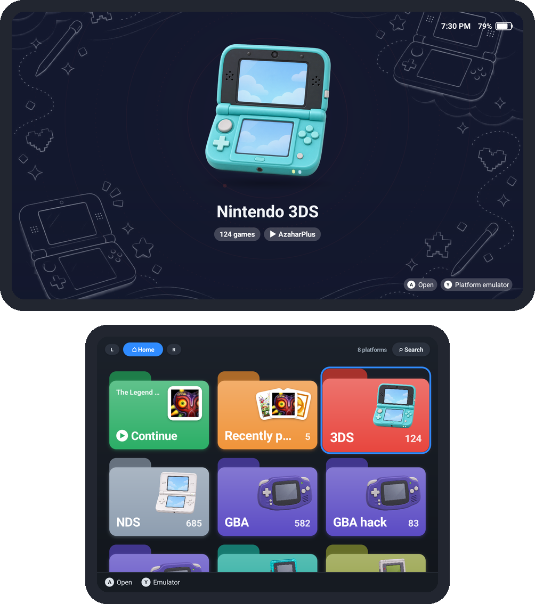

<p align="center"></p>

# Duo Launcher

<p align="center"><a href="README.md">English</a> · <a href="README.fr.md">Français</a> · <a href="README.zh-CN.md">简体中文</a> · <a href="README.zh-TW.md">繁體中文</a> · <a href="README.ja.md">日本語</a> · <a href="README.ko.md">한국어</a> · <a href="README.es.md">Español</a> · <a href="README.de.md">Deutsch</a> · <a href="README.it.md">Italiano</a> · <b>Português</b> · <a href="README.ru.md">Русский</a></p>

Um launcher de jogos de duas telas para o **Retroid Pocket Duo** e outros portáteis Android com uma segunda tela, inspirado no menu inicial do 3DS.
Você aponta para as suas pastas de ROMs e ele encontra os jogos, separa por console, gênero e série, mostra tudo na tela de baixo com a arte na de cima e abre cada jogo no emulador que você escolher.

**Download:** o APK mais recente está na [página de Releases](https://github.com/GenKnot/DuoLauncher/releases/latest) (Android 11 ou mais novo). Instalar uma versão nova por cima da antiga mantém todas as configurações e o seu tempo de jogo.

## Por que mais um launcher?

O Duo Launcher começou como o launcher de um jogador para um portátil, e até hoje cresce a partir do jeito como esse portátil é usado de verdade. Algumas ideias atravessam tudo:

- **Duas telas, duas funções.** A tela de baixo é para escolher: pastas grandes, grade, lista, menus. A de cima é para ver: o console no seu próprio fundo ilustrado, o logo do jogo sobre a capa, uma prévia em vídeo, quanto tempo você já jogou, uma nota para você mesmo ou uma conversa com a IA. Nada precisa disputar espaço com nada.
- **O controle vem primeiro.** Tudo funciona sem tocar na tela: um teclado feito para o direcional, direções que continuam rolando enquanto você segura, L / R para virar a página, segurar L para pesquisar por voz, segurar R para falar com a IA. O toque também funciona, só não é obrigatório.
- **A sua biblioteca, do jeito que ela já está.** Ele lê os metadados e as imagens do Pegasus e do ES-DE que você talvez já tenha, guarda o que acrescenta numa pasta própria, `DuoLauncher`, e nunca reescreve os arquivos de outro frontend.
- **IA que trabalha para você, com a sua chave.** Tradução, organização, imagens, dicas e conversa usam o serviço que *você* escolhe e paga diretamente. As chaves ficam no portátil, e cada pedido é contado nas Configurações com um custo estimado, então nada roda escondido.
- **Tudo pode ser mudado, ocultado ou compartilhado.** Cada bloco da tela inicial pode ser renomeado, ganhar outra cor, outra imagem, mudar de lugar ou sumir. Toda a sua configuração pode ser exportada num arquivo só e passada para um amigo – sem as suas chaves e sem o seu histórico de jogo.

Sugestões e relatos de bugs são bem-vindos no [issue tracker](https://github.com/GenKnot/DuoLauncher/issues).

## Destaques

- **Duas telas, um launcher** – você escolhe na tela de baixo e vê logos, capas, prévias em vídeo, tempo de jogo e descrições na de cima.
- **Todos os emuladores num lugar só** – 3DS, NDS, GBA, GB/GBC, NES, SNES, N64, GameCube, Wii, Mega Drive, PS1, PS2, PSP, PS Vita e Switch, com o emulador escolhido por console ou por jogo. Jogos de vários discos aparecem como um só.
- **Já vem organizado** – cada jogo entra num de 14 gêneros e na sua série (Ys, Castlevania, Super Robot Wars …). A tela inicial mostra a biblioteca por console, gênero ou série, e as pastas inteligentes mantêm sempre em dia “Adicionados recentemente”, “Jogando”, “Quero jogar”, “Zerado” e “Mais bem avaliados”.
- **Um companheiro de IA** – segure R em qualquer lugar e fale: ele recomenda jogos da sua própria biblioteca, explica como passar de um trecho, conta sobre a história ou só bate papo. As respostas podem ser lidas em voz alta.
- **Trapaças organizadas** – milhares de cheats prontos para 3DS, NDS, PSP, GBA e todos os sistemas do RetroArch, traduzidos para o seu idioma com um toque, editáveis e compartilhados entre emuladores.
- **Completa o que falta** – capas reais dos pacotes de thumbnails da libretro, títulos oficiais em inglês e capas, logos e fundos desenhados por IA no estilo do próprio launcher.
- **Feito para um portátil** – protetor de tela seguro para OLED, transferência por Wi-Fi pelo navegador, backup de saves, estatísticas de jogo, progresso no RetroAchievements, um panorama do armazenamento e uma tela inicial que abre em um segundo.
- **Do seu jeito** – temas de cores e pacotes de tema, modo claro e escuro, tamanho do texto, margem das capas, uma tela de configurações como a de um console e configurações que você exporta e compartilha. 11 idiomas na interface.

## Capturas de tela

<p align="center"></p>

<table>
  <tr>
    <th>Definições ao estilo 3DS</th>
    <th>Definições no modo escuro</th>
  </tr>
  <tr>
    <td></td>
    <td></td>
  </tr>
  <tr>
    <th>Uso e custo da IA</th>
    <th>Exportar e importar a configuração</th>
  </tr>
  <tr>
    <td></td>
    <td></td>
  </tr>
  <tr>
    <th colspan="2">Ilustrações desenhadas para o modo escuro</th>
  </tr>
  <tr>
    <td colspan="2" align="center"></td>
  </tr>
  <tr>
    <th>Início por gênero, com ícones de massinha</th>
    <th>Início por série</th>
  </tr>
  <tr>
    <td></td>
    <td></td>
  </tr>
  <tr>
    <th>Gênero e série na página do jogo</th>
    <th>Nota, Perguntar à IA, status, como jogar, saves</th>
  </tr>
  <tr>
    <td></td>
    <td></td>
  </tr>
  <tr>
    <th>Teclado para o controle; títulos em inglês também valem</th>
    <th>Perguntando à IA o que jogar</th>
  </tr>
  <tr>
    <td></td>
    <td></td>
  </tr>
  <tr>
    <th>Ferramentas de IA: séries, sugestões, armazenamento, lembrete de pausa</th>
    <th>Armazenamento: tamanho por console, jogos grandes nunca jogados</th>
  </tr>
  <tr>
    <td></td>
    <td></td>
  </tr>
  <tr>
    <th>Página do jogo com prévia em vídeo</th>
    <th>Logo, capa ou vídeo, por jogo</th>
  </tr>
  <tr>
    <td></td>
    <td></td>
  </tr>
  <tr>
    <th>Modo lista</th>
    <th>Estatísticas de jogo</th>
  </tr>
  <tr>
    <td></td>
    <td></td>
  </tr>
  <tr>
    <th>Temas de cores</th>
    <th>As cores do tema chegam aos fundos</th>
  </tr>
  <tr>
    <td></td>
    <td></td>
  </tr>
  <tr>
    <th>Modo escuro</th>
    <th>Modo escuro</th>
  </tr>
  <tr>
    <td></td>
    <td></td>
  </tr>
  <tr>
    <th>Transferência Wi-Fi</th>
    <th>Ferramentas de organização</th>
  </tr>
  <tr>
    <td></td>
    <td></td>
  </tr>
  <tr>
    <th>GameCube, com o Dolphin</th>
    <th>Segure A para mover uma pasta</th>
  </tr>
  <tr>
    <td></td>
    <td></td>
  </tr>
  <tr>
    <th>Escolha as trapaças antes de importar, com nomes traduzidos</th>
    <th>Detalhes do jogo: tamanho, discos, capturas</th>
  </tr>
  <tr>
    <td></td>
    <td></td>
  </tr>
  <tr>
    <th>Trapaças de 3DS, traduzidas com um toque</th>
    <th>Trapaças de NDS para o DraStic, base de dados chinesa</th>
  </tr>
  <tr>
    <td></td>
    <td></td>
  </tr>
  <tr>
    <th>Trapaças do RetroArch (GBA)</th>
    <th>Editar, adicionar, baixar</th>
  </tr>
  <tr>
    <td></td>
    <td></td>
  </tr>
  <tr>
    <th>Renomear ou excluir uma trapaça</th>
    <th>Traduzir todas as trapaças de uma vez</th>
  </tr>
  <tr>
    <td></td>
    <td></td>
  </tr>
  <tr>
    <th>Protetor de tela (seguro para OLED)</th>
    <th>11 idiomas</th>
  </tr>
  <tr>
    <td></td>
    <td></td>
  </tr>
</table>

## Primeiros passos

1. **Instale o APK** da [página de Releases](https://github.com/GenKnot/DuoLauncher/releases/latest) e abra.
2. **Escolha um idioma** e depois conceda, numa tela só, as permissões que ele pede: acesso aos arquivos (para achar os seus jogos), acesso ao uso (para que o tempo de jogo conte só quando o jogo está de fato na tela) e, se quiser, o papel de tela inicial. Dá para voltar a essa tela quando quiser em Configurações → Sistema → Permissões.
3. **Deixe ele achar os seus jogos.** Qualquer pasta `Roms` no armazenamento interno ou no cartão SD é encontrada sozinha. Outras pastas podem ser adicionadas em Configurações → Início e biblioteca → Pastas de jogos. Os consoles são reconhecidos pelo nome da pasta (`gba`, `Nintendo DS`, `psx` …) e pela extensão dos arquivos.
4. **Escolha os emuladores** onde você quiser algo diferente do padrão: aperte Y numa pasta de console para o console inteiro, ou num jogo só para aquele jogo. Só aparecem os emuladores que estão instalados.
5. **Opcional: coloque uma chave de IA** em Configurações → IA e voz – no próprio portátil ou, com mais conforto, pelo computador ou celular via Wi-Fi (Configurações → Saves, transferência, partilha → Transferência Wi-Fi). Tudo funciona sem chave, menos os recursos de IA.
6. **Opcional: use como tela inicial** (Configurações → Sistema → Definir como tela inicial (ao ligar)) para que ele abra junto com o portátil. O bloco “Início do Android” sempre leva de volta à tela inicial do sistema.

## O básico

**A tela inicial** (tela de baixo) tem as suas pastas de consoles e alguns blocos fixos: “Continuar” (volta direto para o último jogo), “Jogados recentemente”, “Favoritos”, “Nova pasta”, “Pesquisar”, “Estatísticas”, “Armazenamento”, “O que jogar?”, “Configurações” e “Início do Android”. SELECT alterna a tela inicial entre consoles, gêneros e séries.

**Uma pasta** mostra os jogos numa grade de capas. X deixa as capas menores e, apertando mais uma vez, a grade vira uma lista com nomes, tempo de jogo e quando você jogou pela última vez. SELECT ordena (“Padrão”, “Nome”, “Jogados recentemente”, “Mais jogados”) e pode mostrar só versões em chinês simplificado, chinês tradicional ou inglês. L2 / R2 pulam para a inicial anterior ou a próxima – títulos chineses contam pela inicial do pinyin.

**A tela de cima** acompanha o que está selecionado: um console no seu fundo, com o número de jogos e o emulador; ou o logo do jogo sobre a capa desfocada, com console, gênero · série, emulador, tempo de jogo e uma descrição curta, uma prévia em vídeo depois de um instante, ou a imagem de onde você parou.

**Y** é o menu do que estiver selecionado – num jogo: emulador, favorito, pastas, “Trapaças”, “Detalhes”, “Gênero”, “Nota”, “Perguntar à IA”, “Status” e nota de estrelas, “Como jogar”, “Saves”, o que a tela de cima mostra (“Tela superior”), ocultar. Numa pasta de console: emulador padrão, “Renomear”, “Juntar pastas”, ocultar. Num bloco fixo: nome, “Cor”, “Ícone” e fundo.

### Controles

| Botão | Ação |
|---|---|
| Direcional / analógico esquerdo | Mover; segure para continuar andando |
| Esquerda / direita, L / R numa lista ou menu | Uma página por vez |
| A | Abrir / jogar; segure A numa pasta da tela inicial para pegá-la e mudar de lugar |
| B | Voltar |
| L / R | Console anterior / seguinte (nas Configurações: categoria) |
| Segurar L | Pesquisar por voz |
| Segurar R | Falar com a IA |
| L2 / R2 | Inicial anterior / seguinte |
| X | Tamanho das capas, depois modo lista |
| Y | Menu do jogo, pasta ou bloco selecionado |
| START | Configurações (de qualquer ponto da tela inicial, mesmo com o bloco “Configurações” oculto); num menu, o mesmo que A |
| SELECT | Na tela inicial: consoles / gêneros / séries; numa pasta: ordem e filtro de idioma |
| R3 | Pesquisar |
| No teclado de pesquisa | A digita, B apaga, X espaço, Y teclado do sistema, SELECT limpa, START ou R3 conclui, segure L para falar |
| No chat com a IA | Segure R para falar, Y para digitar, X para uma conversa nova, SELECT para o histórico, L2 / R2 para rolar para trás, B para fechar; o direcional e o A escolhem entre os jogos embaixo |

Tudo também funciona por toque: toque para selecionar, toque de novo para abrir, deslize para rolar e toque nos botõezinhos do topo no lugar de L, R, X, SELECT ou Pesquisar. A/B e X/Y podem ser trocados para ter a confirmação no estilo Nintendo ou Xbox (Configurações → Jogo → Botões).

## Sua biblioteca

- **Acha os seus jogos sozinho.** O armazenamento interno e os cartões SD são vasculhados atrás de pastas `Roms`; outras podem ser adicionadas em Configurações → Início e biblioteca → Pastas de jogos. A última busca fica em cache, então a tela inicial abre em um segundo e a próxima busca roda quietinha em segundo plano.
- **Consoles** – 3DS, NDS, GBA (e as pastas de GBA com vibração e de hacks), GBC, GB, NES, SNES, N64, GameCube, Wii, Mega Drive, PlayStation 1/2/3, PSP, PS Vita e Switch, com arte também para PS4, PS5, Xbox 360 e Xbox Series.
- **Jogos de vários discos como um só.** `Disc A/B`, `Disc 1/2`, `CD1/CD2`, `(Disc 2 of 3)` na mesma pasta, ou uma lista `files:` do Pegasus, viram uma entrada só. RetroArch e DuckStation recebem uma playlist `.m3u` dos discos, para você trocar de disco durante o jogo.
- **Jogos e apps de Android** – os jogos instalados ganham uma pasta própria automaticamente; outros apps (vídeo, navegador …) podem ser adicionados a uma pasta “Apps”.
- **Funciona com o que você já tem.** Ele lê o `metadata.pegasus.txt` do Pegasus, o `gamelist.xml` e a `downloaded_media` do ES-DE / EmulationStation, as thumbnails do RetroArch e as pastas `media/`, `covers/` e `images/` ao lado dos jogos. Nada disso é alterado; o que o launcher acrescenta vai para a pasta `DuoLauncher` dele (veja [Suas informações de jogo](#suas-informações-de-jogo)).
- **Percebe jogos novos.** Copie jogos para o cartão e a próxima busca encontra; eles ganham um selo NEW por uma semana (ou até serem jogados) e o launcher oferece separá-los em gêneros e séries. A pergunta pode ser desligada. Y → "Marcar como visto" tira o selo de um jogo; "Marcar todos como vistos" (Y num console ou pasta, ou Configurações → Início e biblioteca) tira de vários de uma vez, e a chave "Selos NEW" ali desliga os selos de vez.
- **Juntar pastas.** Duas pastas do mesmo console em lugares diferentes (duas pastas de PS1, por exemplo) podem aparecer como uma só: Y → “Juntar pastas” num console. Cada jogo mantém o seu emulador, pastas com o mesmo nome se juntam sozinhas e “Separar” desfaz a junção.
- **Suas próprias pastas.** O bloco “Nova pasta” cria uma pasta com nome, cor, ícone e fundo próprios. Adicione qualquer jogo ou app a ela com Y e tire de novo com Y → “Remover desta pasta”.
- **Pastas inteligentes** se enchem sozinhas: “Adicionados recentemente” (os últimos 30 dias), “Ainda não jogados”, “Mais jogados”, “Jogando”, “Quero jogar”, “Zerado” e “Mais bem avaliados”. Y numa delas mostra a regra.
- **Continuar e favoritos.** O primeiro bloco da tela inicial volta direto para o último jogo. Marque jogos com estrela pelo Y para juntá-los na pasta “Favoritos”.
- **Esconda o que você não joga** – uma pasta de console, ou um único jogo ou app (Y → “Ocultar esta pasta” / “Ocultar este jogo”); traga de volta em Configurações → Início e biblioteca.
- **O seu catálogo.** Depois de cada busca, a biblioteca inteira é gravada em `DuoLauncher/catalog.tsv` (console, arquivo, título, título em inglês, gênero, série, tempo de jogo, status, nota) – para planilhas, outras ferramentas ou para a IA.

### Gêneros e séries

Navegar por dois mil jogos só por console cansa, então cada jogo também ganha um de 14 gêneros (RPG, ação, aventura, plataforma, tático, estratégia, tiro, quebra-cabeça, corrida, esporte, luta, simulação, party e música, outros) e a sua série.

- **Primeiro, o que já vem embutido.** Uma tabela dentro do launcher (`assets/gamedb.tsv`, 3.860 nomes de arquivo que cobrem todos os jogos das listas dos packs Pegasus G para esses consoles, com o nome `.iso` e o `.cso` quando o pack tem os dois) já conhece o gênero, a série e o título oficial em inglês dos romsets comuns, por console e nome de arquivo. Jogos que ela conhece não precisam de IA nem de internet.
- **IA para o resto.** Configurações → IA e voz → “IA: separar por gênero” / “IA: séries de jogos” classifica os jogos que sobraram, e o resultado fica em `DuoLauncher/<console>/genres.txt` e `series.txt` no cartão – é feito uma vez só e sobrevive a reinstalações. Gêneros já escritos pelo Pegasus ou pelo ES-DE (“Action RPG”, “角色扮演” …) são encaixados nos 14 gêneros.
- **À mão** – Y → “Gênero” em qualquer jogo.
- **Na tela.** A tela de cima mostra o gênero · série do jogo, e SELECT na tela inicial transforma as pastas em gêneros ou séries. Os nomes das séries seguem o idioma da interface.

### Pesquisa

R3, o bloco “Pesquisar” ou o botão de pesquisa abrem na tela de cima um teclado feito para o direcional, com as suas pesquisas recentes e uma fileira de gêneros logo acima; os resultados vão enchendo a tela de baixo enquanto você digita. Títulos chineses batem com o pinyin, com as iniciais e com o começo de cada sílaba (`kdyg`, `mlao` → 马里奥), e todo jogo também bate com o título oficial em inglês, então `zelda` acha 塞尔达传说. Aberta de dentro de um console, a pesquisa procura só naquele console, com um botão “Todas as plataformas” para ampliar. Segure L para falar o nome em vez de digitar.

### Imagens que se preenchem sozinhas

- **Capas reais** – Configurações → Organizar → “Baixar capas” baixa as capas dos pacotes de thumbnails da libretro. Jogos de NDS e GBA são identificados pelo código de jogo dentro da ROM (ROMs zipadas também, com telas de título), então arquivos traduzidos e renomeados continuam achando as suas imagens; jogos de PlayStation 1/2, PSP, N64, GameCube, Wii, 3DS, GB/GBC, NES, SNES e Mega Drive são identificados pelo título em inglês.
- **Ícones direto das ROMs** – ícones de banner do NDS e ícones SMDH do 3DS; títulos de 3DS instalados mostram o nome no idioma da interface.
- **Capas que combinam** – as capas preenchem os blocos, ou ficam todas com a mesma margem pequena, média ou grande (Configurações → Aparência e som → Margem das capas); bordas brancas embutidas nas imagens das capas são cortadas.
- **Imagens por IA** – com uma chave de imagens, dá para desenhar capas, logos de título e fundos para jogos que não têm (Y → “Detalhes” → “Criar capa com IA”, ou um console inteiro de uma vez em Configurações → IA e voz → “IA: desenhar imagens que faltam”). Veja [IA](#ia).

## Jogando

- **Emulador por jogo ou por console** (Y). Só aparecem os emuladores instalados:

  | Console | Emuladores (o primeiro é o padrão) |
  |---|---|
  | 3DS | AzaharPlus, Azahar, Citra MMJ, Citra MMJ (modo desempenho) |
  | NDS | DraStic, DraStic (caminho simples), RetroArch · melonDS DS |
  | GB / GBC | RetroArch · Gambatte, mGBA |
  | GBA | RetroArch · mGBA, gpSP, gpSP Rumble |
  | NES | RetroArch · FCEUmm, Mesen |
  | SNES | RetroArch · Snes9x |
  | Mega Drive | RetroArch · Genesis Plus GX, PicoDrive |
  | N64 | RetroArch · Mupen64Plus-Next, Mupen64Plus FZ |
  | GameCube / Wii | Dolphin MMJR, Dolphin |
  | PS1 | RetroArch · PCSX ReARMed, SwanStation, DuckStation |
  | PS2 | ARMSX2, AetherSX2 |
  | PSP | PPSSPP, RetroArch · PPSSPP |
  | PS Vita | Vita3K (pelo ID do título, por exemplo um arquivo chamado `PCSE00000.psvita` ou um nome que contenha esse ID) |
  | Switch | Eden |

- **Citra MMJ (modo desempenho)** – a mesma build do Citra MMJ reempacotada com o nome de pacote do benchmark AnTuTu, que muitos sistemas Android rodam com o clock no máximo. Só aparece quando esse pacote é mesmo o Citra.
- **Tempo de jogo e estatísticas** – quanto tempo e quando você jogou cada jogo pela última vez, no estilo do Switch; com o acesso ao uso liberado, conta só o tempo em que o jogo estava de fato na tela. O bloco “Estatísticas” mostra o total, a semana atual dia a dia, o tempo por console e os jogos mais jogados.
- **Onde você parou** – a captura de tela ou a imagem de save state mais recente de um jogo vira o fundo dele na tela de cima.
- **Status, nota e anotações** – marque um jogo como “Jogando”, “Quero jogar”, “Zerado” ou “Abandonado” e dê de uma a cinco estrelas (Y → “Status”); escreva ou fale uma linha sobre onde você está e o que fazer a seguir (Y → “Nota”). Tudo isso aparece na tela de cima da próxima vez que você pegar o jogo.
- **Detalhes do jogo** (Y → “Detalhes”) – arquivo, tamanho, discos, pasta, emulador, tempo de jogo, o título oficial em inglês e as capturas de tela do jogo na tela de cima.
- **Prévias em vídeo e sons** – o vídeo de um jogo começa na tela de cima depois de um instante (ou escolha logo ou capa por jogo: Y → “Tela superior”). Os sons suaves da interface e a musiquinha de banner de cada jogo de 3DS podem ser desligados.
- **Quando um jogo não abre** – arquivo sumido, emulador não instalado, emulador que não abre aquele tipo de arquivo ou jogo que fecha na hora: cada caso ganha uma mensagem dizendo o que fazer.
- **Lembrete de pausa** (Configurações → Jogo) – depois de uma, duas ou três horas num jogo, o launcher sugere uma pausa quando você volta.
- **RetroAchievements** – com o seu nome de usuário e a chave Web API, mostra os jogos recentes com o progresso das conquistas, e uma etiqueta 🏆 nos jogos que têm conquistas.

## Seu companheiro de IA

Tudo isso é opcional e usa o serviço de IA que você escolher, com a sua própria chave (veja [IA](#ia)).

- **Fale com ele de qualquer lugar.** Segure R na tela inicial, numa pasta ou no teclado de pesquisa e fale – ou aperte Y para digitar. A conversa ocupa a tela de cima; os jogos que ele recomenda ou encontra aparecem na de baixo, prontos para abrir com A. Pergunte o que jogar (“um RPG tranquilo, não muito longo”), refine (“algo com mais ação”), pergunte como passar daquele trecho do jogo selecionado, sobre a história ou um personagem, ou só bata papo. Ele lembra da conversa por meia hora.
  *Por quê:* a tela de baixo é onde se escolhem os jogos, então as sugestões da IA caem ali; a de cima fica livre para ler. E num portátil, segurar um botão de ombro e falar é mais rápido que qualquer menu.
- **Conversa nova, histórico salvo.** X no chat começa uma conversa nova; SELECT lista as anteriores, a mais recente no topo, para abrir de novo, apagar uma por uma ou apagar todas (também em Configurações → IA e voz → Histórico de conversas com a IA). Enquanto o chat está aberto, as prévias em vídeo, as músicas de banner do 3DS e os sons dos botões ficam em silêncio, e as respostas faladas tocam no volume de mídia.
  *Por quê:* uma pergunta nova não deve arrastar o assunto anterior, uma resposta que vale guardar não deve sumir ao reiniciar, e uma resposta falada não adianta nada com o trailer de um jogo tocando por cima. O histórico fica só no aparelho, nunca vai junto numa configuração exportada, e "Salvar conversas com a IA" desliga o recurso.
- **Respostas em voz alta** – Configurações → IA e voz → Respostas de voz da IA: Soniox (com chave própria) ou OpenAI (a chave de imagens), com escolha de voz e de velocidade e um botão de teste. Fica desligado até você ligar.
- **O que jogar hoje** – Y no bloco “O que jogar?” faz a IA escolher seis jogos da sua biblioteca de acordo com o seu gosto, com um motivo para cada um. Um aperto simples no bloco sorteia um jogo, dando preferência aos que você nunca jogou.
- **Pergunte sobre um jogo** (Y → “Perguntar à IA”) – uma pergunta sobre o jogo selecionado, digitada ou falada, respondida na tela de cima.
- **Como jogar** (Y → “Como jogar”) – os controles (inclusive os botões de confirmar / cancelar trocados das versões japonesas) e o básico que um iniciante precisa saber, escritos uma vez por jogo e guardados.
- **Ainda sem chave?** Segurar R explica como colocar uma – no portátil ou pelo computador via Wi-Fi.

## Trapaças

Y → “Trapaças” num jogo lista os cheats dele; A liga ou desliga cada um.

| | 3DS (Azahar, Citra) | NDS (DraStic) | PSP (PPSSPP) | RetroArch (GBA, GB, GBC, NES, SNES, N64, MD, PS1, …) |
|---|---|---|---|---|
| Onde ficam | `azahar/cheats/` e `citra-emu/cheats/`, `<title ID>.txt` – gravados para os dois, então trocar de emulador não perde nada | a lista completa em `DuoLauncher/cheats/NDS/`; os que estão ligados vão para os cheats personalizados do próprio DraStic (`DraStic/cheats/<game file name>.cht`), que funcionam também com ROMs traduzidas | `PSP/Cheats/<game ID>.ini`, os arquivos de cheat do próprio PPSSPP; o ID do jogo é lido do ISO, CSO ou EBOOT.PBP | `RetroArch/cheats/<core>/<game file name>.cht`, carregados pelo RetroArch quando o jogo abre |
| O que já vem no aparelho | – | o `usrcheat.dat` do DraStic (em chinês nos portáteis Retroid), identificado só pelo código do jogo, então ROMs com patch e traduzidas acham os seus cheats mesmo quando o próprio DraStic não mostra nenhum | o `cheat.db` do PPSSPP e, nos portáteis Retroid, arquivos de cheat em chinês para cerca de 4.300 jogos | a Retroid traz cheats em chinês para centenas de jogos (`000 中文金手指` e as pastas dos cores); um jogo sem arquivo próprio recebe uma cópia, identificada pelo nome |
| Download | [Sharkive](https://github.com/FlagBrew/Sharkive), cerca de 650 jogos, pelo ID do título lido da ROM | [libretro-database](https://github.com/libretro/libretro-database), cerca de 4.200 jogos, pelo código do jogo no cabeçalho da ROM | [CWCheat-Database-Plus+](https://github.com/Saramagrean/CWCheat-Database-Plus-), cerca de 4.300 jogos, pelo ID do jogo | [libretro-database](https://github.com/libretro/libretro-database) para GBA, pelo código do jogo no cabeçalho da ROM |

- **Escolha antes de importar** – um download primeiro lista o que encontrou, já traduzido, com “Selecionar tudo” / “Desmarcar tudo”; só os marcados são adicionados. *Por quê:* uma base de dados pode ter dezenas de códigos por jogo, e a maioria dos jogadores quer uns três.
- **Traduzir** – os nomes dos cheats em inglês passam para o idioma da interface com um toque, para um jogo ou para todos de uma vez (Configurações → Organizar). Os cheats comuns vêm de um glossário embutido (无限血量, 金钱最大, 主代码 …); o resto vai para o serviço gratuito MyMemory, com o endpoint gratuito do Google como segunda tentativa. Marcas de versão (`v1.2`) e dicas de botão (`(START+L)`) são mantidas, e o nome original em inglês continua no arquivo como comentário.
- **Traduzir com IA** – com uma chave de IA, os cheats de um jogo vão para o modelo junto com o nome do jogo, para que ele use os nomes oficiais de personagens e itens (鬼神林克, 心之容器 …).
- **Editar** – renomeie ou exclua qualquer cheat, apague todos os cheats de um jogo de uma vez, ou adicione os seus com os códigos (códigos de 3DS, NDS e PSP são conferidos no formato `XXXXXXXX YYYYYYYY`).
- **Seguro para o DraStic** – patches de flashcart (desvios de antipirataria, correções de overlay e de Wi-Fi) ficam de fora dos downloads de NDS porque o DraStic trava com eles ligados, e no máximo 256 linhas de código podem estar ligadas ao mesmo tempo, o limite que o DraStic consegue carregar.
- **Seguro para os seus arquivos** – na primeira vez que um arquivo de cheat de 3DS feito à mão é alterado, o original é guardado como `.txt.bak`.
- **RetroArch, uma vez só** – ative uma vez no RetroArch Quick Menu → Cheats → “Auto-Apply Cheats During Game Load”, e os cheats que você ligar aqui ficam ativos desde o momento em que o jogo abre.

## Aparência

- **A tela de cima (1920×1080)** – cada console no seu próprio fundo de papel recortado, ou o logo do jogo selecionado sobre a capa desfocada, com etiquetas e uma descrição curta; o relógio e a bateria ficam no canto.
- **A tela de baixo (1280×960)** – pastas de consoles, uma grade de capas com zoom e um modo lista, com dicas de botões no rodapé que continuam curtas e deixam de fora o que não cabe quando o texto está grande.
- **Temas** – sete esquemas de cores, cores próprias e pacotes de tema com arte de consoles, fundos, fonte, sons e música. Um tema também colore os fundos de traço da tela de cima. Veja [Temas](#temas).
- **Modo claro e escuro** – segue o sistema ou você define, com um conjunto separado de fundos desenhado para cada um.
- **Tudo na tela inicial é seu.** Cada bloco fixo e cada pasta de console pode ser renomeado, ganhar outra cor, um ícone próprio (uma imagem sua ou uma desenhada pelo serviço de imagens no estilo massinha do launcher), mudar de lugar (segure A, ou toque e segure) ou ser ocultado, e volta em Configurações → Início e biblioteca → Pastas ocultas. Blocos fixos como “Estatísticas”, “Armazenamento” e “O que jogar?” também podem ter o seu próprio fundo na tela de cima.
- **Visual dos consoles** – a imagem, o fundo claro e escuro e a cor da pasta de cada console podem ser trocados (Configurações → Aparência e som → Aparência das plataformas). Um fundo escuro pode ser redesenhado pelo serviço de imagens a partir do claro, para que os dois sempre combinem.
- **Tamanho do texto** – quatro tamanhos para as duas telas.
- **Protetor de tela** – depois de alguns minutos parado, a tela de cima mostra as suas capas com um relógio e a de baixo fica preta. O texto muda de canto a cada imagem e se desloca devagar, para nada marcar um painel OLED.

## Configurações e compartilhamento

- **Uma tela de configurações como a de um console.** START abre uma página só: as categorias à esquerda (Aparência e som, Início e biblioteca, Jogo, IA e voz, Saves, transferência, partilha, Organizar, Sistema), as opções de uma categoria à direita com os valores atuais e as chaves de liga/desliga, e a tela de cima mostrando a versão, o espaço livre em cada unidade e quais serviços de IA estão ligados. L / R trocam de categoria.
- **Compartilhe a sua configuração.** Configurações → Saves, transferência, partilha → Exportar minha configuração grava um zip com todas as configurações (visual, layout e ordem da tela inicial, pastas, o que está oculto, escolhas de emulador, serviços de IA) e as suas imagens. “Importar uma configuração” pega uma de `DuoLauncher/exports` ou da pasta Download – enviada por Wi-Fi, por um app de mensagens ou num cartão.
  *Por que é seguro compartilhar:* chaves, senhas e histórico de jogo nunca entram numa configuração exportada, importar uma mantém as suas, e uma chave sua nunca é apontada para um endereço que veio da configuração de outra pessoa.
- **11 idiomas** – 简体中文, 繁體中文, English, 日本語, 한국어, Français, Español, Deutsch, Italiano, Português, Русский.

## Ferramentas úteis

- **Transferência Wi-Fi** – Configurações → Saves, transferência, partilha → Transferência Wi-Fi mostra um endereço e um PIN. Abra o endereço num navegador na mesma rede, digite o PIN e solte ROMs ou pacotes de tema direto em qualquer pasta de console. A mesma página tem as configurações de IA, voz e RetroAchievements, protegidas por uma senha de administração (seis dígitos aleatórios, ou uma sua), para colar chaves longas pelo computador. A tela do portátil fica ligada enquanto a transferência está rodando, porque com a tela apagada não dá para acessar a página.
- **Armazenamento** – um bloco da tela inicial mostra o quanto o cartão está cheio, e o espaço livre de cada unidade na tela de cima. Lá dentro: o tamanho dos jogos de cada console, os maiores jogos nunca jogados e a opção de apagar os arquivos de um jogo (todos os discos e os arquivos citados num `.cue` ou `.m3u`) depois de uma confirmação.
- **Backup de saves** – faça backup e restaure os saves do DraStic, RetroArch, PPSSPP, AetherSX2, DuckStation, Mupen64Plus FZ, Azahar e Citra num zip, guardado em `DuoLauncher/backups` no cartão SD (no armazenamento interno quando não há cartão). Depois de três horas de jogo sem backup o launcher avisa, ou faz um sozinho se você preferir (os dez backups automáticos mais recentes são mantidos; os seus nunca são apagados). Uma restauração só substitui cada save quando a cópia dele está completa. Y → “Saves” faz backup e restaura um jogo sozinho.
- **Organizar** – encontrar jogos duplicados, listar jogos sem imagens, baixar as capas que faltam, traduzir todas as trapaças de uma vez e uma tela de diagnóstico; as ferramentas de IA (nomes e descrições de um console inteiro, gêneros, séries, imagens, ícones de gêneros) ficam em IA e voz.
- **Atualizações** – Configurações → Sistema → Sobre confere a release mais recente no GitHub uma vez por dia e leva até ela.
- **Tela inicial** – defina como app de tela inicial padrão para ele abrir junto com o portátil; o bloco “Início do Android” (ou Configurações → Sistema → Sair para o início do Android) leva de volta à tela inicial do sistema, e Configurações → Sistema → Configurações do Android abre as configurações do próprio sistema.

## IA

Tudo aqui é opcional e usa a sua própria conta. As chaves ficam guardadas nas configurações do launcher, no portátil, e são enviadas só para o serviço que você escolheu. Coloque-as em Configurações → IA e voz, ou na página Wi-Fi pelo computador ou celular.

- **Tradução por IA** – DeepSeek, Qwen, OpenAI, Claude, Gemini ou qualquer endereço compatível com a OpenAI. É essa chave que conversa: o chat, as sugestões de jogos, “Perguntar à IA”, “Como jogar”, gêneros e séries, nomes de cheats (um jogo inteiro num pedido só) e nomes e descrições de jogos no seu idioma (gravados nos metadados do próprio launcher junto com o título oficial em inglês, então uma biblioteca de títulos chineses fica natural em inglês e vice-versa). Sem chave, os cheats são traduzidos por serviços gratuitos.
- **Imagens por IA** – uma chave de imagens da OpenAI (o modelo de imagem mais novo que a chave pode usar é escolhido automaticamente). Capas, logos de título, fundos, imagens de consoles, ícones e fundos de pastas e blocos, tudo no mesmo estilo de ícones de massinha e papel recortado da arte embutida; os ícones são desenhados com fundo transparente, para que as partes brancas fiquem. Uma imagem leva cerca de meio minuto. A mesma chave transforma a sua voz em texto (`/audio/transcriptions`), já que o portátil não tem reconhecimento de voz próprio.
- **Respostas de voz da IA** – Soniox com chave própria, ou OpenAI com a chave de imagens; voz e velocidade (“Normal”, “Rápido”, “Muito rápido” – “Rápido” é o padrão, porque os dois leem chinês devagar).
- **Uso e custo da IA** – cada pedido que o launcher faz é contado no portátil: pedidos, tokens, imagens e minutos de voz, com um custo estimado para hoje, esta semana, este mês e o total. A estimativa usa os preços públicos dos serviços para o que você usa; cada preço pode ser ajustado ao seu (outro modelo, um revendedor, um desconto). O que vale é a fatura do seu provedor.

## Suas informações de jogo

Coloque uma pasta `DuoLauncher` na raiz do cartão SD (ou do armazenamento interno) para acrescentar ou corrigir nomes, descrições e imagens sem mexer nos arquivos de outros frontends. O que estiver aqui tem prioridade sobre o Pegasus, o ES-DE e os dados do próprio jogo.

```
DuoLauncher/
  3DS/metadata.txt
  3DS/media/<file name without extension>/logo.png   (also cover.png, background.png)
  NDS/metadata.txt
```

O `metadata.txt` usa o formato do Pegasus. As entradas são identificadas por `file:`, ou por `titleid:` para jogos de 3DS instalados num emulador:

```
game: 勇者派遣会社
titleid: 0004000000065600
description: …
```

Nomes e descrições podem ser dados por idioma com `name.<language>:` e `description.<language>:` (`en`, `zh-CN`, `zh-TW`, `ja`, `ko`, `fr`, `es`, `de`, `it`, `pt`, `ru`; `zh` vale para os dois chineses). Eles são usados enquanto o launcher está naquele idioma, então uma mesma pasta pode atender jogadores de vários idiomas:

```
game: 塞尔达传说 姆祖拉的假面
file: 塞尔达传说 姆祖拉的假面 汉化版.cci
name.en: The Legend of Zelda: Majora's Mask 3D
description.en: Link has three days before the moon falls on Termina…
```

## Temas

Configurações → Aparência e som → Tema oferece sete temas de cores embutidos (“Azul céu”, “Vermelho cereja”, “Verde menta”, “Roxo uva”, “Tangerina”, “Rosa sakura”, “Grafite”), **“Cores próprias”** (escolha uma cor principal e uma cor de fundo; todos os tons para o modo claro e o escuro são calculados a partir delas) e os pacotes de tema que você tiver instalado. Um tema colore as duas telas, incluindo os fundos de traço da tela de cima.

Um pacote de tema é uma pasta (ou um `.zip` dela, descompactado no primeiro uso) em `DuoLauncher/themes/` no cartão SD ou no armazenamento interno. Tudo é opcional; o que o tema deixar de fora vem do visual embutido, então um tema pode ser só algumas cores.

```
DuoLauncher/themes/my-theme/
  theme.txt                      name, author, colours (see below)
  consoles/<type>.png            console pictures      (3ds, nds, gba, ..., recent, search, settings, custom)
  backgrounds/<type>.jpg         upper-screen backdrops
  backgrounds/dark/<type>.jpg    backdrops for dark mode
  logo.png
  font.ttf, font-bold.ttf
  sounds/move|open|back|launch.ogg   (or .wav / .mp3)
  music.ogg (or music.mp3)       loops on the home screen (Settings → Background music appears when a theme has music)
```

O `theme.txt` usa linhas `chave: valor`: `color.<name>` para o modo claro e `dark.color.<name>` para o escuro, com nomes como `accent`, `shelf-top`, `shelf-bottom`, `card`, `text`, `pill`, `footer`, `backdrop-paper` / `backdrop-ink` (o traço dos fundos da tela de cima) e `folder.<type>` para as pastas da tela inicial. Só `base-color: #RRGGBB` já basta para um esquema de cores completo. [themes/sakura](themes/sakura/theme.txt) é um exemplo completo, com cada chave explicada. Configurações → Saves, transferência, partilha → Exportar tema atual grava o que você montou num zip em `DuoLauncher/exports/`, que outras pessoas podem soltar na pasta `themes/` delas; as suas próprias imagens vão junto em `own/`. (A opção Configurações → Música de fundo aparece quando o tema tem música.)

## Compilação

Não precisa de Android Studio nem de Gradle – só das ferramentas de linha de comando do Android SDK (build-tools 35, plataforma android-35) e do JDK 17 ou mais novo:

```powershell
powershell -File build.ps1            # builds DuoLauncher.apk
powershell -File build.ps1 -Install   # also installs over adb, grants file access and starts it
```

Uma chave de assinatura de debug (`debug.keystore`) é gerada na primeira compilação e não vai para o repositório. O `shot.ps1` envia toques de botão pelo adb e salva capturas das duas telas, o que ajuda bastante enquanto se mexe na interface.

## Arte

`assets/consoles/<type>.png` (ícones de massinha dos consoles e dos blocos) e `assets/backgrounds/<type>.jpg` (fundos de papel recortado com traço, com versões próprias para o modo escuro em `backgrounds/dark/`) foram feitos para este projeto. Os fundos são em tons de cinza, para que um tema de cores possa tingi-los. Consoles sem imagem usam um console desenhado no lugar.

## Notas de inicialização

- O AzaharPlus só aceita uma URI de árvore dentro de uma pasta à qual ele já tem acesso:
  `content://com.android.externalstorage.documents/tree/<volume>%3ARoms%2F3DS/document/<volume>%3ARoms%2F3DS%2F<file>`
- Citra MMJ: `org.citra.emu/org.citra.emu.ui.EmulationActivity` com `-e GamePath <path>`.
- O Citra MMJ (modo desempenho) é a mesma build reempacotada como `com.antutu.ABenchMark`; muitas builds de Android rodam esse nome de pacote com CPU/GPU no clock máximo. Só aparece quando esse pacote contém mesmo o Citra.
- O DraStic que vem nos portáteis Retroid quer `-e GAMEPATH "/sf<path>"`; uma variante “caminho simples” é oferecida para as builds originais.
- RetroArch: `com.retroarch.aarch64/...RetroActivityFuture` com `-e ROM`, `-e LIBRETRO <core>` e `-e CONFIGFILE`. O arquivo de configuração indicado na linha de inicialização é mantido: no Duo, o `retroarch.cfg` do próprio RetroArch mostra as molduras por sistema da Retroid em tamanho cheio, enquanto o `retroarch1920x1080.cfg` por tela da Retroid desenha os jogos pequenos dentro de uma moldura de TV.
- Dolphin (MMJR e oficial): `.../ui.main.MainActivity` com `--es AutoStartFile <path>`.
- ARMSX2, AetherSX2, Eden, PPSSPP e Mupen64Plus FZ recebem o jogo como um link `content://com.duo.launcher.rom/...` somente leitura, com permissão de leitura de uso único, então não precisam de acesso próprio a pastas.
- Vita3K: `org.vita3k.emulator/.Emulator` com o extra de array de strings `AppStartParameters = ["-r", "<title ID>"]`.
- Linhas de inicialização dos metadados do Pegasus são usadas sem alteração.

### Citra MMJ num portátil de duas telas

O Citra MMJ coloca a tela de toque no display de cima por padrão. Para ter a imagem principal em cima e esconder os botões na tela, feche o Citra e defina em `/sdcard/citra-emu/config/config-mmj.ini`:

```ini
[Controls]
input_overlay_hide = True
[Layout]
landscape_swap_screen = True
```

## Feedback

O Duo Launcher toma forma pelo jeito como é usado. Se algo estiver faltando, confuso ou quebrado – ou se você fez um tema que vale a pena compartilhar – abra uma [issue](https://github.com/GenKnot/DuoLauncher/issues).

## Licença

[MIT](LICENSE)
