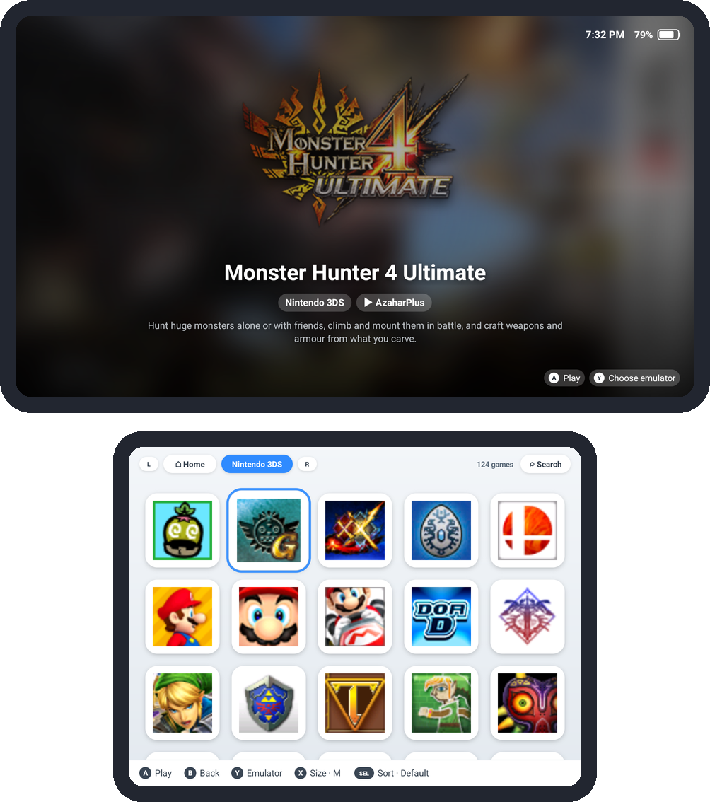
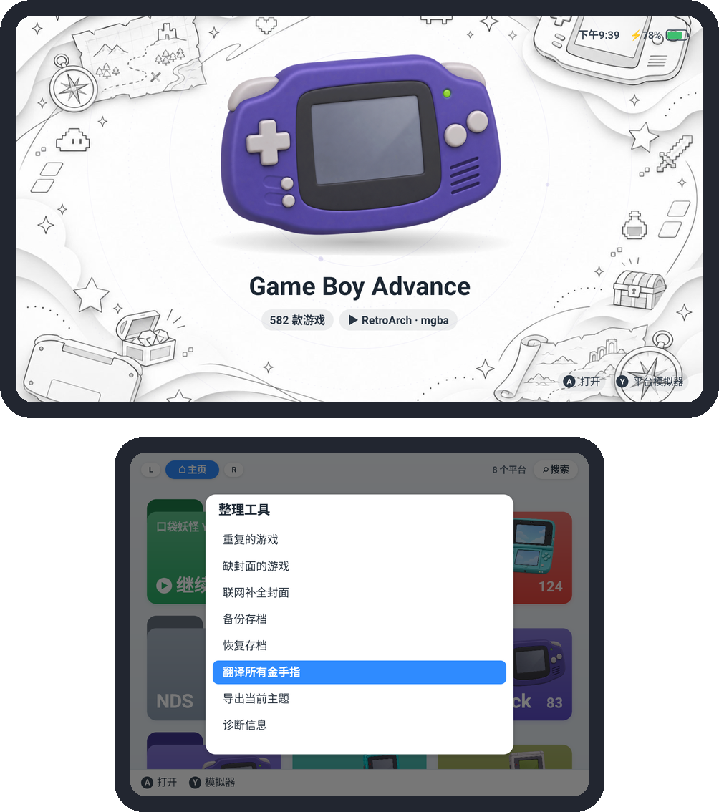

<p align="center"></p>

# Duo Launcher

<p align="center"><a href="README.md">English</a> · <a href="README.fr.md">Français</a> · <a href="README.zh-CN.md">简体中文</a> · <a href="README.zh-TW.md">繁體中文</a> · <a href="README.ja.md">日本語</a> · <a href="README.ko.md">한국어</a> · <a href="README.es.md">Español</a> · <a href="README.de.md">Deutsch</a> · <a href="README.it.md">Italiano</a> · <a href="README.pt.md">Português</a> · <b>Русский</b></p>

Двухэкранный лаунчер игр для **Retroid Pocket Duo** и других Android-консолей со вторым дисплеем – в духе главного меню 3DS.
Укажите ему папки с ROM-ами, и он сам найдёт игры, разложит их по консолям, жанрам и сериям, покажет на нижнем экране, а обложки и арт – на верхнем, и запустит каждую игру в том эмуляторе, который вы выбрали.

**Скачать:** свежий APK лежит на [странице релизов](https://github.com/GenKnot/DuoLauncher/releases/latest) (нужен Android 11 или новее). Новую версию можно ставить прямо поверх старой – все настройки и наигранное время сохранятся.

## Зачем ещё один лаунчер?

Duo Launcher начинался как лаунчер одного игрока для одной консоли и до сих пор растёт из того, как этой консолью пользуются на самом деле. Через весь проект проходят несколько идей:

- **Два экрана – две задачи.** Нижний экран нужен, чтобы выбирать: большие папки, сетка, список, меню. Верхний – чтобы смотреть: консоль на собственном рисованном фоне, логотип игры поверх обложки, видеопревью, сколько вы уже наиграли, заметка самому себе или разговор с ИИ. Ничему не приходится делить место с чем-то ещё.
- **Сначала геймпад.** Всё работает без касания экрана: клавиатура, сделанная под крестовину, прокрутка при удержании направления, L / R листают страницы, удержание L – голосовой поиск, удержание R – разговор с ИИ. Сенсор тоже работает, просто он не обязателен.
- **Ваша библиотека – такой, какая она уже есть.** Лаунчер читает метаданные и картинки Pegasus и ES-DE, если они у вас уже есть, свои дополнения хранит в собственной папке `DuoLauncher` и никогда не переписывает файлы других фронтендов.
- **ИИ, который работает на вас – с вашим ключом.** Перевод, сортировка, картинки, советы и разговоры идут через сервис, который выбираете *вы* и оплачиваете напрямую. Ключи остаются на консоли, а каждый запрос учитывается в настройках вместе с примерной стоимостью, так что ничего не происходит у вас за спиной.
- **Всё можно изменить, скрыть или передать другому.** Любую плитку на главной можно переименовать, перекрасить, дать ей новую картинку, переставить или скрыть. Всю свою настройку можно выгрузить одним файлом и отдать другу – без ваших ключей и без истории игр.

Предложения и сообщения об ошибках – в [трекере задач](https://github.com/GenKnot/DuoLauncher/issues).

## Главное

- **Два экрана, один лаунчер** – выбираете на нижнем экране, а на верхнем видите логотипы, обложки, видеопревью, время в игре и описания.
- **Все эмуляторы в одном месте** – 3DS, NDS, GBA, GB/GBC, NES, SNES, N64, GameCube, Wii, Mega Drive, PS1, PS2, PSP, PS Vita и Switch, а также ещё 22 старые консоли через RetroArch (от Master System до Dreamcast, PC Engine, Neo Geo, WonderSwan, Atari, аркадные автоматы, DOS …); эмулятор выбирается для всей консоли или для отдельной игры. Многодисковые игры показываются одной записью.
- **Всё уже разложено** – каждая игра попадает в один из 14 жанров и в свою серию (Ys, Castlevania, Super Robot Wars …). Главная показывает библиотеку по консолям, жанрам или сериям, а умные папки сами следят за тем, что «недавно добавлено», во что вы «играете», что «хотите пройти», что уже «пройдено» и что у вас «лучшее по оценке».
- **ИИ-компаньон** – зажмите R где угодно и говорите: он посоветует игру из вашей же библиотеки, подскажет, как пройти трудное место, расскажет о сюжете или просто поболтает. Ответы можно слушать вслух.
- **Читы под контролем** – тысячи готовых читов для 3DS, NDS, PSP, GBA и всех систем RetroArch, перевод на ваш язык в одно нажатие, редактирование и общие файлы для разных эмуляторов.
- **Дополняет то, чего не хватает** – настоящие обложки из наборов миниатюр libretro, официальные английские названия, а также обложки, логотипы и фоны, нарисованные ИИ в стиле самого лаунчера.
- **Сделан для портативки** – заставка, безопасная для OLED, передача файлов по Wi-Fi из браузера, резервные копии сохранений, статистика игр, прогресс RetroAchievements, обзор занятой памяти и главный экран, который появляется за секунду.
- **Настраивается под вас** – цветовые темы и пакеты тем, светлый и тёмный режим, размер текста, поля обложек, страница настроек как на консоли и конфигурации, которыми можно делиться. 11 языков интерфейса.

## Скриншоты

<p align="center"></p>

<table>
  <tr>
    <th>Настройки в стиле 3DS</th>
    <th>Настройки в тёмной теме</th>
  </tr>
  <tr>
    <td></td>
    <td></td>
  </tr>
  <tr>
    <th>Расход и стоимость ИИ</th>
    <th>Экспорт и импорт настроек</th>
  </tr>
  <tr>
    <td></td>
    <td></td>
  </tr>
  <tr>
    <th colspan="2">Рисованные фоны для тёмной темы</th>
  </tr>
  <tr>
    <td colspan="2" align="center"></td>
  </tr>
  <tr>
    <th>Главная по жанрам, с пластилиновыми значками жанров</th>
    <th>Главная по сериям</th>
  </tr>
  <tr>
    <td></td>
    <td></td>
  </tr>
  <tr>
    <th>Жанр и серия на странице игры</th>
    <th>Заметка, «Спросить ИИ», статус, «Как играть», сохранения</th>
  </tr>
  <tr>
    <td></td>
    <td></td>
  </tr>
  <tr>
    <th>Клавиатура для геймпада; ищет и по английским названиям</th>
    <th>Спросите ИИ, во что поиграть</th>
  </tr>
  <tr>
    <td></td>
    <td></td>
  </tr>
  <tr>
    <th>Инструменты ИИ: серии, подборка, память, напоминание об отдыхе</th>
    <th>Память: объём по консолям, большие игры без запуска</th>
  </tr>
  <tr>
    <td></td>
    <td></td>
  </tr>
  <tr>
    <th>Страница игры с видеопревью</th>
    <th>Логотип, обложка или видео – для каждой игры</th>
  </tr>
  <tr>
    <td></td>
    <td></td>
  </tr>
  <tr>
    <th>Вид списком</th>
    <th>Статистика игр</th>
  </tr>
  <tr>
    <td></td>
    <td></td>
  </tr>
  <tr>
    <th>Цветовые темы</th>
    <th>Цвет темы доходит и до фонов</th>
  </tr>
  <tr>
    <td></td>
    <td></td>
  </tr>
  <tr>
    <th>Тёмный режим</th>
    <th>Тёмный режим</th>
  </tr>
  <tr>
    <td></td>
    <td></td>
  </tr>
  <tr>
    <th>Передача по Wi-Fi</th>
    <th>Инструменты для порядка</th>
  </tr>
  <tr>
    <td></td>
    <td></td>
  </tr>
  <tr>
    <th>GameCube через Dolphin</th>
    <th>Удерживайте A, чтобы переместить папку</th>
  </tr>
  <tr>
    <td></td>
    <td></td>
  </tr>
  <tr>
    <th>Выбор читов перед импортом, названия уже переведены</th>
    <th>Подробности об игре: размер, диски, скриншоты</th>
  </tr>
  <tr>
    <td></td>
    <td></td>
  </tr>
  <tr>
    <th>Читы для 3DS, перевод в одно нажатие</th>
    <th>Читы NDS для DraStic, китайская база</th>
  </tr>
  <tr>
    <td></td>
    <td></td>
  </tr>
  <tr>
    <th>Читы RetroArch (GBA)</th>
    <th>Изменить, добавить, скачать</th>
  </tr>
  <tr>
    <td></td>
    <td></td>
  </tr>
  <tr>
    <th>Переименовать или удалить чит</th>
    <th>Перевести все читы разом</th>
  </tr>
  <tr>
    <td></td>
    <td></td>
  </tr>
  <tr>
    <th>Заставка (безопасная для OLED)</th>
    <th>11 языков</th>
  </tr>
  <tr>
    <td></td>
    <td></td>
  </tr>
</table>

## С чего начать

1. **Установите APK** со [страницы релизов](https://github.com/GenKnot/DuoLauncher/releases/latest) и откройте его.
2. **Пройдите вводный гид.** При первом запуске короткий гид проводит через настройку, по одной странице за раз:
   - **«Найдены ваши прежние настройки и записи»** – появляется первым и только тогда, когда на одном из накопителей нашлась автоматическая копия лаунчера (после переустановки или на новой консоли с той же картой). «Восстановить» позволяет выбрать, что вернуть, как в «Импорте настроек»; «Начать с нуля» просто продолжает гид. Подробнее – в разделе [Настройки и обмен](#настройки-и-обмен).
   - **Язык.**
   - **Разрешения**, все на одной странице: доступ к файлам (чтобы найти игры), доступ к статистике использования (чтобы время в игре считалось только тогда, когда игра действительно на экране) и роль главного экрана с пометкой «необязательно». Эта страница есть и в «Настройки» → «Система» → «Разрешения».
   - **Что найдено** – сколько консолей и игр нашлось при сканировании и где лаунчер искал: в папке `Roms` в корне каждого накопителя и во всех папках, которые вы добавили. Если сканирование ещё идёт, страница так и скажет, а когда оно закончится, заполнится сама. Отсюда можно перейти в [список проблем](#полезные-инструменты) – ко всему, что не удалось разобрать.
   - **ИИ (по желанию)** – что умеют функции ИИ и что платите вы сами выбранному сервису за то, чем пользуетесь. Дальше – *Ввести ключи с телефона (Wi-Fi)*, *Настроить на консоли* или *Позже*.
   - **Кнопки** – что делает каждая, на одной странице.

   На каждой странице есть *Пропустить гид*, а B возвращает на страницу назад. «Настройки» → «Система» → «Снова показать вводный гид» запускает его ещё раз.
   *Почему так:* первые минуты решают, покажется ли лаунчер понятным, и новичку не стоит ради этого читать эту страницу. А сразу увидеть, сколько игр найдено, – это ответ на первый вопрос, который возникает у всех («а мои игры он нашёл?»). Кто уже знает, что делает, может пропустить гид с любой страницы.
3. **Дайте ему найти игры.** Любая папка `Roms` во внутренней памяти или на SD-карте подхватывается сама. Другие папки добавляются в «Настройки» → «Главная и библиотека» → «Папки с играми». Консоль определяется по названию папки (`gba`, `Nintendo DS`, `psx` …) и по расширению файлов.
4. **Выберите эмуляторы**, если вам нужен не тот, что стоит по умолчанию: нажмите Y на папке консоли, чтобы сменить его для всей консоли, или на игре – только для неё. В списке только установленные эмуляторы.
5. **По желанию: добавьте ключ ИИ** в «Настройки» → «ИИ и голос» → «Сервисы ИИ и ключи» – прямо на консоли или, что удобнее, с компьютера или телефона по Wi-Fi («Настройки» → «Сохранения, передача, обмен» → «Передача по Wi-Fi» или «Ввести с компьютера или телефона» в том же меню). Всё, кроме функций ИИ, работает и без ключа.
6. **По желанию: сделайте его главным экраном** («Настройки» → «Система» → «Сделать главным экраном»), чтобы он запускался вместе с консолью. Плитка «Рабочий стол Android» всегда возвращает на системный рабочий стол.

## Основы

**Главная** (нижний экран) – это ваши папки консолей и несколько встроенных плиток: «Продолжить» (сразу вернуться в последнюю игру), «Недавние», «Избранное», «Новая папка», «Поиск», «Статистика», «Память», «Во что поиграть?», «Настройки» и «Рабочий стол Android». SELECT переключает главную между консолями, жанрами и сериями.

**Папка** показывает игры сеткой обложек. X уменьшает обложки, а ещё одно нажатие превращает сетку в список с названиями, временем в игре и датой последнего запуска. SELECT сортирует (по умолчанию, по имени, по недавним, по наигранному времени) и может оставить только релизы на упрощённом китайском, традиционном китайском или английском. L2 / R2 перескакивают к предыдущей или следующей начальной букве – китайские названия считаются по первой букве пиньиня.

**Верхний экран** показывает то, что сейчас выбрано: консоль на своём фоне с числом игр и эмулятором; логотип игры поверх размытой обложки с консолью, жанром · серией, эмулятором, временем в игре и коротким описанием, через мгновение – видеопревью или картинку того места, где вы остановились.

**Y** – меню того, что выбрано. На игре оно короткое, а то, что нужно реже, убрано на шаг глубже: эмулятор, избранное, добавить в папку / убрать из папки, «Читы» ›, «Помощь ИИ» › («Спросить ИИ», «Как играть»), «Об игре» › (подробности, жанр, статус и оценка, заметка, что показывать на верхнем экране, «ИИ-картинки для этой игры») и «Ещё» › (сохранения, «Отметить как просмотренное», скрыть, «Удалить файл игры»). На папке консоли: эмулятор по умолчанию, переименовать, «Объединить папки» ›, «Отметить все как просмотренные», скрыть. На встроенной плитке: название, цвет, значок и фон. Внизу меню одной строкой поясняется, что делает выбранный пункт.

*Почему так:* меню из пятнадцати пунктов на портативке читать тяжело. Вложенные разделы оставляют на виду то, чем пользуются каждый день, а подсказка в одну строку избавляет от необходимости гадать, что делает пункт, прежде чем его нажать.

**«Удалить файл игры»** (Y → «Ещё») сначала переспрашивает, показывая размер и напоминая, что сохранения останутся; курсор стоит на «Отмена», так что случайное быстрое двойное нажатие A ничего не удалит. У многодисковой игры удаляются все файлы, а игра, удалённая из перечня в списке проблем (например, из «Дубликатов игр»), сразу из него исчезает.

*Почему так:* дубликаты и пройденные игры можно убрать без компьютера.

**Разовые подсказки.** Когда какая-то функция впервые оказывается под рукой, на нижнем экране прямо над подписями кнопок появляется одна строка. Она показывается один раз и исчезает примерно через девять секунд или по нажатию любой кнопки (только не в первые секунды две, чтобы она не пропала раньше, чем вы успеете прочитать; сама кнопка при этом срабатывает как обычно). Пока их четыре:

- на главной: удерживайте A, чтобы взять плитку и переставить её, Y – параметры этой плитки;
- снова на главной после выхода из папки: SELECT показывает главную по консолям, по жанрам или по сериям;
- на игре в папке консоли при порядке по умолчанию: удерживайте A, чтобы переставить игру куда нужно, Y – эмулятор, читы, сохранения и прочее;
- в папке «Не распознано»: A на файле, чтобы указать, для какой он консоли.

«Настройки» → «Система» → «Подсказки к новым функциям» отключает их, а «Снова показать все подсказки» возвращает уже увиденные.
*Почему так:* удержание A для перестановки или SELECT на главной легко пропустить и трудно угадать. Строка ровно в тот момент, когда это можно сделать, запоминается лучше любого руководства, и одного раза хватает: подсказка, которая всплывает снова и снова, превращается в шум.

### Управление

| Кнопка | Действие |
|---|---|
| Крестовина / левый стик | Перемещение; удерживайте, чтобы двигаться дальше |
| Влево / вправо, L / R в списке или меню | На страницу за раз |
| A | Открыть / играть; удерживайте A на папке главной или на игре внутри папки консоли, чтобы взять её и переместить |
| B | Назад |
| L / R | Предыдущая / следующая консоль (в настройках – раздел) |
| Удерживать L | Голосовой поиск |
| Удерживать R | Разговор с ИИ |
| L2 / R2 | Предыдущая / следующая начальная буква |
| X | Размер обложек, затем вид списком |
| Y | Меню выбранной игры, папки или плитки |
| START | Настройки (откуда угодно на главной, даже если плитка «Настройки» скрыта); в меню – то же, что A |
| SELECT | На главной: консоли / жанры / серии; в папке: сортировка и фильтр по языку |
| R3 | Поиск |
| На клавиатуре поиска | A – ввод, B – удалить, X – пробел, Y – системная клавиатура, SELECT – очистить, START или R3 – готово, удерживать L – сказать голосом |
| В чате с ИИ | Удерживать R – говорить, Y – набрать текст, X – новый чат, SELECT – история, L2 / R2 – прокрутить назад, B – закрыть; крестовиной и A выбираются игры внизу |

Всё работает и касанием: коснитесь, чтобы выбрать, ещё раз – чтобы открыть, смахивайте для прокрутки, а вместо L, R, X, SELECT или поиска нажимайте на кнопки-«таблетки» вверху. A/B и X/Y можно поменять местами, чтобы подтверждение было как у Nintendo или как у Xbox («Настройки» → «Игра» → «Кнопки»).

## Ваша библиотека

- **Сам находит игры.** Во внутренней памяти и на SD-картах ищутся папки `Roms`; другие можно добавить в «Настройки» → «Главная и библиотека» → «Папки с играми». Результат последнего сканирования запоминается, поэтому главный экран появляется за секунду, а следующее сканирование тихо идёт в фоне.
- **Консоли** – 3DS, NDS, GBA (а также папки GBA с вибрацией и хаков), GBC, GB, NES, SNES, N64, GameCube, Wii, Mega Drive, PlayStation 1/2/3, PSP, PS Vita и Switch; есть картинки и для PS4, PS5, Xbox 360 и Xbox Series. Распознаются и все остальные консоли из сборки Pegasus G: Virtual Boy, Master System, Game Gear, 32X, Mega-CD, Saturn, Dreamcast, NAOMI, PC Engine и его CD-версия, PC-FX, Neo Geo CD, Neo Geo Pocket Color, WonderSwan и WonderSwan Color, Pokémon Mini, Atari Lynx, Atari 2600, Game & Watch, 3DO, DOS и аркадные автоматы.
- **Многодисковые игры – одной записью.** `Disc A/B`, `Disc 1/2`, `CD1/CD2`, `(Disc 2 of 3)` в одной папке или список `files:` в Pegasus превращаются в одну игру. RetroArch и DuckStation получают плейлист дисков `.m3u`, так что диски можно менять прямо в игре.
- **Игры и приложения Android** – установленные игры автоматически попадают в свою папку; любые другие приложения (видео, браузер …) можно добавить в папку «Приложения».
- **Работает с тем, что у вас уже есть.** Читает `metadata.pegasus.txt` от Pegasus, `gamelist.xml` и `downloaded_media` от ES-DE / EmulationStation, миниатюры RetroArch, а также папки `media/`, `covers/` и `images/` рядом с играми. Их файлы не меняются; собственные дополнения лаунчера идут в его папку `DuoLauncher` (см. [Своя информация об играх](#своя-информация-об-играх)).
- **Замечает новые игры.** Скопируйте игры на карту – следующее сканирование их найдёт; неделю (или до первого запуска) они носят значок NEW, и лаунчер предлагает разложить их по жанрам и сериям. Этот вопрос можно отключить. Y → «Отметить как просмотренное» снимает метку с одной игры; «Отметить все как просмотренные» (Y на консоли или папке либо «Настройки» → «Главная и библиотека») – сразу со многих, а переключатель «Метки NEW» там же отключает их совсем.
- **Объединение папок.** Две папки одной консоли из разных мест (скажем, две папки PS1) можно показывать как одну: Y → «Объединить папки» на консоли. У каждой игры остаётся свой эмулятор, папки с одинаковым названием объединяются сами, а «Отделить» всё возвращает.
- **Свои папки.** Плитка «Новая папка» создаёт папку со своим названием, цветом, значком и фоном. Любая игра или приложение добавляется туда через Y, а убирается через Y → «Убрать из этой папки».
- **Умные папки** наполняются сами: «Недавно добавленные» (за последние 30 дней), «Ещё не играл», «Больше всего играл», «Играю», «Хочу сыграть», «Пройдена» и «Лучшие по оценке». Y на такой папке показывает её правило.
- **«Продолжить» и избранное.** Первая плитка на главной сразу возвращает в последнюю игру. Отмечайте игры звёздочкой через Y – они соберутся в папке «Избранное».
- **Скройте то, во что не играете** – папку консоли или отдельную игру либо приложение (Y → «Скрыть эту игру»); вернуть их можно в «Настройки» → «Главная и библиотека».
- **Приведите названия в порядок.** Названия, взятые прямо из файлов ROM, нередко выглядят как `0153 - Legend of Zelda, The - The Minish Cap (USA) [!]`. В «Настройки» → «Главная и библиотека» → «Привести названия в порядок» есть шесть переключателей, поначалу все выключены: убрать метки региона и языка, убрать метки версии и дампа, убрать номер в начале, заменить подчёркивания и точки пробелами, перенести «, The» с конца в начало и убрать всё в скобках. Рядом с каждым переключателем – пример из вашей же библиотеки, название до и после, а «Все изменения» перечисляют все игры, которые будут переименованы. *Почему так:* меняется только название на экране. Файлы на карте остаются ровно такими, какими были, так что эмуляторы, сохранения и другие фронтенды ничего не заметят. Названия из Pegasus, ES-DE или исправленные вами вручную не трогаются: их уже кто-то выбрал. Метки, которые отличают одну версию игры от другой, вроде `(Beta)` или `(Hack)`, остаются, пока не включён переключатель со скобками.
- **Свой порядок игр.** Внутри папки консоли удерживайте A на игре (или долго нажмите на неё пальцем), чтобы взять её, переместите крестовиной и отпустите, чтобы положить. Порядок запоминается для каждой консоли, переживает повторное сканирование и входит в полную копию. Игры, добавленные позже, встают на своё обычное место. Y на консоли → «Вернуть исходный порядок» всё отменяет. Перемещать игры можно только при сортировке по умолчанию и без фильтра по языку: при сортировке по имени или по времени в игре ваш порядок ничего бы не значил. *Почему так:* игры, в которые вы играете прямо сейчас, или серия в порядке выхода должны стоять вместе наверху, а никакая автоматическая сортировка об этом не догадается.
- **Ваш каталог.** После каждого сканирования вся библиотека записывается в `DuoLauncher/catalog.tsv` (консоль, файл, название, английское название, жанр, серия, время в игре, статус, оценка) – для таблиц, других программ или для ИИ.

### Жанры и серии

Листать две тысячи игр только по консолям утомительно, поэтому каждая игра получает ещё и один из 14 жанров (ролевые, экшен, приключения, платформеры, тактика, стратегии, шутеры, головоломки, гонки, спорт, файтинги, симуляторы, игры для компании и музыкальные, другое) и свою серию.

- **Сначала встроенные знания.** Таблица внутри лаунчера (`assets/gamedb.tsv`, 3 860 имён файлов, которые покрывают все игры из списков сборок Pegasus G для этих консолей, причём и `.iso`, и `.cso`, если в сборке есть оба варианта) уже знает жанр, серию и официальное английское название распространённых наборов ROM-ов по консоли и имени файла. Для известных ей игр не нужны ни ИИ, ни интернет.
- **Остальное – с помощью ИИ.** «Настройки» → «ИИ и голос» → «ИИ наведёт порядок в библиотеке» → «ИИ: разложить по жанрам» / «ИИ: серии игр» разбирают оставшиеся игры, а результаты сохраняются на карте в `DuoLauncher/<console>/genres.txt` и `series.txt`, так что делается это один раз и переживает переустановку. Жанры, уже прописанные в Pegasus или ES-DE («Action RPG», «角色扮演» …), сводятся к тем же 14 жанрам.
- **Вручную** – Y → «Жанр» на любой игре.
- **На экране.** Верхний экран показывает жанр · серию игры, а SELECT на главной превращает папки в жанры или серии. Названия серий идут на языке интерфейса.

### Поиск

R3, плитка «Поиск» или кнопка поиска открывают на верхнем экране клавиатуру, сделанную под крестовину, с недавними запросами и рядом жанров-«чипов» над ней; результаты заполняют нижний экран прямо по ходу ввода. Китайские названия находятся по пиньиню, по его инициалам и по началу каждого слога (`kdyg`, `mlao` → 马里奥), а любая игра находится и по официальному английскому названию, так что `zelda` найдёт 塞尔达传说. Если открыть поиск внутри консоли, он ищет только по ней, а кнопка «Все платформы» расширяет поиск. Зажмите L, чтобы произнести название, а не набирать его.

### Картинки, которые находятся сами

- **Настоящие обложки** – «Настройки» → «Порядок» → «Скачать обложки» (это же есть в списке проблем, в пункте «Игры без обложек») загружает обложки из наборов миниатюр libretro. Игры NDS и GBA сопоставляются по коду игры внутри ROM-а (в том числе в zip-архивах, вместе с титульными экранами), поэтому даже переведённые и переименованные файлы находят свои картинки; игры PlayStation 1/2, PSP, N64, GameCube, Wii, 3DS, GB/GBC, NES, SNES и Mega Drive сопоставляются по английскому названию. «Без обложки» везде значит одно и то же: у игры нет обложки (одного логотипа или фона мало), поэтому список проблем, «Скачать обложки» и меню ИИ-картинок показывают одно и то же число.
- **Значки прямо из ROM-ов** – значки баннеров NDS и значки SMDH у 3DS; установленные игры 3DS показывают своё название на языке интерфейса.
- **Обложки в едином виде** – обложки заполняют плитку целиком или все стоят с одинаковыми малыми, средними или большими полями («Настройки» → «Вид и звук» → «Поля обложек»); белые рамки, впечатанные в картинки обложек, обрезаются.
- **Картинки от ИИ** – с ключом для изображений ИИ рисует обложку, фон и логотип с названием. Для одной игры: Y → «Об игре» → «ИИ-картинки для этой игры»; там у каждой картинки видно, есть ли она уже, новая заменяет текущую, а для логотипа нужно английское название (его находит «ИИ: названия и описания игр»). Для многих игр: «Настройки» → «ИИ и голос» → «ИИ наведёт порядок в библиотеке» → «ИИ: дорисовать картинки игр»; там у каждого вида картинок указано, у скольких игр его нет, список консолей начинается с пункта «Все платформы», а у двух консолей с одинаковым названием видно имя папки (например, папки с хаками GBA). См. [ИИ](#ии).

## Играем

- **Эмулятор для игры или для консоли** (Y). В списке только установленные эмуляторы:

  | Консоль | Эмуляторы (первый – по умолчанию) |
  |---|---|
  | 3DS | AzaharPlus, Azahar, Citra MMJ, Citra MMJ (режим производительности) |
  | NDS | DraStic, DraStic (обычный путь), RetroArch · melonDS DS |
  | GB / GBC | RetroArch · Gambatte, mGBA |
  | GBA | RetroArch · mGBA, gpSP, gpSP Rumble |
  | NES | RetroArch · FCEUmm, Mesen |
  | SNES | RetroArch · Snes9x |
  | Mega Drive | RetroArch · Genesis Plus GX, PicoDrive |
  | N64 | RetroArch · Mupen64Plus-Next, Mupen64Plus FZ |
  | GameCube / Wii | Dolphin MMJR, Dolphin |
  | PS1 | RetroArch · PCSX ReARMed, SwanStation, DuckStation |
  | PS2 | ARMSX2, AetherSX2 |
  | PSP | PPSSPP, RetroArch · PPSSPP |
  | PS Vita | Vita3K (по ID игры, например файл `PCSE00000.psvita` или файл, в имени которого есть этот ID) |
  | Switch | Eden |
  | Virtual Boy | RetroArch · Beetle VB |
  | Master System / Game Gear | RetroArch · Genesis Plus GX, PicoDrive |
  | 32X | RetroArch · PicoDrive |
  | Mega-CD | RetroArch · Genesis Plus GX, PicoDrive |
  | Saturn | RetroArch · Yaba Sanshiro, Yabause |
  | Dreamcast / NAOMI | RetroArch · Flycast |
  | PC Engine / PC Engine CD | RetroArch · Beetle PCE Fast, Beetle PCE |
  | PC-FX | RetroArch · Beetle PC-FX |
  | Neo Geo CD | RetroArch · NeoCD |
  | Neo Geo Pocket Color | RetroArch · Beetle NeoPop, RACE |
  | WonderSwan / Color | RetroArch · Beetle Cygne |
  | Pokémon Mini | RetroArch · PokeMini |
  | Atari Lynx | RetroArch · Handy, Beetle Lynx |
  | Atari 2600 | RetroArch · Stella |
  | Game & Watch | RetroArch · Game & Watch |
  | 3DO | RetroArch · Opera |
  | DOS | RetroArch · DOSBox Pure |
  | Аркады | RetroArch · FinalBurn Neo, MAME 2003-Plus |

  В `metadata.pegasus.txt` из Pegasus обычно уже есть своя строка запуска для каждой консоли; она используется в первую очередь, а ядра из таблицы предлагаются рядом с ней.

- **Citra MMJ (режим производительности)** – та же сборка Citra MMJ, перепакованная под именем пакета бенчмарка AnTuTu: многие Android-системы запускают его на максимальных частотах. Этот вариант предлагается, только если под этим пакетом действительно Citra.
- **Время в игре и статистика** – сколько и когда вы в последний раз играли в каждую игру, как на Switch; при выданном доступе к статистике использования считается только время, когда игра действительно была на экране. Плитка «Статистика» показывает общее время, текущую неделю по дням, время по консолям и самые наигранные игры.
- **Где вы остановились** – самый свежий скриншот или картинка сейв-стейта сыгранной игры становится её фоном на верхнем экране.
- **Статус, оценка и заметки** – отметьте игру как «Играю», «Хочу сыграть», «Пройдена» или «Брошена» и поставьте ей от одной до пяти звёзд (Y → «Статус»); напишите или надиктуйте строчку о том, где вы сейчас и что делать дальше (Y → «Заметка»). Всё это появится на верхнем экране, когда вы в следующий раз вернётесь к игре.
- **Подробности об игре** (Y → «Подробности») – файл, размер, диски, папка, эмулятор, время в игре, официальное английское название и скриншоты игры на верхнем экране.
- **Видеопревью и звуки** – через мгновение на верхнем экране запускается видеоролик игры (или выберите для каждой игры логотип или обложку: Y → «Верхний экран»). Негромкие звуки интерфейса и собственную мелодию баннера каждой игры 3DS можно выключить.
- **Не мешает, пока вы играете.** Как только игра запущена, нижний экран отдаётся эмулятору, а видео, музыка и мелодии баннеров замолкают. Кроме того, лаунчер отпускает картинки, которые держит в памяти (по замерам – примерно с 167 до 109 МБ), откладывает начатое сканирование карты до вашего возвращения, чтобы не отбирать карту у эмулятора, и останавливает обновление часов и всё движение на верхнем экране. Когда вы возвращаетесь, обложки снова на экране меньше чем через секунду.
  *Почему так:* память и карта целиком достаются эмулятору.
- **Если игра не запускается** – на каждый случай есть сообщение с подсказкой, что делать: файл не найден, эмулятор не установлен, эмулятор не умеет открывать такие файлы или игра сразу закрылась. А [список проблем](#полезные-инструменты) заранее покажет консоли, для которых не установлен эмулятор, – ещё до того, как вы на это наткнётесь.
- **Напоминание об отдыхе** («Настройки» → «Игра») – после одного, двух или трёх часов в игре лаунчер, когда вы к нему вернётесь, предложит сделать перерыв.
- **RetroAchievements** – с вашим именем пользователя и ключом Web API: недавние игры с прогрессом достижений и метка 🏆 у игр, в которых есть достижения.

## ИИ-компаньон

Всё это необязательно и работает через выбранный вами сервис ИИ с вашим собственным ключом (см. [ИИ](#ии)).

- **Говорите с ним где угодно.** Зажмите R на главной, в папке или на клавиатуре поиска и говорите – или нажмите Y, чтобы набрать текст. Разговор занимает верхний экран, а игры, которые он советует или находит, появляются на нижнем – их сразу можно запустить кнопкой A. Спросите, во что поиграть («спокойная RPG, не очень длинная»), уточните («что-нибудь подинамичнее»), спросите, как пройти то место в выбранной игре, где вы застряли, расспросите о сюжете или персонаже – или просто поболтайте. Разговор он помнит полчаса.
  *Почему так:* игры выбираются на нижнем экране, поэтому и советы ИИ появляются там, а верхний остаётся свободным для чтения. И на портативке зажать плечевую кнопку и сказать вслух быстрее, чем пробираться через любое меню.
- **Новый чат и история.** X в чате начинает новый разговор; SELECT показывает прежние, новые сверху, – их можно открыть снова, удалить по одному или все сразу (также «Настройки» → «ИИ и голос» → «История чатов с ИИ»). Пока чат открыт, видеопревью, мелодии баннеров 3DS и звуки кнопок молчат, а ответы вслух звучат с громкостью мультимедиа.
  *Почему так:* новый вопрос не должен тянуть за собой старую тему, полезный ответ не должен пропадать после перезапуска, а ответ вслух бесполезен, если поверх играет трейлер игры. История никогда не попадает в настройки, экспортированные через *Поделиться*, но входит в автоматическую копию в `DuoLauncher/profile/`, так что переустановка её не сотрёт; и её можно отключить переключателем «Сохранять чаты с ИИ» внутри «Истории чатов с ИИ».
- **Ответы вслух** – «Настройки» → «ИИ и голос» → «Сервисы ИИ и ключи» → «Голосовые ответы ИИ»: Soniox (со своим ключом) или OpenAI (ключ для картинок), с выбором голоса и темпа и кнопкой проверки. По умолчанию выключено.
- **Во что поиграть сегодня** – Y на плитке «Во что поиграть?» просит ИИ подобрать из вашей библиотеки шесть игр под ваш вкус, с объяснением для каждой. Обычное нажатие на плитку выбирает одну игру случайно, чаще те, в которые вы ещё ни разу не играли.
- **Спросить об игре** (Y → «Спросить ИИ») – вопрос о выбранной игре, набранный или сказанный голосом; ответ появляется на верхнем экране.
- **Как играть** (Y → «Как играть») – управление (включая переставленные кнопки подтверждения и отмены в японских релизах) и основы, которые нужны новичку; пишется один раз для каждой игры и сохраняется.
- **Ключа пока нет?** Если зажать R, лаунчер объяснит, как его добавить – на самой консоли или с компьютера по Wi-Fi.

## Читы

Y → «Читы» на игре показывает её читы; A включает или выключает чит.

| | 3DS (Azahar, Citra) | NDS (DraStic) | PSP (PPSSPP) | RetroArch (GBA, GB, GBC, NES, SNES, N64, MD, PS1, …) |
|---|---|---|---|---|
| Где хранятся | `azahar/cheats/` и `citra-emu/cheats/`, `<title ID>.txt` – записываются для обоих, так что при смене эмулятора читы остаются | полный список в `DuoLauncher/cheats/NDS/`; включённые попадают в собственные пользовательские читы DraStic (`DraStic/cheats/<game file name>.cht`), которые работают и с переведёнными ROM-ами | `PSP/Cheats/<game ID>.ini`, собственные файлы читов PPSSPP; ID игры читается из ISO, CSO или EBOOT.PBP | `RetroArch/cheats/<core>/<game file name>.cht`, RetroArch загружает их при запуске игры |
| Что уже есть на устройстве | – | `usrcheat.dat` от DraStic (на консолях Retroid – на китайском), сопоставляется только по коду игры, поэтому пропатченные и переведённые ROM-ы находят читы даже там, где сам DraStic не показывает ни одного | `cheat.db` от PPSSPP, а на консолях Retroid – китайские файлы читов примерно для 4 300 игр | Retroid поставляет китайские читы для сотен игр (`000 中文金手指` и папки ядер); игра без своего файла получает копию, подобранную по названию |
| Загрузка | [Sharkive](https://github.com/FlagBrew/Sharkive), около 650 игр, по ID игры, прочитанному из ROM-а | [libretro-database](https://github.com/libretro/libretro-database), около 4 200 игр, по коду игры в заголовке ROM-а | [CWCheat-Database-Plus+](https://github.com/Saramagrean/CWCheat-Database-Plus-), около 4 300 игр, по ID игры | [libretro-database](https://github.com/libretro/libretro-database) для GBA, по коду игры в заголовке ROM-а |

- **Выбор перед импортом** – при загрузке сначала показывается всё найденное, уже переведённое, с кнопками «Выбрать все» / «Снять все»; добавляются только отмеченные. *Почему так:* в базе бывают десятки кодов на одну игру, а большинству игроков нужны три из них.
- **Перевод** – английские названия читов переводятся на язык интерфейса в одно нажатие, для одной игры или сразу для всех («Настройки» → «Порядок»). Распространённые читы берутся из встроенного словаря (无限血量, 金钱最大, 主代码 …), остальные уходят в бесплатный сервис MyMemory, а запасным вариантом служит бесплатный адрес Google. Метки версий (`v1.2`) и подсказки по кнопкам (`(START+L)`) сохраняются, а исходное английское название остаётся в файле комментарием.
- **Перевод с ИИ** – при наличии ключа ИИ читы игры отправляются модели вместе с названием игры, поэтому она использует официальные имена персонажей и предметов (鬼神林克, 心之容器 …).
- **Редактирование** – переименуйте или удалите любой чит, удалите разом все читы игры или добавьте свой с кодами (коды 3DS, NDS и PSP проверяются на формат `XXXXXXXX YYYYYYYY`).
- **Безопасно для DraStic** – патчи для флеш-картриджей (обходы защиты от копирования, исправления оверлеев и Wi-Fi) в загрузки NDS не попадают, потому что с ними DraStic падает, а одновременно можно включить не больше 256 строк кода – это предел того, что DraStic способен загрузить.
- **Безопасно для ваших файлов** – когда написанный вручную файл читов 3DS меняется впервые, оригинал сохраняется как `.txt.bak`.
- **RetroArch – один раз** – один раз включите в RetroArch Quick Menu → Cheats → «Auto-Apply Cheats During Game Load» (в русском интерфейсе: «Быстрое меню» → «Читы» → автоприменение читов при загрузке игры), и читы, которые вы включаете здесь, будут работать с первой секунды игры.

## Внешний вид

- **Верхний экран (1920×1080)** – каждая консоль на собственном фоне в технике вырезанной бумаги или логотип выбранной игры поверх её размытой обложки, с метками и коротким описанием; в углу – часы и заряд батареи.
- **Нижний экран (1280×960)** – папки консолей, сетка обложек с изменяемым масштабом и вид списком, а внизу – подсказки по кнопкам, которые остаются короткими и при крупном тексте пропускают то, что не помещается.
- **Темы** – семь цветовых схем, свои цвета и пакеты тем с картинками консолей, фонами, шрифтом, звуками и музыкой. Тема перекрашивает и контурные фоны на верхнем экране. См. [Темы](#темы).
- **Светлый и тёмный режим** – как в системе или по вашему выбору, причём для каждого режима нарисован свой набор фонов.
- **На главной всё ваше.** Любую встроенную плитку и любую папку консоли можно переименовать, перекрасить, дать ей собственный значок (вашу картинку или нарисованную сервисом изображений в пластилиновом стиле лаунчера), переставить (удерживайте A или долго нажмите пальцем) или скрыть, а вернуть – в «Настройки» → «Главная и библиотека» → «Скрытые папки». У встроенных плиток вроде «Статистика», «Память» и «Во что поиграть?» тоже может быть свой фон на верхнем экране.
- **Вид консолей** – картинку каждой консоли, её светлый и тёмный фон и цвет папки можно заменить («Настройки» → «Вид и звук» → «Оформление платформ»). Тёмный фон сервис изображений может перерисовать по светлому, чтобы они всегда сочетались.
- **Размер текста** – четыре размера для обоих экранов.
- **Заставка** – через несколько минут бездействия верхний экран показывает ваши обложки с часами, а нижний гаснет. Текст с каждой картинкой перемещается в другой угол и медленно смещается, поэтому на OLED-панели ничего не выгорает.
- **Лёгкий режим** («Настройки» → «Вид и звук», первая строка) – один переключатель, который выключает видеопревью и музыку баннеров 3DS, размытую картинку за игрой, плывущие точки на верхнем экране и мягкое покачивание изображения консоли, анимацию появления и пульсирующую рамку выбора. Пока он включён, переключатели «Видеопревью» и «Музыка баннеров 3DS» показаны выключенными и при нажатии объясняют почему; ваш собственный выбор вернётся, как только лёгкий режим будет выключен. Замер на Duo, лаунчер без дела на главной: обычно верхний экран перерисовывает около 600 кадров за 5 секунд, в лёгком режиме – ни одного.
  *Почему так:* для долгих сессий от батареи – или если вам просто больше нравится неподвижный экран.

## Настройки и обмен

- **Страница настроек как на консоли.** START открывает одну страницу: слева разделы («Вид и звук», «Главная и библиотека», «Игра», «ИИ и голос», «Сохранения, передача, обмен», «Порядок», «Система»), справа – строки выбранного раздела с текущими значениями и переключателями, а на верхнем экране – версия, свободное место на каждом накопителе и какие сервисы ИИ включены. L / R переключают раздел.
  Некоторые строки ведут в меню поменьше («Сервисы ИИ и ключи», «ИИ наведёт порядок в библиотеке», «Список проблем» …). Пока курсор стоит на такой строке, внизу карточки одной строкой написано, что за ней, а B изнутри возвращает на ту же строку, где значения уже обновлены.
  *Почему так:* раздел из дюжины строк на экране 1280×960 выглядит как сплошная стена. Если убрать редкие настройки на шаг глубже, каждый раздел остаётся коротким, а заметка в одну строку подсказывает, что внутри, ещё до того, как вы туда зайдёте.
- **Сохраните копию или поделитесь своей настройкой.** «Настройки» → «Сохранения, передача, обмен» → «Экспорт моих настроек» спрашивает, что положить в файл: настройки и ваши картинки, историю игры, статусы, оценки и заметки, ключи и аккаунты, расход ИИ и чаты, а также данные игр из папок `DuoLauncher` – или один из двух готовых вариантов: *Поделиться* (только настройки и картинки) и *Полная копия* (всё). «Импорт настроек» берёт такой файл из `DuoLauncher/exports` или из папки «Загрузки» – куда он попал по Wi-Fi, через мессенджер или на карте – и показывает, что в нём есть, чтобы можно было снять галочки с того, что должно остаться как есть. Если на странице Wi-Fi отправить файл в *Настройки для импорта*, он сразу попадёт в `DuoLauncher/exports` и уже будет ждать в «Импорте настроек».
  *Почему так:* настройки, отданные другу, никогда не должны уносить ваши ключи или вашу историю, а ваша собственная копия должна возвращать точно такой же лаунчер на новой консоли или после переустановки. В полной копии лежат ваши ключи, поэтому при экспорте лаунчер предупреждает, что её лучше держать при себе, а ваш ключ ни за что не будет отправлен на адрес, пришедший из чужой конфигурации.
- **Где хранить данные** («Настройки» → «Сохранения, передача, обмен») – куда кладётся папка `DuoLauncher`: жанры, серии и названия от ИИ для каждой консоли, скачанные и нарисованные ИИ картинки, резервные копии сохранений, экспорт, темы и копия настроек, о которой ниже. «Рядом с играми» – вариант по умолчанию и прежнее поведение: данные каждой консоли на том накопителе, где лежат её игры, резервные копии – на карте. «Карта» кладёт всё на TF-карту, так что данные переезжают вместе с ней на другую консоль (если карты нет, пока используется внутренняя память). «Внутренняя» оставляет всё на консоли, даже когда вы меняете карты. Всё, что было записано до переключения, по-прежнему читается оттуда, где лежит. Если выбрана «Карта» или «Внутренняя», пункт «Перенести сюда имеющиеся данные» сначала показывает объём, а потом переносит папки `DuoLauncher` с других накопителей; файлы, которые уже на месте, сохраняются, а списки читов NDS и плейлисты многодисковых игр остаются там, где их ждут эмуляторы.
  *Почему так:* где лежат ваши данные, решаете вы; ничего не зашито в код.
- **Автоматическая копия настроек и записей.** «Хранить копию настроек и записей» (в том же меню, включено по умолчанию) копирует настройки, ваши картинки, время в игре, статусы, оценки и заметки, порядок игр, расход ИИ и чаты в `DuoLauncher/profile/` на выбранном накопителе – в первый раз в течение минуты, затем всякий раз, когда что-то изменилось. Проверка идёт примерно раз в минуту, пока лаунчер на экране, и никогда – во время игры; хранится только самая свежая копия. API-ключи в неё не входят, пока не включён пункт «Включать API-ключи в копию» – с предупреждением, что их сможет прочитать любой, у кого окажется карта. «Сохранить копию сейчас» делает копию сразу и показывает, когда была сделана последняя. После переустановки или на новой консоли с той же картой вводный гид начинается со слов «Найдены ваши прежние настройки и записи»: «Восстановить» позволяет выбрать, что вернуть, как в «Импорте настроек», а «Начать с нуля» оставляет всё как есть.
  *Почему так:* раньше удаление приложения или сброс к заводским настройкам уносили с собой время в игре, заметки и настройки, если вы не экспортировали их заранее вручную.
- **11 языков** – 简体中文, 繁體中文, English, 日本語, 한국어, Français, Español, Deutsch, Italiano, Português, Русский.

## Полезные инструменты

- **Список проблем** – первая строка в «Настройки» → «Порядок». Каждый раз, когда вы его открываете, он в фоне проверяет библиотеку и собирает всё, на что, возможно, стоит взглянуть, с числом в каждой строке:
  - **Недостающие разрешения** – открывает страницу разрешений.
  - **Нераспознанные файлы** – открывает папку «Не распознано», где A на файле позволяет выбрать его консоль.
  - **Консоли без установленного эмулятора** – выберите консоль, чтобы увидеть установленные эмуляторы (A переключает на один из них) и те, что, как знает лаунчер, заработают после установки, а также *Открыть эту консоль*.
  - **Файлы, которые не открываются** – пустые файлы и файлы, которые упомянуты в списке игр Pegasus или ES-DE, но которых нет на карте.
  - **Игры без обложек** – небольшое меню: «Показать эти игры (N)», «Скачать обложки» (запускается прямо здесь со строкой «Ищем обложки в сети…», потом меню возвращается с новым числом и тем, сколько нашлось, или сообщает, что в сети ничего не нашлось) и «Нарисовать ИИ обложки для этих игр (N)».
  - **Дубликаты игр** – та же консоль, то же название и тот же размер: скорее всего, одна игра, скопированная дважды.

  Первая строка напоминает, что ничто из этого не мешает работе лаунчера, а показываются только те проблемы, которые действительно обнаружены. Сюда же ведёт страница *Что найдено* во вводном гиде. B в списке, открытом отсюда («Игры без обложек», «Дубликаты игр», «Файлы, которые не открываются»), возвращает в список проблем, а не на главную.
  *Почему так:* раньше эти проверки были разбросаны по настройкам, а об отсутствующем эмуляторе вы узнавали, только когда игра не запускалась. Одно место, которое проверяется, когда вы туда заходите, и никогда не выскакивает само, позволяет наводить порядок, когда захочется, и не обращать внимания на остальное.
- **Передача по Wi-Fi** – «Настройки» → «Сохранения, передача, обмен» → «Передача по Wi-Fi» показывает на верхнем экране адрес страницы и рядом QR-код, пароль администратора (шесть случайных цифр или ваш собственный) и короткий список того, для чего эта страница. Наведите на код камеру телефона или введите адрес в браузере в той же сети. QR-код создаётся на самой консоли, так что интернет не нужен. B в меню Wi-Fi возвращает туда, откуда вы его открыли.
  Страница подстраивается под светлую или тёмную тему телефона или компьютера и показывается на первом из предпочитаемых браузером языков, который есть среди одиннадцати языков лаунчера (для Тайваня, Гонконга и Макао – традиционный китайский), а если ни один не подходит – на английском. Всё на ней переведено, названия те же, что в приложении. Пока страница заблокирована, она спрашивает только пароль администратора и объясняет, что здесь можно сделать. После разблокировки (при перезагрузке страницы пароль заново не отправляется) на ней есть:
  - **Отправить файлы** – выберите папку и перетащите файлы: ROM-ы в любую папку консоли, пакеты тем или конфигурацию в *Настройки для импорта*, откуда она попадает в `DuoLauncher/exports` и появляется в «Настройки» → «Импорт настроек».
  - **Настройки ИИ-перевода, ИИ-картинок, голосовых ответов ИИ и RetroAchievements**, чтобы длинные ключи можно было вставить с компьютера. Сохранённые ключи никогда не показываются целиком.
  - **Загрузки** – все экспортированные настройки, экспортированные темы и резервные копии сохранений, новые сверху, с размером и датой.

  Пока идёт передача, экран консоли не гаснет: с выключенным экраном страница недоступна.
  *Почему так:* набирать адрес на телефоне – самое муторное, а камера справляется с этим за секунду. Загрузки спрятаны за паролем, потому что в полной копии могут лежать ваши API-ключи, а страница, которую может открыть любой в той же сети Wi-Fi, не должна их раздавать.
- **Память** – плитка на главной показывает, насколько заполнена карта, а на верхнем экране – свободное место на каждом накопителе. Внутри: сколько занимают игры каждой консоли, самые большие игры, которые ни разу не запускались, и удаление файлов игры (всех дисков и файлов, перечисленных в `.cue` или `.m3u`) после подтверждения.
- **Резервные копии сохранений** – сохранения DraStic, RetroArch, PPSSPP, AetherSX2, DuckStation, Mupen64Plus FZ, Azahar и Citra копируются и восстанавливаются одним zip-архивом, который лежит в `DuoLauncher/backups` на SD-карте (если карты нет – во внутренней памяти). После трёх часов игры без резервной копии лаунчер напомнит о ней или, если хотите, сделает её сам (хранятся десять последних автоматических копий; ваши собственные не удаляются никогда). При восстановлении каждое сохранение заменяется, только когда его копия полностью готова. Y → «Сохранения» копирует и восстанавливает одну отдельную игру.
- **Порядок** – список проблем, «Память», «Скачать обложки», «Перевести все читы» и страница «Диагностика». «Дубликаты игр» и «Игры без обложек» теперь живут внутри списка проблем. Инструменты на основе ИИ (названия и описания для всей консоли, жанры, серии, значки жанров, картинки вместо недостающих) находятся в «ИИ и голос» → «ИИ наведёт порядок в библиотеке».
- **Обновления** – «Настройки» → «Система» → «О программе» раз в день проверяет последний релиз на GitHub и даёт на него ссылку.
- **Главный экран** – назначьте лаунчер главным приложением по умолчанию, чтобы он запускался вместе с консолью; плитка «Рабочий стол Android» (или «Настройки» → «Система» → «Выйти на рабочий стол Android») возвращает на системный рабочий стол, а «Настройки» → «Система» → «Настройки Android» открывает настройки самой системы.

## ИИ

Всё здесь необязательно и работает через ваш собственный аккаунт. Ключи хранятся в настройках лаунчера на консоли и отправляются только в выбранный вами сервис. Ввести их можно в «Настройки» → «ИИ и голос» → «Сервисы ИИ и ключи» или на странице Wi-Fi с компьютера или телефона.

В «Настройки» → «ИИ и голос» шесть строк:

- **«Выбрать игру с ИИ»** и **«ИИ: во что сыграть»** – чат и шесть подборок (см. [ИИ-компаньон](#ии-компаньон)).
- **«Сервисы ИИ и ключи»** – «ИИ-перевод», «ИИ-картинки» и «Голосовые ответы ИИ», у каждого свой сервис и ключ, плюс *Ввести с компьютера или телефона (страница Wi-Fi)*.
- **«ИИ наведёт порядок в библиотеке»** – «ИИ: названия и описания игр», «ИИ: разложить по жанрам», «ИИ: серии игр», «ИИ: значки жанров» и «ИИ: дорисовать картинки игр».
- **«История чатов с ИИ»** – прежние разговоры и переключатель «Сохранять чаты с ИИ».
- **«Использование и расходы ИИ».**

*Почему так:* раньше в этом разделе было тринадцать строк одним списком, где ежедневное перемешалось с ключами, которые вводят один раз. Теперь две вещи, ради которых сюда приходят, стоят наверху, разовая настройка убрана в одно подменю, а задачи, которые проходят по всей библиотеке, – в другое.

- **ИИ-перевод** – DeepSeek, Qwen, OpenAI, Claude, Gemini или любой OpenAI-совместимый адрес. Этот ключ отвечает за всё, что связано с текстом: чат, подбор игр, «Спросить ИИ», «Как играть», жанры и серии, названия читов (вся игра одним запросом), а также названия и описания игр на вашем языке (они записываются в собственные метаданные лаунчера вместе с официальным английским названием, так что библиотека китайских игр естественно читается по-английски – и наоборот). Без ключа читы переводятся бесплатными сервисами.
- **ИИ-картинки** – ключ OpenAI для изображений (самая новая модель изображений, доступная этому ключу, выбирается автоматически). Обложки, логотипы с названием, фоны, картинки консолей, значки и фоны папок и плиток – всё в том же пластилиновом стиле значков и в технике вырезанной бумаги, что и встроенная графика; значки рисуются на прозрачном фоне, чтобы их белые части не пропадали. Одна картинка занимает около полуминуты. Этот же ключ превращает вашу речь в текст (`/audio/transcriptions`), потому что собственного распознавания речи у консоли нет.
- **Голосовые ответы ИИ** – Soniox со своим ключом или OpenAI с ключом для картинок; голос и темп («Обычный», «Быстрый», «Очень быстрый» – по умолчанию «Быстрый», потому что оба сервиса читают китайский медленно).
- **Использование и расходы ИИ** – каждый запрос лаунчера учитывается прямо на консоли: запросы, токены, картинки и минуты речи, с примерной стоимостью за сегодня, за эту неделю, за этот месяц и за всё время. Оценка строится по опубликованным ценам сервисов на то, чем вы пользуетесь; любую цену можно задать свою (другая модель, перекупщик, скидка). Окончательная сумма – та, что в счёте вашего провайдера.

## Как лаунчер находит игры

Чтобы начать, не нужны ни файл метаданных, ни скрейпер, ни особая структура папок: скопируйте игры на карту, а остальное лаунчер сделает сам. В этом разделе подробно описано, как именно это происходит, – чтобы вы знали, куда что класть и почему игра оказывается там, где оказывается.

### Где он ищет

- **Все папки `Roms` в корне каждого накопителя** – во внутренней памяти и на каждой SD-карте. Регистр букв не важен (`ROMs`, `roms`). Отключается в «Настройки» → «Главная и библиотека» → «Папки с играми» → «Искать папки Roms автоматически».
- **Любые папки, которые вы добавили** в «Настройки» → «Главная и библиотека» → «Папки с играми», – для игр, которые лежат где-то ещё.
- **До трёх уровней вложенности** от них. Папки с картинками или файлами эмуляторов пропускаются: `media`, `images`, `videos`, `covers`, `boxart`, `screenshots`, `manuals`, `marquees`, `wheel`, `saves`, `states`, `savestates`, `bios`, `system`, `cheats`, `downloaded_media`.
- **Игры 3DS, установленные в Azahar или Citra** (из их папки `sdmc`), и **игры Android** тоже добавляются.

Результат сканирования запоминается, поэтому главный экран появляется за секунду; игры, скопированные позже, найдёт следующее сканирование.

*Почему так:* у большинства уже есть папка `Roms` от другого фронтенда или из сборки ROM-ов. Если начинать с неё, ничего не придётся заранее переносить, переименовывать или настраивать.

### Рекомендуемая структура

По одной папке на консоль, названной по имени консоли:

```
Roms/
  3DS/      NDS/      GBA/      GBC/      GB/
  NES/      SNES/     N64/      NGC/      WII/
  MD/       PS1/      PS2/      PSP/      PSV/
  SWITCH/   SATURN/   DC/       PCE/      ARCADE/  …
```

Названия папок сравниваются нестрого (пробелы, дефисы и регистр не учитываются), и привычные названия из Pegasus, ES-DE и RetroArch тоже подходят:

| Консоль | Какие названия папок понимает | Какие типы файлов узнаёт где угодно |
|---|---|---|
| Nintendo 3DS | `3ds`, `n3ds`, `nintendo3ds` | `.3ds` `.cci` `.cxi` `.cia` `.3dsx` |
| Nintendo DS | `nds`, `ds`, `nintendods` | `.nds` `.dsi` |
| Game Boy Advance | `gba`, `gameboyadvance` | `.gba` |
| Game Boy Color | `gbc`, `gameboycolor` | `.gbc` |
| Game Boy | `gb`, `gameboy` | `.gb` |
| NES / Famicom | `nes`, `fc`, `famicom` | `.nes` `.fds` `.unf` |
| SNES / Super Famicom | `snes`, `sfc`, `superfamicom`, `supernintendo` | `.sfc` `.smc` |
| Nintendo 64 | `n64`, `nintendo64` | `.n64` `.z64` `.v64` |
| GameCube | `ngc`, `gc`, `gamecube`, `nintendogamecube` | `.gcm` `.gcz` `.rvz` `.ciso` |
| Wii | `wii`, `nintendowii` | `.wbfs` `.wad` |
| Mega Drive / Genesis | `md`, `genesis`, `megadrive`, `segagenesis` | `.md` `.gen` `.smd` |
| PlayStation | `ps1`, `psx`, `playstation` | `.pbp` |
| PlayStation 2 | `ps2`, `playstation2` | – (нужна своя папка) |
| PSP | `psp` | `.cso` |
| PS Vita | `psv`, `psvita`, `vita` | `.vpk` |
| Switch | `switch`, `ns`, `nintendoswitch` | `.nsp` `.xci` `.nsz` `.xcz` |
| Virtual Boy | `vb`, `virtualboy` | `.vb` `.vboy` |
| Master System | `sms`, `mastersystem` | `.sms` |
| Game Gear | `gg`, `gamegear` | `.gg` |
| 32X | `32x`, `sega32x`, `md32x` | `.32x` |
| Mega-CD / Sega CD | `segacd`, `megacd`, `mdcd` | – (по содержимому) |
| Saturn | `saturn`, `ss`, `segasaturn` | – (по содержимому) |
| Dreamcast | `dc`, `dreamcast` | `.cdi` `.gdi` |
| NAOMI / Atomiswave | `naomi`, `naomi2`, `atomiswave` | – (нужна своя папка) |
| PC Engine / TurboGrafx-16 | `pce`, `pcengine`, `tg16` | `.pce` |
| PC Engine CD | `pcecd`, `pcenginecd`, `tgcd` | – (нужна своя папка) |
| PC-FX | `pcfx` | – (нужна своя папка) |
| Neo Geo CD | `neogeocd`, `ngcd` | – (нужна своя папка) |
| Neo Geo Pocket Color | `ngpc`, `ngp`, `neogeopocket` | `.ngp` `.ngc` |
| WonderSwan | `ws`, `wonderswan` | `.ws` |
| WonderSwan Color | `wsc`, `wonderswancolor` | `.wsc` |
| Pokémon Mini | `pokemini` | `.min` |
| Atari Lynx | `lynx`, `atarilynx` | `.lnx` |
| Atari 2600 | `atari`, `atari2600`, `2600` | `.a26` |
| Game & Watch | `gw`, `gameandwatch` | `.mgw` |
| 3DO | `3do` | – (по содержимому) |
| DOS | `dos`, `msdos`, `pc` | `.dosz` |
| Аркады | `arcade`, `mame`, `fbneo`, `fba`, `neogeo`, `cps1`/`cps2`/`cps3` | – (нужна своя папка) |

### Смешанные папки и то, чему нужна своя папка

Можно и сложить всё в одну папку. Для каждого файла лаунчер по порядку выясняет:

1. **Вы уже указали, для какой он консоли?** (см. последний пункт ниже)
2. **Говорит ли об этом название папки?**
3. **Принадлежит ли его тип файла только одной консоли?** (правый столбец таблицы)
4. **Что говорит сам файл?** Для типов файлов, общих для нескольких консолей, лаунчер читает несколько байт из начала файла – это быстро даже на большой карте памяти:
   - `.iso` – диски GameCube, Wii, PSP, PlayStation, Saturn, Mega-CD и 3DO помечены каждый по-своему; диск PlayStation больше 900 МБ считается диском PS2.
   - `.rvz`, `.wia`, `.ciso` – по заголовку диска видно, GameCube это или Wii. (`.gcz` так не различить, он считается GameCube.)
   - `.cue` – первая дорожка `.bin`, на который он ссылается: PlayStation, Saturn, Mega-CD или 3DO.
   - `.chd` – GD-ROM Dreamcast или DVD PS2; CD-образам других консолей нужна своя папка.
   - `.zip` – одна игра внутри (не больше четырёх файлов), тип которой принадлежит одной консоли, например `.gba` в `.zip`. Аркадным наборам из множества частей нужна аркадная папка.
   - `.m3u` – то же, что и его первый диск.

То, что и после этого осталось неизвестным (скажем, `.7z` или `.zip` с аркадной игрой вне аркадной папки), не пропадает: оно попадает в папку **Не распознано** на главной. Нажмите A или Y на такой игре и один раз выберите консоль; выбор запоминается, сохраняется после повторного сканирования, а отменить его можно через Y → «Для какой это консоли?» → «Сбросить». Из пар `.cue` + `.bin` для PlayStation в списке показывается только `.cue`. [Список проблем](#полезные-инструменты) считает такие файлы в пункте «Нераспознанные файлы» и сам открывает эту папку.

*Почему так:* ошибиться хуже, чем не угадывать вовсе: игра PS2, принятая за игру PSP, просто не запустится. Поэтому лаунчер решает сам, только когда папка, тип файла или заголовок самого файла дают ясный ответ, а об остальном спрашивает вас, а не прячет такие игры.

### Откуда берутся названия, картинки и подробности

Для каждой игры побеждает первый источник, в котором что-то есть:

1. **Собственная папка лаунчера `DuoLauncher/`** (см. ниже) – ваши исправления, переводы ИИ, жанры и серии. Её ничто не перекрывает.
2. **Pegasus** – `metadata.pegasus.txt` в папке с играми: названия, описания, картинки, строки запуска и списки дисков многодисковых игр. Игры, скопированные позже и не имеющие записи, всё равно появляются.
3. **ES-DE / EmulationStation** – `gamelist.xml` рядом с играми или в `ES-DE/gamelists/` и картинки в `downloaded_media/`.
4. **Картинки рядом с играми** – `media/<file name without extension>/` или картинка с тем же именем в `covers/`, `images/` или `boxart/`.
5. **Миниатюры RetroArch.**
6. **Встроенная таблица игр** (3 860 известных имён файлов) – официальное английское название, жанр и серия.
7. **Само имя файла.**

Файлы других фронтендов только читаются и никогда не меняются, так что Pegasus, ES-DE и Duo Launcher могут жить на одной карте.

*Почему так:* ваши собственные правки всегда должны побеждать, но всё, что вы или другой фронтенд уже собрали, должно идти в дело, а не выбрасываться.

### Что лежит в папке `DuoLauncher`

Лаунчер хранит свои файлы в папке `DuoLauncher` в корне накопителя. По умолчанию то, что относится к консоли, лежит на том накопителе, где её игры (обычно на SD-карте); в «Настройки» → «Сохранения, передача, обмен» → «Где хранить данные» можно собрать всё на карте или во внутренней памяти (см. [Настройки и обмен](#настройки-и-обмен)). Списки читов и списки дисков всегда лежат во внутренней памяти:

| Путь | Что это |
|---|---|
| `DuoLauncher/<console>/metadata.txt` | Названия, описания и английские названия, добавленные вами или ИИ (формат Pegasus, см. [Своя информация об играх](#своя-информация-об-играх)) |
| `DuoLauncher/<console>/media/<file name without extension>/` | Ваши собственные или скачанные логотипы, обложки и фоны |
| `DuoLauncher/<console>/genres.txt`, `series.txt` | Жанр и серия каждой игры |
| `DuoLauncher/cheats/NDS/` | Полные списки читов NDS (внутренняя память) |
| `DuoLauncher/m3u/` | Списки дисков для многодисковых игр (внутренняя память) |
| `DuoLauncher/themes/` | Пакеты тем (на любом накопителе) |
| `DuoLauncher/backups/` | Резервные копии сохранений (на SD-карте, если на ней есть папка `DuoLauncher`) |
| `DuoLauncher/exports/` | Экспортированные настройки и темы |
| `DuoLauncher/profile/` | Автоматическая копия ваших настроек и записей (на накопителе, выбранном в «Где хранить данные») |
| `DuoLauncher/catalog.tsv` | Список всей вашей библиотеки – для вашего собственного использования |

Такие настройки, как раскладка главной, папки, выбор эмуляторов и время в игре, хранятся внутри приложения, а их копия в `DuoLauncher/profile/` обновляется сама; «Настройки» → «Сохранения, передача, обмен» → «Экспорт моих настроек» может сохранить их вместе со всем перечисленным выше в один файл (см. [Настройки и обмен](#настройки-и-обмен)).

## Своя информация об играх

Положите папку `DuoLauncher` в корень SD-карты (или внутренней памяти), чтобы добавить или исправить названия, описания и картинки, не трогая файлы других фронтендов. Всё, что лежит здесь, важнее данных Pegasus, ES-DE и самой игры.

```
DuoLauncher/
  3DS/metadata.txt
  3DS/media/<file name without extension>/logo.png   (also cover.png, background.png)
  NDS/metadata.txt
```

`metadata.txt` использует формат Pegasus. Записи сопоставляются по `file:`, а для игр 3DS, установленных в эмулятор, – по `titleid:`:

```
game: 勇者派遣会社
titleid: 0004000000065600
description: …
```

Названия и описания можно задавать для каждого языка через `name.<language>:` и `description.<language>:` (`en`, `zh-CN`, `zh-TW`, `ja`, `ko`, `fr`, `es`, `de`, `it`, `pt`, `ru`; `zh` подходит для обоих вариантов китайского). Они используются, пока лаунчер работает на этом языке, так что одна папка может служить игрокам, говорящим на разных языках:

```
game: 塞尔达传说 姆祖拉的假面
file: 塞尔达传说 姆祖拉的假面 汉化版.cci
name.en: The Legend of Zelda: Majora's Mask 3D
description.en: Link has three days before the moon falls on Termina…
```

## Темы

«Настройки» → «Вид и звук» → «Тема» предлагает семь встроенных цветовых тем («Небесно-голубая», «Вишнёвая», «Мятная», «Виноградная», «Мандариновая», «Сакура», «Графит»), **свои цвета** (выберите основной цвет и цвет фона – все оттенки для светлого и тёмного режима рассчитываются из них) и любые установленные пакеты тем. Тема окрашивает оба экрана, включая контурные фоны на верхнем.

Пакет темы – это папка (или её `.zip`, который распаковывается при первом использовании) в `DuoLauncher/themes/` на SD-карте или во внутренней памяти. Всё в нём необязательно; чего в теме нет, то берётся из встроенного оформления, так что тема может состоять всего из пары цветов.

```
DuoLauncher/themes/my-theme/
  theme.txt                      name, author, colours (see below)
  consoles/<type>.png            console pictures      (3ds, nds, gba, ..., recent, search, settings, custom)
  backgrounds/<type>.jpg         upper-screen backdrops
  backgrounds/dark/<type>.jpg    backdrops for dark mode
  logo.png
  font.ttf, font-bold.ttf
  sounds/move|open|back|launch.ogg   (or .wav / .mp3)
  music.ogg (or music.mp3)       loops on the home screen (Settings → Background music appears when a theme has music)
```

`theme.txt` состоит из строк `key: value`: `color.<name>` для светлого режима и `dark.color.<name>` для тёмного, с именами вроде `accent`, `shelf-top`, `shelf-bottom`, `card`, `text`, `pill`, `footer`, `backdrop-paper` / `backdrop-ink` (контурные рисунки на верхнем экране) и `folder.<type>` для папок на главной. Одной строки `base-color: #RRGGBB` достаточно для полной цветовой схемы. [themes/sakura](themes/sakura/theme.txt) – полный пример с объяснением каждого ключа. «Настройки» → «Сохранения, передача, обмен» → «Экспорт текущей темы» сохраняет всё, что вы настроили, в zip в `DuoLauncher/exports/`, который другие могут просто положить в свою папку `themes/`; ваши собственные картинки идут вместе с ним в `own/`.

## Сборка

Не нужны ни Android Studio, ни Gradle – только инструменты командной строки Android SDK (build-tools 35, платформа android-35) и JDK 17 или новее:

```powershell
powershell -File build.ps1            # builds DuoLauncher.apk
powershell -File build.ps1 -Install   # also installs over adb, grants file access and starts it
```

Отладочный ключ подписи (`debug.keystore`) создаётся при первой сборке и в репозиторий не попадает. `shot.ps1` отправляет нажатия кнопок через adb и сохраняет скриншоты обоих экранов – это удобно, когда работаешь над интерфейсом.

## Графика

`assets/consoles/<type>.png` (пластилиновые значки консолей и плиток) и `assets/backgrounds/<type>.jpg` (контурные фоны в технике вырезанной бумаги, со своими версиями для тёмного режима в `backgrounds/dark/`) нарисованы специально для этого проекта. Фоны сделаны в оттенках серого, чтобы цветовая тема могла их подкрасить. Для консолей без картинки рисуется условная консоль.

## Заметки о запуске

- AzaharPlus принимает только tree URI внутри папки, к которой у него уже есть доступ:
  `content://com.android.externalstorage.documents/tree/<volume>%3ARoms%2F3DS/document/<volume>%3ARoms%2F3DS%2F<file>`
- Citra MMJ: `org.citra.emu/org.citra.emu.ui.EmulationActivity` с `-e GamePath <path>`.
- Citra MMJ (режим производительности) – та же сборка, перепакованная как `com.antutu.ABenchMark`; многие сборки Android запускают пакет с таким именем на максимальных частотах CPU/GPU. Вариант предлагается, только если в этом пакете действительно Citra.
- DraStic в том виде, в каком он поставляется на консолях Retroid, ждёт `-e GAMEPATH "/sf<path>"`; для обычных сборок есть вариант «обычный путь».
- RetroArch: `com.retroarch.aarch64/...RetroActivityFuture` с `-e ROM`, `-e LIBRETRO <core>` и `-e CONFIGFILE`. Файл конфигурации, указанный в строке запуска, сохраняется: на Duo собственный `retroarch.cfg` от RetroArch показывает рамки Retroid для каждой системы в полный размер, а `retroarch1920x1080.cfg` от Retroid, рассчитанный на конкретный экран, рисует игры мелко внутри рамки-телевизора.
- Dolphin (MMJR и официальный): `.../ui.main.MainActivity` с `--es AutoStartFile <path>`.
- ARMSX2, AetherSX2, Eden, PPSSPP и Mupen64Plus FZ получают игру как ссылку только для чтения `content://com.duo.launcher.rom/...` с однократным разрешением на чтение, так что собственный доступ к папкам им не нужен.
- Vita3K: `org.vita3k.emulator/.Emulator` с дополнительным параметром-массивом строк `AppStartParameters = ["-r", "<title ID>"]`.
- Строки запуска из метаданных Pegasus используются без изменений.

### Citra MMJ на двухэкранной консоли

По умолчанию Citra MMJ выводит сенсорный экран на верхний дисплей. Чтобы основная картинка была сверху, а экранные кнопки скрылись, закройте Citra и пропишите в `/sdcard/citra-emu/config/config-mmj.ini`:

```ini
[Controls]
input_overlay_hide = True
[Layout]
landscape_swap_screen = True
```

## Обратная связь

Duo Launcher складывается из того, как им пользуются. Если чего-то не хватает, что-то непонятно или сломано – или вы сделали тему, которой стоит поделиться, – откройте [issue](https://github.com/GenKnot/DuoLauncher/issues).

## Лицензия

[MIT](LICENSE)
