<p align="center"></p>

# Duo Launcher

<p align="center"><a href="README.md">English</a> · <a href="README.fr.md">Français</a> · <a href="README.zh-CN.md">简体中文</a> · <b>繁體中文</b> · <a href="README.ja.md">日本語</a> · <a href="README.ko.md">한국어</a> · <a href="README.es.md">Español</a> · <a href="README.de.md">Deutsch</a> · <a href="README.it.md">Italiano</a> · <a href="README.pt.md">Português</a> · <a href="README.ru.md">Русский</a></p>

一款給 **Retroid Pocket Duo** 和其他有第二個螢幕的 Android 掌機用的雙螢幕遊戲啟動器，概念參考 3DS 的主選單。
告訴它你的 ROM 放在哪裡，它就會自己找出遊戲，依主機、類型和系列分好，在下螢幕列出遊戲、上螢幕顯示圖片，再用你選好的模擬器開啟遊戲。

**下載：** 最新的 APK 在 [Releases 頁面](https://github.com/GenKnot/DuoLauncher/releases/latest)（需要 Android 11 以上）。新版本直接覆蓋安裝即可，所有設定和遊玩時間都會保留。

## 為什麼又做一個啟動器？

Duo Launcher 一開始只是一個玩家幫自己的掌機做的啟動器，到現在也還是照著這台掌機實際的用法一點一點長出來的。整個啟動器有幾個出發點：

- **兩個螢幕，各做各的事。** 下螢幕用來挑：大資料夾、封面格狀檢視、列表、選單。上螢幕用來看：主機配上自己的插畫背景、遊戲 Logo 疊在封面上、影片預覽、玩了多久、留給自己的備忘，或是和 AI 的對話。誰都不用跟誰搶空間。
- **手把優先。** 所有功能都不必碰螢幕：專為十字鍵設計的鍵盤、按住方向鍵就會持續捲動、L / R 翻頁、按住 L 語音搜尋、按住 R 跟 AI 說話。觸控當然也可以用，只是不一定要用。
- **遊戲庫維持原樣。** 你原本就有的 Pegasus（天馬G）和 ES-DE 資料與圖片，它都能直接讀取；它自己加的東西全放在自己的 `DuoLauncher` 資料夾裡，絕不改寫其他前端的檔案。
- **AI 替你做事，用的是你自己的金鑰。** 翻譯、分類、畫圖、出主意、聊天，用的都是*你*自己挑選、自己付費的服務。金鑰只存在掌機上，每一次請求都會記錄在設定裡，並附上估算的費用，不會有任何東西在背後偷偷執行。
- **什麼都能改、能藏、能分享。** 主頁上的每個格子都能改名、換顏色、換圖、移動位置或隱藏。整套設定可以匯出成一個檔案傳給朋友，裡面不會帶上你的金鑰和遊玩記錄。

歡迎到 [Issues](https://github.com/GenKnot/DuoLauncher/issues) 提建議、回報 bug。

## 特色

- **兩個螢幕，一個啟動器**：在下螢幕挑遊戲；上螢幕看 Logo、封面、影片預覽、遊玩時間和簡介。
- **所有模擬器集中一處**：3DS、NDS、GBA、GB/GBC、NES、SNES、N64、GameCube、Wii、Mega Drive、PS1、PS2、PSP、PS Vita 和 Switch，模擬器可以依主機設定，也可以每款遊戲個別指定。多光碟的遊戲只會顯示成一款。
- **自動分好類**：每款遊戲都會歸到 14 種類型之一，也會歸進它所屬的系列（伊蘇、惡魔城、超級機器人大戰……）。主頁可以依主機、類型或系列排列；智慧資料夾會自動更新「最近新增」「在玩」「想玩」「通關了」和「評分最高」。
- **AI 夥伴**：在任何地方按住 R 說話就行：它會從你自己的遊戲庫推薦遊戲、告訴你某一段怎麼過、聊聊劇情，或者單純陪你聊天。回答還可以唸出來。
- **金手指統一管理**：3DS、NDS、PSP、GBA 以及所有 RetroArch 平台都有成千上萬條現成的金手指，一鍵翻譯成你的語言，可以編輯，不同模擬器之間共用。
- **缺什麼補什麼**：從 libretro 封面庫下載真正的遊戲封面、補上官方英文名稱，還能用 AI 依啟動器本身的風格畫封面、Logo 和背景。
- **為掌機而做**：防止 OLED 烙印的螢幕保護、用瀏覽器透過 Wi-Fi 傳檔、存檔備份、遊玩統計、RetroAchievements 成就進度、儲存空間總覽，主頁一秒就能開好。
- **隨你調整**：顏色主題和主題包、淺色與深色模式、字體大小、封面邊距、像遊戲主機一樣的設定頁，設定還能匯出分享。介面支援 11 種語言。

## 截圖

<p align="center"></p>

<table>
  <tr>
    <th>像 3DS 一樣的設定頁</th>
    <th>設定頁（深色）</th>
  </tr>
  <tr>
    <td>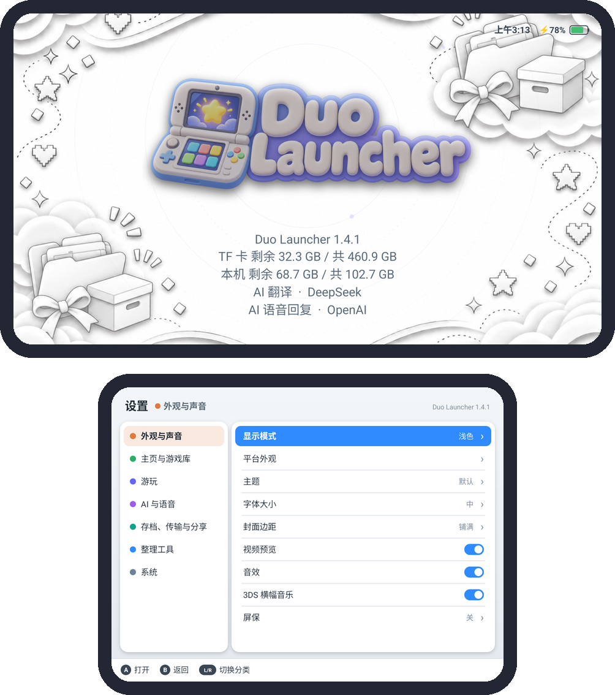</td>
    <td>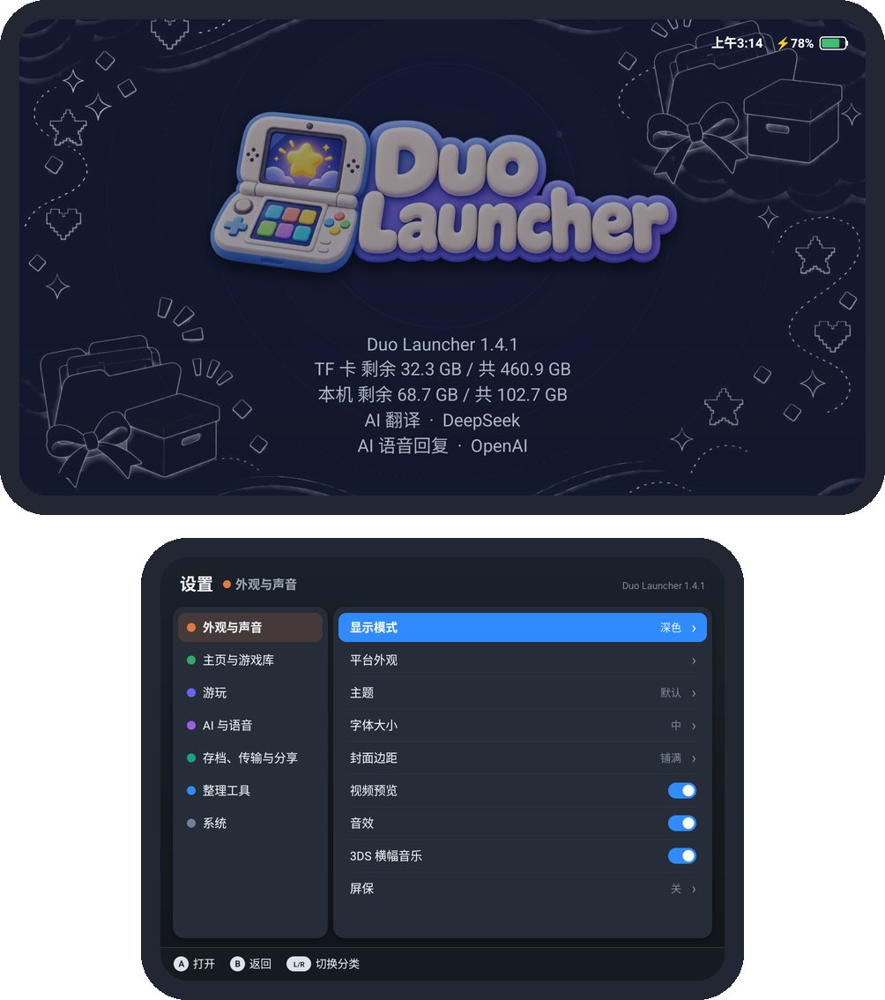</td>
  </tr>
  <tr>
    <th>AI 用量與花費</th>
    <th>匯出、匯入設定</th>
  </tr>
  <tr>
    <td>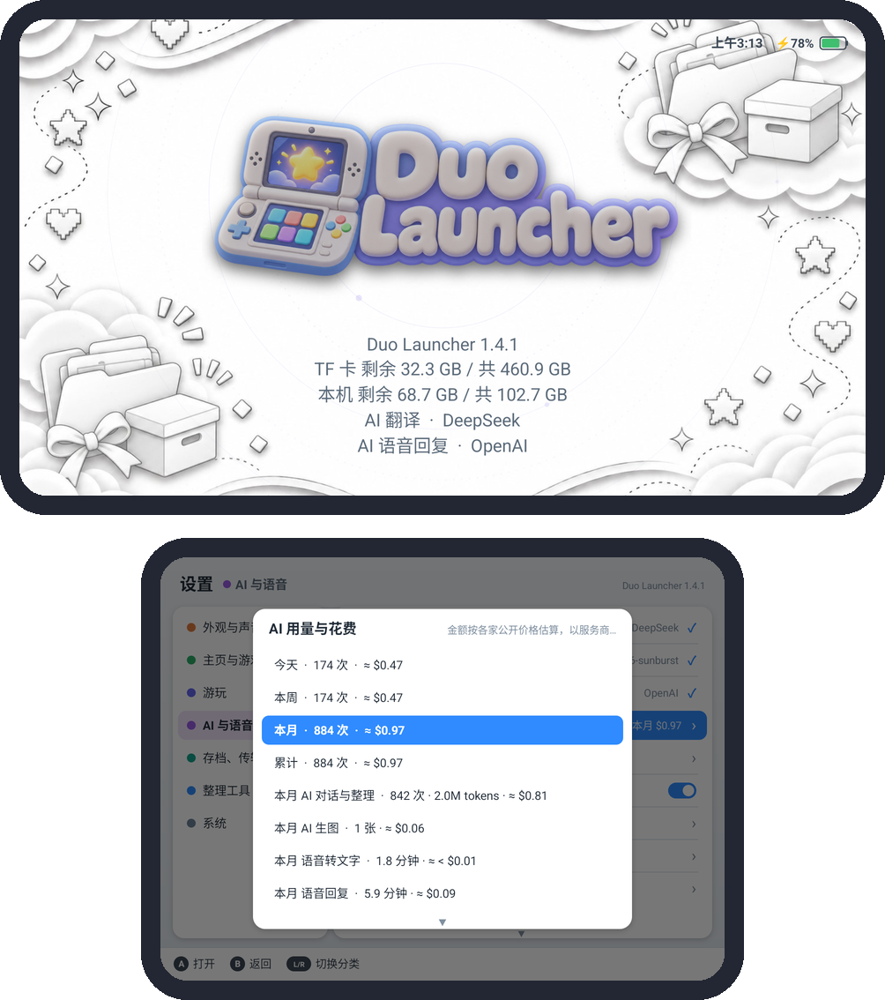</td>
    <td>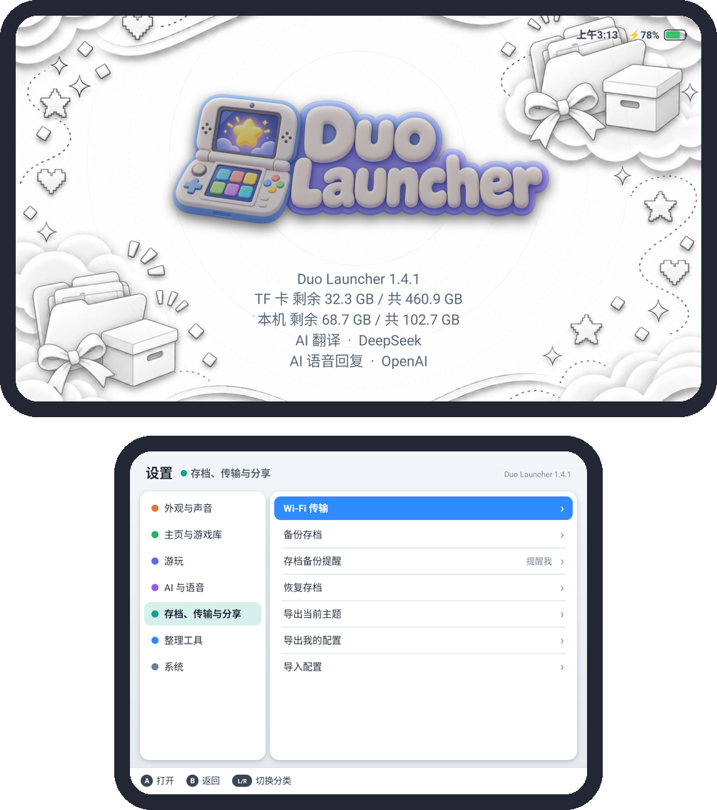</td>
  </tr>
  <tr>
    <th colspan="2">深色模式的手繪插畫</th>
  </tr>
  <tr>
    <td colspan="2" align="center"></td>
  </tr>
  <tr>
    <th>依類型分組（黏土風格類型圖示）</th>
    <th>依系列分組</th>
  </tr>
  <tr>
    <td></td>
    <td>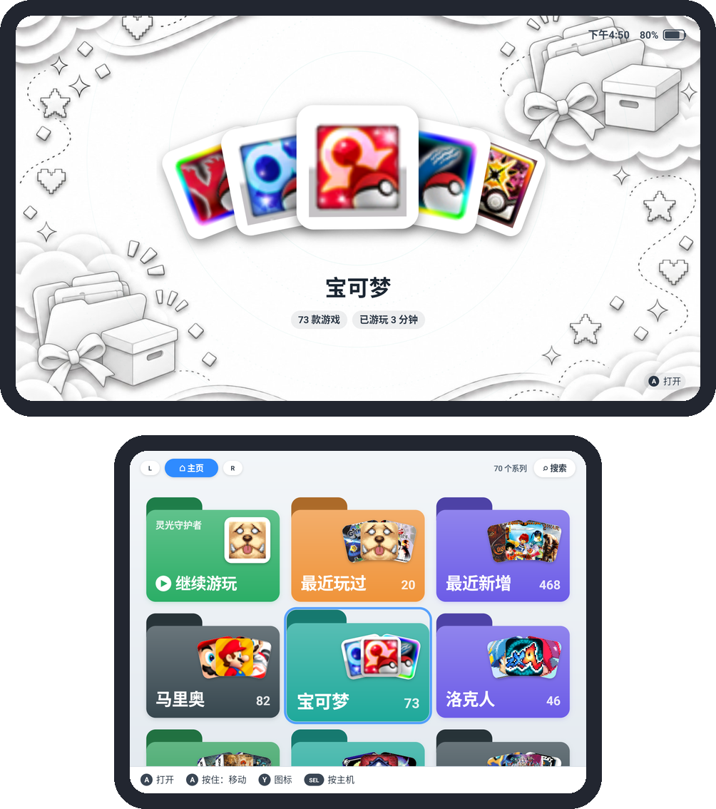</td>
  </tr>
  <tr>
    <th>遊戲頁顯示類型 · 系列</th>
    <th>備忘錄、問 AI、狀態、操作說明、存檔</th>
  </tr>
  <tr>
    <td></td>
    <td></td>
  </tr>
  <tr>
    <th>手把鍵盤：用英文名也能搜到中文遊戲</th>
    <th>跟 AI 聊聊玩什麼</th>
  </tr>
  <tr>
    <td></td>
    <td></td>
  </tr>
  <tr>
    <th>AI 遊戲系列、今天玩什麼、儲存空間、休息提醒</th>
    <th>儲存空間：各主機占用、沒玩過的大遊戲</th>
  </tr>
  <tr>
    <td></td>
    <td></td>
  </tr>
  <tr>
    <th>主頁</th>
    <th>遊戲頁</th>
  </tr>
  <tr>
    <td></td>
    <td></td>
  </tr>
  <tr>
    <th>上螢幕顯示：Logo / 封面 / 影片</th>
    <th>列表檢視</th>
  </tr>
  <tr>
    <td>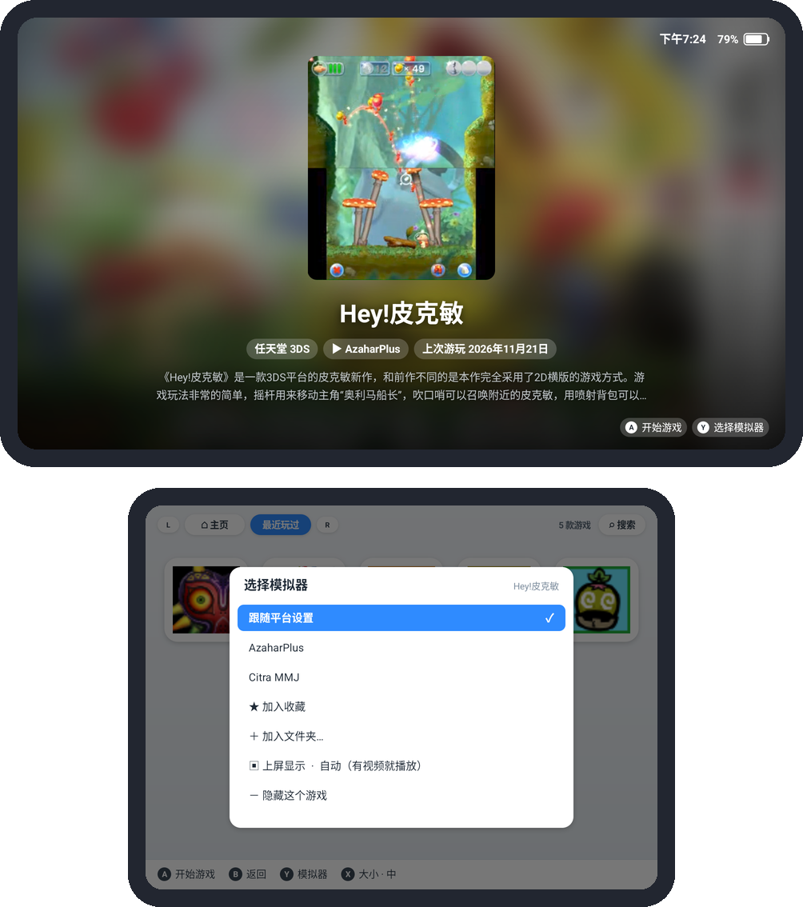</td>
    <td></td>
  </tr>
  <tr>
    <th>GameCube（Dolphin）</th>
    <th>按住 A 拖曳資料夾</th>
  </tr>
  <tr>
    <td></td>
    <td></td>
  </tr>
  <tr>
    <th>下載的金手指先挑再匯入（名稱已翻譯）</th>
    <th>遊戲詳情：大小、光碟數、截圖</th>
  </tr>
  <tr>
    <td></td>
    <td>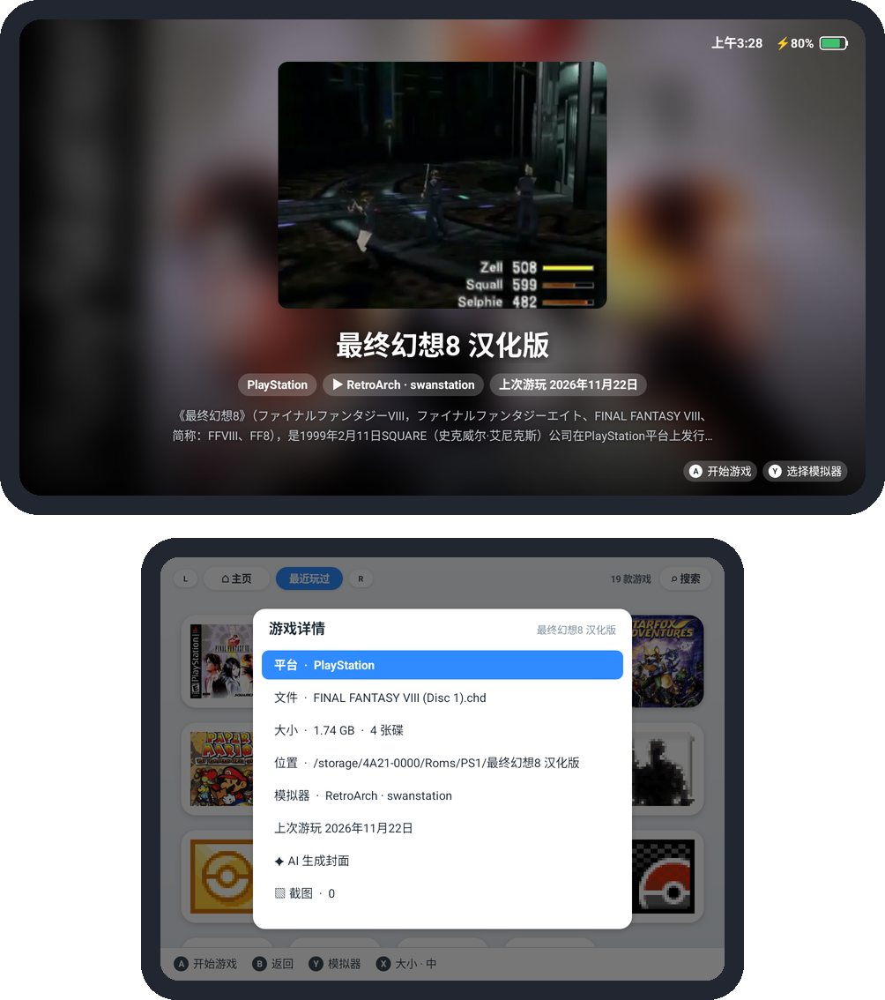</td>
  </tr>
  <tr>
    <th>3DS 金手指：一鍵翻譯成中文</th>
    <th>NDS 金手指：DraStic 中文金手指庫</th>
  </tr>
  <tr>
    <td></td>
    <td></td>
  </tr>
  <tr>
    <th>GBA 金手指（內建中文庫）</th>
    <th>金手指：編輯、新增、下載</th>
  </tr>
  <tr>
    <td></td>
    <td>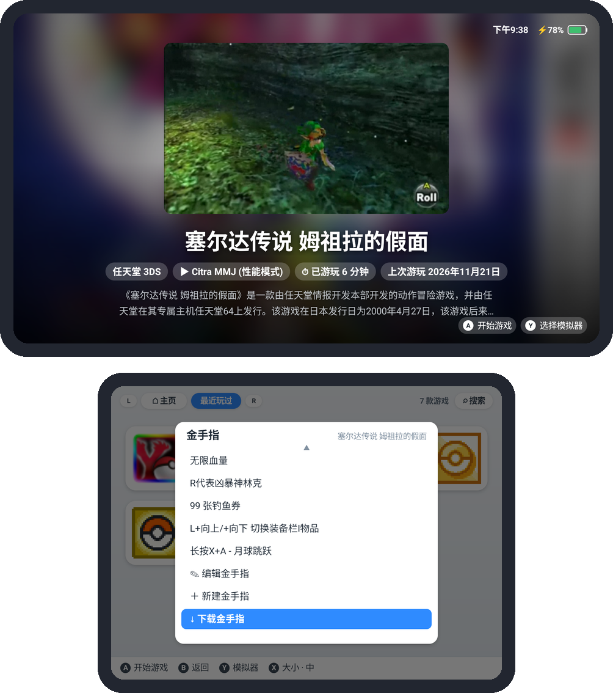</td>
  </tr>
  <tr>
    <th>改名或刪除</th>
    <th>一鍵翻譯所有金手指</th>
  </tr>
  <tr>
    <td></td>
    <td></td>
  </tr>
  <tr>
    <th>遊玩統計</th>
    <th>遊玩統計 · 深色</th>
  </tr>
  <tr>
    <td>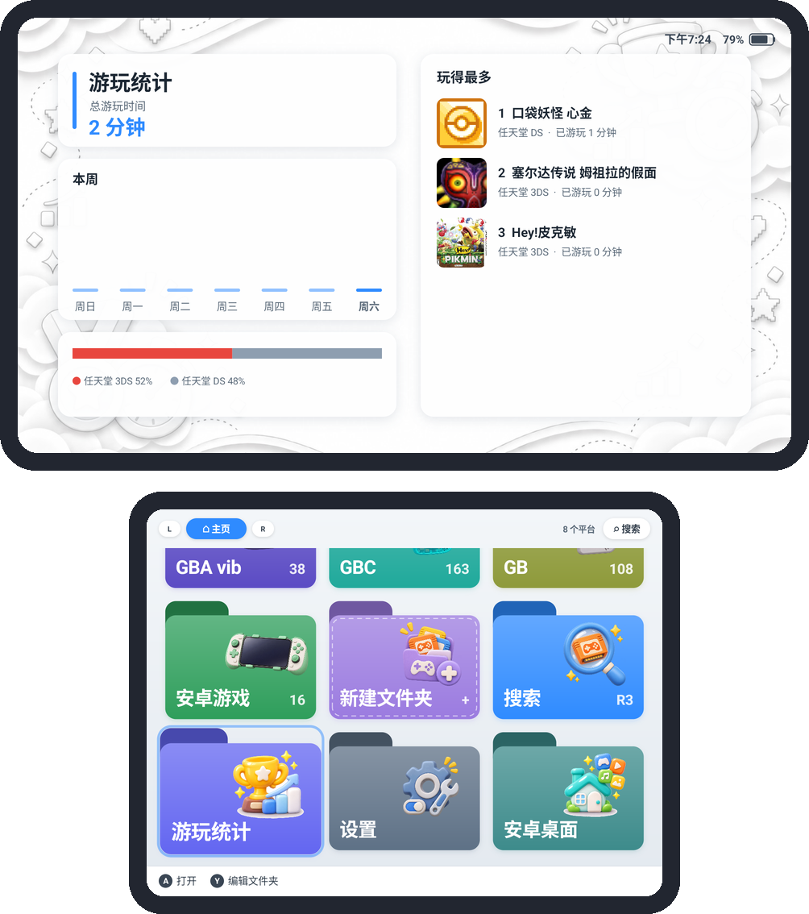</td>
    <td></td>
  </tr>
  <tr>
    <th>顏色主題</th>
    <th>櫻花粉主題</th>
  </tr>
  <tr>
    <td></td>
    <td>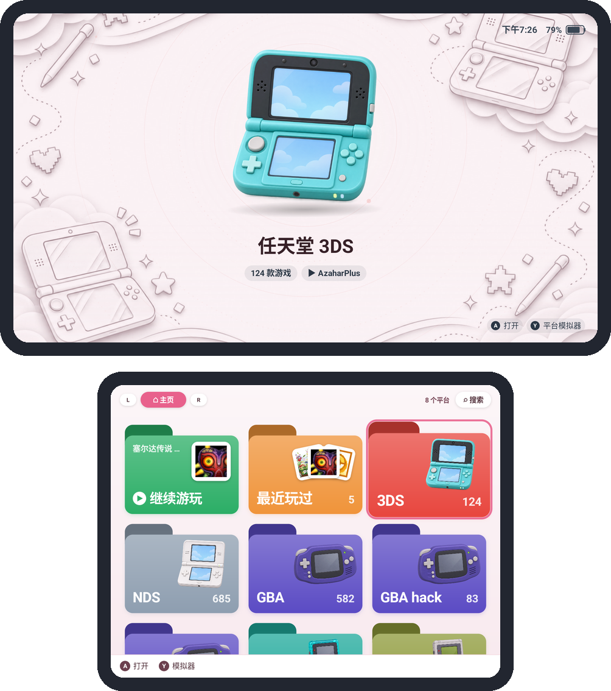</td>
  </tr>
  <tr>
    <th>Wi-Fi 傳輸</th>
    <th>整理工具</th>
  </tr>
  <tr>
    <td></td>
    <td></td>
  </tr>
  <tr>
    <th>深色模式</th>
    <th>螢幕保護</th>
  </tr>
  <tr>
    <td></td>
    <td>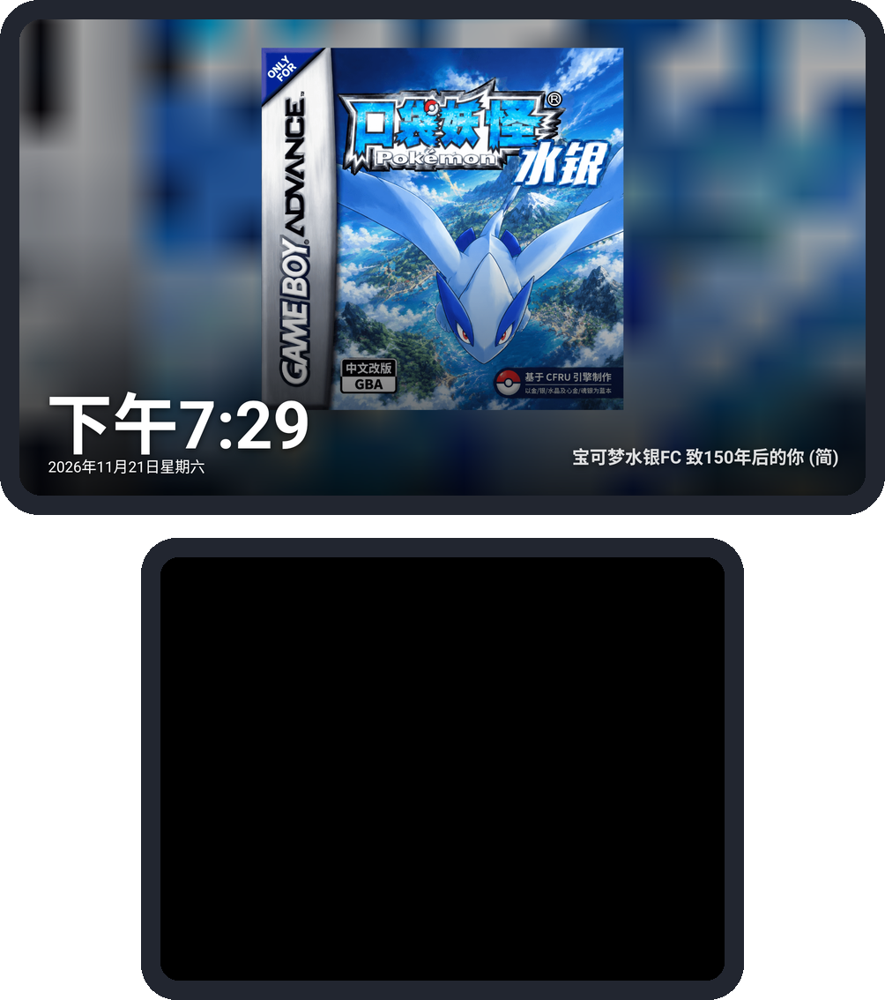</td>
  </tr>
</table>

## 開始使用

1. **安裝 APK**：從 [Releases 頁面](https://github.com/GenKnot/DuoLauncher/releases/latest) 下載後開啟安裝。
2. **選擇語言**，接著在同一頁給它需要的權限：檔案存取（用來找遊戲）、使用情況存取（這樣遊玩時間只會計算遊戲真正顯示在螢幕上的時間），願意的話再把它設為桌面。之後隨時可以從「設定 → 系統 → 權限」回到這一頁。
3. **讓它自己找遊戲。** 內部儲存空間或記憶卡（TF 卡）上的 `Roms` 資料夾會自動被認出來。其他資料夾可以在「設定 → 主頁與遊戲庫 → 遊戲資料夾」裡新增。主機是依資料夾名稱（`gba`、`Nintendo DS`、`psx`……）和副檔名來判斷的。
4. **選模擬器**：不想用預設模擬器的話，在主機資料夾上按 Y 是改整個主機，在遊戲上按 Y 則只改這一款。只會列出已經安裝的模擬器。
5. **選用：填入 AI 金鑰**，在「設定 → AI 與語音」裡。可以直接在掌機上輸入，更方便的是用電腦或手機透過 Wi-Fi 輸入（「設定 → 存檔、傳輸與分享 → Wi-Fi 傳輸」）。除了 AI 功能以外，其他功能都不需要金鑰。
6. **選用：設為桌面**（「設定 → 系統 → 設為預設桌面（開機啟動）」），這樣掌機一開機就會進入 Duo Launcher。主頁上的「Android 桌面」格子隨時能回到系統內建的桌面。

## 基本操作

**主頁**（下螢幕）放著你的主機資料夾和幾個內建格子：「繼續遊玩」（直接回到上次玩的遊戲）、「最近玩過」、「收藏」、「新增資料夾」、「搜尋」、「遊玩統計」、「儲存空間」、「今天玩什麼」、「設定」和「Android 桌面」。按 SELECT 可以在依主機、依類型、依系列三種排列方式之間切換。

**資料夾**裡的遊戲以封面格狀顯示。按 X 封面會變小，再按一次就變成列表，顯示遊戲名稱、遊玩時間和上次遊玩的時間。按 SELECT 排序（預設、名稱、最近玩過、遊玩時間最長），也可以只顯示簡體中文、繁體中文或英文版本。L2 / R2 跳到上一個或下一個首字母，中文遊戲依拼音首字母計算。

**上螢幕**會跟著目前選取的項目變化：選到主機時，顯示主機的背景圖、遊戲數量和模擬器；選到遊戲時，顯示遊戲 Logo 疊在模糊的封面上，配上主機、類型 · 系列、模擬器、遊玩時間和一段簡介，停一下就會播放影片預覽，或是顯示你上次玩到的畫面。

**Y** 是目前選取項目的選單。在遊戲上：模擬器、收藏、資料夾、金手指、遊戲詳情、類型、備忘錄、問 AI、狀態與評分、操作說明、存檔、上屏顯示、隱藏。在主機資料夾上：預設模擬器、重新命名、合併資料夾、隱藏。在內建格子上：名稱、顏色、圖示和背景圖。

### 按鍵

| 按鍵 | 功能 |
|---|---|
| 十字鍵 / 左搖桿 | 移動；按住會持續移動 |
| 在列表或選單裡按左 / 右、L / R | 一次翻一頁 |
| A | 開啟 / 開始遊戲；在主頁資料夾上按住 A 可以拿起來移動位置 |
| B | 返回 |
| L / R | 上一個 / 下一個主機（在設定裡是切換分類） |
| 按住 L | 語音搜尋 |
| 按住 R | 跟 AI 說話 |
| L2 / R2 | 上一個 / 下一個首字母 |
| X | 調整封面大小，再按一次切到列表 |
| Y | 目前遊戲、資料夾或格子的選單 |
| START | 設定（在主頁任何位置都能按，「設定」格子隱藏了也一樣）；在選單裡等同 A |
| SELECT | 在主頁：依主機 / 類型 / 系列；在資料夾裡：排序與語言篩選 |
| R3 | 搜尋 |
| 在搜尋鍵盤裡 | A 輸入，B 刪除，X 空格，Y 系統鍵盤，SELECT 清空，START 或 R3 完成，按住 L 說話 |
| 在 AI 聊天裡 | 按住 R 說話，Y 打字，X 開始新對話，SELECT 打開聊天紀錄，L2 / R2 往回翻看，B 關閉；用十字鍵和 A 從下方的遊戲裡挑 |

所有操作也都能用觸控：點一下選取，再點一下開啟，滑動捲動，頂端那排小按鈕可以代替 L、R、X、SELECT 和搜尋。A/B 和 X/Y 可以互換，看你習慣任天堂還是 Xbox 的確認鍵（「設定 → 遊玩 → 按鍵設定」）。

## 遊戲庫

- **自己找遊戲。** 會在內部儲存空間和記憶卡上找 `Roms` 資料夾；更多資料夾可以在「設定 → 主頁與遊戲庫 → 遊戲資料夾」裡新增。上一次掃描的結果會快取起來，所以主頁一秒就能開好，下一次掃描則在背景默默完成。
- **支援的主機**：3DS、NDS、GBA（還有 GBA 震動版和改版資料夾）、GBC、GB、NES、SNES、N64、GameCube、Wii、Mega Drive、PlayStation 1/2/3、PSP、PS Vita 和 Switch，PS4、PS5、Xbox 360 和 Xbox Series 也有主機圖。
- **多光碟遊戲合成一款。** 同一個資料夾裡的 `Disc A/B`、`Disc 1/2`、`CD1/CD2`、`(Disc 2 of 3)`，或是 Pegasus 的 `files:` 清單，都會合併成一筆。RetroArch 和 DuckStation 會拿到一個包含所有光碟的 `.m3u` 播放清單，在遊戲裡就能換片。
- **Android 遊戲和應用程式**：已安裝的 Android 遊戲會自動歸到它們自己的資料夾；其他應用程式（影音、瀏覽器……）可以加進「應用程式」資料夾。
- **相容你原有的資料。** 它能讀取 Pegasus 的 `metadata.pegasus.txt`、ES-DE / EmulationStation 的 `gamelist.xml` 和 `downloaded_media`、RetroArch 的縮圖，以及遊戲旁邊的 `media/`、`covers/` 和 `images/` 資料夾。這些檔案一個都不會被改動；啟動器自己加的內容放在它自己的 `DuoLauncher` 資料夾裡（見[自訂遊戲資訊](#自訂遊戲資訊)）。
- **發現新遊戲。** 把遊戲複製到記憶卡上，下次掃描就會找到；新遊戲會掛一個 NEW 標記，維持一週（玩過就會消失），並會問你要不要分進類型和系列。這個詢問可以關掉。按 Y →「標為已看過」可以拿掉單一遊戲的標記；「全部標為已看過」（在主機或資料夾上按 Y，或在「設定 → 主頁與遊戲庫」裡）一次拿掉一批；那裡的「NEW 標記」開關可以完全關掉。
- **合併資料夾。** 同一個主機的兩個資料夾放在不同地方（例如兩個 PS1 資料夾），可以顯示成一個：在主機上按「Y → 合併資料夾」。每款遊戲保留各自的模擬器，同名資料夾會自動合併，用「拆開」就能還原。
- **自己的資料夾。** 用「新增資料夾」格子可以建立一個有自己名稱、顏色、圖示和背景圖的資料夾。在任何遊戲或應用程式上按 Y 就能加進去，用「Y → 從這個資料夾移除」再拿出來。
- **智慧資料夾**會自己裝進遊戲：最近新增（近 30 天）、還沒玩過、玩得最多、在玩、想玩、通關了、評分最高。在智慧資料夾上按 Y 可以看到它的規則。
- **繼續遊玩和收藏。** 主頁第一個格子會直接回到上次玩的遊戲。在遊戲上按 Y 加星號，它就會收進「收藏」資料夾。
- **藏起不玩的**：主機資料夾、單一遊戲或應用程式都能隱藏（「Y → 隱藏這個遊戲」）；在「設定 → 主頁與遊戲庫」裡可以找回來。
- **遊戲清單。** 每次掃描後，整個遊戲庫都會寫進 `DuoLauncher/catalog.tsv`（主機、檔案、遊戲名稱、英文名稱、類型、系列、遊玩時間、狀態、評分），可以用試算表開啟、給其他工具使用，或是交給 AI。

### 類型與系列

兩千款遊戲光靠主機分類實在翻到手痠，所以每款遊戲還會分到 14 種類型之一（角色扮演、動作、冒險、平台跳躍、戰棋、策略、射擊、益智、賽車、運動、格鬥、模擬經營、派對音樂、其他），並標上它所屬的系列。

- **先用內建資料。** 啟動器內建一張表（`assets/gamedb.tsv`，收錄 3,860 個檔名，涵蓋天馬G 整合包這類主機清單裡的所有遊戲，整合包同時有 `.iso` 和 `.cso` 的，兩種檔名都有收），依主機和檔名就能認出常見 ROM 合集的類型、系列和官方英文名稱。表裡有的遊戲，完全不需要 AI，也不需要連網。
- **剩下的交給 AI。** 「設定 → AI 與語音」裡的「AI 遊戲分類」和「AI 遊戲系列」會處理剩下的遊戲，結果存在記憶卡上的 `DuoLauncher/<console>/genres.txt` 和 `series.txt`，做一次就夠，重新安裝也不會不見。Pegasus 或 ES-DE 已經寫好的類型（"Action RPG"、"角色扮演"……）會自動對應到這 14 種類型。
- **手動設定**：在任何遊戲上按「Y → 類型」。
- **顯示在螢幕上。** 上螢幕會顯示遊戲的類型 · 系列；在主頁按 SELECT，資料夾就會改成依類型或依系列排列。系列名稱會跟著介面語言。

### 搜尋

按 R3、點「搜尋」格子或搜尋按鈕，上螢幕會跳出一個專為十字鍵設計的鍵盤，上方有最近搜尋和一排類型標籤；一邊輸入，下螢幕就一邊出現結果。中文遊戲名稱可以用漢語拼音的全拼、拼音首字母或每個字的拼音開頭來搜（`kdyg`、`mlao` → 马里奥），每款遊戲也能用官方英文名稱搜到，所以輸入 `zelda` 就能找到薩爾達傳說。在某個主機裡開啟搜尋時只會搜這個主機，點「全部平台」可以擴大範圍。不想打字的話，按住 L 直接說出遊戲名稱就好。

### 自動補齊的圖片

- **真正的封面**：「設定 → 整理工具 → 連網補全封面」會從 libretro 封面庫下載封面。NDS 和 GBA 遊戲是依 ROM 裡的遊戲代碼比對（壓縮檔裡的 ROM 也可以，還會附上標題畫面），所以中文化過、改過名的檔案也找得到圖；PlayStation 1/2、PSP、N64、GameCube、Wii、3DS、GB/GBC、NES、SNES 和 Mega Drive 遊戲則依英文名稱比對。
- **直接從 ROM 裡取圖示**：NDS 的 banner 圖示和 3DS 的 SMDH 圖示；安裝進模擬器的 3DS 遊戲會用介面語言顯示名稱。
- **封面看起來整齊一致**：封面可以填滿格子，也可以統一留出小、中、大三種邊距（「設定 → 外觀與聲音 → 封面邊距」）；封面圖本身帶的白邊會被裁掉。
- **AI 畫圖**：有了圖片金鑰，就能幫沒有圖的遊戲畫封面、標題 Logo 和背景（「Y → 遊戲詳情 → AI 生成封面」，或在「設定 → AI 與語音 → AI 生圖」裡一次畫完整個主機）。詳見 [AI](#ai)。

## 遊玩

- **模擬器可以依遊戲或依主機設定**（按 Y）。只會列出已安裝的模擬器：

  | 主機 | 模擬器（第一個是預設） |
  |---|---|
  | 3DS | AzaharPlus、Azahar、Citra MMJ、Citra MMJ（效能模式） |
  | NDS | DraStic、DraStic（一般路徑）、RetroArch · melonDS DS |
  | GB / GBC | RetroArch · Gambatte、mGBA |
  | GBA | RetroArch · mGBA、gpSP、gpSP Rumble |
  | NES | RetroArch · FCEUmm、Mesen |
  | SNES | RetroArch · Snes9x |
  | Mega Drive | RetroArch · Genesis Plus GX、PicoDrive |
  | N64 | RetroArch · Mupen64Plus-Next、Mupen64Plus FZ |
  | GameCube / Wii | Dolphin MMJR、Dolphin |
  | PS1 | RetroArch · PCSX ReARMed、SwanStation、DuckStation |
  | PS2 | ARMSX2、AetherSX2 |
  | PSP | PPSSPP、RetroArch · PPSSPP |
  | PS Vita | Vita3K（依遊戲 ID 啟動，例如檔名叫 `PCSE00000.psvita`，或檔名裡含有這個 ID） |
  | Switch | Eden |

- **Citra MMJ（效能模式）**：就是同一個 Citra MMJ，只是重新封裝成安兔兔跑分軟體的套件名稱，很多 Android 系統會讓這個套件名稱以全速執行。只有當這個套件裡裝的確實是 Citra 時，才會出現這個選項。
- **遊玩時間與統計**：像 Switch 一樣記錄每款遊戲玩了多久、上次什麼時候玩；給了使用情況存取權限後，只會計算遊戲真正顯示在螢幕上的時間。「遊玩統計」格子裡有總遊玩時間、本週每天的時數、各主機的時數和玩得最多的遊戲。
- **上次玩到哪裡**：玩過的遊戲，會用最新的截圖或即時存檔畫面當作上螢幕的背景。
- **狀態、評分和備忘錄**：把遊戲標成在玩、想玩、通關了或棄坑，再打一到五顆星（「Y → 狀態」）；打字或用說的記下現在打到哪裡、下一步要做什麼（「Y → 備忘錄」）。下次再選到這款遊戲時，這些都會顯示在上螢幕。
- **遊戲詳情**（「Y → 遊戲詳情」）：檔案、大小、光碟數、所在資料夾、模擬器、遊玩時間、官方英文名稱，上螢幕還會顯示遊戲截圖。
- **影片預覽與音效**：選到遊戲停一下，上螢幕就會播放影片預覽（也可以每款遊戲個別選擇顯示 Logo 或封面：「Y → 上屏顯示」）。輕柔的介面音效，以及每款 3DS 遊戲自己的橫幅音樂，都可以關掉。
- **遊戲打不開時**：檔案不見了、模擬器沒安裝、模擬器開不了這種檔案、遊戲一開就閃退，每種狀況都會提示你該怎麼處理。
- **休息提醒**（「設定 → 遊玩」）：在同一款遊戲裡連續玩滿一、二或三小時後，回到啟動器時會提醒你休息一下。
- **RetroAchievements**：填入使用者名稱和 Web API 金鑰，就能看到最近玩過的遊戲和它們的成就進度，有成就的遊戲會掛一個 🏆 標記。

## AI 夥伴

這些全部都是選用的，用的是你自己選的 AI 服務和你自己的金鑰（見 [AI](#ai)）。

- **隨時開口聊。** 在主頁、資料夾或搜尋鍵盤裡按住 R 說話，或按 Y 打字。對話會顯示在上螢幕；它推薦或找到的遊戲顯示在下螢幕，按 A 就能直接開玩。可以問它要玩什麼（「來個輕鬆一點的 RPG，不要太長」），再縮小範圍（「動作多一點的」），問目前選取的遊戲某一段怎麼過，問劇情、問角色，或者隨便聊聊。半小時內它都會記得你們聊過什麼。
  為什麼這樣設計：下螢幕本來就是挑遊戲的地方，所以 AI 推薦的遊戲放在下螢幕；上螢幕空出來專門讓你看文字。而且在掌機上，按住肩鍵說一句話，比翻任何選單都快。
- **新對話、聊天紀錄。** 在聊天裡按 X 開始新對話；按 SELECT 列出以前的對話（最新的在最上面），可以重新打開，也可以一段段刪除或一次清空（「設定 → AI 與語音 → AI 聊天紀錄」裡也能看）。聊天框打開時，影片預覽、3DS 橫幅音樂和按鍵音效都會停下，語音回答依媒體音量播放。
  為什麼這樣設計：換個問題不該拖著上一個話題；值得留的回答不該一重開就消失；遊戲預告片蓋在語音回答上，回答就白唸了。聊天紀錄只存在掌機上，不會跟著設定匯出，「儲存 AI 聊天紀錄」可以關掉。
- **把回答唸出來**：「設定 → AI 與語音 → AI 語音回覆」：可以用 Soniox（需要它自己的金鑰）或 OpenAI（使用圖片金鑰），能選聲音和語速，還有試聽按鈕。預設是關閉的，要你自己開啟。
- **今天玩什麼**：在「今天玩什麼」格子上按 Y，AI 會依你的口味從你的遊戲庫裡挑六款遊戲，每款都附上理由。直接按這個格子則是隨機挑一款，優先挑你從沒玩過的。
- **問問這款遊戲**（「Y → 問 AI」）：針對選取的遊戲提問，打字或用說的都可以，回答會顯示在上螢幕。
- **操作說明**（「Y → 操作說明」）：遊戲的按鍵配置（包括日版遊戲確認 / 取消鍵相反的情況）和新手需要知道的基本玩法，每款遊戲只會產生一次，之後一直保留。
- **還沒有金鑰？** 按住 R 時會告訴你怎麼新增：直接在掌機上輸入，或用電腦透過 Wi-Fi 輸入。

## 金手指

在遊戲上按「Y → 金手指」會列出它的金手指，按 A 開啟或關閉。

| | 3DS（Azahar、Citra） | NDS（DraStic） | PSP（PPSSPP） | RetroArch（GBA、GB、GBC、NES、SNES、N64、MD、PS1……） |
|---|---|---|---|---|
| 存放位置 | `azahar/cheats/` 和 `citra-emu/cheats/`，檔名為 `<title ID>.txt`，兩邊都會寫入，所以換模擬器也不會不見 | 完整清單在 `DuoLauncher/cheats/NDS/`；開啟的那些會寫進 DraStic 自己的自訂金手指（`DraStic/cheats/<game file name>.cht`），中文化 ROM 也能用 | `PSP/Cheats/<game ID>.ini`，也就是 PPSSPP 自己的金手指檔；遊戲 ID 從 ISO、CSO 或 EBOOT.PBP 裡讀出 | `RetroArch/cheats/<core>/<game file name>.cht`，遊戲啟動時由 RetroArch 載入 |
| 機器上原有的 | – | DraStic 的 `usrcheat.dat`（Retroid 掌機上是中文的），只依遊戲代碼比對，所以打過修正檔、中文化過的 ROM 也找得到金手指，就算 DraStic 自己顯示沒有也一樣 | PPSSPP 的 `cheat.db`；Retroid 掌機上還有約 4,300 款遊戲的中文金手指檔 | Retroid 內建幾百款遊戲的中文金手指（`000 中文金手指` 和各核心的資料夾）；沒有專屬檔案的遊戲會依名稱比對，複製一份過來 |
| 下載來源 | [Sharkive](https://github.com/FlagBrew/Sharkive)，約 650 款遊戲，依 ROM 裡讀出的 title ID 比對 | [libretro-database](https://github.com/libretro/libretro-database)，約 4,200 款遊戲，依 ROM 檔頭裡的遊戲代碼比對 | [CWCheat-Database-Plus+](https://github.com/Saramagrean/CWCheat-Database-Plus-)，約 4,300 款遊戲，依遊戲 ID 比對 | [libretro-database](https://github.com/libretro/libretro-database) 的 GBA 部分，依 ROM 檔頭裡的遊戲代碼比對 |

- **先挑再匯入**：下載後會先把找到的金手指列出來（已經翻譯好），可以「全選」或「全不選」，只有勾選的才會加進去。為什麼這樣設計：資料庫裡一款遊戲可能有幾十條代碼，大多數人只想要其中三條。
- **翻譯**：英文金手指名稱可以一鍵翻譯成介面語言，單一遊戲或所有遊戲一起翻都行（「設定 → 整理工具」）。常見的金手指直接用內建詞表（無限血量、金錢最大、主代碼……）；剩下的交給免費的 MyMemory 服務，不行再改用 Google 的免費介面。版本標記（`v1.2`）和按鍵提示（`(START+L)`）會保留，原本的英文名稱則以註解形式留在檔案裡。
- **用 AI 翻譯**：有 AI 金鑰的話，一款遊戲的金手指會連同遊戲名稱一起送給模型，這樣角色和道具都會用官方譯名（鬼神林克、愛心容器……）。
- **編輯**：任何金手指都能改名或刪除，可以一次刪掉一款遊戲的全部金手指，也可以自己新增金手指和代碼（3DS、NDS 和 PSP 的代碼會依 `XXXXXXXX YYYYYYYY` 格式檢查）。
- **對 DraStic 安全**：NDS 的下載內容會去掉燒錄卡修正碼（防盜版繞過、overlay 和 Wi-Fi 修正），因為開著它們 DraStic 會當掉；同時開啟的代碼最多 256 行，這是 DraStic 能載入的上限。
- **對你的檔案安全**：你手寫的 3DS 金手指檔第一次被修改時，原始檔案會另存為 `.txt.bak`。
- **RetroArch 只要設定一次**：在 RetroArch 的 Quick Menu（快速選單）→ Cheats（金手指）裡，把 "Auto-Apply Cheats During Game Load"（載入遊戲時自動套用金手指）打開一次，之後在這裡開啟的金手指從遊戲一啟動就會生效。

## 外觀

- **上螢幕（1920×1080）**：每個主機都有自己的剪紙風格背景；選到遊戲時，遊戲 Logo 疊在模糊的封面上，配上標籤和一段簡介；角落是時鐘和電量。
- **下螢幕（1280×960）**：主機資料夾、可縮放的封面格狀檢視和列表檢視；底部的按鍵提示會盡量精簡，字體調大後放不下的就不顯示。
- **主題**：七套配色、自訂顏色，以及包含主機圖、背景、字型、音效和音樂的主題包。主題也會替上螢幕的線稿背景上色。詳見[主題](#主題)。
- **淺色與深色模式**：跟隨系統，或自己指定；兩種模式各有一套另外畫的背景。
- **主頁上的東西都由你決定。** 每個內建格子和主機資料夾都能改名、換顏色、換圖示（用你自己的圖，或讓圖片服務依啟動器的黏土風格畫一個）、移動位置（按住 A，或長按）或隱藏，隱藏的可以在「設定 → 主頁與遊戲庫 → 已隱藏的資料夾」裡找回來。「遊玩統計」「儲存空間」「今天玩什麼」這類內建格子也可以有自己的上螢幕背景。
- **平台外觀**：每個主機的圖片、淺色與深色背景、資料夾顏色都可以替換（「設定 → 外觀與聲音 → 平台外觀」）。深色背景可以讓圖片服務照著淺色背景重畫，兩套永遠對得上。
- **字體大小**：兩個螢幕都有四種大小可選。
- **螢幕保護**：閒置幾分鐘後，上螢幕會輪流顯示你的遊戲封面和時鐘，下螢幕變黑。每換一張圖，文字就換個角落，還會慢慢飄移，OLED 螢幕不會烙印。

## 設定與分享

- **像遊戲主機一樣的設定頁。** 按 START 會開啟一整頁：左邊是分類（外觀與聲音、主頁與遊戲庫、遊玩、AI 與語音、存檔、傳輸與分享、整理工具、系統），右邊是目前分類的各項設定，直接顯示目前的值和開關；上螢幕顯示版本號碼、每個儲存空間的剩餘容量，以及開著哪些 AI 服務。L / R 切換分類。
- **分享你的設定。** 「設定 → 存檔、傳輸與分享 → 匯出我的設定」會把所有設定（外觀、主頁配置和順序、資料夾、隱藏的項目、模擬器選擇、AI 服務）連同你自己的圖片打包成一個 zip。「匯入設定」會從 `DuoLauncher/exports` 或 Download 資料夾讀取設定檔，檔案可以透過 Wi-Fi、通訊軟體或記憶卡傳過來。
  為什麼可以放心分享：金鑰、密碼和遊玩記錄永遠不會寫進設定檔；匯入別人的設定時，你自己的這些資料都會保留；你的金鑰也絕不會被送到別人設定檔裡帶來的位址。
- **11 種語言**：简体中文、繁體中文、English、日本語、한국어、Français、Español、Deutsch、Italiano、Português、Русский。

## 實用工具

- **Wi-Fi 傳輸**：「設定 → 存檔、傳輸與分享 → Wi-Fi 傳輸」會顯示一個網址和 PIN 碼。在同一個網路下用瀏覽器開啟這個網址、輸入 PIN，就能把 ROM 或主題包直接拖進任何主機資料夾。同一個頁面還有 AI、語音和 RetroAchievements 的設定，以管理密碼保護（隨機六位數字，也可以自己設定），長長的金鑰可以直接從電腦貼上。傳輸期間掌機螢幕會保持亮著，因為螢幕一關，這個頁面就連不上了。
- **儲存空間**：主頁上有個格子顯示記憶卡用了多少，上螢幕顯示每個儲存空間的剩餘容量。點進去可以看到每個主機的遊戲占了多大、從沒玩過的大遊戲，還可以在確認後刪除遊戲檔案（包括所有光碟，以及 `.cue` 或 `.m3u` 裡列出的檔案）。
- **存檔備份**：DraStic、RetroArch、PPSSPP、AetherSX2、DuckStation、Mupen64Plus FZ、Azahar 和 Citra 的存檔可以一起備份成一個 zip，也能一起還原，備份放在記憶卡的 `DuoLauncher/backups` 裡（沒有記憶卡就放在內部儲存空間）。玩了三小時還沒備份，啟動器會提醒你；你也可以讓它自動備份（自動備份保留最新的十份，你手動做的備份永遠不會被刪掉）。還原時，每個存檔都要等備份完整複製好才會取代。「Y → 存檔」可以單獨備份和還原一款遊戲。
- **整理工具**：找出重複的遊戲、列出缺封面的遊戲、連網補全封面、一鍵翻譯所有金手指，還有一個診斷資訊頁；AI 相關的工具（整個主機的遊戲名稱和簡介、類型、系列、圖片、類型圖示）放在「AI 與語音」裡。
- **更新**：「設定 → 系統 → 關於」每天會到 GitHub 檢查一次最新版本，並提供下載連結。
- **桌面**：把它設為預設桌面應用程式，掌機開機就會啟動它；「Android 桌面」格子（或「設定 → 系統 → 退出到 Android 桌面」）可以回到系統內建的桌面，「設定 → 系統 → Android 系統設定」會開啟系統本身的設定。

## AI

這裡的一切都是選用的，用的是你自己的帳號。金鑰存在掌機上啟動器的設定裡，只會送給你選的那個服務。可以在「設定 → AI 與語音」裡輸入，也可以用電腦或手機在 Wi-Fi 頁面上輸入。

- **AI 翻譯**：DeepSeek、通義千問（Qwen）、OpenAI、Claude、Gemini，或任何相容 OpenAI 的 API 位址。所有跟文字有關的工作都靠這把金鑰：聊天、挑遊戲、「問 AI」、「操作說明」、類型和系列、金手指名稱（一款遊戲一次請求翻完），以及把遊戲名稱和簡介翻成你的語言（連同官方英文名稱一起寫進啟動器自己的資料裡，這樣全是中文名稱的遊戲庫換成英文介面也很自然，反過來也一樣）。沒有金鑰時，金手指會用免費服務翻譯。
- **AI 生圖**：OpenAI 的圖片金鑰（會自動選用這把金鑰能用的最新圖片模型）。封面、標題 Logo、背景、主機圖、資料夾和格子的圖示與背景，都跟內建素材一樣是黏土圖示和剪紙風格；圖示用透明背景產生，所以圖示裡白色的部分不會被當成背景一起去掉。一張圖大約半分鐘。同一把金鑰也負責把你的語音轉成文字（`/audio/transcriptions`），因為掌機本身沒有語音辨識。
- **AI 語音回覆**：用 Soniox（需要它自己的金鑰），或用 OpenAI（圖片金鑰）；可以選聲音和語速（正常、快、很快，預設是「快」，因為兩家唸中文都偏慢）。
- **AI 用量與花費**：啟動器送出的每一次請求都記錄在掌機上：請求次數、token、圖片張數和語音分鐘數，並估算出今天、本週、本月和累計的花費。估算是依各服務公開的價格計算，每一項價格都可以改成你自己的（換了模型、透過代理服務、有折扣）。實際花了多少，以服務商的帳單為準。

## 自訂遊戲資訊

在記憶卡（或內部儲存空間）根目錄放一個 `DuoLauncher` 資料夾，就可以新增或修正遊戲名稱、簡介和圖片，而不必動到其他前端的檔案。這裡的內容優先於 Pegasus、ES-DE 和遊戲本身附帶的資料。

```
DuoLauncher/
  3DS/metadata.txt
  3DS/media/<file name without extension>/logo.png   (also cover.png, background.png)
  NDS/metadata.txt
```

`metadata.txt` 採用 Pegasus 的格式。條目依 `file:` 比對；安裝進模擬器的 3DS 遊戲則依 `titleid:` 比對：

```
game: 勇者派遣会社
titleid: 0004000000065600
description: …
```

遊戲名稱和簡介可以依語言分開寫，用 `name.<language>:` 和 `description.<language>:`（`en`、`zh-CN`、`zh-TW`、`ja`、`ko`、`fr`、`es`、`de`、`it`、`pt`、`ru`；`zh` 同時適用簡體和繁體）。啟動器用哪種語言，就顯示哪種語言的內容，所以同一個資料夾可以讓說不同語言的玩家一起用：

```
game: 塞尔达传说 姆祖拉的假面
file: 塞尔达传说 姆祖拉的假面 汉化版.cci
name.en: The Legend of Zelda: Majora's Mask 3D
description.en: Link has three days before the moon falls on Termina…
```

## 主題

「設定 → 外觀與聲音 → 主題」裡有七套內建顏色主題（天空藍、櫻桃紅、薄荷綠、葡萄紫、橘子橙、櫻花粉、石墨灰）、**自訂顏色**（選一個主色和一個背景色，淺色和深色模式下的各種深淺都會自動算出來），以及所有已安裝的主題包。主題會替兩個螢幕都上色，包括上螢幕的線稿背景。

主題包就是記憶卡或內部儲存空間上 `DuoLauncher/themes/` 裡的一個資料夾（也可以是這個資料夾的 `.zip`，第一次使用時會自動解壓縮）。裡面的東西全都是選用的；主題沒提供的部分會沿用內建的樣子，所以一個主題可以小到只有幾種顏色。

```
DuoLauncher/themes/my-theme/
  theme.txt                      name, author, colours (see below)
  consoles/<type>.png            console pictures      (3ds, nds, gba, ..., recent, search, settings, custom)
  backgrounds/<type>.jpg         upper-screen backdrops
  backgrounds/dark/<type>.jpg    backdrops for dark mode
  logo.png
  font.ttf, font-bold.ttf
  sounds/move|open|back|launch.ogg   (or .wav / .mp3)
  music.ogg (or music.mp3)       loops on the home screen (Settings → Background music appears when a theme has music)
```

上面各項依序是：`theme.txt` 寫名稱、作者和顏色（見下文）；`consoles/` 放主機圖片；`backgrounds/` 放上螢幕背景，`backgrounds/dark/` 放深色模式的背景；`logo.png`；字型；`sounds/` 放移動、開啟、返回、啟動的音效（也可以是 .wav / .mp3）；`music.ogg` 是在主頁循環播放的音樂（主題附有音樂時，設定裡會出現「背景音樂」）。

`theme.txt` 每一行寫成 `key: value`：淺色模式用 `color.<name>`，深色模式用 `dark.color.<name>`，名稱有 `accent`、`shelf-top`、`shelf-bottom`、`card`、`text`、`pill`、`footer`、`backdrop-paper` / `backdrop-ink`（上螢幕的線稿），以及主頁資料夾用的 `folder.<type>` 等。只寫一行 `base-color: #RRGGBB` 就足以產生一整套配色。[themes/sakura](themes/sakura/theme.txt) 是一個完整的範例，每個 key 都有說明。「設定 → 存檔、傳輸與分享 → 匯出目前主題」會把你現在的設定存成 zip，放在 `DuoLauncher/exports/` 裡，別人放進自己的 `themes/` 資料夾就能使用；你自己的圖片會一起放在 `own/` 裡。

## 編譯

不需要 Android Studio 或 Gradle，只要 Android SDK 命令列工具（build-tools 35、platform android-35）和 JDK 17 以上：

```powershell
powershell -File build.ps1            # builds DuoLauncher.apk
powershell -File build.ps1 -Install   # also installs over adb, grants file access and starts it
```

第一行指令會編譯出 DuoLauncher.apk；加上 `-Install` 還會透過 adb 安裝、授予檔案存取權限並啟動。第一次編譯時會產生一個除錯用的簽署金鑰（`debug.keystore`），它不會提交到儲存庫。`shot.ps1` 會透過 adb 送出按鍵，並儲存兩個螢幕的截圖，修改介面時很好用。

## 美術素材

`assets/consoles/<type>.png`（黏土風格的主機和格子圖示）和 `assets/backgrounds/<type>.jpg`（剪紙線稿背景，深色模式版本在 `backgrounds/dark/` 裡）都是為這個專案特別製作的。背景是灰階圖，所以顏色主題可以替它們上色。沒有圖片的主機會用程式繪製的主機圖代替。

## 啟動參數說明

- AzaharPlus 只接受它已經有存取權限的資料夾底下的 tree URI：
  `content://com.android.externalstorage.documents/tree/<volume>%3ARoms%2F3DS/document/<volume>%3ARoms%2F3DS%2F<file>`
- Citra MMJ：`org.citra.emu/org.citra.emu.ui.EmulationActivity`，參數 `-e GamePath <path>`。
- Citra MMJ（效能模式）是同一個版本重新封裝成 `com.antutu.ABenchMark`；很多 Android 系統會讓這個套件名稱以全速 CPU/GPU 執行。只有當這個套件裡確實是 Citra 時，才會出現這個選項。
- Retroid 掌機內建的 DraStic 要用 `-e GAMEPATH "/sf<path>"`；原版 DraStic 另外提供「一般路徑」選項。
- RetroArch：`com.retroarch.aarch64/...RetroActivityFuture`，參數 `-e ROM`、`-e LIBRETRO <core>` 和 `-e CONFIGFILE`。啟動指令裡指定的設定檔會原封不動保留：在 Duo 上，RetroArch 自己的 `retroarch.cfg` 會讓 Retroid 替各平台準備的邊框以全尺寸顯示，而 Retroid 依螢幕區分的 `retroarch1920x1080.cfg` 會把遊戲畫面縮小，放進一個電視邊框裡。
- Dolphin（MMJR 和官方版）：`.../ui.main.MainActivity`，參數 `--es AutoStartFile <path>`。
- ARMSX2、AetherSX2、Eden、PPSSPP 和 Mupen64Plus FZ 拿到的是一個唯讀的 `content://com.duo.launcher.rom/...` 連結，附帶一次性的讀取授權，所以它們本身不需要任何資料夾存取權限。
- Vita3K：`org.vita3k.emulator/.Emulator`，帶字串陣列參數 `AppStartParameters = ["-r", "<title ID>"]`。
- Pegasus 資料裡寫好的啟動指令會照原樣使用。

### 在雙螢幕掌機上使用 Citra MMJ

Citra MMJ 預設把觸控畫面放在上面那個螢幕。想讓主畫面顯示在上螢幕，並隱藏螢幕上的虛擬按鍵，先關掉 Citra，再到 `/sdcard/citra-emu/config/config-mmj.ini` 裡這樣設定：

```ini
[Controls]
input_overlay_hide = True
[Layout]
landscape_swap_screen = True
```

## 意見回饋

Duo Launcher 是照著大家實際的用法慢慢改出來的。如果你覺得少了什麼、哪裡看不懂、哪裡壞掉了，或是做了一個值得分享的主題，歡迎開個 [issue](https://github.com/GenKnot/DuoLauncher/issues)。

## 授權條款

[MIT](LICENSE)
